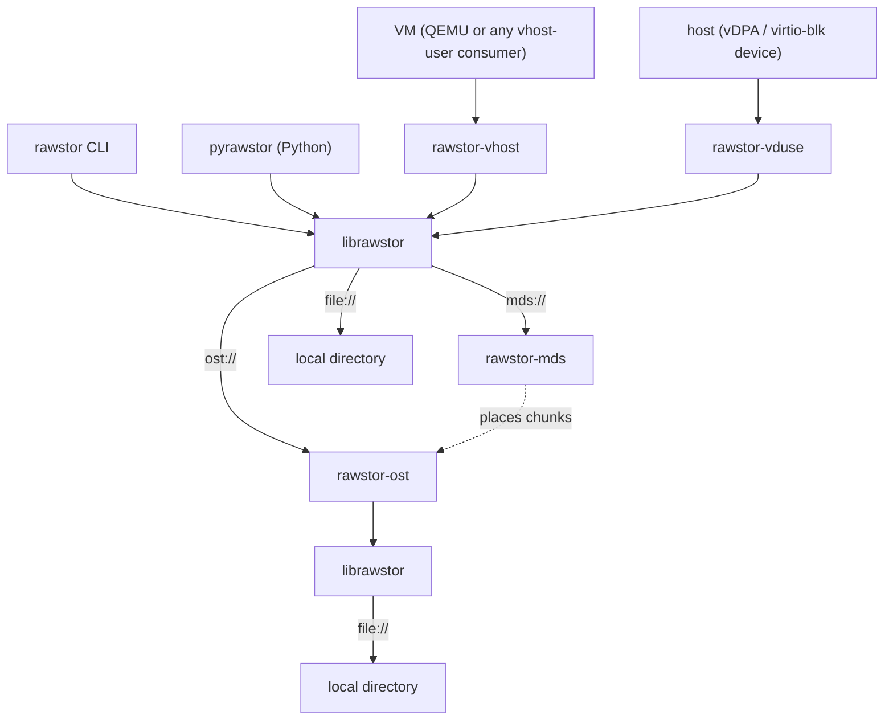

# Rawstor library and tools

[](https://github.com/rawstor/librawstor/actions/workflows/dist.yml)

Rawstor is a raw object storage system: a network-addressable object,
identified by a UUID, that you read and write like a raw block device. It is
a client library plus a small family of servers and backends.

The main use is a virtual machine's disk. `rawstor-vhost` (or `rawstor-vduse`)
exposes an object to a guest as a `virtio-blk` disk, so the disk is just an
object stored on the network.

## Key ideas

- **The client does the work.** Redundancy and data preparation live in the
  client library, not in the servers. A write goes to every mirror from the
  client, and a stale or missing copy is resynced by the client too.
- **You choose the layout.** An object is a single chunk on one server, or
  many chunks spread across a cluster, with a chunk size, stripe width and
  failure domain of your choosing. Rawstor sits between local storage and a
  fully distributed one.
- **Simple addressing.** A *Location* (`ost://host`, `file:///path`) names a
  backend store, and a *Target* adds an object UUID. Comma-separated lists
  mean mirroring or data locality. See [Concepts](docs/concepts.md).
- **Small moving parts.** `rawstor-ost` stores the data, `rawstor-mds`
  optionally keeps the map from an object to its chunks, and both speak one
  binary [wire protocol](docs/protocol.md).



## Quick start

The [Quick start](docs/quickstart.md) sets up a mirrored virtual machine disk
from packages on four hosts, every service run by systemd. To build from a
checkout instead, see [Building from source](docs/building.md). Before relying
on Rawstor, read the [known limitations](docs/limitations.md).

## Documentation

| | |
|---|---|
| [Quick start](docs/quickstart.md) | A mirrored VM disk from packages, every service run by systemd. |
| [Concepts](docs/concepts.md) | Location and Target: the addressing model. |
| [Architecture](docs/architecture.md) | The components and their roles. |
| [rawstor-ost](docs/ost.md), [rawstor-mds](docs/mds-server.md) | Object storage and metadata servers: options, systemd instances. |
| [rawstor-vhost](docs/vhost.md), [rawstor-vduse](docs/vduse.md) | Expose an object as a `virtio-blk` disk. |
| [Configuration](docs/configuration.md) | Environment variables of the client and servers. |
| [Witness members](docs/witness.md) | A metadata-only vote for an even number of data copies. |
| [Protocol](docs/protocol.md) | Commands and frame layouts of the wire protocol. |
| [MDS design](docs/mds.md) | Placement, chunk allocation, versions. |
| [Tenants](docs/tenants.md) | Namespaces of objects: addressing, wire protocol, storage layout. |
| [Security](docs/security.md) | Planned authentication, authorization, TLS, tenants and at-rest encryption. |
| [Mirroring](docs/mirroring.md) | The N-way mirror failure model and recovery. |
| [Multi-attach](docs/multiattach.md), [CASPaxos](docs/caspaxos.md) | Several writers of one mirrored object. |
| [Building from source](docs/building.md) | For developers: build and run every service by hand on one machine. |
| [Known limitations](docs/limitations.md) | What is not implemented yet and the risks accepted for now. |
| [Troubleshooting](docs/troubleshooting.md) | `io_uring` problems and how to tell them apart. |
| [Authors](docs/authors.md) | Who wrote Rawstor. |

## Testing

```
make test
```

## Contributing

See [CONTRIBUTING.md](CONTRIBUTING.md) for the development environment,
code style, commit conventions and pull request guidelines.
