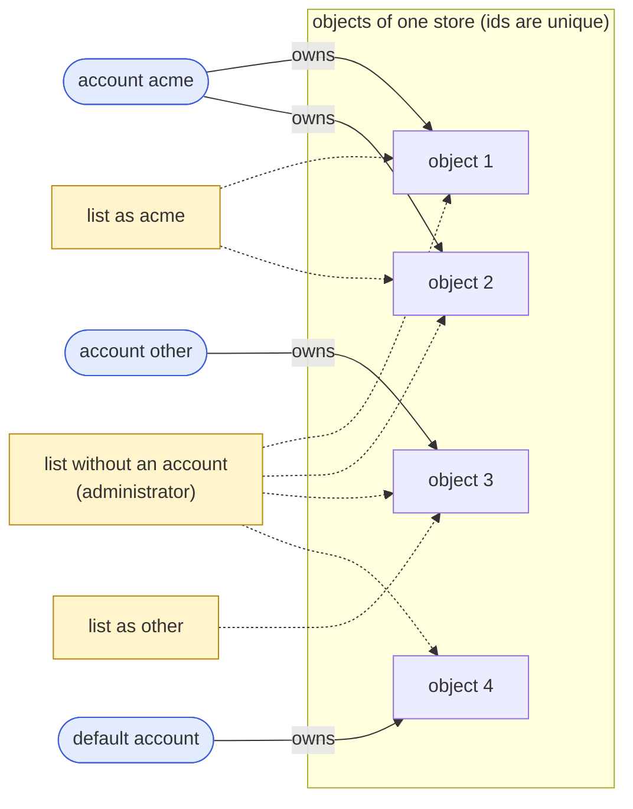
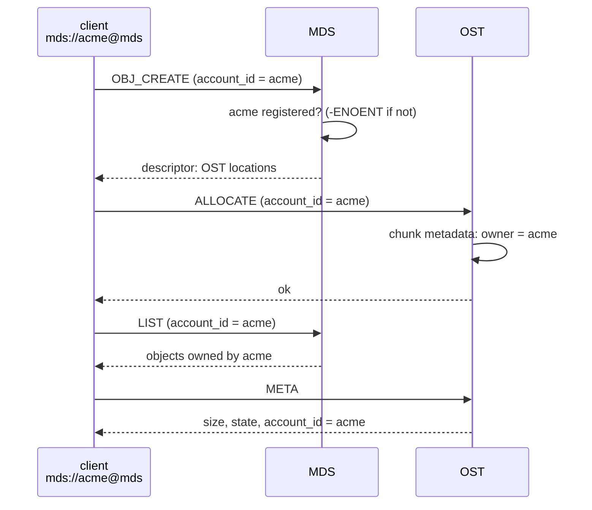
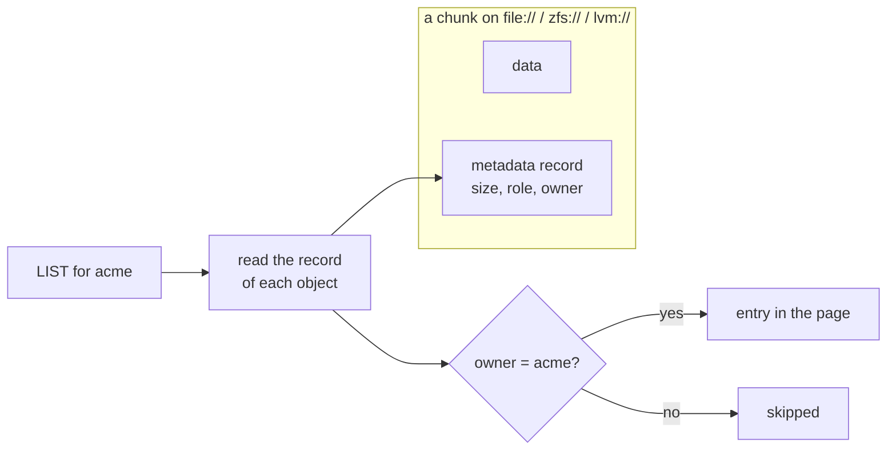

# Accounts

An **account** is a field of an object: the party that owns it. An object is
addressed by its id alone (ids are unique on their own), and the account is
what authorization checks against the authenticated caller. In TLS mode the
certificate identifies the caller's account and carries its signed role and
object permission overrides. MDS and OST independently enforce that policy against
the object's owner. Plaintext `--insecure` has no account security boundary. See
[Authorization](configuration.md#authorization).

## Status

Legend: ✅ implemented · 🟡 partial · ❌ not implemented yet.

| Feature | Status | Where |
|---|---|---|
| Account in the location URI (`<account>@`), optional | ✅ | `src/location.cpp`, `librawstd/src/uri.cpp` |
| Owner recorded with every chunk (`ALLOCATE`, chunk metadata, `META`) | ✅ | `src/blk_backend.cpp`, `include/rawstor/protocol.h` |
| `LIST` by owner, every row carrying its owner; no account lists every object | ✅ | `src/blk_backend.cpp`, `mds/src/store.cpp` |
| The caller's certificate account owns unnamed creates; providers/insecure clients use the default account | ✅ | `src/location.cpp`, `mds/src/store.cpp` |
| MDS: owner of an object, account registry, `ACCOUNT_CREATE` / `ACCOUNT_REMOVE` / `LIST_ACCOUNTS` | ✅ | `mds/src/store.cpp`, `mds/src/client.cpp` |
| `--reconstruct` restores owners and registers their accounts | ✅ | `mds/src/store.cpp` |
| CLI: `rawstor account create/list/remove` | ✅ | `cli/account.c` |
| Transfer of an object to another account: `SET_OWNER`, `OBJ_TRANSFER`, `rawstor object transfer` | ✅ | `src/target.cpp`, `src/blk_backend.cpp`, `mds/src/store.cpp` |
| Transfer by mutual consent of two account clients, without admin credentials | ❌ | [Implementation plan](#planned-transfer-by-mutual-consent) |
| Checking the caller's permissions against the owner | ✅ | Independent MDS and OST certificate policy checks |
| Protection against cross-account UUID/member squatting on initial allocation | ❌ | [Open allocation namespace problem](#planned-allocation-namespace-isolation) |
| Authentication, binding an account to a certificate | ✅ | mTLS SPIFFE identity and signed certificate permissions |

## Model

- An object has **one account**, its owner, set when it is created and changed
  only by a [transfer](#transfer). It is 16 bytes, a UUID. An object created without naming an account
  belongs to the **default account** (`00000000-0000-0000-0000-000000000001`),
  which every MDS registers and nobody can create or remove. The nil UUID
  owns nothing: in a `LIST` it means **no filter**, and creating an object for
  it, or transferring one to it, is refused with `-EINVAL`.
- An object id is **globally unique**: the account is not part of an address,
  a path on disk or a database key. Creating an id that exists is `-EEXIST`
  whoever asks.
- A location names an account as its **user information**, optionally. It is
  the account whose objects the location addresses: the owner of what is
  created through it, and the filter of what is listed through it. It is not
  who is calling: the caller is identified by its TLS certificate, so
  an administrator creates an object for a user by naming that user in the
  location. TLS account callers may create only for their own account, subject to their role.
- `list` returns the objects **visible to the caller**. A TLS account client
  sees its own account. An admin or an insecure client that names no account
  sees every object of the store.
- A target names the owner of its object as the user information of its
  URIs (`mds://<account>@host:port/<uuid>`). Without user information, a TLS
  account client uses its own account; a provider or insecure client uses the
  built-in default account. So every row of a
  listing carries its owner, also for the administrator, and
  `rawstor_target_account()` reads it from the address. In CLI `object list`,
  the `account` column reports that owner, while displayed `target` and `location`
  URIs retain only the account explicitly supplied in `LOCATION`. When omitted,
  it is not added to those columns; a TLS client uses its certificate account.
- Every other operation takes the account to be informational: an object is
  found by its id, whoever the caller says it is.

Who owns what, and what a `list` shows each caller:



## Addressing

```text
ost://<account>@10.0.0.1:7777
mds://<account>@10.0.0.2:7776/<object-uuid>
file://<account>@/var/lib/rawstor
zfs://<account>@tank/rawstor
```

The account is read from the address where the user's request enters the
library (`Location`, `Target`) and handed down as an argument: the owner of a
`create`, the filter of a `list`. A backend has no account of its own, and the
MDS and the OSTs record what they are given. A user information that is not a
non-nil UUID is refused with `-EINVAL`.

How the account of a location reaches the stored object, through the MDS and an
OST:



A server takes no account from its own configuration: `LOCATION=file:///data`
names a store, and the account of a request is the one in that request.

## Wire protocol

The account is data, not an address, so only the requests that set or filter it
carry it: `RawstorFrameAllocatePayload` and `RawstorFrameObjCreatePayload`
(the owner), `RawstorFrameListPayload` (the filter, nil = every object).
`META`'s answer (`RawstorFrameMetaPayload`) reports the owner. Every other
frame names an object by its id alone.

Three commands concern the registry ([protocol](protocol.md)), all of them on
the MDS: `LIST_ACCOUNTS`, `ACCOUNT_CREATE` and `ACCOUNT_REMOVE`. An OST answers
`-ENOSYS`. `LIST_ACCOUNTS` is paginated like `LIST`: a page in ascending
order after a token, and a trailing row that resumes it (`RawstorFrameListAccountsPayload`);
`rawstor_location_accounts()` takes a limit and a token the same way, and
`Location.accounts()` yields every page.

Frame layouts and the metadata record are not compatible with earlier ones, and
no older format is read or written.

## Storage

Backends keep the layout they had: `<location>/<uuid>/<offset>` on `file://`,
a zvol per chunk on `zfs://`, a logical volume per chunk on `lvm://`. The owner
is a field of the chunk's metadata record, next to its size and role, so it is
stored with the chunk wherever the chunk is. A listing reads that record of
each object in id order, so every row carries its owner, and skips the objects
of other accounts before they count against the page: a page holds up to `limit`
objects of the account.



## MDS

An object's owner is a column of the `objects` table (16 zero bytes for none)
and of a witness, and `LIST` filters on it. An MDS database written before
accounts is refused at start (`-EPROTO`) instead of being misread: there are no
installations to migrate.

The **account registry** holds the accounts an object can be created for. An
object can be created for a registered account; any other account is `-ENOENT`.
The default account is registered when the database is created.
`ACCOUNT_CREATE` registers an id (`-EEXIST` if it is, the default account
included, `-EINVAL` for nil), `ACCOUNT_REMOVE` removes an account that owns no
object (`-EBUSY` while it owns one, `-EPERM` for the default account). Both are idempotent, and a retried creation of an account removed in
between registers it again. Accounts have no names in rawstor: the control plane
that creates them keeps its own.

Removing an account removes its objects, the way removing an object removes its
versions: `rawstor account remove`, `rawstor_location_remove_account()` and
pyrawstor `remove_account()` list the objects the account owns a page at a time
and remove each one (with its versions, from the MDS and from every OST), and
only then send `ACCOUNT_REMOVE`, which itself still answers `-EBUSY` while the
account owns an object. The default account is refused (`-EPERM`) before any
object is touched. A failure part-way leaves the objects not yet removed and
the account registered, and running the removal again finishes it. An object
removed by someone else meanwhile is skipped. An object created for the account
meanwhile can make the last step answer `-EBUSY`. The removal acts on the
objects by their ids: an object transferred out of the account between the
listing and its removal can still be removed by the provider admin carrying
out that operation: the batch is not atomic with ownership transfer. Account
clients cannot remove the account registry or transfer ownership; their object
operations are checked against their own account and role.

`--reconstruct` rebuilds the map from what the OSTs hold, and the owner is part
of a chunk's metadata, so owners come back with it; an account found as an owner is
registered again.

## Transfer

`rawstor object transfer TARGET ACCOUNT` (`rawstor_target_transfer()`, pyrawstor
`Target.transfer()`) makes another account the owner of an object. The owner is
a field of every copy's own metadata record, and for an `mds://` object also a
column of the MDS, so a transfer writes all of them:

- on an `mds://` target the MDS goes first (`OBJ_TRANSFER`: `-ENOENT` for a
  account it does not know, `-EINVAL` for the nil one), then the client records
  the owner with every member of every chunk, witnesses included, one at a
  time;
- on any other target the client records it with every URI of the target
  (`SET_OWNER`; a `file://`, `lvm://` or `zfs://` member rewrites its
  record, an `ost://` one asks its server to), and no registry is consulted:
  only an MDS has one.

Both commands are idempotent. `SET_OWNER` is by its nature, like the commands
on a copy: setting the owner a copy already has changes nothing, and nothing
else in the record (state, roles, ballots, size) moves. `OBJ_TRANSFER` carries
an `idempotency_key` like every mutating `OBJ_*` request ([MDS
design](mds.md), "Idempotent mutations"): a transfer resent after a lost reply
is answered with its recorded result and is not applied again, so it does not
undo a transfer made since.

Two transfers of one object can reach the MDS in one order and the members in
another. The transfer therefore does not take the members for done when it has
written them: it asks the MDS again (the same request, which applies nothing and
answers with the owner as it is then), and if the owner is no longer the one it
wrote, it writes the members with that one and asks again. Whoever writes a
member last has read the MDS after it, so the members end with the owner the
MDS has; a storm that does not settle in 16 rounds fails with `-EAGAIN`.

A `resize` does the same for the chunks it adds: it creates them for the owner
`OBJ_RESIZE` reports, asks again afterwards (the same request, which applies
nothing), and while the owner is not the one the new chunks were written with,
writes them with the new one, so a transfer that came in meanwhile and did not
find these chunks does not leave them with the old owner.

A transfer that fails part-way, say with a copy unreachable, leaves copies with
different owners until it is run again, which finishes it. A member the MDS has
no address for (its OST is gone from the topology) is unreachable too: the
other members are done, then the transfer fails with `-ENOTCONN` instead of
reporting success; until then
`--reconstruct` refuses the object (`-EINVAL`: its copies disagree on the
owner). A `resize` meanwhile is not affected: the chunks it adds are created for
the owner the MDS has, which `OBJ_RESIZE` reports, not for the owner some copy
records. The old address still finds the object, as every address does, by its
id. The default account can be a source or a destination, and the nil UUID is
never a destination.

## Planned allocation namespace isolation

Status: confirmed architectural problem, unresolved and deferred. No runtime
fix is included in this plan. Review references:
[foreign object ID allocation](https://github.com/rawstor/librawstor/pull/761#discussion_r4589291539)
and [direct allocation without MDS placement](https://github.com/rawstor/librawstor/pull/761#discussion_r4589291550).

### Problem and impact

An account manager may create a missing member directly on an OST. Its
certificate authorizes operations in its account, but does not establish global
ownership of an arbitrary object UUID. The local metadata check proves an
existing member's owner; it cannot prove who owns a missing member elsewhere.

For example, account A owns object X. Account B can request `ALLOCATE` for X at
an unused offset or on an OST that has not seen X, recording B as that member's
owner. With the current physical key `(object UUID, offset)`, this can obstruct
A's subsequent placement, resize or recovery. Existing-member ownership checks
still prevent reading A's recorded data; the confirmed issue is cross-account
namespace interference and availability.

### Constraints

- Preserve certificate-based authorization and direct OST operation without an
  online MDS dependency on ordinary I/O. Direct allocation under `manage` is
  intentional; absence of an MDS placement alone is not an authorization defect.
- Account selection still defaults to the certificate identity; an explicit URI
  account must be authorized. Naming a UUID or account grants no ownership.
- Decide whether UUID uniqueness is a global ownership guarantee or a logical
  convention backed by account-isolated physical storage. The current global
  namespace claim cannot be enforced for first allocation from an account-wide
  certificate alone.
- Resource quotas and limits on legitimate direct allocations are separate work;
  solving them does not establish the rightful owner of a UUID.

### Decisions and implementation work

1. **Choose the ownership model.** Evaluate account-scoped physical keys
   `(account, object UUID, offset)` against a global namespace backed by trusted,
   verifiable object-ownership evidence. In the first model, choosing another
   account's UUID cannot occupy that account's storage key. In the second, define
   who establishes ownership, how an OST verifies it on first allocation, and
   how transfer and revocation update it without requiring MDS on every I/O.
   Neither option is selected or implemented yet.
2. **Define the scope of local hardening.** An object-level owner record on an
   OST can prevent allocation of a foreign offset when that OST already knows
   the object. Document that this alone does not protect an OST that has never
   seen the UUID, and do not treat it as a complete global-namespace fix.
3. **Update the affected contracts.** Cover allocation, lookup, listing,
   versions, deletion, mirror repair, reconstruction and provider operations.
   Define explicit account context for privileged requests and compatibility
   with existing stored objects. Review protocol and backend metadata layouts.
4. **Coordinate with ownership transfer.** Reconcile the chosen keys/evidence
   with the [mutual-consent transfer plan](#planned-transfer-by-mutual-consent),
   including fencing, durable ownership generations and recovery. Account-scoped
   physical keys require a safe key transition when ownership changes.

### Acceptance tests

- Account B cannot obstruct A by allocating A's UUID at a missing offset or on a
  different OST before A's legitimate allocation arrives. With isolated keys,
  B's own object may exist independently without occupying A's key.
- Verify the same behavior when the attacked OST has no local record of A's
  object; checking other local offsets is not sufficient coverage.
- Concurrent first allocations, UUID reuse, partial deletion, repair and restart
  preserve the selected ownership model and cannot switch another account's data.
- Provider operations select the intended account unambiguously; listing and
  reconstruction preserve ownership even if isolated namespaces reuse a UUID.
- Direct OST I/O continues with valid certificates while MDS is unavailable.
- Document residual capacity-exhaustion risks separately from UUID ownership;
  keep this issue open until the chosen namespace protection is implemented.

## Planned transfer by mutual consent

Status: planned, not implemented. The existing transfer remains provider-admin
only. This task adds a separate offer/accept workflow for two clients that
initially have access only to their own accounts.

### Scope and authorization

- Start with whole objects registered in the same MDS, including every chunk,
  data copy, witness and version. Cross-MDS and direct-OST transfers are outside
  the first implementation.
- A missing account in the URI defaults to the certificate identity's account.
  An explicit URI account is checked against certificate permissions; naming it
  grants no access. Neither party needs a certificate for both accounts.
- Add explicit certificate permissions `transfer-out` and `transfer-in`, with PKI
  CLI/C/Python issuance, inspection and renewal support. Do not grant them
  implicitly through `manager` or widen the existing `manage` bit. Object
  restrictions must be able to deny export of a particular object.
- The sender authorizes export from the current owner account to one named
  destination. The receiver authorizes import into that destination. Neither
  client receives provider credentials or general `SET_OWNER` permission.
- A transfer ID identifies an offer; possessing it does not authorize acceptance.
  Check the accepting client's destination account and import permission independently.

### Proposed user flow

These commands describe the planned interface; they are not available yet:

```sh
# Sender, authenticated only for account A.
rawstor object transfer offer TARGET ACCOUNT_B --expires 1h
# Returns TRANSFER_ID.

# Receiver, authenticated only for account B, using the same MDS location.
rawstor object transfer accept TRANSFER_ID

# Sender, before acceptance starts the handover.
rawstor object transfer cancel TRANSFER_ID

# Either participant, with access only to its own side of the transfer.
rawstor object transfer show TRANSFER_ID
```

Offer management uses `RAWSTOR_LOCATION` when no MDS location is supplied.
Document the explicit-location syntax when finalizing the CLI and C API.
Keep `rawstor object transfer TARGET ACCOUNT` as the provider-admin operation.

### Implementation steps

1. **Certificate policy and protocol.** Specify the new permissions and their object
   mask semantics, validation of unknown bits, and renewal behavior. Define
   offer, accept, cancel and status requests, idempotency keys, error semantics
   and the metadata needed by OST. Validate authority on both clients' requests;
   an offer is not an I/O capability.
2. **Durable MDS offers.** Store a unique transfer ID, object ID, source and
   destination accounts, initiating identity, source certificate evidence,
   ownership generation, expiry, state and replay results. Limit expiry by the
   sender certificate's expiry; revalidate the recorded approval at acceptance
   against the current trust/revocation policy. Offers leave ownership unchanged.
   Serialize acceptance, cancellation, expiry and conflicting transfers. Reject
   stale offers after an ownership change, including transfer away and back.
3. **MDS-to-OST authority.** Define how each member authenticates the responsible
   MDS, rather than accepting any account or arbitrary MDS as a coordinator.
   Scope transfer operations to the object, transfer ID, expected owner and
   ownership generation. The coordinator may update transfer metadata without
   acquiring data-write privileges. Account clients must remain unable to bypass
   the offer/accept protocol with raw member commands.
4. **Durable handover.** Let MDS coordinate the operation rather than asking a
   account client to propagate `SET_OWNER`. Persist transfer fences on every
   member, stop admitting account I/O and structural changes, and drain admitted
   operations before the ownership decision. Ordinary expiring `FREEZE` leases
   alone are insufficient: a restart or lease expiry must not reopen a partially
   transferred object. Record the commit decision durably, update all members
   and versions, then release the fences. Report success only after the required
   members acknowledge completion; an unavailable member prevents completion.
5. **Recovery and concurrency.** Persist progress and retry member operations
   idempotently after disconnects and MDS/OST restarts. Before the durable commit
   decision, a failed prepare can roll back its fences. After that decision,
   recovery finishes the committed transfer. Prevent an account from clearing a
   fence through direct OST access, and serialize resize, removal, version
   mutations, account removal and provider-admin transfers with the handover.
   Invalidate ownership cached by existing data connections.
6. **Client APIs and documentation.** Implement offer/accept/cancel/status in
   the C API, Python bindings and CLI. Status exposes details only to the
   participants or provider admin; it distinguishes pending, preparing,
   committing, completed, cancelled and expired operations. Document certificate
   permissions, expiry, cancellation, retry behavior and the same-MDS limitation.

### Acceptance tests

- Two certificates, each authorized for just its own account, complete a transfer
  without admin credentials; the object UUID and data are preserved.
- Missing export/import permissions, a forbidden source object, the wrong destination
  account, or a third client with only the transfer ID cannot complete it.
- Expired, revoked, cancelled and stale approvals cannot be accepted. Replaying
  requests cannot duplicate a transfer or undo a later ownership change.
- Cancellation versus acceptance and two offers for one object have one durable
  outcome. Concurrent resize, deletion, version creation and provider transfer
  cannot bypass the ownership generation or leave untracked members.
- After completion, the source loses access and the destination gains access on
  MDS and direct OST connections, including handles opened before the handover.
- Unavailable members, lost replies and crashes at every prepare/commit step
  recover without reporting premature success, losing data, or exposing a copy
  to the old account after the destination has received ownership.
- Fences cover direct account commands as well as MDS-mediated access, persist
  across OST restart and do not disappear when a write-barrier lease expires.
- Ordinary reads/writes keep certificate-based authorization and acquire no
  online dependency on MDS. Existing provider-admin transfers retain their
  documented interface.

## CLI

```bash
rawstor account create mds://10.0.0.2:7776            # prints the new account_id
rawstor account create mds://10.0.0.2:7776 --uuid <uuid>
rawstor account create mds://10.0.0.2:7776 --format value   # just the id
rawstor account list   mds://10.0.0.2:7776
rawstor account remove mds://10.0.0.2:7776 <uuid>       # with every object it owns

rawstor object create mds://<account>@10.0.0.2:7776 --size 10G ...   # owned by <account>
rawstor object create mds://10.0.0.2:7776 ...                       # owned by the default account
rawstor object list   mds://<account>@10.0.0.2:7776                  # what <account> owns
rawstor object list   mds://10.0.0.2:7776                           # every object
rawstor object transfer mds://10.0.0.2:7776/<uuid> <account>         # <account> becomes its owner
```

`create`, `list` and `show` print the owner of the object as a column of its
own (`account`), also for an administrator, whose location names no account. The
`target` column keeps only the account `LOCATION` names, as `list` does: when
it names none, none is added to the target.
`create -t TARGET` makes the object for the account its target names.

## Python

```python
admin = rawstor.Location("mds://10.0.0.2:7776")
account = admin.create_account()            # a random UUID, or create_account(uuid)
admin.accounts()                           # yields the registered accounts, as strings
admin.remove_account(account)

mine = rawstor.Location(f"mds://{account}@10.0.0.2:7776")
target = mine.create(size=10 << 30, width=1, chunk_size=256 << 20)
target.account                             # the owner named by the target
target.meta()[0].account                   # the owner the copy records
[t.account for t in mine.objects()]        # what `mine` lists: its own objects
rawstor.DEFAULT_ACCOUNT                    # the owner when none is named
```

`Target.transfer(account)` is a transfer; it returns nothing, and the target that
names the new owner is the old one with `<account>@` as user information.
`Target.account` reads the address only. `ObjectMeta.account` is the owner a copy
records. `Location.accounts()`, `create_account()` and `remove_account()` raise
`OSError` (`ENOTSUP`) for a location that is not an `mds://` one.

## Not here

TLS authentication, certificate roles and object restrictions enforce
account access; see [Security](security.md). Quotas and per-account resource
limits are separate work. An insecure deployment has no authenticated account
boundary.
