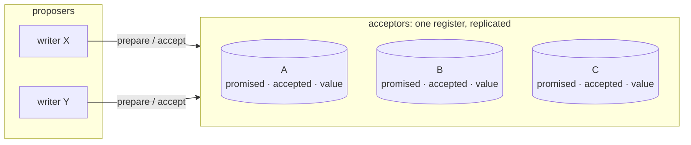
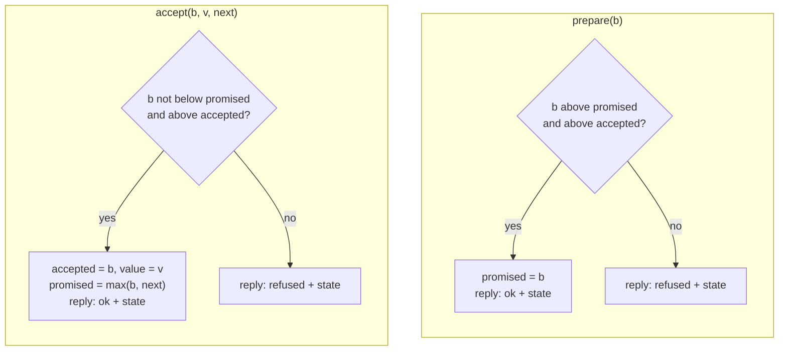
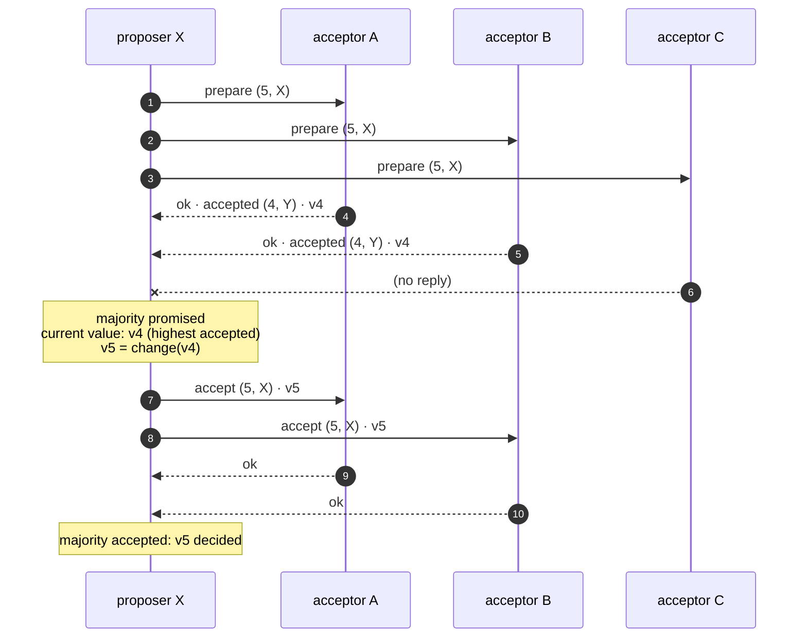
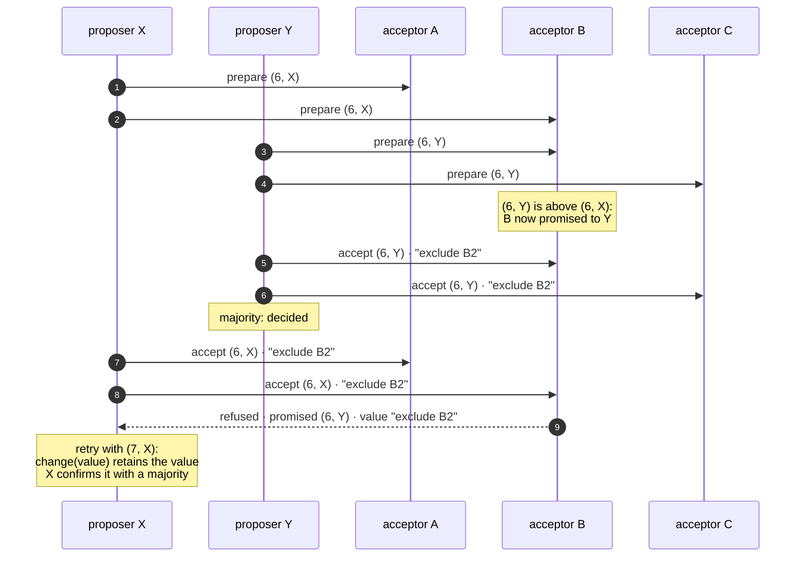
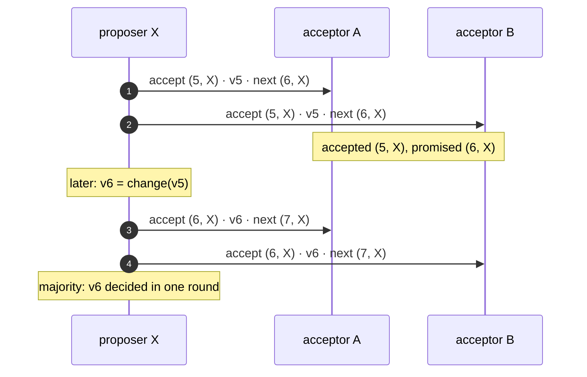

# CASPaxos: a replicated register without a leader

## Status

Legend: ✅ implemented · 🟡 partial · ❌ not implemented yet. Stage 1 covers
the acceptor; stage 2 adds the generic proposer.

| Feature | Stage | Status | Where |
|---|---|---|---|
| `Ballot`, `Acceptor<V>`, acceptor rules `prepare()` / `accept()` | 1 | ✅ | `librawstd/include/rawstd/caspaxos.hpp`, `librawstd/tests/test_caspaxos.cpp` |
| `accept()` promising the proposer's next ballot (one-round changes) | 1 | ✅ | `rawstd::caspaxos::Acceptor<V>::accept()` |
| `Proposer<V>`: the two phases as a coroutine over a pluggable transport | 2 | ✅ | `librawstd/include/rawstd/caspaxos.hpp`, `librawstd/tests/test_caspaxos.cpp` |
| Proposer skipping phase 1 after its own decision | 2 | ✅ | `rawstd::caspaxos::Proposer<V>::change()` |
| Proposer raising its counter above states it read outside a round | 2 | ✅ | `rawstd::caspaxos::Proposer<V>::observe()` |

## Overview

CASPaxos (Denis Rystsov,
["CASPaxos: Replicated State Machines without logs"](https://github.com/rystsov/caspaxos))
keeps one value replicated over a set of **acceptors** and lets any number
of **proposers** change it, with no leader: a change is a function of the
current value, and it is decided once a majority of acceptors accepted the
result. Two proposers racing each other never decide two different values,
whichever minority each of them reached.

`rawstd::caspaxos` is generic over the value type and over how requests
reach the acceptors. Rawstor uses it for a mirrored chunk's configuration
-- its members are the acceptors, every writer of the chunk a proposer
(the multi-attach design) -- but nothing in it knows about chunks.



---

## Ballots

A **ballot** is `(counter, proposer id)`, ordered by counter and then by
proposer id, so two proposers never use the same one. The zero ballot is
below every ballot a proposer uses: it is what an acceptor that never saw a
request has promised and accepted.

## The acceptor

Each acceptor stores three things and applies two rules to them. It
persists the result before replying, and **replies with its whole state,
whether the request succeeded or not** -- a proposer always learns the
actual value from the reply itself.

| Stored | Meaning |
|---|---|
| `promised` | The highest ballot this acceptor promised not to go below |
| `accepted` | The ballot the current value was accepted under |
| `value` | The current value |



`next` is optional: on success the acceptor also promises it, which lets
the same proposer make its next change in one round (*One-round changes*).

### Reach

An acceptor refuses a request whose counter is more than
`Acceptor::max_jump` (2^28) above the highest counter it holds, promised or
accepted (`within_jump()`); the caller reports it as an error, not as a
refusal. A proposer raises its counter by one per attempt from the counters
the acceptors report, so a legitimate ballot is only as far ahead as the
acceptor is behind its peers, in decisions it missed. A larger step could
only exhaust the counter space: the acceptor would promise it and refuse
every ballot below, and no proposer could go on.

## A change

A proposer changes the value with a **change function**: given the
current value, it returns the new one, or nothing when the current value
already says what the proposer wanted -- another proposer made the change
first.

1. **Prepare.** The proposer picks a ballot above every ballot it has
   seen and sends `prepare(b)` to every acceptor it reaches. It needs
   promises from a majority.
2. **Choose.** Among the replies it takes the value with the highest
   `accepted` ballot: the current value. It applies the change function to
   it. If the function returns nothing, it retains that value and still
   submits it in phase 2: the highest accepted value might otherwise be
   present on a minority only.
3. **Accept.** It sends `accept(b, chosen value)` to every acceptor it
   reaches. The change is decided once a majority accepted it.



C missed the change. It holds the old value under an older `accepted`
ballot, so any later majority -- which always includes A or B -- shows
the newer value to whoever reads it.

## Conflicts

A refused request carries the acceptor's actual state: the higher
`promised` ballot that beat the proposer, and the value it holds. The
proposer retries from step 1 with a counter above that ballot, and
re-applies its change function to the value it then finds. Often the
change is already there -- the competing proposer wanted the same thing
-- and there is nothing left to do.



## One-round changes

A proposer that has just decided a change usually makes the next one too.
Its accept carries `next`, its own following ballot; each acceptor that
accepts also promises `next`. The proposer's next change then skips the
prepare round and sends `accept(next, ...)` straight away, against the
value it just decided. If another proposer prepared in between, that
accept is refused with the actual state, and the proposer falls back to a
full change from step 1.



---

## API

`librawstd/include/rawstd/caspaxos.hpp`, namespace `rawstd::caspaxos`:

```cpp
struct Ballot { uint64_t counter; uint64_t proposer; };  // ordered

template <typename V>
class Acceptor {
public:
    Acceptor(Ballot promised = {}, Ballot accepted = {}, V value = {});

    const Ballot& promised() const noexcept;
    const Ballot& accepted() const noexcept;
    const V& value() const noexcept;

    bool prepare(const Ballot& ballot) noexcept;
    bool accept(const Ballot& ballot, const V& value,
                const Ballot& next = Ballot{});
};

// The caller persists a successful transition before replying.
// Read-only accessors expose the state to persistence and transport code.

```

The proposer API:

```cpp
template <typename V>
struct Reply { bool ok; Acceptor<V> state; };

template <typename V>
class Proposer {
public:
    Proposer(uint64_t id, size_t members);

    template <typename Transport, typename Change>
    rawstd::Task<V> change(Transport& transport, Change transform,
                         size_t attempts = 16);
};
```

The transport supplies two coroutine calls for each acceptor:

```cpp
rawstd::Task<Reply<V>> prepare(size_t index, Ballot ballot);
rawstd::Task<Reply<V>> accept(size_t index, Ballot ballot, const V& value,
                            Ballot next);
```

- One proposer instance addresses one fixed register: the same acceptors,
  in the same order, across calls. Its nonzero id must be unique among
  live proposers. Calls on an instance must be serialized on the caller's
  queue; an overlapping call fails with `EBUSY`. The proposer and transport
  must outlive the returned task. Acceptors start with the same initial
  value (`V{}`).
- `transform` is taken by value and returns `std::optional<V>`.
  `std::nullopt` means retain the current value, not skip agreement:
  unchanged values, including reads, go through accept too.
  The function must have no side effects and may be reapplied after a
  conflict. A failed operation may already have changed some acceptors;
  retries must tolerate finding that change in the recovered value.
- Each round starts requests to all acceptors before awaiting replies.
  Requests must complete or time out; the transport owns timeouts and
  retrying network requests. The proposer drains every request before
  returning, including on failure. This waits for slow minority requests
  as well as the majority, so their transport timeouts bound round latency.
- Transport `std::system_error` exceptions count as unavailable replies;
  `ECANCELED` and other exception types propagate after the round drains.
  Without a majority and without refusals, the operation fails with
  `EHOSTUNREACH`. Refusals trigger a higher ballot and a full prepare;
  exhausting `attempts` fails with `EAGAIN`. Counter exhaustion fails
  with `EOVERFLOW`.
- A majority decision caches the decided value and the next promised
  ballot for one-round changes. A refusal prevents keeping that
  reservation, even when a majority accepted. Any unsuccessful operation
  discards the reservation. An accept rejected on the one-round path
  falls back to prepare and reapplies the function to the recovered value.
- Tests use in-memory acceptors with lost replies, unavailable majorities,
  competing proposers, conflicts between phases, and out-of-order
  coroutine completions.

This generic proposer is implemented independently of the Rawstor writer.
Rawstor integration is developed separately in `add/multiqueue-mirroring`.

## Use in rawstor

| Register | Acceptors | Proposers | Value | Document |
|---|---|---|---|---|
| A mirrored chunk's configuration | The chunk's members (its record, next to the data) | Every writer process of the chunk | `epoch`, `sync_id` and its history, member roles, resync owner | Multi-attach design |
