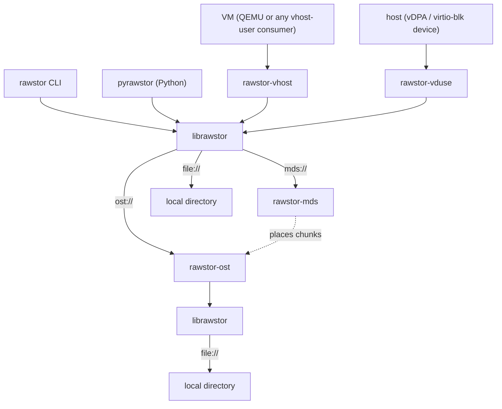

# Rawstor

Rawstor is a raw object storage system: a network-addressable object,
identified by a UUID, that you read and write like a raw block device. It is
a client library plus a small family of servers and backends.

The main use is a virtual machine's disk. `rawstor-vhost` (or `rawstor-vduse`)
exposes an object to a guest as a `virtio-blk` disk, so the disk is just an
object stored on the network.

## Key ideas

- **The client does the work.** Redundancy and data preparation live in the
  client library, not in the servers. A write goes to every mirror from the
  client, and a stale or missing copy is resynced by the client too.
- **You choose the layout.** An object is a single chunk on one server, or
  many chunks spread across a cluster, with a chunk size, stripe width and
  failure domain of your choosing. Rawstor sits between local storage and a
  fully distributed one.
- **Simple addressing.** A *Location* (`ost://host`, `file:///path`) names a
  backend store, and a *Target* adds an object UUID. Comma-separated lists
  mean mirroring or data locality. See [Concepts](concepts.md).
- **Small moving parts.** `rawstor-ost` stores the data, `rawstor-mds`
  optionally keeps the map from an object to its chunks, and both speak one
  binary [wire protocol](protocol.md).

## Components

| Component | What it is |
|---|---|
| `librawstor` | Client library with a C API; create, open, read, write and list objects. |
| `rawstor` | Command-line client: `location`, `object`, `testio`, `version`. |
| `rawstor-ost` | Object storage server. Serves a local directory or proxies to other OSTs. |
| `rawstor-mds` | Metadata server for chunked objects: placement across OSTs, versions. |
| `rawstor-vhost`, `rawstor-vduse` | Expose an object as a `virtio-blk` disk over vhost-user or VDUSE. |
| `pyrawstor` | Python bindings. |

## Getting started

The [Quick start](quickstart.md) sets up a mirrored virtual machine disk
from packages on four hosts, every service run by systemd. To build from a
checkout instead, see [Building from source](building.md); before relying on
Rawstor, read the [known limitations](limitations.md).

## Where to go next

- [Quick start](quickstart.md): a mirrored VM disk from packages.
- [Downloads](downloads.md): packages and sources of every release.
- [Concepts](concepts.md): Location and Target, the addressing model.
- [Architecture](architecture.md): the components and their roles.
- Services: [rawstor-ost](ost.md), [rawstor-mds](mds-server.md),
  [rawstor-vhost](vhost.md), [rawstor-vduse](vduse.md),
  [configuration](configuration.md) and [witness members](witness.md).
- Design: [Protocol](protocol.md), [MDS design](mds.md),
  [Mirroring](mirroring.md), [Multi-attach](multiattach.md) and
  [CASPaxos](caspaxos.md).
- [Building from source](building.md): for developers.
- [Known limitations](limitations.md): what is not implemented yet.
- [Troubleshooting](troubleshooting.md): `io_uring` problems.
- [Authors](authors.md): who develops Rawstor.

Source code: [rawstor/librawstor](https://github.com/rawstor/librawstor).
