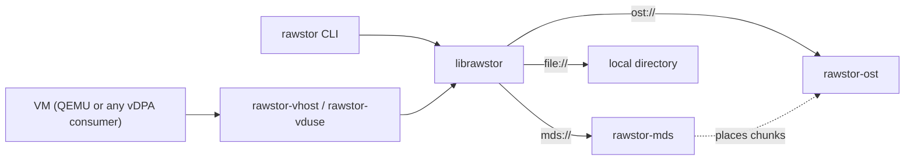

# Rawstor

Rawstor is a raw object storage system: a network-addressable object,
identified by a UUID, that you read and write like a raw block device. It is
a client library plus a small family of servers and backends.

The main use is a virtual machine's disk. `rawstor-vhost` (or `rawstor-vduse`)
exposes an object to a guest as a `virtio-blk` disk, so the disk is just an
object stored on the network.

## Key ideas

- **The client does the work.** Redundancy and data preparation live in the
  client library, not in the servers. A write goes to every mirror from the
  client, and a stale or missing copy is resynced by the client too.
- **You choose the layout.** An object is a single chunk on one server, or
  many chunks spread across a cluster, with a chunk size, stripe width and
  failure domain of your choosing. Rawstor sits between local storage and a
  fully distributed one.
- **Simple addressing.** A *Location* (`ost://host`, `file:///path`) names a
  backend store, and a *Target* adds an object UUID. Comma-separated lists
  mean mirroring or data locality. See [Concepts](concepts.md).
- **Small moving parts.** `rawstor-ost` stores the data, `rawstor-mds`
  optionally keeps the map from an object to its chunks, and both speak one
  binary [wire protocol](protocol.md).



## Components

| Component | What it is |
|---|---|
| `librawstor` | Client library with a C API; create, open, read, write and list objects. |
| `rawstor` | Command-line client: `create`, `list`, `show`, `info`, `resize`, `remove`, `testio`. |
| `rawstor-ost` | Object storage server. Serves a local directory or proxies to other OSTs. |
| `rawstor-mds` | Metadata server for chunked objects: placement across OSTs, versions. |
| `rawstor-vhost`, `rawstor-vduse` | Expose an object as a `virtio-blk` disk over vhost-user or VDUSE. |
| `pyrawstor` | Python bindings. |

## Getting started

A mirrored virtual machine disk served from four hosts, every service run by
systemd:

| Host | Address | Runs | Packages |
|---|---|---|---|
| storage 1 | `192.168.0.11` | `rawstor-ost`, holds one copy of the data | `rawstor-ost` |
| storage 2 | `192.168.0.12` | `rawstor-ost`, holds the other copy | `rawstor-ost` |
| metadata | `192.168.0.13` | `rawstor-mds`, places the object's chunks on the OSTs and acts as the mirror's witness | `rawstor-mds` |
| hypervisor | any | `rawstor-vhost` and QEMU, the VM's disk | `rawstor-vhost` |

The hypervisor talks to the metadata host to find an object's chunks and to
both storage hosts to read and write them, and the metadata host talks to the
storage hosts. Addresses in locations are IPs, not host names.

With two data copies, a quorum needs a third vote to tell a failed copy from
a network split. The witness is that vote: it stores no data, only the
mirror's state, and the MDS can host it, so no fifth machine is needed. With
it, the disk stays available when either storage host goes down.

Download the packages from [Downloads](downloads.md). Every host needs
`librawstor` (the library and the `rawstor` CLI) next to its own package:

```
VERSION=0.2.12

# Debian/Ubuntu, on a storage host; likewise rawstor-mds and
# rawstor-vhost on the other two
sudo apt install ./librawstor_${VERSION}_amd64.deb \
                 ./rawstor-ost_${VERSION}_amd64.deb

# RHEL/AlmaLinux
sudo dnf install ./librawstor-${VERSION}-0.x86_64.rpm \
                 ./rawstor-ost-${VERSION}-0.x86_64.rpm
```

Installing a package starts nothing. Each server is a systemd template unit,
one instance per OST or cluster, named after its id and configured by an
environment file in `/etc/rawstor/`.

### Storage hosts

On each of the two storage hosts, start an OST that stores its data in
`/var/lib/rawstor/ost/<id>` (created on start and owned by the `rawstor`
user), and note its id, the metadata host needs it:

```
OST=$(cat /proc/sys/kernel/random/uuid)
echo "BIND_ADDR=0.0.0.0" | sudo tee /etc/rawstor/ost/${OST}.conf
sudo systemctl enable --now rawstor-ost@${OST}

echo ${OST}                                   # for the topology below
rawstor info ost://192.168.0.11               # serving? (.12 on the other)
journalctl -u rawstor-ost@${OST}              # log
```

### Metadata host

The MDS decides which OSTs hold each chunk of an object. It reads a topology
file with one line per OST: the OST's id, the location clients reach it at, a
weight, its roles and its place in the failure hierarchy. The two storage
hosts are `data` members. The MDS lists itself too, as a `witness`: it serves
the witness subset of the OST protocol on its own port, so its location is an
`ost://` one with the MDS's port, `7776`, and it needs an id of its own:

```
OST1=<the id printed on storage host 1>
OST2=<the id printed on storage host 2>
WITNESS=$(cat /proc/sys/kernel/random/uuid)
CLUSTER=$(cat /proc/sys/kernel/random/uuid)

sudo tee /etc/rawstor/mds/${CLUSTER}.topology <<EOF
${OST1} ost://192.168.0.11 100 data dc1/row1/rack1/host1
${OST2} ost://192.168.0.12 100 data dc1/row1/rack2/host2
${WITNESS} ost://192.168.0.13:7776 100 witness dc1/row1/rack3/host3
EOF
echo "BIND_ADDR=0.0.0.0" | sudo tee /etc/rawstor/mds/${CLUSTER}.conf
sudo systemctl enable --now rawstor-mds@${CLUSTER}

rawstor info mds://192.168.0.13               # serving?
```

Each member sits on its own server, so a chunk's two copies and its witness
never share a failure domain.

After editing the topology file later, apply it with
`sudo systemctl reload rawstor-mds@${CLUSTER}`. The package also ships a
commented example in `/usr/share/doc/rawstor-mds/topology.conf`.

### Hypervisor

Create a 10 GiB mirrored object, split into 256 MiB chunks. For every chunk
the MDS places two copies on the two OSTs and, since the number of copies is
even, a witness on its own host. `rawstor` prints the object's target, and the
last path segment of that target is the object's UUID:

```
OBJECT_TARGET=$(rawstor create mds://192.168.0.13 --size=10G --chunk-size=256M --mirrors=2)
OBJECT=${OBJECT_TARGET##*/}

rawstor show -v ${OBJECT_TARGET}              # each copy's state, per chunk
```

Expose the object as a vhost-user disk. The `rawstor-vhost@` instance is
named after the object and listens on `/run/rawstor/<object>.sock`. It
opens `${LOCATION}/<object>`, with `LOCATION` taken from
`/etc/rawstor-vhost.conf`, so point it at the MDS:

```
echo "LOCATION=mds://192.168.0.13" | sudo tee /etc/rawstor-vhost.conf
sudo systemctl enable --now rawstor-vhost@${OBJECT}
```

QEMU only needs permission to connect to that socket, which is a matter of
joining the `rawstor` group (`libvirt-qemu` on Debian/Ubuntu, `qemu` on
Fedora/RHEL):

```
sudo usermod -aG rawstor libvirt-qemu
```

Then give the guest the disk:

```
qemu-system-x86_64 \
    -enable-kvm -m 4G \
    -machine accel=kvm,memory-backend=mem \
    -object memory-backend-memfd,id=mem,size=4G,share=on \
    -chardev socket,id=rawstor1,reconnect=1,path=/run/rawstor/${OBJECT}.sock \
    -device vhost-user-blk-pci,chardev=rawstor1,num-queues=1,disable-legacy=on
```

A restarted `rawstor-vhost` instance picks up where it left off, so QEMU's
`reconnect=1` is enough to survive it. Later, grow the disk with
`rawstor resize ${OBJECT_TARGET} --size=20G`. The details of every service
are in the [README](https://github.com/rawstor/librawstor#readme), and how a
mirror degrades and recovers is in [Mirroring](mirroring.md).

## Where to go next

- [Downloads](downloads.md): packages and sources of every release.
- [Concepts](concepts.md): Location and Target, the addressing model.
- [Architecture](architecture.md): the components and their roles.
- [Protocol](protocol.md): commands and frame layouts.
- [MDS design](mds.md): placement, chunk allocation, versions.
- [Mirroring](mirroring.md): the N-way mirror failure model and recovery.
- [Multi-attach](multiattach.md) and [CASPaxos](caspaxos.md): several writers
  of one mirrored object.

Source code: [rawstor/librawstor](https://github.com/rawstor/librawstor).
