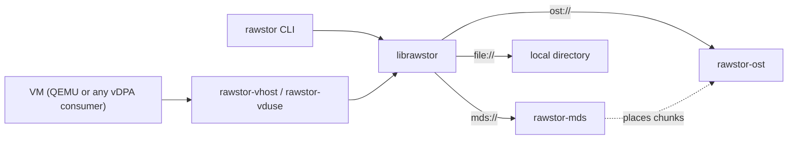

# Rawstor

Rawstor is a raw object storage system: a network-addressable object,
identified by a UUID, that you read and write like a raw block device. It is
a client library plus a small family of servers and backends.

The main use is a virtual machine's disk. `rawstor-vhost` (or `rawstor-vduse`)
exposes an object to a guest as a `virtio-blk` disk, so the disk is just an
object stored on the network.

## Key ideas

- **The client does the work.** Redundancy and data preparation live in the
  client library, not in the servers. A write goes to every mirror from the
  client, and a stale or missing copy is resynced by the client too.
- **You choose the layout.** An object is a single chunk on one server, or
  many chunks spread across a cluster, with a chunk size, stripe width and
  failure domain of your choosing. Rawstor sits between local storage and a
  fully distributed one.
- **Simple addressing.** A *Location* (`ost://host`, `file:///path`) names a
  backend store, and a *Target* adds an object UUID. Comma-separated lists
  mean mirroring or data locality. See [Concepts](concepts.md).
- **Small moving parts.** `rawstor-ost` stores the data, `rawstor-mds`
  optionally keeps the map from an object to its chunks, and both speak one
  binary [wire protocol](protocol.md).



## Components

| Component | What it is |
|---|---|
| `librawstor` | Client library with a C API; create, open, read, write and list objects. |
| `rawstor` | Command-line client: `create`, `list`, `show`, `info`, `resize`, `remove`, `testio`. |
| `rawstor-ost` | Object storage server. Serves a local directory or proxies to other OSTs. |
| `rawstor-mds` | Metadata server for chunked objects: placement across OSTs, versions. |
| `rawstor-vhost`, `rawstor-vduse` | Expose an object as a `virtio-blk` disk over vhost-user or VDUSE. |
| `pyrawstor` | Python bindings. |

## Getting started

A single host serving a VM disk from a local directory, with every service
run by systemd. Download the packages from [Downloads](downloads.md) first:
`librawstor` (the `rawstor` CLI and the library), `rawstor-ost` and
`rawstor-vhost`.

```
VERSION=0.2.12

# Debian/Ubuntu
sudo apt install ./librawstor_${VERSION}_amd64.deb \
                 ./rawstor-ost_${VERSION}_amd64.deb \
                 ./rawstor-vhost_${VERSION}_amd64.deb

# RHEL/AlmaLinux
sudo dnf install ./librawstor-${VERSION}-0.x86_64.rpm \
                 ./rawstor-ost-${VERSION}-0.x86_64.rpm \
                 ./rawstor-vhost-${VERSION}-0.x86_64.rpm
```

Installing a package starts nothing. Each server is a systemd template unit,
one instance per OST, named after its id and configured by an environment
file. Start an OST that stores its data in `/var/lib/rawstor/ost/<id>`
(created on start and owned by the `rawstor` user):

```
OST=$(cat /proc/sys/kernel/random/uuid)
echo "BIND_ADDR=0.0.0.0:7777" | sudo tee /etc/rawstor/ost/${OST}.conf
sudo systemctl enable --now rawstor-ost@${OST}

rawstor info ost://127.0.0.1:7777               # serving?
journalctl -u rawstor-ost@${OST}              # log
```

Create a 10 GiB object on it. `rawstor` prints the object's target, and the
last path segment of that target is the object's UUID:

```
OBJECT_TARGET=$(rawstor create ost://127.0.0.1:7777 --size=10G --mirrors=1)
OBJECT=${OBJECT_TARGET##*/}
```

Expose the object as a vhost-user disk. The `rawstor-vhost@` instance is
named after the object and listens on `/run/rawstor/<object>.sock`; it reads
the backend from `LOCATION` in `/etc/rawstor-vhost.conf` (default
`ost://127.0.0.1:7777`):

```
sudo systemctl enable --now rawstor-vhost@${OBJECT}
```

QEMU only needs permission to connect to that socket, which is a matter of
joining the `rawstor` group (`libvirt-qemu` on Debian/Ubuntu, `qemu` on
Fedora/RHEL):

```
sudo usermod -aG rawstor libvirt-qemu
```

Then give the guest the disk:

```
qemu-system-x86_64 \
    -enable-kvm -m 4G \
    -machine accel=kvm,memory-backend=mem \
    -object memory-backend-memfd,id=mem,size=4G,share=on \
    -chardev socket,id=rawstor1,reconnect=1,path=/run/rawstor/${OBJECT}.sock \
    -device vhost-user-blk-pci,chardev=rawstor1,num-queues=1,disable-legacy=on
```

A restarted `rawstor-vhost` instance picks up where it left off, so QEMU's
`reconnect=1` is enough to survive it. For several OSTs on one host, give each
its own id, port and store. For chunked objects placed across a cluster, run
`rawstor-mds@` the same way and create the object on `mds://` instead. Both
are covered in the
[README](https://github.com/rawstor/librawstor#readme).

## Where to go next

- [Downloads](downloads.md): packages and sources of every release.
- [Concepts](concepts.md): Location and Target, the addressing model.
- [Architecture](architecture.md): the components and their roles.
- [Protocol](protocol.md): commands and frame layouts.
- [MDS design](mds.md): placement, chunk allocation, versions.
- [Mirroring](mirroring.md): the N-way mirror failure model and recovery.
- [Multi-attach](multiattach.md) and [CASPaxos](caspaxos.md): several writers
  of one mirrored object.

Source code: [rawstor/librawstor](https://github.com/rawstor/librawstor).
