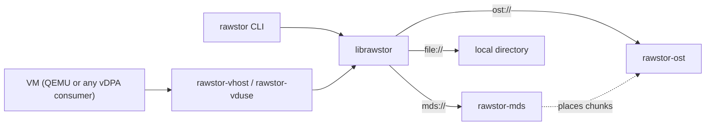

# Rawstor

Rawstor is a raw object storage system: a network-addressable object,
identified by a UUID, that you read and write like a raw block device. It is
a client library plus a small family of servers and backends.

The main use is a virtual machine's disk. `rawstor-vhost` (or `rawstor-vduse`)
exposes an object to a guest as a `virtio-blk` disk, so the disk is just an
object stored on the network.

## Key ideas

- **The client does the work.** Redundancy and data preparation live in the
  client library, not in the servers. A write goes to every mirror from the
  client, and a stale or missing copy is resynced by the client too.
- **You choose the layout.** An object is a single chunk on one server, or
  many chunks spread across a cluster, with a chunk size, stripe width and
  failure domain of your choosing. Rawstor sits between local storage and a
  fully distributed one.
- **Simple addressing.** A *Location* (`ost://host`, `file:///path`) names a
  backend store, and a *Target* adds an object UUID. Comma-separated lists
  mean mirroring or data locality. See [Concepts](concepts.md).
- **Small moving parts.** `rawstor-ost` stores the data, `rawstor-mds`
  optionally keeps the map from an object to its chunks, and both speak one
  binary [wire protocol](protocol.md).



## Components

| Component | What it is |
|---|---|
| `librawstor` | Client library with a C API; create, open, read, write and list objects. |
| `rawstor` | Command-line client: `create`, `list`, `show`, `info`, `resize`, `remove`, `testio`. |
| `rawstor-ost` | Object storage server. Serves a local directory or proxies to other OSTs. |
| `rawstor-mds` | Metadata server for chunked objects: placement across OSTs, versions. |
| `rawstor-vhost`, `rawstor-vduse` | Expose an object as a `virtio-blk` disk over vhost-user or VDUSE. |
| `pyrawstor` | Python bindings. |

## Try it

Start a server on a local directory and create an object on it:

```
mkdir -p /var/rawstor
rawstor-ost --bind 127.0.0.1 file:///var/rawstor &

rawstor create ost://127.0.0.1 --size=1G --mirrors=1
```

`rawstor create` prints the new object's target. Serve it to QEMU with
`rawstor-vhost --socket-path=... TARGET`. The full walkthrough, including
`rawstor-mds`, is in the
[README](https://github.com/rawstor/librawstor#readme).

## Where to go next

- [Downloads](downloads.md): packages and sources of every release.
- [Concepts](concepts.md): Location and Target, the addressing model.
- [Architecture](architecture.md): the components and their roles.
- [Protocol](protocol.md): commands and frame layouts.
- [MDS design](mds.md): placement, chunk allocation, versions.
- [Mirroring](mirroring.md): the N-way mirror failure model and recovery.
- [Multi-attach](multiattach.md) and [CASPaxos](caspaxos.md): several writers
  of one mirrored object.

Source code: [rawstor/librawstor](https://github.com/rawstor/librawstor).
