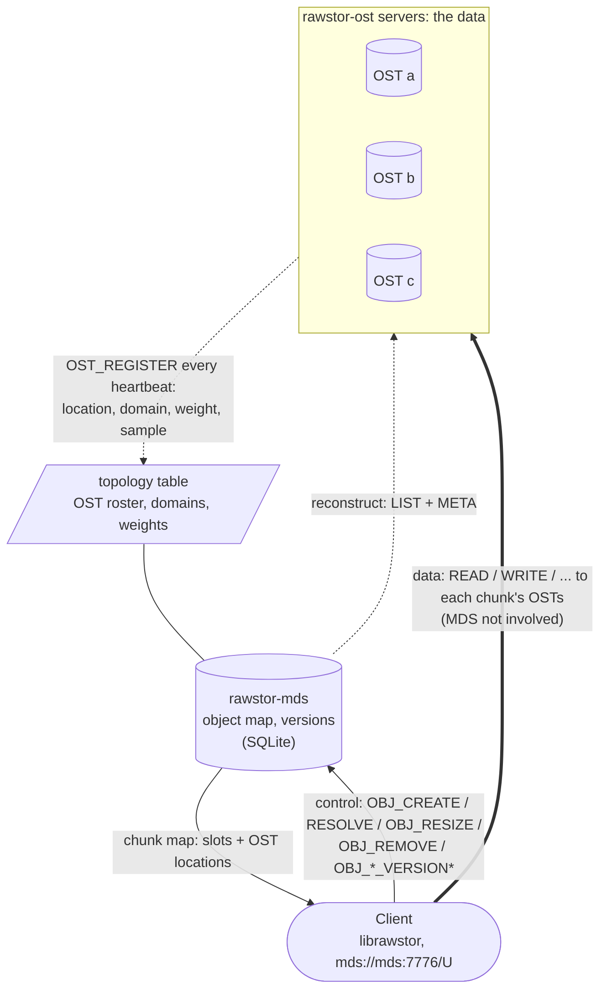
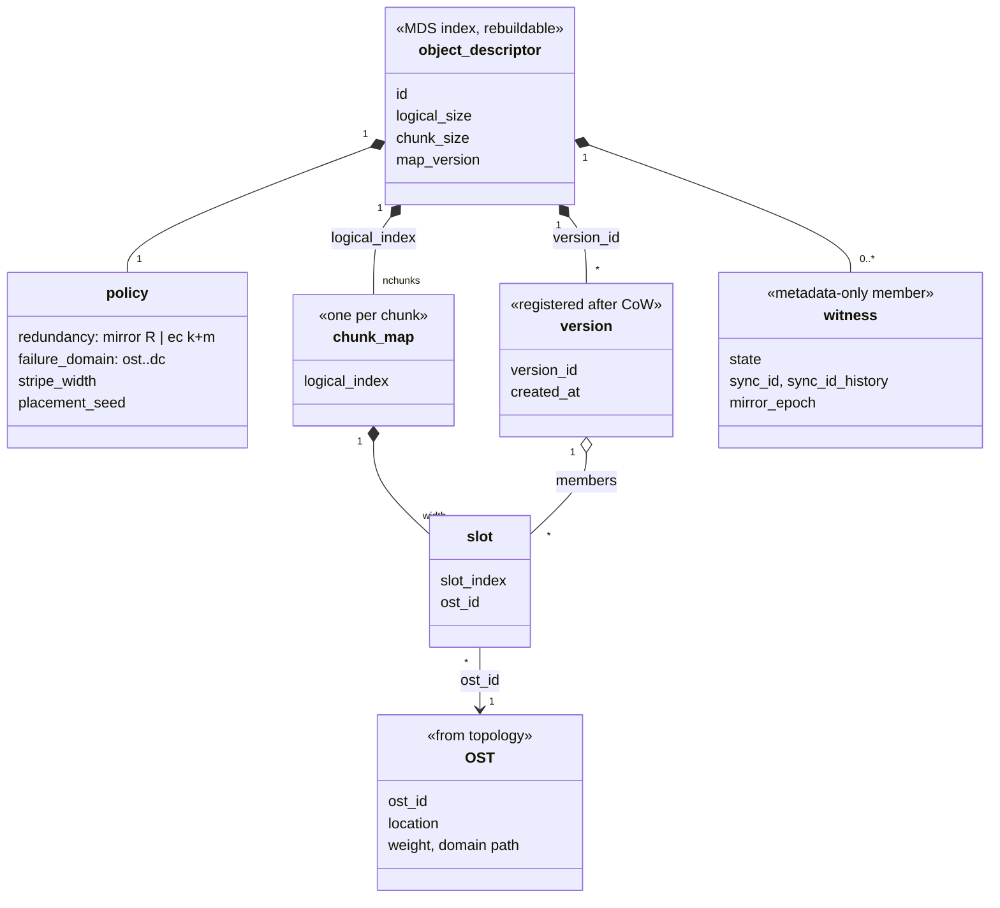
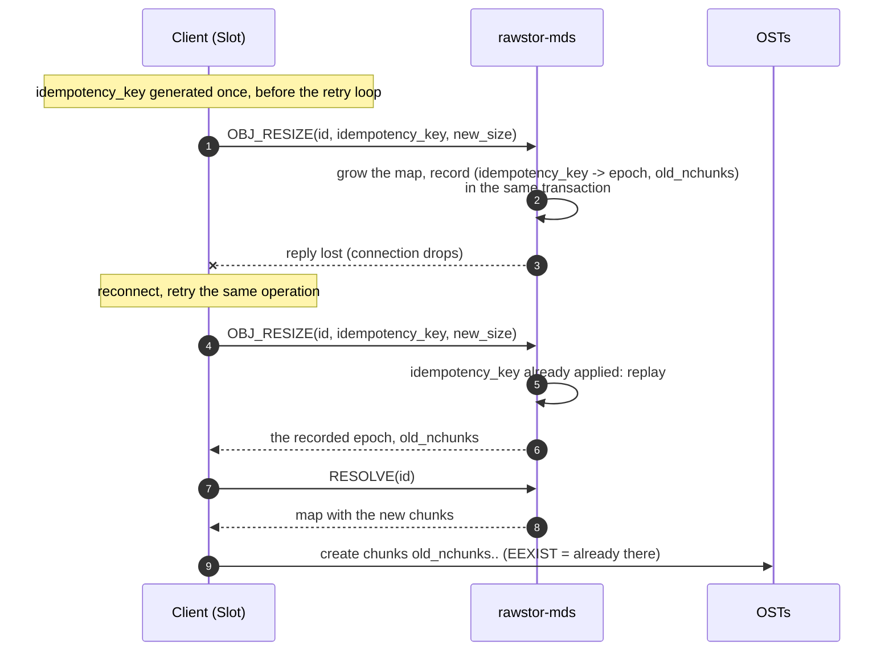
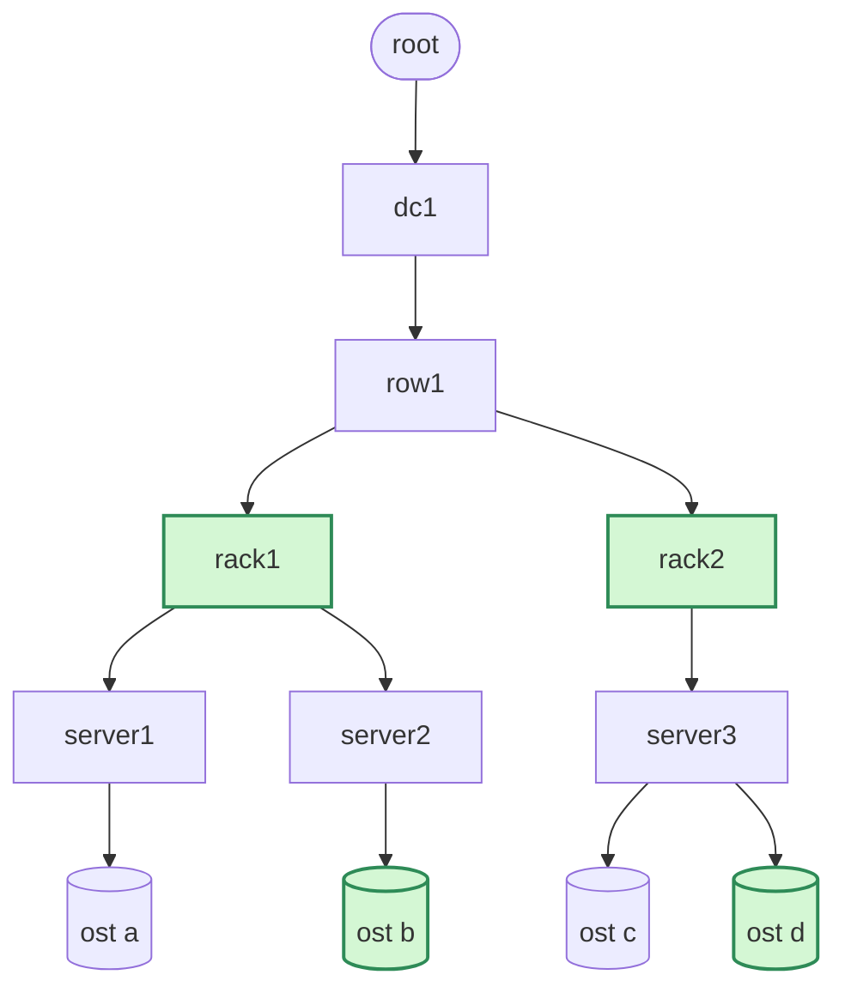
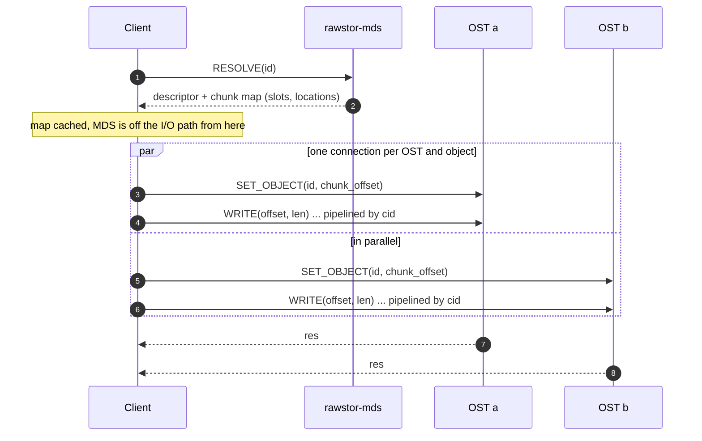
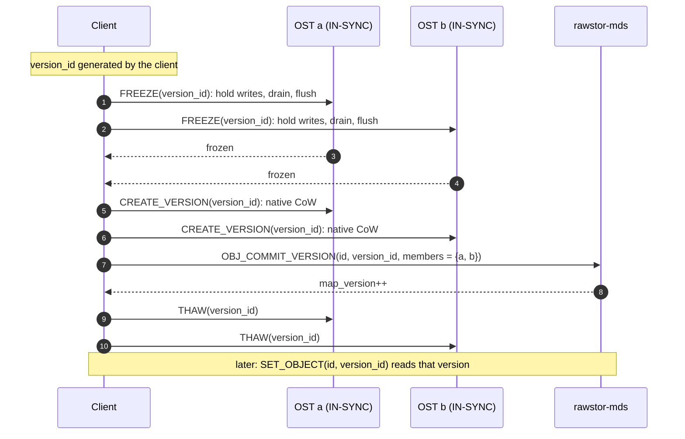
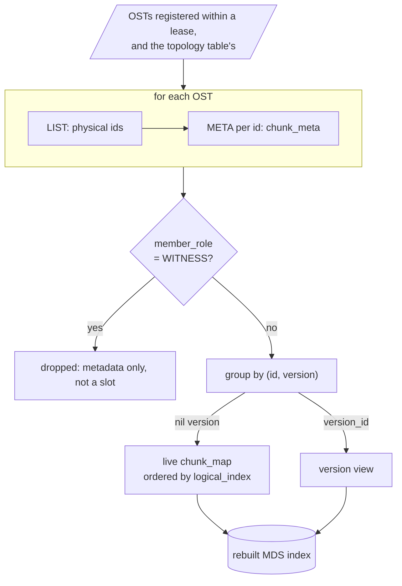

# RawStor MDS design (block storage)

## Status

Legend: ✅ implemented · 🟡 partial · ❌ not implemented yet. *Stage* is this
document's own numbering (see *Implementation stages*); [Mirroring](mirroring.md)
numbers its stages separately.

| Feature | Stage | Status | Where |
|---|---|---|---|
| `rawstor-mds` server, `-w/--workers` threads | 1 | ✅ | `mds/src/main.cpp`, `mds/src/server.cpp` |
| SQLite store (WAL, `synchronous=FULL`) | 1 | ✅ | `mds/src/store.cpp` |
| `OBJ_CREATE` / `RESOLVE` / `OBJ_RESIZE` / `OBJ_REMOVE` | 1 | ✅ | `mds/src/client.cpp`, `src/mds_backend.cpp` |
| Explicit chunk map, client-side routing by chunk | 1 | ✅ | `src/mds_backend.cpp`, `src/object.cpp` |
| Weighted HRW placement, `failure_domain`, `stripe_width` | 1 | ✅ | `mds/src/placement.cpp` |
| Unsatisfiable topology hard-fails | 1 | ✅ | `mds/src/placement.cpp` |
| Topology in the database, entered by OST registration (`OST_REGISTER`), heartbeat lease | 1 | ✅ | `mds/src/store.cpp`, `ost/src/registrar.cpp`, [OST registration](#ost-registration) |
| Idempotent mutations (`idempotency_key`, `applied_mutations`, 1-day expiry) | 1 | ✅ | `mds/src/store.cpp` |
| Grow-only resize | 1 | ✅ | `mds/src/store.cpp` (shrink refused) |
| `map_version` per object: the version of its map, not a fence | 1 | ✅ | stored and returned by `OBJ_*`; [map_version](#map_version) |
| `updatePlacement` / migration / rebalance | 1 | ❌ | [Migration design](migration.md) |
| One connection per (OST, object) serving all its chunks | 1 | 🟡 | one connection pool per chunk slot (`SET_OBJECT` with the chunk offset) |
| `--reconstruct`: rebuild the live map from `LIST` + `META` | 1 | ✅ | `mds/src/main.cpp` |
| `LIST` limited to one location of the topology, told by its URI: the objects with a slot or a version member on it | 1 | ✅ | `mds/src/store.cpp`, `rawstor_location_list_held()`, [Migration](migration.md#mds-side) |
| `--reconstruct`: register complete versions, collect garbage | 2 | ❌ | version records are skipped |
| Scrub: full MDS serving the same scan from its own index | — | ❌ | — |
| `OBJ_COMMIT_VERSION` / `OBJ_REMOVE_VERSION` / `LIST_VERSIONS` | 2 | ✅ | `mds/src/client.cpp`, `src/mds_backend.cpp` |
| Client-generated `version_id`, CoW in descending chunk order | 2 | ✅ | `src/mds_backend.cpp` |
| Write barrier across a version: `FREEZE`/`THAW` on every DATA member of every chunk, with a lease | 2 | ✅ | `ost/src/freeze_gate.cpp`, `src/target.cpp`, `src/mds_backend.cpp` |
| Version confirmation: `PENDING`/`VALID`, `OBJ_CONFIRM_VERSION` | 2 | ❌ | [plan](#confirming-a-version-not-implemented) |
| Collecting expired `PENDING` versions | 2 | ❌ | [plan](#confirming-a-version-not-implemented) |
| Native copies marked confirmed, so `--reconstruct` registers only those | 2 | ❌ | [plan](#confirming-a-version-not-implemented) |
| Native CoW: `zfs://` | 2 | ✅ | `src/zfs_backend.cpp` |
| Native CoW: `lvm://` (classic snapshot) | 2 | ✅ | `src/lvm_backend.cpp` |
| Native CoW: `lvm://` (thin) | 2 | ❌ | — |
| `file://` fake snapshots (full copy of `data`) | 2 | ✅ | `src/file_backend.cpp` |
| Object removal removes its versions; the MDS refuses with `-EBUSY` only for a version created meanwhile | 2 | ✅ | `src/mds_backend.cpp`, `mds/src/store.cpp` |
| Version redundancy status surfacing | 2 | ❌ | TODO |
| vhost/QEMU flush hook for versions | 2 | ❌ | the CLI assumes no concurrent writer |
| Space samples sent by the OSTs, `LOCATION_INFO` from them | — | ✅ | `ost/src/registrar.cpp`, `mds/src/store.cpp` |
| Member digest against the map; a lasting disagreement lists the OST and logs the difference | — | ✅ | `mds/src/store.cpp`, `mds/src/reconciler.cpp`, [Member digest](#space-and-the-member-digest) |
| `LIST_LOCATIONS`: the locations of the topology, paged like `LIST`; `rawstor location list` | — | ✅ | `mds/src/client.cpp`, `src/wire_backend.cpp`, `cli/locations.c` |
| `HANDSHAKE`: feature bits, the first request of every connection (no protocol version) | — | ✅ | [Protocol](protocol.md), `src/wire_backend.cpp`, `ost/src/client.cpp`, `mds/src/client.cpp` |
| Unified response frame `{res, len, hash}` | — | ❌ | — |
| Witness: metadata-only members and quorum | 3 | ✅ | `src/chunk.cpp`, SQLite witness records |
| Witness: durable states, voting rules, synchronous barriers, re-attach | 3 | ✅ | `src/chunk.cpp` |
| MDS replication (primary + log) | v2+ | ❌ | — |
| EC policy | v2+ | ❌ | — |
| Stored checksums / scrub, version redundancy repair | v2+ | ❌ | — |
| Authentication and authorization (mTLS, certificate roles) | — | ✅ | [Security](security.md) |
| Shrink | open | ❌ | — |

Metadata Storage Target (**MDS/MDT**) design, specialized for the **block
storage** use case: sparse (thin) allocation and large object chunks (1+ GiB).

Status: **approved**. Supersedes the earlier draft where the
*Decision revalidation* table below says so. Implementation progress is
tracked in the *Status* table above; see also *Implementation stages*.

See also: [Architecture](architecture.md), [Protocol](protocol.md),
`librawstor/docs/mirroring.md` (quorum rules the witness plugs into).

At a glance: the MDS only answers *where* an object's chunks live; data
never passes through it.



The client-side `mds::Backend` and `ost::Backend` inherit their shared network
transport and member commands from `wire::Backend` (`src/wire_backend.*`).
MDS encodes object commands and decodes their responses directly in
`mds::Backend`, using that same connection and CID response dispatcher. MDS overrides whole-object operations to resolve
its chunk map; `Target::open()` expands an `mds://` target through
`Backend::resolve_targets()` into the ordinary multi-chunk target of the
object's real members and opens that, so the MDS is not involved in the
object's I/O after open. Native witness metadata
uses the protected nonvirtual wire requests directly. OST implements its
virtual member operations by forwarding to those same requests. Shared
`set_state` and `info` implementations are final in the wire
base class. OST data I/O (`READ`, `WRITE`,
`DISCARD`, `WRITE_ZEROES`, `FLUSH`) is implemented in `ost::Backend`
(`src/ost_backend.cpp`); `mds::Backend` serves no data I/O (`ENOTSUP`).

## Requirements, in priority order

0. **Allocation and tracking** — answer "which OST hosts which part of which
   object" (`getObj` / `getObjPart` / `getFreeOst` of `architecture.md`, refined
   below) and generate placements at create/grow time. This is the reason MDS
   exists; everything else layers on top.
1. **Version registry** — register client-generated `version_id`s
   and remember which members hold each version.
2. **Witness** — metadata-only quorum member for client-side mirroring
   (restores auto-start for 2 data mirrors with one OST down; see
   `mirroring.md`, Quorum).

Implementation order follows the same list: chunking first, versions second,
witness third. All three are designed here so the later stages land without a
redesign.

## Principles

- **OST side is the durable ground truth.** Every chunk is *self-describing*:
  alongside the chunk data the OST keeps metadata about that chunk itself
  (`chunk_meta`). Losing the MDS map is therefore **not** fatal — it can be
  rebuilt by scanning all OSTs.
- **MDS is an index over that truth.** It is the normal source for
  `openObject`, but it is recoverable, so v1 runs a single instance.
- **MDS is off the hot path — including the moment of a disk failure.** The
  map is read once at object open and cached; degrade decisions during I/O are
  made and recorded by the client on surviving members through synchronous
  configuration barriers, including the witness when declared. The witness
  is updated on first write, degradation, resync completion and clean close;
  see *Witness*.
- **Redundancy is the client's responsibility** (per `architecture.md`). MDS and
  placement only produce *slots*; the client decides what goes in them
  (mirror copies or erasure-coding shards) and does the encode/decode.
- **One wire protocol.** MDS commands are new opcodes in the existing OST
  protocol (`rstr` magic). An OST can therefore serve as a *partial MDS*
  (the shared metadata subset), and a full MDS is a server speaking the same
  protocol without the data opcodes.

Why the explicit map works for block storage: with 1 GiB chunks a 1 TiB object
has **≤ 1024** map entries (a few KiB), so the map is stored **explicitly**
rather than computed (unlike Ceph/CRUSH). The deterministic placement function
is only the *generator* of placements at create/grow time and the reference
used when rebuilding by scan.

| | Ceph (4 MiB objects) | rawstor block (1+ GiB chunks) |
|---|---|---|
| 1 TiB object | ~256 000 objects | **≤ 1024 map entries** |
| Per-object map | huge, computed (CRUSH) | **tiny, stored explicitly** |
| MDS on hot path | — | **no, allocation only** |

## Compatibility stance

There are **no live installations yet**: breaking wire and on-disk formats is
free until the first one. The core decisions here do not lean on backward
compatibility (they would be the same greenfield), but this freedom is used
in four places and spent on one addition:

- **Response frame**: every response becomes `{ int32 res; uint32 len;
  uint64 hash }` + `len` bytes of body — an explicit length field instead of
  overloading `res`, resolving the standing TODO in `protocol.h`. (This is,
  amusingly, the response frame of the rejected separate MDS protocol — the
  frame survives, the magic does not.)
- **No legacy acceptance**: `chunk_meta` starts at `format_version` 1; the
  `.spec` v0 (size-only) acceptance/migration in librawstor is dropped rather
  than carried into the chunked world. Note: `sync_id == 0` is **not** a
  legacy shim and stays — it is the live "blank copy, never part of a sync
  set" marker written at create and relied on by F10 recreate (a blank copy
  with a random `sync_id` would read as split brain at the next open; with
  the current set's `sync_id` it would claim data it does not have).
- **Opcode space**: regrouped into reserved ranges per role (session / data /
  shared metadata / object) instead of appending to one enum — free today, a
  breaking change after the first install.
- The degenerate single-chunk unification (below) is kept as *design* — one
  schema, one code path — not as a migration bridge; there is nothing to
  migrate.
- **Spent on: capability negotiation.** This freedom ends at the first live
  install, so the mechanism for future breaks exists already: `HANDSHAKE`, the
  first request of every connection, negotiates feature bits (none is defined
  yet). There is no protocol version: a wire change goes behind a bit, and a
  client and a server that do not share it refuse each other instead of
  misreading a frame ([Protocol](protocol.md)).

## Decision revalidation (vs the earlier draft)

| Draft decision | Verdict | Why |
|---|---|---|
| Separate MDS wire protocol, distinct magic `rsmd` | **Changed: single protocol with OST** | An OST doubles as a partial MDS (the witness subset — `META` and the register's requests — already exists on OSTs today); one framing/parsing stack; misconnection safety comes from `-ENOSYS` on unknown opcodes instead of a magic mismatch |
| Explicit stored map (not CRUSH-computed) | Keep | ≤ 1024 entries/TiB; placement function stays the generator |
| Weighted rendezvous (HRW) placement | Keep | deterministic, minimal reshuffle, stateless, O(N) fine at this scale |
| Hand-rolled packed structs, count prefixes, `format_version` | Keep | codebase idiom, no new dependency |
| Chunk identity rides `RawstorFrameBasicPayload` unchanged | Keep | see *Chunk identity* |
| Opaque stable `ost_id` (UUID), resolved via topology | Keep | required for HRW stability |
| epoch-fence (client cache vs per-chunk hard gate) | **Dropped** | the chunk's register epoch is the hard gate ([Migration](migration.md)); `map_version` per object is only the version of the map, see [map_version](#map_version) |
| Shard by `id`; primary + replicated log per shard; reads from any replica | **Replaced in v1: single MDS instance** | witness availability does not require MDS replication (a dead witness = one lost vote); the map is rebuildable by scan; replication is v2, the epoch/CAS model below is compatible with primary+log |

## Chunk identity

```
logical chunk_id  = (id, chunk_offset, version)
physical chunk_id = (id, chunk_offset, version, slot_index)
```

A logical chunk has `width` slots (`slot_index` 0..width-1); see *Redundancy*.
`version` is a UUID (`version_id`, client-generated like every other id --
never a monotonic counter), carried in its own field of the one payload
every chunk-level command shares:

```c
struct RawstorFrameBasicPayload {
    uint8_t  object_id[16];  // = id
    uint64_t offset;         // = chunk_offset (logical_index * chunk_size)
    uint8_t  version_id[16]; // = version; nil = live
    uint64_t val;
} __attribute__((packed));
```

Every chunk-level command (SET_OBJECT, RELEASE, CREATE_VERSION, META, …) and
RESOLVE rides this payload; `version_id` nil means "live" -- RELEASE
removes the live version this way, and with a non-nil `version_id` the
same command removes that one version. Commands that never bind a version
leave it nil. OBJ_RESIZE, OBJ_REMOVE and OBJ_REMOVE_VERSION ride
`RawstorFrameObjOpPayload { id[16]; idempotency_key[16]; version_id[16];
val; }` instead (see *Idempotent mutations*).
On-OST layout (the slot's home, also where `chunk_meta` lives). `version`
is part of the *logical* identity only: on CoW backends a version materializes as
a **native version of the slot's live volume**, not a separately named one —
naming a volume per version would contradict the version design (stage 2).
`version_id` is a UUID string wherever it appears in a name below, not a
number:

| Backend | Slot home + metadata | Versions (`version_id`) |
|---------|----------------------|----------------------|
| `file://` | dir `<id>/<offset>/`, `data` + `meta` inside it | fake snapshot: copy of `data` in `<id>/<offset>/<version_id>/data` |
| `lvm://`  | LV `<id>-<offset>`, meta in LVM tags | read-only snapshot LV `s<version_id>-<offset>`, carrying the live LV's tag as of the version |
| `zfs://`  | zvol `<id>:<offset>`, meta in user properties | `@s<version_id>` |

(The physical `<offset>` is never omitted, even "0" -- unlike the
target-string syntax's own offset path segment (docs/concepts.md, "Chunk
offset"), a physical name has no ambiguity to avoid by omitting it.
`slot_index` isn't part of the physical name at all: each
mirror of one chunk gets its own URI in the target string that
addresses it -- comma-separated, same as any plain mirrored target --
rather than a naming-scheme component; `-` is LVM's own separator since
its naming forbids `:`.)

### `chunk_meta` — one schema, two layers

Mirroring (implemented) already stores a per-copy consistency tuple on every
backend (`.spec` / LVM tags / ZFS user properties) and moves it over the wire
as `RawstorFrameMetaPayload { size, epoch, sync_id, sync_id_history[4],
state, … }`. `chunk_meta` **extends** that record with placement identity instead
of inventing a second one:

```
chunk_meta {
  magic, format_version
  // placement identity. id/logical_index are not stored here:
  // object_id already *is* id (see above), logical_index is
  // chunk_offset / chunk_size, and chunk_offset rides the wire
  // unconditionally (RawstorFrameBasicPayload.offset above / its own
  // dedicated field on ALLOCATE) -- only chunk_size is stored (needed
  // to invert chunk_offset back into logical_index without a separate
  // lookup).
  chunk_size
  version                  // version_id this slot belongs to; nil = live
  redundancy               // mirror{R} | ec{k,m} — how to decode
  slot_index
  member_role              // DATA = 1 | WITNESS = 2 — witness records are metadata-only
                           // and are excluded from the map reconstruct
  created_at, project_id
  // per-slot consistency (exists today, per mirroring.md)
  size, state, mirror_epoch, sync_id, sync_id_history[4]
  data_checksum            // per-slot, v3+ (scrub); reserved
  versions[]               // version list present on this slot; reserved for stage 2
}
```

A present-day plain (non-`mds://`) target is the degenerate case: a
single chunk (`logical_index = 0`, `chunk_size = object size`,
`version = 0`), `width = N`.
One schema and one code path for both worlds — kept as design, not as a
migration bridge (no live installations, nothing to migrate; see
*Compatibility stance*).

`chunk_meta` feeds **two** consumers from one source: the OST's local in-RAM
index (`offset → local slot`, built by one backend scan at startup) and the
global MDS reconstruct.

## MDS data model

```
object_descriptor {
  id, logical_size, chunk_size,
  policy {
    redundancy    = mirror{ copies R } | ec{ data k, parity m },  // width = R | k+m
    failure_domain = ost | server | rack | row | dc,  // level at which slots must differ
    stripe_width  = K | all,               // locality: over how many OSTs spread
    placement_seed
  },
  project_id, created_at,
  map_version                              // monotonic, ++ on any map/descriptor
                                         // change (incl. version, resize)
}

chunk_map[logical_index] = {
  slots: [ {slot_index, ost_id} * width ] // who holds each copy/shard
  // physical existence ("materialized") is an OST fact, not tracked strictly
}

versions[version_id] = {                   // version_id: UUID, client-generated
  created_at,
  members: [ost_id],                     // who actually holds it (see Versions)
  view: { logical_index -> version }     // cache over OST-side versions
}

witness[id, chunk_offset] = {
  state,                                 // CLEAN | DIRTY | LOST
  sync_id, sync_id_history[4], mirror_epoch,
  roles[]                                // data and witness member roles
}
```

The same model as a diagram: one descriptor per object, a `chunk_map`
entry per chunk with `width` slots, each slot naming one OST from the
topology; a version records which slots hold it.



Two classes of state, by recoverability:

- `object_descriptor` / `chunk_map` / `versions` — an **index**; DR = rebuild
  by OST scan (below).
- `witness` records (SQLite `witnesses` table) — **not** rebuildable by scan (they *are* the extra vote).
  Losing them degrades availability (auto-start requires a data majority
  rules), never correctness; re-attach is defined in *Witness*.

The topology (OST roster, failure domains, weights, `ost_id -> location`) is
neither: each OST states its own entry and keeps it alive by registering
(see [OST registration](#ost-registration)), and the MDS keeps the entries in
its database, in the `topology` table. An entry stays as long as a slot or a
version member is on its OST, so no slot is ever left without an address.
Lost with the database, the roster comes back as the OSTs register again,
which is what *Reconstruct / DR* waits for.

## MDS API

| Method | When | Hot? |
|--------|------|------|
| `createObject(size, chunk_size, policy) -> {id, map_version}` | once | no |
| `openObject(id) -> {descriptor, map_version, chunk_map}` | at open | **only hot read**, client-cached |
| `resizeObject(id, new_size)` | grow (v1: grow-only) | no |
| `version(id, version_id)` | version -- `version_id` is client-generated, like `id` itself | no |
| `updatePlacement(id, index, slots)` | rebalance/recovery | rare |
| `removeObject(id)` | delete | no |
| witness get/put | metadata at open, record before first write (incl. witness-assisted degraded open) / clean close / resync-complete / synchronous degrade | no (see Witness) |

Refines `getObj / getObjPart / getFreeOst` from `architecture.md`; `getFreeOst`
is subsumed by the placement function + topology (the client never picks OSTs
ad hoc).

> Optimization (optional, v2+): with deterministic placement the client can
> derive placement locally from `{descriptor + exception-list + topology}`,
> pushing MDS even further off the path. Base design returns the explicit map.

## Idempotent mutations

A control connection can drop after the MDS committed a mutation but before
its reply reached the client. The client's `Slot` then reconnects and retries
the whole operation -- which, applied a second time, either fails for no real
reason (`OBJ_CREATE` -> `EEXIST`, `OBJ_REMOVE` -> `ENOENT`) or, worse, silently
does the wrong thing (a resize that already grew the map "sees" no chunks left
to create). So every mutating request is made idempotent:

- **`idempotency_key`.** `Slot` generates a UUID once per mutating call (create, remove,
  resize, create_version, remove_version, set_owner), before its retry loop,
  and every attempt carries that same one. `OBJ_CREATE`, `OBJ_RESIZE`,
  `OBJ_REMOVE`, `OBJ_COMMIT_VERSION`, `OBJ_REMOVE_VERSION` and `OBJ_TRANSFER`
  send it ([protocol](protocol.md)).
- **The MDS records what it applied.** An `applied_mutations` table maps `idempotency_key` to the
  command, the object and the reply's result, written in the same SQLite
  transaction as the mutation itself -- a committed mutation always has its
  record. A request whose `idempotency_key` is recorded is not applied again: it gets the
  recorded result. An `idempotency_key` recorded for another command or object is
  `EINVAL`. Only successes are recorded (a failed request changed nothing, so a
  retry of it simply runs); records expire after a day, far beyond any retry.
- **Replies carry what a retry needs to finish.** `OBJ_RESIZE` returns the
  chunk count the object grew from, `OBJ_REMOVE` the map the object had --
  both are gone from the MDS's live state once the first attempt applied them.
- **The client's own part is resumable.**
  - *create*: a failure while creating the chunks rolls back (copies, then the
    object via its own `idempotency_key`); a retry of the original `idempotency_key` whose object is
    gone creates it afresh.
  - *resize*: creates the chunks from the returned count on, one copy at a
    time; an `EEXIST` copy was made by an earlier attempt and counts as done.
    No rollback: the chunks are in the map, and a retry fills in the rest.
  - *remove*: destroys the chunks of the returned map (`ENOENT` tolerated).
  - *version*: a CoW copy that already exists (`EEXIST`) was taken by an
    earlier attempt (the `version_id` is unique to the call); the commit then
    replays.
  - *version remove*: destroys the replayed member set.



## Wire protocol: one protocol, role subsets

Same `rstr` magic, same frame heads, one response frame for everything
(`{res, len, hash}` + body — see *Compatibility stance*). Opcodes live in
reserved ranges per role:

```
0x00, 0x07  session:     SET_OBJECT, HANDSHAKE         // every role
0x01..  data:            READ, WRITE, DISCARD, ALLOCATE, RELEASE, FLUSH
0x40..  object (MDS):    OBJ_CREATE, RESOLVE, OBJ_RESIZE, OBJ_REMOVE,
                         OBJ_COMMIT_VERSION, OBJ_REMOVE_VERSION
```

- `HANDSHAKE` is the mandatory first request on **every** connection: the
  client offers feature bits and the server answers with those it accepts; any
  other first request is `-EPROTO` and closes the connection.
- `SET_OBJECT` follows it and uses `RawstorFrameSetObjectPayload` for the
  object/chunk/version binding and open flags. On control connections (object
  commands only) the binding is null — which is why both sit in their own
  *session* group, implemented by every role, not in the data group.
- A server answers `-ENOSYS` to any opcode outside its role — the existing
  convention; this is also the misconnection guard that the separate magic
  used to provide.

Role matrix:

| Opcode group | OST | OST as partial MDS | full MDS |
|---|---|---|---|
| session (`HANDSHAKE`, `SET_OBJECT`) | yes | yes | yes |
| data (`READ`,`WRITE`,`DISCARD`,`FLUSH`) | yes | yes | no (`-ENOSYS`) |
| member lifecycle (`ALLOCATE`,`RELEASE`) | yes | yes | witness members only |
| member metadata (`META`, `SYNC_PREPARE`, `SYNC_ACCEPT`) | yes | yes | witness members only |
| member listing (`LIST` + `META`) | yes | yes | yes |
| reconstruct scan (`LIST` + member `META`) | yes | yes | `LIST` serves registered objects and native witnesses |
| object commands (`CMD_OBJ_*`) | no | optional | yes |

Consequence: **a witness needs no new server.** A metadata-only
member on a plain `rawstor-ost` already speaks the witness subset.

Example `CMD_RESOLVE`:
```
req  body: { id[16], version_id[16] }                      // nil = live
resp: { res, len, hash }; body:
      { descriptor{...}, nchunks u32,
        entry[nchunks] { width u8,
                         (slot_index u8, ost_id[16], location_len u16,
                          location[location_len]) * width } }
```

`ost_id` is an **opaque stable UUID** (not its location) — required for HRW
stability; resolved to a location URI via the topology and sent along with
it, so clients stay zero-config. The location is the single rawstor location
URI the OST registered (normally `ost://host:port`), handed to the client as
is: moving an OST only changes its location, never its id. A topology entry
holds exactly one URI (several are refused): an entry is one placement slot,
i.e. one member with one vote in the mirror quorum.

## Placement function

Role: `place(id, index, topology) -> [ (slot_index, ost_id) * width ]`.
Used only at create/grow (generate the plan) and at rebalance/recovery (where
to put a rebuilt slot). The MDS map stays authoritative; the function is a
generator.

- **Algorithm: weighted rendezvous (HRW)** hashing — deterministic, capacity-
  weighted, minimal reshuffle on topology change, distinct slots = top-N, no
  state. O(N) per lookup is fine (small N, rare lookups). Scores hash with
  `rawstd_hash_stable()` (FNV-1a with a 64-bit finalizer), so placement is
  the same whether or not the MDS is built with libxxhash.
- **Topology = tree**: `root -> dc -> row -> rack -> server -> ost(leaf)`
  (an OST's `--domain` is `[[[dc/]row/]rack/]server`, root first,
  ending at the OST's server; only the server is required, and a leading
  level left out is one implicit domain shared by every entry leaving it
  out). Levels are numbered from
  the leaf up (`RAWSTOR_OBJ_DOMAIN_OST = 1` ... `DC = 5`, 0 = unset, i.e. the
  client's default, server), so a wider level such as a region only ever
  takes the next number. Weights
  aggregate up the tree; `ost_id -> host:port` resolved from the same source
  (v1: static config).
- **Hierarchical HRW** descends the tree, choosing `width` slots so that **no
  failure-domain holds more than `m` shards** (mirror: ≤ 1 copy per domain),
  making a domain loss survivable.

```
place(id, index):
  slots = HRW_choose(width, level=failure_domain, key)  // distinct domains
  for s in slots: ost = HRW_descend_to_leaf(s, key)
  return [(slot_index, ost) ...]
```

For example, `width = 2` with `failure_domain = rack`: HRW picks two
distinct racks, then descends each to one OST (highlighted), so losing a
whole rack loses at most one copy.



- **Locality knob: `stripe_width` stays a number `K`** (the draft's
  alternative `locality_level` is dropped — `K` already spans the whole
  spectrum and a level form can be layered later as sugar over K + topology).
  Slot separation is the independent axis, always at `failure_domain`:

| stripe_width | HRW key | behavior |
|---|---|---|
| `K=1` (local) | `id` only | all chunks -> same OSTs (DRBD-like), still domain-separated |
| `K=all` (spread) | `(id, index)` | each chunk independent (Ceph-like) |
| `K` partial | pool of K by `id`, then `(id, index)` within | stripe over a subset |

- **Unsatisfiable topology hard-fails.** If `R`/`failure_domain` cannot be met
  (need 3 racks, have 2), `createObject` fails; it does not silently place an
  under-protected object. The same rule holds at recovery time: if a rebuilt
  slot cannot be placed without violating domain-distinctness, the chunk stays
  explicitly degraded and is reported — an operator may relax the policy, the
  system never does it silently. (Design-by-construction: "protected by
  policy" is an invariant, not a best effort.)

## Redundancy

Placement produces `width` domain-distinct slots; the **client** fills and
reads them per the scheme (encode/decode is client-side):

| Scheme | width | slot content | write | read |
|--------|-------|--------------|-------|------|
| mirror R | `R` | full copy | write all R | read any 1 |
| EC k+m | `k+m` | shard (data/parity) | encode, write k+m | read any k, decode |

- Physical shard size under EC = `chunk_size / k` (e.g. 256 MiB at k=4 for a
  1 GiB logical chunk).
- `mirror` is implemented first; `EC` is a future **policy**, not a redesign —
  the slot model (`width` + `slot_index`) and `chunk_meta.redundancy` already
  carry it.

## I/O path (MDS not involved)

```
client holds the cached map: which OST owns which (logical_index, slot)
  |
  |- splits the request at chunk boundaries ONLY to pick owning OST(s)
  |- encodes per redundancy (mirror: copy; EC: shards)
  '- one connection per (OST, object):
        SET_OBJECT(id, version_id; nil = live)              <- once
        READ/WRITE(offset = logical object offset, len)  <- many, pipelined by cid
              '- OST: offset -> local slot -> backing file/LV/zvol
```

- IO frame **unchanged** — `offset` stays the 64-bit logical object offset.
- **One connection per (OST, object)** serves all of that OST's chunks.
- Client needs `chunk_size` only for **routing**, not for addressing inside an OST.



## map_version

One counter per object: the version of its map (`object.map_version`). The MDS
increments it on every change of the map or the descriptor (resize, a version
committed, a change of members) and returns it in the answer of every `OBJ_*`
request.

- It is the **compare-and-set token** of the MDS mutations.
- It is the **validator of a client's cached map**: a client that sees a higher
  value than the one it holds knows its map is older.
- It is **not a fence.** No member stores it, no I/O frame carries it, and a
  write is never refused for it. A writer under an outdated configuration is
  refused by the register epoch of the chunk (`-ESTALE`) and adopts the
  decided value, which names the members ([Migration](migration.md)).

The two counters differ in scope and writer. `map_version` is per object, issued
by the MDS and versions the *placement*. The register epoch is per chunk,
decided by the writers without the MDS on the I/O path, and versions the
*membership and its health*; it is part of the durable consistency tuple on
every member and witness ([Mirroring](mirroring.md), [Multi-attach](multiattach.md)).
A change of members moves the map once, after the register's commit
([Migration](migration.md#the-change-as-register-decisions)); a client with the
old map still reaches a member that holds the newest value.

If the old owner of a slot is unreachable, which is the usual reason to move
it, nothing has to be written there: the slot is reassigned by the register's
decision of the remaining members. If the old copy comes back, it is stale by
its record (`sync_id` ancestry) and is not a member of the chunk.

## Versions (stage 2)

Versions are **OST-side CoW** (native zfs/lvm); the MDS only registers
them. Coordination is **client-driven**, per the mirroring identity model:
a write barrier first, so a version is a crash-consistent point across all
members and all chunks, and only IN-SYNC members participate. The barrier is
held by the **OST**, not by the writer: the process that takes a version (the
CLI, a script) is not the one writing, and the OST is the one place that
sees every writer of a member.

`version_id` is a UUID, generated by the client itself before any of this
starts -- the same single point of generation every other id comes from
(no round trip to reserve one: a client-generated id can't collide with a
crashed attempt's leftovers, because there is no shared counter to leave
a hole in):

```
create_version(id, version_id):
  client: FREEZE every IN-SYNC member of every chunk     (point-in-time barrier; in parallel,
          all chunks before the first CoW)                  token = version_id, lease 30 s)
  OST*:   FREEZE -> new writes wait, admitted ones drain, the member is flushed, then it answers
  OST*:   each IN-SYNC member -> backend CoW (zfs snapshot zvol@s<version_id> / lvcreate -s)
  MDS:    OBJ_COMMIT_VERSION -> record versions[version_id] { members = the IN-SYNC set },
                             map_version++ -- rejects a version_id already registered (EEXIST,
                             the versions table's own primary key) or nil (EINVAL, reserved
                             for the live version)
  client: THAW every member                               (writes resume; ESTALE = lease ran
                                                           out, the version is removed again
                                                           and the call fails)
  read:   client SET_OBJECT(id, version_id) -> OST serves that version
```



A crash before commit leaves unregistered native versions on the OSTs —
the same garbage class as a crashed deletion, reconciled by the
reconstruct scan (below).

### The write barrier

The barrier is a per-member gate in `rawstor-ost`, keyed by (object id, chunk
offset) and shared by all of the process's worker threads, since the writers
of one member may be connected to any of them.

- **`FREEZE`** (`token` = the `version_id`, `val` = lease in ms, 0 = the
  server default of 30 s, at most 10 min). From then on `WRITE`,
  `WRITE_ZEROES` and `DISCARD` (resync writes too) to that member *wait*: they
  neither fail nor are lost, the writer just sees latency. Reads, `META` and
  `FLUSH` are not held. `FREEZE` answers once the writes admitted before it
  are done and the member is flushed; if draining and flushing take longer
  than the lease it lifts the barrier and answers `-ETIMEDOUT` (the lease is
  checked again after the flush, so a frozen member is always a quiet one). A
  `FREEZE` still draining does not count as holding the member: a
  `CREATE_VERSION` naming its token does not start under it. A `FREEZE` by the token that
  already holds the member renews its lease; one by another token waits its
  turn, so two snapshots of one chunk are serialized.
- **`THAW`** (same `token`) lifts it, and the waiting writes go through. It
  answers `-ESTALE` when the barrier is no longer held, which means its lease
  ran out and writes were let through before every copy existed: the version
  is not a consistent point.
- **The lease length** of a whole object is 30 s plus 2 s per chunk (the CoW
  of the chunks runs one after another), at most the server's 10 min cap; an
  object so large that its CoW outlasts that fails with `-ESTALE` and its
  version is removed (renewing the lease in flight is not implemented).
- **The lease** is what keeps a holder that died between `FREEZE` and `THAW`
  from stopping the writers for good: when it runs out the member thaws by
  itself, and the late `THAW` reports it.
- **Where it is taken.** `Target::create_version()` freezes all DATA members
  of its target around the CoW, a witness excluded (it holds no data). An
  `mds://` object needs more: `mds::Backend::create_version()` freezes every
  DATA member of **every chunk** first, in parallel — their leases tick
  meanwhile — and only then starts the descending-index CoW, so the version is
  one point in time across the object and not one per chunk (a write acked on
  chunk 1 before a write to chunk 0 is in the version only if the
  second one is too). It thaws after `OBJ_COMMIT_VERSION`, on failure too. A
  `THAW` that does not succeed -- `-ESTALE` (the lease ran out) or any other
  error (the member could not be asked, so it is unknown whether the lease
  held) -- leaves the version unverified: it removes the version it just
  registered and fails with that error. A failed freeze of any member thaws
  the ones already frozen and fails the version before anything is CoW'd.
- **A bare `CREATE_VERSION`** (no `FREEZE` before it, e.g. an older client)
  takes the same barrier itself for the length of the call, so the OST never
  snapshots under a write either way; only the cross-member and cross-chunk
  cut is then up to the caller. If its lease ran out before the version
  existed, the OST removes the version again and answers `-ESTALE`.
- **Only members served by `rawstor-ost` have a barrier.** A member reached in
  process (`file://`, `lvm://`, `zfs://` as a location the client opens
  itself, e.g. a topology entry that is not an `ost://`) has no server that
  sees every writer: `freeze`/`thaw` are no-ops there. For a `zfs://` member
  that is a real gap, since `zfs snapshot` works: a version taken by one
  process (the CLI) while another process (a vhost on the same host) writes
  the zvol directly is not a consistent point, and nothing stops those
  writes. Serve such a zvol through `rawstor-ost` (an `ost://` location backed
  by `zfs://`) to get the barrier, or stop the writers first.

### Confirming a version (not implemented)

A version is registered by `OBJ_COMMIT_VERSION` *before* the members are
thawed, so a version whose barrier turns out not to have held is registered for
a moment and then removed again. That removal is best effort: if it fails (the
MDS is unreachable, the caller dies), the version stays registered although it
is not one consistent point in time, and nothing tells it from a good one.

The plan closes this with a state on the version, so that a version is only
visible once the orchestrator has verified its barrier:

- **`PENDING` / `VALID`.** `OBJ_COMMIT_VERSION` registers the version as
  `PENDING`: `rawstor version list`, `SET_OBJECT` of its `version_id` and `RESOLVE`
  do not see it. After every member answered `THAW` successfully the
  orchestrator sends `OBJ_CONFIRM_VERSION` (idempotent, like the other
  mutations) and the version becomes `VALID`. A `THAW` that failed or answered
  `-ESTALE` leaves it `PENDING`; the orchestrator removes it at once if it can.
- **Collecting `PENDING`.** A `PENDING` version older than a threshold above
  the longest lease (the OST caps one at 10 min; the plan uses 15 min) is
  garbage, whoever left it: a dead orchestrator, a failed rollback, a barrier
  that did not hold. Collecting it means unregistering it on the MDS and
  destroying its native copies on the members, as `OBJ_REMOVE_VERSION` and the
  fan-out destroy already do. The MDS does not talk to OSTs for data, so the
  executor is the client: every `rawstor version create`, and a `rawstor` command for
  the purpose, sweep the expired `PENDING` versions they find. Having the MDS
  do the destroy itself is the alternative, and changes what the MDS is.
- **Reconstruct.** `--reconstruct` rebuilds the version records from the OSTs
  when the MDS database is gone, and cannot tell a version whose barrier held
  from one whose lease ran out. After `OBJ_CONFIRM_VERSION` the orchestrator
  marks each native copy (a user property on the ZFS snapshot, next to
  `snapdev`) as confirmed, and the scan registers only the marked ones. A crash
  between the confirmation on the MDS and the marks leaves a valid version
  unmarked: reconstruct then leaves it out, which is the safe side.

- **`version` in chunk identity = `version_id`** (nil = live). One namespace, no
  separate counter.
- **In-sync versions are immutable → they never resync.** A member that was
  STALE at version time simply does not have that version; rejoin/resync
  covers the live version only (v1).
- **Degraded objects:** the version is taken on the IN-SYNC members only and
  `versions[version_id].members` records exactly who holds it. Version reads
  route only to recorded members. A version may therefore have less
  redundancy than the object policy; this is surfaced in status, not silently
  repaired (v1; a repair = copy of an immutable version, safe to add later).
- **Deletion:** MDS unregisters first (no new readers), then fan-out destroy
  on members; the reconstruct scan reconciles leftovers from a crash between
  the two steps (an unreferenced version found on an OST is garbage,
  collectable).
- **`file://` backend has no CoW** → its versions are fake snapshots: under the
  write barrier, `rawstor version create` copies each member's `data` and `meta` to
  `<id>/<offset>/<version_id>/` (no sharing). The copy runs on the member's
  event loop one 1 MiB block at a time, keeps the source's holes, and is
  synced; it is staged in files unique to the attempt and renamed into place
  (`data` last), so a half copy is never taken for a version and concurrent
  attempts at one version do not touch each other's files. Such a version
  opens read-only like any other. Removing the live chunk removes its
  versions with it.

**v1 notes (shipped):**

- **LVM versions are classic (non-thin) snapshots.** A version is a
  read-only `lvcreate --snapshot` named `s<version_id>-<offset>`. The object
  is the snapshot's origin, which open, meta and remove check against the
  requested object (`ENOENT` otherwise); the name stays short because LVM
  refuses a device-mapper name over 127 characters, and the snapshot's `-cow`
  device doubles every `-`. It is created with `-l 100%ORIGIN`: the
  preallocated COW area holds every block of the origin being rewritten, so a
  version is never invalidated by overflow, at the price of reserving the
  origin's full size in the VG per version. Chunk creation leaves 20% of the
  VG free for them and fails with `ENOSPC` otherwise; the check and the
  allocation run under one per-VG lock, so it holds between the creates of one
  process, not between processes sharing a VG. A snapshot whose `lvcreate`
  failed halfway is removed, but only an LV that carries the attempt's own
  `rawstor.attempt=<uuid>` tag (set by that `lvcreate`); an LV of that name
  made by a concurrent request, or by anything else, is left alone. The
  snapshot carries the live LV's `rawstor.meta` tag as of the version
  (`lvcreate` does not copy tags). Removing the live LV removes its
  snapshots. A thin backend is not implemented. zfs versions are
  `<parent>/<uuid>@s<version_id>` (the `@s<id>` name *is* the version key —
  nothing stored twice; `snapdev=visible` is set with every version so
  each one that exists is also openable), read via
  `/dev/zvol/…@s<id>`, read-only at the device level too.
- **Reads:** a trailing version path segment on the regular open
  (`mds://host:port/<id>/<version_id>` for the whole logical object,
  `mds://host:port/<id>/0/<version_id>` for its first logical chunk, or
  `ost://…/<uuid>/0/<version_id>` for a physical chunk member), `version_id` a UUID
  string; the wire carries it in SET_OBJECT's/RESOLVE's own
  `version_id[16]` field (`RawstorFrameBasicPayload`), and META answers
  about that version's own copy the same way. A version opens read-only
  only, and **never takes part in the mirror's live state machine**: no
  barriers, no resync, no probe, no state recorded. Its members are the
  data copies of the chunk. The witness takes no snapshot, so a version has
  none, and the records of its copies (the live chunk's as of the version,
  roles of the witness included) are read as the records of the data members
  that are opened. They agree on a sync set like those of a live read-only
  open, which needs the quorum of its members unless `RAWSTOR_FORCE` lifts
  it, and the version's frozen state, DIRTY because versions are taken
  mid-session, is never recovered from.
- **The id can never alias a leftover of a crashed attempt**, without any
  reservation step: `version_id` is a client-generated UUID (like every
  other id in this design), not a monotonic counter with a "next" value
  a crash could leave pointing at something already used. `OBJ_COMMIT_VERSION`
  itself is the only uniqueness check that's needed — the `versions`
  table's own primary key rejects a duplicate `(id, version_id)` with
  `EEXIST`.
- **Chunks are CoW'd in descending index order** (chunk 0 last). A crashed
  attempt therefore always leaves a hole at the low indices, and the
  reconstruct scan can never mistake a partial leftover for a complete
  (legitimately shorter, pre-resize) version: a contiguous `0..max`
  version proves itself, because index 0 exists only when every higher
  index was already done. Complete versions found by the scan are
  registered even if the commit never landed — they are indistinguishable
  from committed ones; holed versions stay unregistered garbage. The scan
  cannot tell whether the write barrier outlived the CoWs (a holder that
  died after its lease ran out leaves a complete set that is not a
  consistent point), so a version registered this way is crash-consistent
  per member only, not guaranteed point-in-time across them.
- **Object deletion removes the versions first**: the client removes each
  of the object's versions as `remove_version` does (unregistered at the
  MDS, then destroyed on the members it recorded, found through the
  object's still-present map), then the MDS unregisters the map, then the
  chunk objects are destroyed. The MDS still refuses with `-EBUSY` *before*
  any data is touched if a version was created after the client removed
  them; a retry removes it. A crash in between leaves the object
  registered with the versions that remain.
- **Concurrent writers are safe**: the write barrier above is held by the
  OSTs, so a version may be taken while a vhost/vduse device writes the
  object. Version redundancy status surfacing is still TODO.

## Witness

Witness members use ordinary backend URIs: `ost://host:port`,
`ost://host:port` (including an MDS server), `file:///path`, `lvm://vg` or `zfs://pool/rawstor`.
The URI contains only the address. Creation makes the last location a
witness when the chunk has `width + 1`
locations and `width` is even and at least two. With `width` locations, all
members store data. The same width-and-count rule determines the last
member's expected role during opening and recovery, regardless of its
availability. Available `META.member_role` values are checked against this
layout, rather than used to find a witness. Unavailable members appear as
zero-filled `UNREACHABLE` entries in target metadata. The layout does not
depend on the recorded configuration, and no extra position field is stored.
One witness per chunk is supported, only alongside an even number of data
members (2, 4, 6, ...). Odd data-member counts are rejected with `EINVAL`.
The ordinary create path creates it with the other members; `width` counts
only data copies, while `config.nroles` includes the witness. MDS witness records are independent of the object map:
a witness can serve an explicitly addressed chunk without an MDS object
registration. New `mds://` chunks automatically receive one witness when
`width` is even; `width` continues to count DATA copies only.

For example, create a two-copy object with a witness on MDS:

```sh
rawstor object create -s 1G -m 2 'ost://10.0.0.11:9090,ost://10.0.0.12:9090,ost://10.0.0.13:9091'
```

The mirroring model supports several writer queues within one process and
several writer processes (see
[Model and assumptions](mirroring.md#model-and-assumptions)); this feature
does not add writer exclusion.

Use the returned complete target, including the witness, for subsequent
opens. Member ordering and the member set must stay fixed. Independently
attached writers coordinate through the configuration register
([multi-attach](multiattach.md)), not through this feature.

Chunk decides the configuration through the same register requests for DATA
and witness members. The caller decides whether quorum permits recreating a
missing member. The member role selects
the allocation type; it does not select a separate state-write operation.
After recreation, Chunk re-reads META to obtain the persisted member record.
The OST transports the requests as `SYNC_PREPARE`/`SYNC_ACCEPT`; MDS commits
them in SQLite WAL with `synchronous=FULL`. The block backends use their existing metadata format:
file witnesses keep an empty data file plus metadata, LVM witnesses use a
minimum-size LV and its tag, and ZFS witnesses use a minimum-size zvol and its
property. All BLK members persist the requested logical size in native
metadata (format version 1), independently of file length, LV extents or
zvol allocation. MDS witness records retain the same declared size. Witnesses
can answer spec queries when data members are unavailable, but receive no
data I/O and never participate in resync or snapshot CoW. Creating or removing
a witness snapshot through Slot is a no-op. Target snapshot creation skips an
unavailable trailing witness when a reachable member's width confirms its
expected role; unavailable data members still fail the operation. DATA opens
use the logical size returned by META without comparing physical capacity. An OST hosting a witness must have
one underlying location. MDS discovers witness records from metadata and
forwards their member operations through the same shared protocol; its
ordinary object placement API remains separate.

The witness is also a durable CASPaxos acceptor for each chunk's
configuration register ([multi-attach Stage 2](multiattach.md#implementation-stages)),
storing `promised`, `accepted` and the accepted configuration. On every
member type it confirms `SYNC_PREPARE` / `SYNC_ACCEPT` only after persisting
the transition; the MDS commits them in the same SQLite transaction as the
record read (`synchronous=FULL`).
Two data copies and their witness provide three register votes; any
two form a majority. The witness is omitted from data I/O; its role remains in the complete
configuration and target member numbering.

The recovery rules below describe shared in-process writer control.

In multi-attach Stage 2, excluding a failed data member needs this register
quorum before writes resume under the new epoch.

A witness is a **metadata-only member** of a chunk's quorum: it
stores the consistency tuple (`state`-like record, `sync_id`,
`sync_id_history`, `mirror_epoch`) and holds no data. For N=2 data mirrors it
is the third vote that restores auto-start with one OST down. Implementation:
any server speaking the witness subset (`ALLOCATE`/`META`/`SYNC_PREPARE`/`SYNC_ACCEPT`/`RELEASE`) — a plain OST, an
OST doubling as partial MDS, or the MDS itself. The member appears in the
target list like any other member; data I/O and the data-copy phase of resync skip it. Its stored
record carries `member_role = WITNESS` (see `chunk_meta`), so the
reconstruct scan (`LIST` + per-object `META`) never mistakes the witness
host for a data slot.

### Membership barriers

The witness participates in the same synchronous configuration barriers as
other members. Every member stores `epoch`, `sync_id`, history and the
complete role array. IN_SYNC, SYNCING and EXCLUDED determine membership;
CLEAN, DIRTY and LOST describe a copy's stored state, which the copy keeps
itself from its writer sessions; a witness has no copy and no writer
session, so its state stays as created. LOST remains sticky through
ordinary barriers and clean departure; the end of a resync or of a heal
clears it ([Clearing LOST](multiattach.md#clearing-lost)).

| Moment | Durable record before dependent acknowledgements |
|---|---|
| creation | identical initial CLEAN generation on all members |
| first write / read-repair | consistent configuration decided on all voters |
| runtime degradation | new generation and surviving composition decided on all remaining voters |
| resync start | the member syncing, the writer its owner, a new epoch |
| resync completion | configuration promoting the rejoined member, a new generation |

Configuration updates may run in parallel. The synchronous barrier waits
for all updates, excludes failed members, records the resulting composition
on survivors, and checks the majority. Ordinary data writes between barriers
issue no witness operation. A failed update has the same effect for DATA and
WITNESS: the member loses its vote until it rejoins. Writes below majority
freeze. Missing members may be recreated only with a surviving majority.

Rejoin uses the same STALE → SYNCING → IN_SYNC transitions for both member
types. DATA members receive a full data copy and concurrent client writes;
a witness has no data regions to copy, but still completes the configuration
barriers before becoming a voter.

### Voting rule

With N data members and one witness, a quorum is strictly more than
(N + 1) / 2 members. Every current voter must match the recorded configuration:
`epoch`, `sync_id`, history, resync owner and role array, with its own role
IN_SYNC. CLEAN, DIRTY and LOST follow the same reconciliation rules for both
member roles. A missing, empty, excluded or mismatching member cannot vote;
a blank member recreated during this open must first complete its rejoin.

| Data copies | Minimum data copies with a valid witness | Minimum without witness |
|---|---|---|
| 2 | 1 | 2 |
| 4 | 2 | 3 |
| 6 | 3 | 4 |

These thresholds apply to writable opening and runtime writes. Opening can
include reachable nonempty stale records in its availability majority, then compares
histories to select the newest generation and an authoritative DATA source.
Runtime votes count only IN_SYNC members. A read-only open needs the same
quorum and performs no membership updates; with `RAWSTOR_FORCE` it retains
relaxed inspection semantics and reads from whatever members are reachable.

The metadata vote establishes which generation is current; it cannot replace
a data copy or recover data lost by every authoritative copy. The data
durability and flush contract still applies. Writer queues share MirrorControl
and its transition lock within one process; across processes the writers
coordinate through the register ([multi-attach](multiattach.md)).

History comparison includes every member. After A and W record S2, stale B
at S1 cannot start with W if A is unavailable: the newest generation has no
DATA source. A witness with four data copies can vote alongside two matching
DATA members; a later membership change updates all survivors synchronously
before acknowledging another write.

Metadata durability assumes acknowledged records are never rolled back.
When replacing an MDS database from backup, discard backed-up witness
records, reconstruct the object map, and re-attach empty witnesses through a
data majority. Reconstructing a current database preserves its witnesses.
`rawstor object resolve` records EXCLUDED for every non-winner before establishing
the operator's new generation, and aborts if an exclusion cannot be persisted.
Only DATA members can be selected as content winners.

### Witness in the chunked world

Witness records are per `(id, chunk_offset)` — chunks degrade
independently in general. With `stripe_width K=1` (all chunks on the same
OSTs) member loss degrades every chunk identically; the record may be stored
once per object with the index dimension collapsed (an optimization of the
same schema, decided at descriptor level).

## MDS server, v1: single instance

One `rawstor-mds` process, no replication in v1. Justification: the map is
rebuildable by scan; witness loss costs one vote (availability), not
correctness; and a witness for the *data* quorum does not itself need to be
replicated. Replication (primary + log shipping, reads from any replica with
the `map_version` of an answer telling a client its map is lagging) is reserved for v2 — the
epoch/CAS data model here is already compatible with it.

Within that one process, `-w/--workers N` (default 4) worker threads each
run their own I/O queue and client sessions, all accepting on one listening
socket, like `rawstor-ost`. They share one store: a single SQLite
connection, every store call serialized by a mutex. SQLite never sees
concurrent use of the connection, and a read-then-write mutation (e.g.
resize reading the descriptor before its transaction) can't race another
worker's; mutations are rare enough that serializing them costs nothing.

### Storage engine

Requirements: kilobyte-scale data, rare mutations, `fsync`-grade durability
per mutation (witness records above all), crash-atomicity, one deployable
binary.

| Option | Verdict |
|---|---|
| PostgreSQL | **Rejected.** An external server and its operational surface for kilobytes of state; breaks "MDS = one binary"; v2 replication must follow the epoch model anyway, not a DBMS's |
| Own format (append-log + version, or per-object files à la `.spec`) | Viable, zero dependencies, codebase style — but the fsync-ordering / torn-write / atomic-rename protocol must be designed and proven by us, and every schema change is manual |
| **SQLite** (WAL mode; `synchronous=FULL` for witness and map mutations) | **Chosen.** Crash-safety and transactional atomicity by construction rather than by our own proof; trivial schema migrations; ubiquitous, dependency-wise in the same class as liburing/xxhash. Mutations are rare and synchronous under the shared store mutex on the MDS worker handling the request |

The asymmetry of the two state classes (map = recoverable cache, witness =
authoritative votes) does not force a hybrid: SQLite serves both, with the
witness tables being the reason `synchronous=FULL` is non-negotiable.

## Reconstruct / DR

```
rebuild the map:
  wait for the OSTs to register: a lease (three heartbeat intervals), and
    every OST of the topology table, if the database still has one
  for each OST registered: LIST -> physical ids, then per id: META -> chunk_meta
  drop member_role = WITNESS records (metadata-only, not slots)
  group by (id, version): nil version -> live chunk_map,
                                 version = version_id -> version view
  within each group: order by logical_index
  -> reassembled maps (+ version views)
```



No dedicated batch scan opcode: this is the same `LIST` + per-object `META`
a caller composing the scan itself would do anyway, at O(n) round trips
per OST rather than one — an acceptable cost for a scan that only runs on
`rawstor-mds --reconstruct`, not a hot path -- no use case needs the
round-trip savings badly enough to justify a second code path.

This same scan doubles as a scrub / consistency check. Witness records are
**not** reconstructed (see the two state classes); after a from-scratch
database replacement every lost witness abstains until clients re-attach records in the course
of normal opens/closes.

**v1 notes (shipped as `rawstor-mds --reconstruct`, scan before serving):**

- **Wait for the OSTs, then scan.** The MDS listens from the start, so the
  OSTs can register, but answers every other request with `-EAGAIN` until the
  map is rebuilt (witness records are not part of the map and stay served).
  It waits one lease, three heartbeat intervals, in which every OST that runs
  registers (an OST gives each registration one interval, so it is back within
  two of the MDS), and then for every OST the topology table has — a database
  whose map is corrupt still has it — logging the ones it is waiting for every
  ten seconds. A database that is gone has no table: the OSTs registered
  within the lease are the ones scanned. An OST that is really gone, but still
  in the table, is waited for; starting from no database is the operator's way
  out, an explicit decision, not a timeout.
- **No partial scans, by construction:** every OST scanned must answer
  `LIST` or the reconstruct aborts outright, and the MDS exits. A half scan
  would silently drop the unanswered OST's live copies from the map. One
  object's own `META` failing on an OST that otherwise answered is a softer
  case: that one record is skipped (logged), the same "salvage the readable
  copies" tolerance the next bullet's degraded-chunk handling already relies
  on.
- **The map is restored, the policy knobs are not.** `failure_domain`,
  `stripe_width` and the placement seed are deliberately not persisted on
  chunks (descriptor-only state); the rebuilt descriptor gets the weakest
  constraints (per-OST domain, spread), `width` comes from the records.
  Existing chunks keep their placement — the map is explicit — so only a
  post-disaster resize places new chunks under the reset policy.
- **Degraded chunks reconstruct degraded:** a chunk with some copies lost
  keeps its surviving slots and `RESOLVE` serves them (the mirror layer
  owns the redundancy question). A chunk with **no** surviving copy fails
  the whole reconstruct loudly — the MDS must not pretend the object is
  whole, and it cannot invent data.
- Every chunk is exactly `chunk_size` (an object's size is always a
  multiple of it, checked at create and resize), so the reconstructed
  `logical_size` is simply the chunk count times `chunk_size` — a copy's
  own stored size, which a block backend may round up (LVM extent, ZFS
  volblocksize), plays no part.
- Version records are skipped (stage 2); the full MDS serving the
  same `LIST` + per-object `META` scan from its own index (the scrub
  comparison) is not implemented yet.

## Implemented protocol and deferred extensions

The authoritative layouts are in `include/rawstor/protocol.h` and
[Protocol](protocol.md). The current protocol has one `rstr` command space,
a response head plus `{hash, res}` body (`res` is the following payload's
length), a `HANDSHAKE` with feature bits as the first request of every
connection, and a `SET_OBJECT` binding with object/chunk/version and open
flags. I/O offsets are local to the chunk bound by `SET_OBJECT`.

Witness metadata uses the existing 376-byte Meta record: `config.roles`
identifies survivors in member order.
`SYNC_PREPARE`/`SYNC_ACCEPT` atomically persist the ballots and the
configuration using the SyncPropose request layout. Ordinary `LIST`
reports both registered objects and native witness records on MDS. Internally,
a listing group with empty offsets addresses a whole object; `{0}` addresses
one physical chunk at offset zero. Registered-object rows have empty offsets; native witness rows preserve
their chunk offsets. Logical MDS listings prefer the object when its local
witness shares the UUID. Native ost:// access lists the witness records. No data
I/O or CoW operation is issued to a witness.

Wire changes are negotiated by `HANDSHAKE` feature bits; a protocol version
is not planned. An I/O `map_version` fence is not planned either: a member
change is fenced by the register epoch instead ([Migration](migration.md)).
Interprocess mirror coordination is [multi-attach](multiattach.md).

## Implementation stages

1. **Chunking**: `CMD_OBJ_CREATE/OPEN/RESIZE/REMOVE`, HRW placement + the topology the OSTs register in,
   explicit map in MDS (SQLite), client-side routing, `map_version`,
   `LIST` + per-object `META` reconstruct scan.
2. **Versions**: `CMD_OBJ_COMMIT_VERSION/REMOVE_VERSION/LIST_VERSIONS`, client-generated UUID
   `version`/`version_id` in chunk identity, member-set registry, deletion,
   fake snapshots (data copy) on `file://`.
3. **Witness**: metadata-only member in the target list, durable member states
   + voting rules in the client quorum logic, synchronous membership barriers,
   re-attach.
4. **v2+**: MDS replication (primary + log), EC policy, persistent
   write-intent bitmap interplay, version redundancy repair, stored
   checksums / scrub.

## Open questions

- **EC details** — codec, read-repair, partial-stripe writes. Client-side
  mechanics; the slot model and `chunk_meta.redundancy` already reserve the
  room.
- **Resize: shrink** — v1 is grow-only; shrink interacts with placement GC
  and versions, revisit later.


## OST registration

An OST enters itself in the topology of the MDS of its cluster and keeps
itself there: `rawstor-ost --mds mds://host:port` sends `OST_REGISTER`
([Protocol](protocol.md#ostregister--64-bytes-then-the-location-and-the-domain))
with its id, the location the clients reach its store at (`--advertise`), its
failure domain (`--domain`, `[[[dc/]row/]rack/]server`) and its share of new
chunks (`--weight`, 100 by default), and sends it again every heartbeat
interval the MDS answers with. The MDS keeps no list of its own: any OST that
registers is in the topology, and every OST is a DATA and witness candidate.
With TLS the id is that of the OST's certificate (`spiffe://<trust
domain>/ost/<id>`): the MDS refuses any other id from it (`-EPERM`), and an OST
started with an `--id` that is not its certificate's does not start. Without
TLS the MDS takes the id as sent.

An OST is available for new chunks for three heartbeat intervals after it
registered last. The MDS keeps that in memory only, so a heartbeat that changes
nothing writes nothing; after an MDS restart every OST is unavailable until it
registers again, at most one interval later. An OST that stops registers once
more as leaving (`OST_LEAVING`) and is unavailable at once. An entry changes
with every registration that changes it:

- **Location.** An OST moved to another address registers there; the objects
  placed on it resolve to the new address. While an OST is available, a
  registration of its id at another location is refused (`-EEXIST`): one id
  is one OST.
- **Domain, weight.** Taken as the OST sends them and logged as a warning
  (`OST ... moved from failure domain ... to ...`). Chunks placed under the old
  domain stay where they are, even where two copies of one chunk now share a
  domain; only new chunks are placed under the new one.
- **Gone.** The entry of an OST that is unavailable and holds no slot and no
  version member is dropped: no chunk refers to it, and the OST registers
  again if it comes back. An OST holding chunks keeps its entry, unavailable,
  for as long as it does. One that has not registered since the MDS started
  gets one lease to do so first.

The witness the MDS hosts itself is entered by `rawstor-mds --advertise
ost://<this host>:<port> --domain PATH [--weight N]` (and `--id`, without
TLS): a witness candidate only, always available while the MDS runs, its id
that of the MDS. No OST may register under it (`-EEXIST`).

### Space and the member digest

Every registration carries the OST's latest sample of its store: `used` and
`total`, as `LOCATION_INFO` reports them, and the **member digest**: how many
members the store holds and the sum, modulo 2^64, of
`rawstd_hash_stable(object id (16 bytes) ‖ chunk offset (8 bytes,
little-endian))` over them, as its `LIST` reports them. The sum does not depend
on the order of the members. The MDS never computes the space a slot takes:
that is the OST's business (sparse files, compression and so on).

The MDS compares the digest with its own over the slots its map places on the
OST (every live chunk's, witnesses included: the store lists those too). It
computes its own only when the OST's or the map's has changed since the last
comparison, so a heartbeat costs it nothing. A disagreement is reported only
once it has lasted three heartbeat intervals: between a create's reply and the
client creating the chunks, the map places members the OST does not have yet.
Then the MDS logs it (`OST ... disagrees with the map: ...`), lists the OST
with `LIST`, once -- an `ost://` location only, and with TLS only the server
there with that OST's certificate: the MDS opens no local path, nor another
OST, on an OST's word -- and logs the members it holds that the map does not place on
it -- leftovers of a remove made while it was away, for one -- and the ones the
map places there that it lacks, up to eight of each. A member created or
removed during the listing is not counted either way: the map is read before
the listing and after it. Nothing is changed: the map stays as it is, and so
does the OST. The OST is listed again only once the two digests have changed,
and `OST ... agrees with the map again` is logged once they agree. All the
members of an OST registered with an MDS are taken to be of its cluster.

An OST samples its store when it starts, every `RAWSTOR_MDS_OPTS_INFO_INTERVAL`,
and `RAWSTOR_MDS_OPTS_INFO_REFRESH_DELAY` after it created or removed a member
or a version, so that `rawstor location info` catches up with a create, grow or
remove well before the next regular sample. A further change before the
sample restarts the delay, so a client's burst of them is sampled once, after
the last. The MDS sends both values with every reply to `OST_REGISTER`.

`rawstor location info mds://host:port` sends `LOCATION_INFO` to the MDS and
reads the sums of the latest samples of the OSTs of the topology, available
or not, from its database. They are physical backend counters, without
dividing by mirror width. An OST that has sent no sample contributes zero, and
so does the MDS's own witness. A request never polls an OST.

| Environment variable | Default | Meaning |
|---|---|---|
| `RAWSTOR_MDS_OPTS_HEARTBEAT_INTERVAL` | `10000` | Milliseconds between two registrations of an OST; one that has not registered for three of them is unavailable. Must be positive. |
| `RAWSTOR_MDS_OPTS_INFO_INTERVAL` | `300000` | Milliseconds a sample is good for: an OST samples its store again this long after the last time. Must be positive. |
| `RAWSTOR_MDS_OPTS_INFO_REFRESH_DELAY` | `5000` | Milliseconds after an OST created or removed a member or a version before it samples its store again. `0` samples at once. |

Sampling walks the store (`file://` sums the sizes of its files), which is why
it runs once an interval rather than with every heartbeat. A systemd instance
(`rawstor-mds@<uuid>`) reads overrides from `/etc/rawstor/mds/<uuid>.conf`, and
the MDS logs the effective values at startup.

### Logical objects and physical members

`mds://host:port/UUID` resolves the registered object's placement map.
`mds://host:port/UUID/OFFSET` selects one logical chunk and resolves its
physical members from that map. Offsets are hexadecimal byte offsets.
`ost://host:port/UUID/OFFSET` addresses a physical member directly, including
when that member is a witness stored on the MDS server. MDS serves the native
member commands over the same wire protocol; the URI scheme selects the client
backend, not the server process. No witness-detection probe is needed.

Chunk enumeration returns physical targets at their actual backend locations,
using `ost://` for both data members and witnesses served by MDS. Listing an
`mds://` location preserves logical object URIs and emits native witness records
as `ost://` targets. Logical chunk URIs support metadata lookup, member
configuration, register voting and chunk-local I/O; object creation, removal,
version creation and resizing require a whole-object URI.


### Automatic witness placement

Creating or growing an MDS object with an even mirror count adds one witness
per new chunk. Both roles use ordinary weighted HRW placement over eligible
backends. Witness selection reserves enough other DATA domains for the required
width; DATA copies are then placed outside the witness domain. All DATA
members and the witness must occupy distinct domains at the requested level;
insufficient eligible domains fail the operation instead of omitting the vote.
Odd mirror counts do not add a witness. Existing chunk maps are not rewritten.

DATA placement uses the OSTs, and witness placement the OSTs and the witness
the MDS hosts itself, which takes no data. A physical URI does not select the
role: the MDS witness is an `ost://` location at the MDS endpoint, given with
its failure domain so that placement knows it:

```bash
rawstor-ost ... --id ${OST1} --mds mds://host3:7776 --advertise ost://host1:7777 --domain dc1/row1/rack1/host1 file:///srv/ost
rawstor-ost ... --id ${OST2} --mds mds://host3:7776 --advertise ost://host2:7777 --domain dc1/row1/rack1/host2 file:///srv/ost
rawstor-mds ... -b 0.0.0.0:7776 --advertise ost://host3:7776 --domain dc1/row1/rack1/host3
```

Here `-m 2 --failure-domain server` places two DATA copies and a witness on
host3. The MDS witness is always available, and its capacity is not counted as
storage capacity. Returned physical witness URIs use
`ost://host3:7776/UUID/OFFSET`, including in `rawstor object slots`.

Witness slots are last in each live chunk map and are created and removed with
their chunk. They take part in configuration barriers and quorum, but receive
no data I/O or CoW versions. Version maps contain DATA members only. Witnesses
must not turn a failed DATA snapshot into a successful version.

`--reconstruct` recovers maps from DATA records; witness-only candidates
are skipped during the startup scan. Reconstruction does not recreate witness
placement or votes. This is distinct from restarting with the existing MDS
database, which preserves both chunk maps and native witness records.
