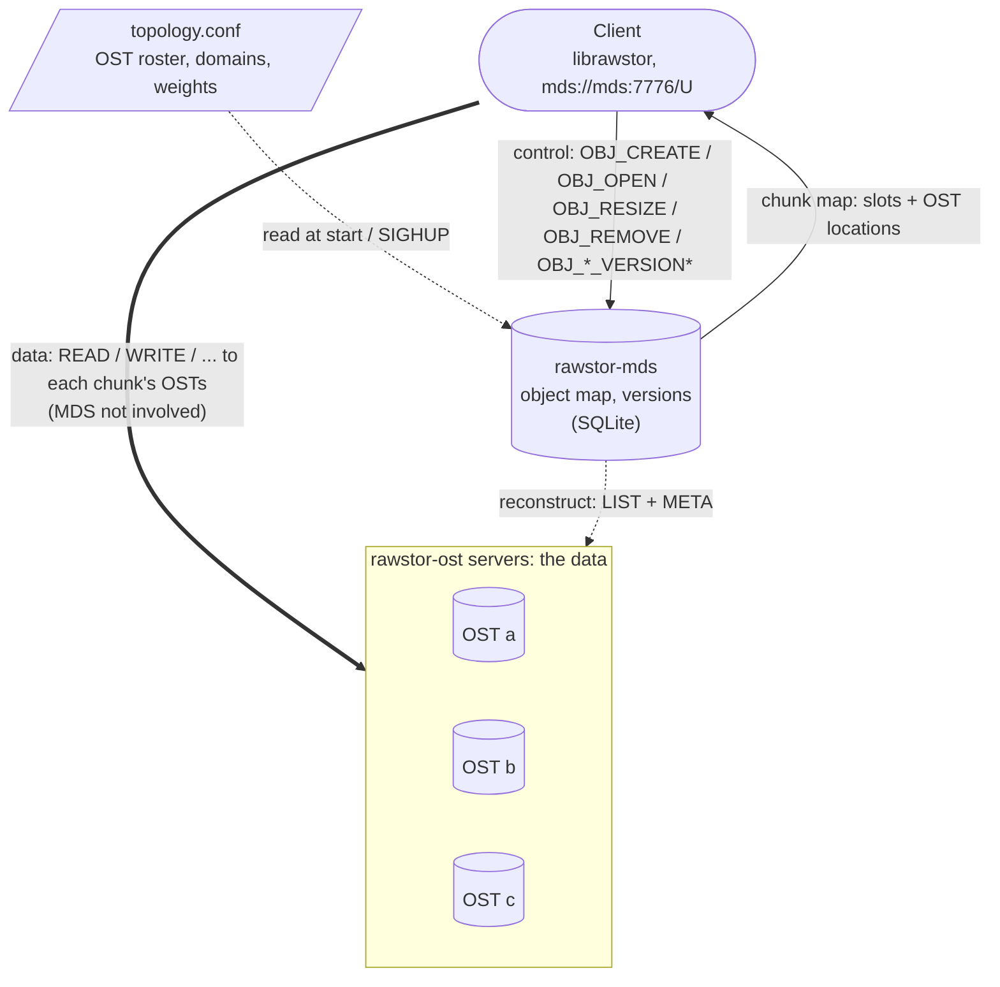
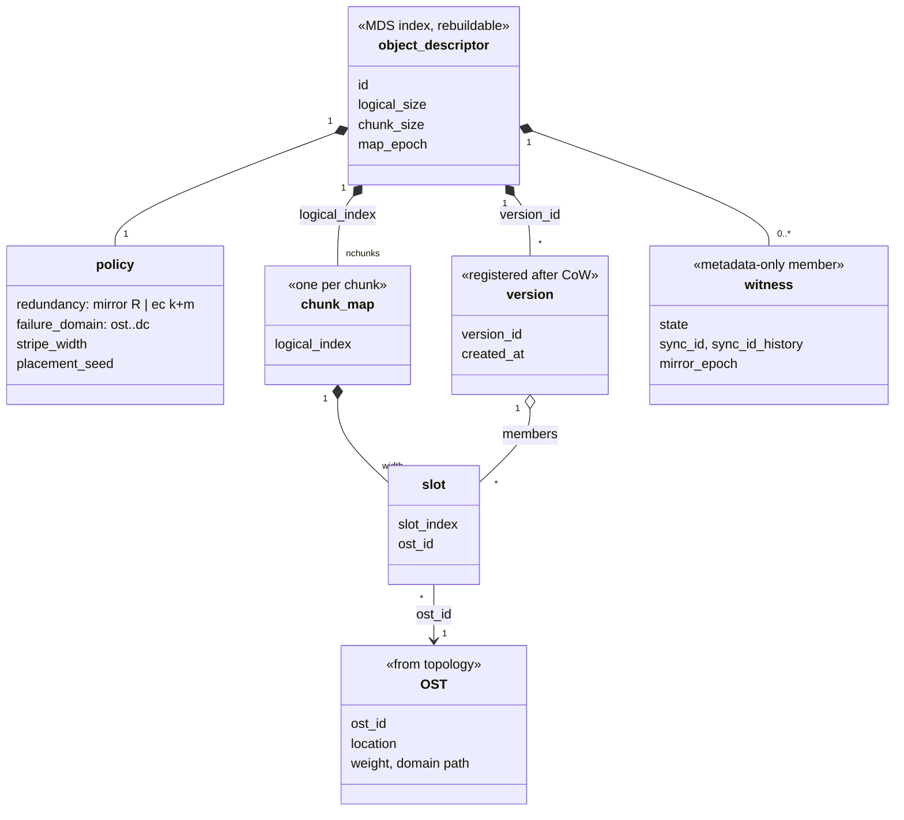
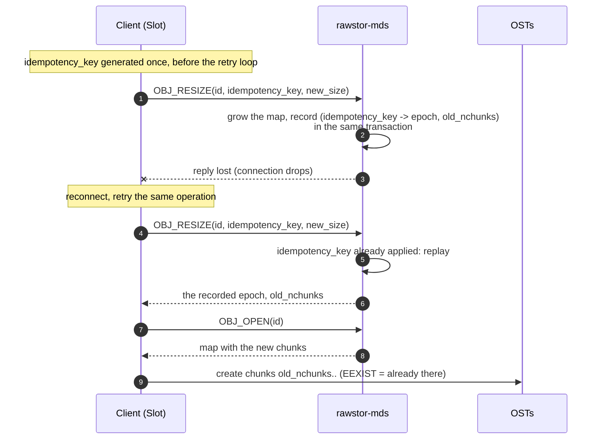
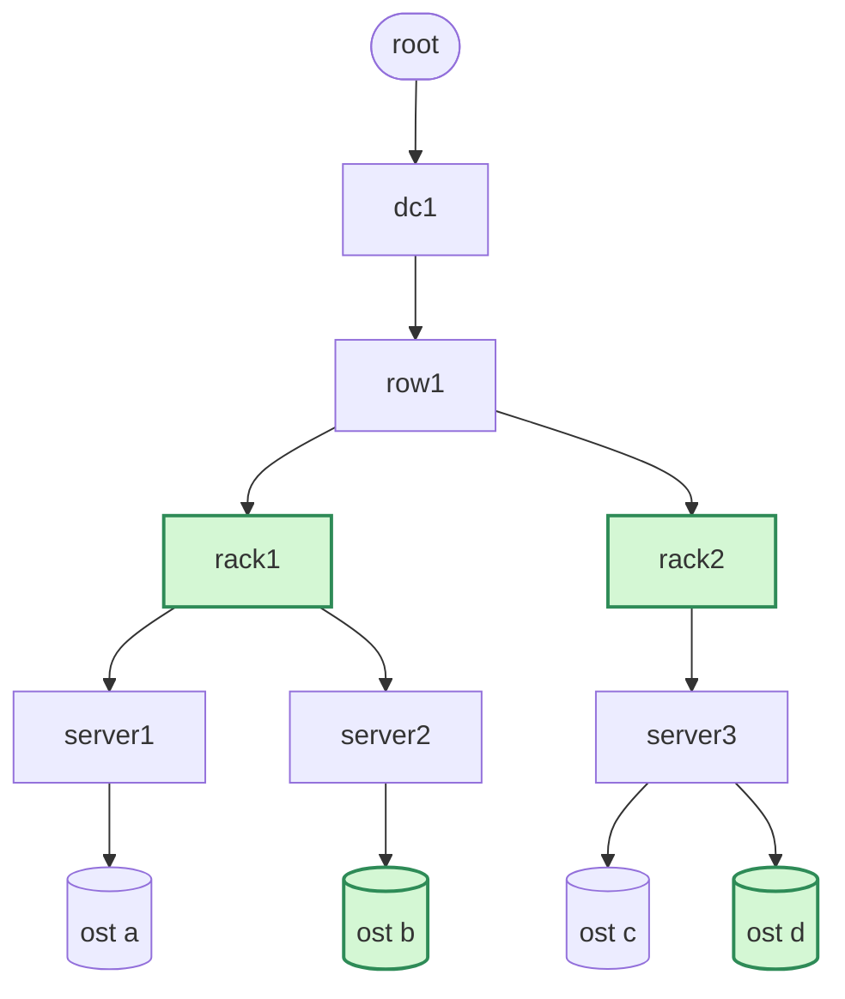
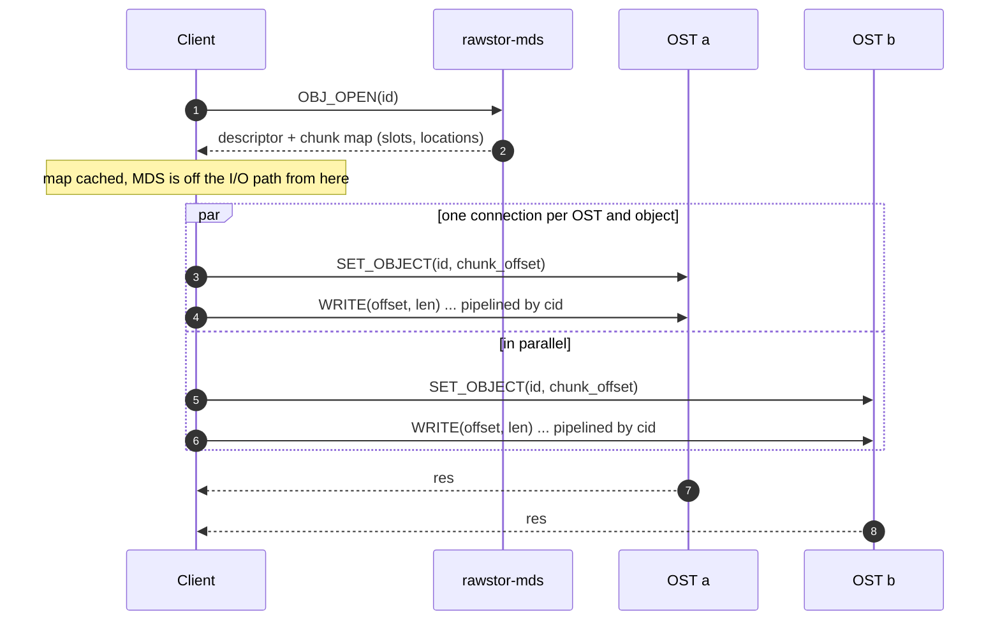
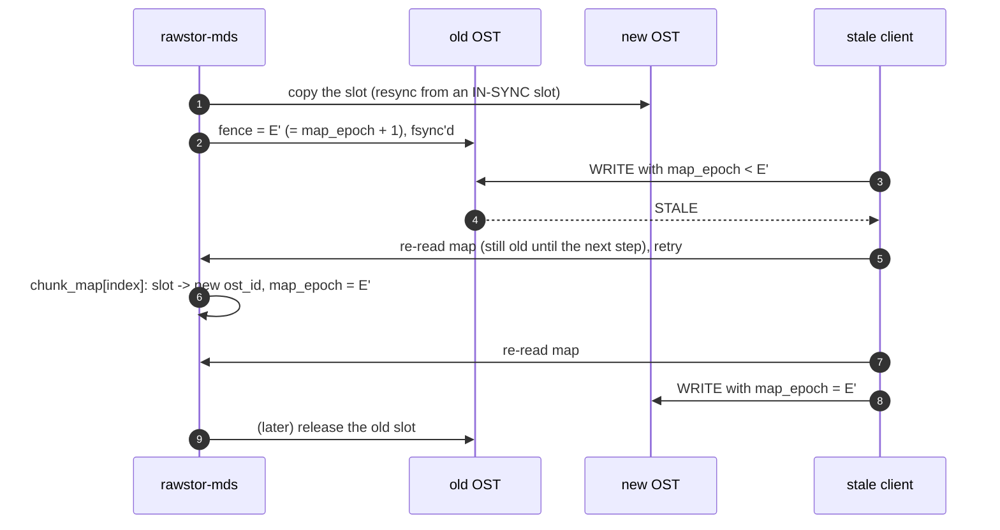
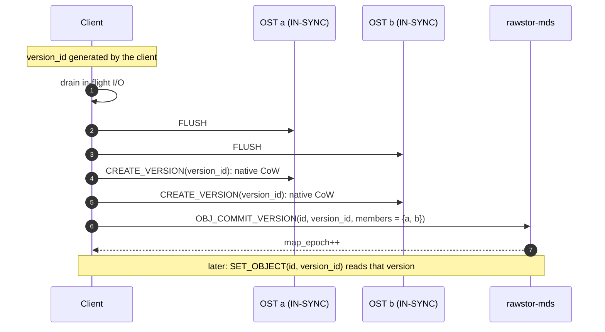
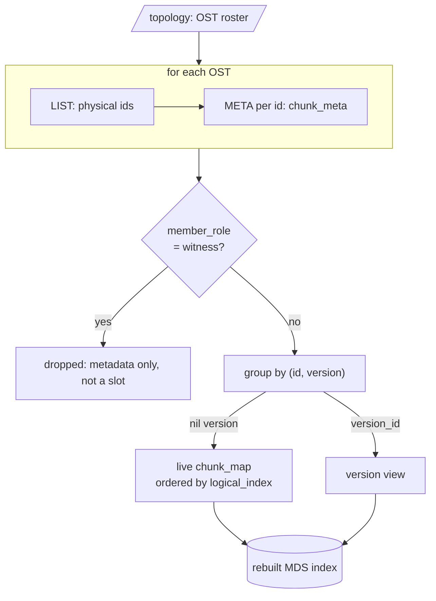

# Rawstor MDS design (block storage)

## Status

Legend: ✅ implemented · 🟡 partial · ❌ not implemented yet. *Stage* is this
document's own numbering (see *Implementation stages*); [Mirroring](mirroring.md)
numbers its stages separately.

| Feature | Stage | Status | Where |
|---|---|---|---|
| `rawstor-mds` server, `-w/--workers` threads | 1 | ✅ | `mds/src/main.cpp`, `mds/src/server.cpp` |
| SQLite store (WAL, `synchronous=FULL`) | 1 | ✅ | `mds/src/store.cpp` |
| `OBJ_CREATE` / `OBJ_OPEN` / `OBJ_RESIZE` / `OBJ_REMOVE` | 1 | ✅ | `mds/src/client.cpp`, `src/mds_backend.cpp` |
| Explicit chunk map, client-side routing by chunk | 1 | ✅ | `src/mds_backend.cpp`, `src/object.cpp` |
| Weighted HRW placement, `failure_domain`, `stripe_width` | 1 | ✅ | `mds/src/placement.cpp` |
| Unsatisfiable topology hard-fails | 1 | ✅ | `mds/src/placement.cpp` |
| Static `topology.conf`, `SIGHUP` reload, refusal to drop OSTs in use | 1 | ✅ | `mds/src/topology.cpp`, `mds/src/main.cpp` |
| Idempotent mutations (`idempotency_key`, `applied_mutations`, 1-day expiry) | 1 | ✅ | `mds/src/store.cpp` |
| Grow-only resize | 1 | ✅ | `mds/src/store.cpp` (shrink refused) |
| `map_epoch` per object | 1 | 🟡 | stored and returned by `OBJ_*`; not sent in IO frames |
| epoch-fence (`slot.fence` watermark on OSTs) | 1 | ❌ | — |
| `updatePlacement` / migration / rebalance | 1 | ❌ | — |
| One connection per (OST, object) serving all its chunks | 1 | 🟡 | one connection pool per chunk slot (`SET_OBJECT` with the chunk offset) |
| `--reconstruct`: rebuild the live map from `LIST` + `META` | 1 | ✅ | `mds/src/main.cpp` |
| `--reconstruct`: register complete versions, collect garbage | 2 | ❌ | version records are skipped |
| Scrub: full MDS serving the same scan from its own index | — | ❌ | — |
| `OBJ_COMMIT_VERSION` / `OBJ_REMOVE_VERSION` / `OBJ_LIST_VERSIONS` | 2 | ✅ | `mds/src/client.cpp`, `src/mds_backend.cpp` |
| Client-generated `version_id`, CoW in descending chunk order | 2 | ✅ | `src/mds_backend.cpp` |
| Native CoW: `zfs://` | 2 | ✅ | `src/zfs_backend.cpp` |
| Native CoW: `lvm://` (thin) | 2 | ❌ | `-ENOTSUP` |
| `file://` versions refused with `-ENOTSUP` | 2 | ✅ | `src/file_backend.cpp` |
| Object removal refused with `-EBUSY` while versions exist | 2 | ✅ | `mds/src/store.cpp` |
| Version redundancy status surfacing | 2 | ❌ | TODO |
| vhost/QEMU flush hook for versions | 2 | ❌ | the CLI assumes no concurrent writer |
| Backend health / `LOCATION_INFO` collector | — | ✅ | `mds/src/monitor.cpp`, `mds/src/opts.cpp` |
| Protocol version + feature bits in `SET_OBJECT` | — | ❌ | — |
| Unified response frame `{res, len, hash}` | — | ❌ | — |
| Witness: metadata-only members and quorum | 3 | ✅ | `src/chunk.cpp`, `Backend::set_config()`, SQLite witness records |
| Witness: durable states, voting rules, synchronous barriers, re-attach | 3 | ✅ | `src/chunk.cpp` |
| MDS replication (primary + log) | v2+ | ❌ | — |
| EC policy | v2+ | ❌ | — |
| Stored checksums / scrub, version redundancy repair | v2+ | ❌ | — |
| Auth / capabilities, shrink, MGS as a service | open | ❌ | — |

Metadata Storage Target (**MDS/MDT**) design, specialized for the **block
storage** use case: sparse (thin) allocation and large object chunks (1+ GiB).

Status: **approved**. Supersedes the earlier draft where the
*Decision revalidation* table below says so. Implementation progress is
tracked in the *Status* table above; see also *Implementation stages*.

See also: [Architecture](architecture.md), [Protocol](protocol.md),
`librawstor/docs/mirroring.md` (quorum rules the witness plugs into).

At a glance: the MDS only answers *where* an object's chunks live; data
never passes through it.



The client-side `mds::Backend` and `ost::Backend` inherit their shared network
transport and member commands from `wire::Backend` (`src/wire_backend.*`).
MDS encodes object commands and decodes their responses directly in
`mds::Backend`, using that same connection and CID response dispatcher. MDS overrides whole-object operations to resolve
its chunk map and route data to the nested object; native witness metadata
uses the protected nonvirtual wire requests directly. OST implements its
virtual member operations by forwarding to those same requests. Shared
`set_config`, `set_state`, and `info` implementations are final in the wire
base class. OST data I/O (`READ`, `WRITE`,
`DISCARD`, `WRITE_ZEROES`, `FLUSH`) is implemented in `ost::Backend`
(`src/ost_backend.cpp`); MDS data I/O routes to its nested object.

## Requirements, in priority order

0. **Allocation and tracking** — answer "which OST hosts which part of which
   object" (`getObj` / `getObjPart` / `getFreeOst` of `architecture.md`, refined
   below) and generate placements at create/grow time. This is the reason MDS
   exists; everything else layers on top.
1. **Version registry** — register client-generated `version_id`s
   and remember which members hold each version.
2. **Witness** — metadata-only quorum member for client-side mirroring
   (restores auto-start for 2 data mirrors with one OST down; see
   `mirroring.md`, Quorum).

Implementation order follows the same list: chunking first, versions second,
witness third. All three are designed here so the later stages land without a
redesign.

## Principles

- **OST side is the durable ground truth.** Every chunk is *self-describing*:
  alongside the chunk data the OST keeps metadata about that chunk itself
  (`chunk_meta`). Losing the MDS map is therefore **not** fatal — it can be
  rebuilt by scanning all OSTs.
- **MDS is an index over that truth.** It is the normal source for
  `openObject`, but it is recoverable, so v1 runs a single instance.
- **MDS is off the hot path — including the moment of a disk failure.** The
  map is read once at object open and cached; degrade decisions during I/O are
  made and recorded by the client on surviving members through synchronous
  configuration barriers, including the witness when declared. The witness
  is updated on first write, degradation, resync completion and clean close;
  see *Witness*.
- **Redundancy is the client's responsibility** (per `architecture.md`). MDS and
  placement only produce *slots*; the client decides what goes in them
  (mirror copies or erasure-coding shards) and does the encode/decode.
- **One wire protocol.** MDS commands are new opcodes in the existing OST
  protocol (`rstr` magic). An OST can therefore serve as a *partial MDS*
  (the shared metadata subset), and a full MDS is a server speaking the same
  protocol without the data opcodes.

Why the explicit map works for block storage: with 1 GiB chunks a 1 TiB object
has **≤ 1024** map entries (a few KiB), so the map is stored **explicitly**
rather than computed (unlike Ceph/CRUSH). The deterministic placement function
is only the *generator* of placements at create/grow time and the reference
used when rebuilding by scan.

| | Ceph (4 MiB objects) | rawstor block (1+ GiB chunks) |
|---|---|---|
| 1 TiB object | ~256 000 objects | **≤ 1024 map entries** |
| Per-object map | huge, computed (CRUSH) | **tiny, stored explicitly** |
| MDS on hot path | — | **no, allocation only** |

## Compatibility stance

There are **no live installations yet**: breaking wire and on-disk formats is
free until the first one. The core decisions here do not lean on backward
compatibility (they would be the same greenfield), but this freedom is used
in four places and spent on one addition:

- **Response frame**: every response becomes `{ int32 res; uint32 len;
  uint64 hash }` + `len` bytes of body — an explicit length field instead of
  overloading `res`, resolving the standing TODO in `protocol.h`. (This is,
  amusingly, the response frame of the rejected separate MDS protocol — the
  frame survives, the magic does not.)
- **No legacy acceptance**: `chunk_meta` starts at `format_version` 1; the
  `.spec` v0 (size-only) acceptance/migration in librawstor is dropped rather
  than carried into the chunked world. Note: `sync_id == 0` is **not** a
  legacy shim and stays — it is the live "blank copy, never part of a sync
  set" marker written at create and relied on by F10 recreate (a blank copy
  with a random `sync_id` would read as split brain at the next open; with
  the current set's `sync_id` it would claim data it does not have).
- **Opcode space**: regrouped into reserved ranges per role (session / data /
  shared metadata / object) instead of appending to one enum — free today, a
  breaking change after the first install.
- The degenerate single-chunk unification (below) is kept as *design* — one
  schema, one code path — not as a migration bridge; there is nothing to
  migrate.
- **Spent on: a version handshake.** This freedom ends at the first live
  install, so the mechanism for future breaks is added now, while it costs
  nothing: protocol version + feature bits in the connection handshake
  (`SET_OBJECT` is already the mandatory first command). Partially covers the
  "capabilities negotiation TBD" of `protocol.md`.

## Decision revalidation (vs the earlier draft)

| Draft decision | Verdict | Why |
|---|---|---|
| Separate MDS wire protocol, distinct magic `rsmd` | **Changed: single protocol with OST** | An OST doubles as a partial MDS (the witness subset — `META`/`SET_CONFIG` — already exists on OSTs today); one framing/parsing stack; misconnection safety comes from `-ENOSYS` on unknown opcodes instead of a magic mismatch |
| Explicit stored map (not CRUSH-computed) | Keep | ≤ 1024 entries/TiB; placement function stays the generator |
| Weighted rendezvous (HRW) placement | Keep | deterministic, minimal reshuffle, stateless, O(N) fine at this scale |
| Hand-rolled packed structs, count prefixes, `format_version` | Keep | codebase idiom, no new dependency |
| Chunk identity rides `RawstorFrameBasicPayload` unchanged | Keep | see *Chunk identity* |
| Opaque stable `ost_id` (UUID), resolved via topology | Keep | required for HRW stability |
| epoch-fence (client cache vs per-chunk hard gate) | Keep, **collapsed + renamed** | one counter `map_epoch` per object; the per-slot fence is a stored *watermark* of it, not a second counter; the mirroring per-copy `mirror_epoch` (already shipped) provably cannot be merged in — see *epoch-fence* |
| Shard by `id`; primary + replicated log per shard; reads from any replica | **Replaced in v1: single MDS instance** | witness availability does not require MDS replication (a dead witness = one lost vote); the map is rebuildable by scan; replication is v2, the epoch/CAS model below is compatible with primary+log |

## Chunk identity

```
logical chunk_id  = (id, chunk_offset, version)
physical chunk_id = (id, chunk_offset, version, slot_index)
```

A logical chunk has `width` slots (`slot_index` 0..width-1); see *Redundancy*.
`version` is a UUID (`version_id`, client-generated like every other id --
never a monotonic counter), carried in its own field of the one payload
every chunk-level command shares:

```c
struct RawstorFrameBasicPayload {
    uint8_t  object_id[16];  // = id
    uint64_t offset;         // = chunk_offset (logical_index * chunk_size)
    uint8_t  version_id[16]; // = version; nil = live
    uint64_t val;
} __attribute__((packed));
```

Every chunk-level command (SET_OBJECT, RELEASE, CREATE_VERSION, META, …) and
OBJ_OPEN rides this payload; `version_id` nil means "live" -- RELEASE
removes the live version this way, and with a non-nil `version_id` the
same command removes that one version. Commands that never bind a version
leave it nil. OBJ_RESIZE, OBJ_REMOVE and OBJ_REMOVE_VERSION ride
`RawstorFrameObjOpPayload { id[16]; idempotency_key[16]; version_id[16];
val; }` instead (see *Idempotent mutations*).
On-OST layout (the slot's home, also where `chunk_meta` lives). `version`
is part of the *logical* identity only: on CoW backends a version materializes as
a **native version of the slot's live volume**, not a separately named one —
naming a volume per version would contradict the version design (stage 2).
`version_id` is a UUID string wherever it appears in a name below, not a
number:

| Backend | Slot home + metadata | Versions (`version_id`) |
|---------|----------------------|----------------------|
| `file://` | dir `<id>/<offset>/`, `data` + `meta` inside it | `-ENOTSUP` in v1 |
| `lvm://`  | thin LV `<id>-<offset>`, meta in LVM tags | thin snapshot LV |
| `zfs://`  | zvol `<id>:<offset>`, meta in user properties | `@s<version_id>` |

(The physical `<offset>` is never omitted, even "0" -- unlike the
target-string syntax's own offset path segment (docs/concepts.md, "Chunk
offset"), a physical name has no ambiguity to avoid by omitting it.
`slot_index` isn't part of the physical name at all: each
mirror of one chunk gets its own URI in the target string that
addresses it -- comma-separated, same as any plain mirrored target --
rather than a naming-scheme component; `-` is LVM's own separator since
its naming forbids `:`.)

### `chunk_meta` — one schema, two layers

Mirroring (implemented) already stores a per-copy consistency tuple on every
backend (`.spec` / LVM tags / ZFS user properties) and moves it over the wire
as `RawstorFrameMetaPayload { size, epoch, sync_id, sync_id_history[4],
state, … }`. `chunk_meta` **extends** that record with placement identity instead
of inventing a second one:

```
chunk_meta {
  magic, format_version
  // placement identity. id/logical_index are not stored here:
  // object_id already *is* id (see above), logical_index is
  // chunk_offset / chunk_size, and chunk_offset rides the wire
  // unconditionally (RawstorFrameBasicPayload.offset above / its own
  // dedicated field on ALLOCATE) -- only chunk_size is stored (needed
  // to invert chunk_offset back into logical_index without a separate
  // lookup).
  chunk_size
  version                  // version_id this slot belongs to; nil = live
  redundancy               // mirror{R} | ec{k,m} — how to decode
  slot_index
  member_role              // data | witness — witness records are metadata-only
                           // and are excluded from the map reconstruct
  created_at, project_id
  // per-slot consistency (exists today, per mirroring.md)
  size, state, mirror_epoch, sync_id, sync_id_history[4]
  data_checksum            // per-slot, v3+ (scrub); reserved
  versions[]               // version list present on this slot; reserved for stage 2
}
```

A present-day plain (non-`mds://`) target is the degenerate case: a
single chunk (`logical_index = 0`, `chunk_size = object size`,
`version = 0`), `width = N`.
One schema and one code path for both worlds — kept as design, not as a
migration bridge (no live installations, nothing to migrate; see
*Compatibility stance*).

`chunk_meta` feeds **two** consumers from one source: the OST's local in-RAM
index (`offset → local slot`, built by one backend scan at startup) and the
global MDS reconstruct.

## MDS data model

```
object_descriptor {
  id, logical_size, chunk_size,
  policy {
    redundancy    = mirror{ copies R } | ec{ data k, parity m },  // width = R | k+m
    failure_domain = ost | server | rack | row | dc,  // level at which slots must differ
    stripe_width  = K | all,               // locality: over how many OSTs spread
    placement_seed
  },
  project_id, created_at,
  map_epoch                              // monotonic, ++ on any map/descriptor
                                         // change (incl. version, resize)
}

chunk_map[logical_index] = {
  slots: [ {slot_index, ost_id} * width ] // who holds each copy/shard
  // physical existence ("materialized") is an OST fact, not tracked strictly
}

versions[version_id] = {                   // version_id: UUID, client-generated
  created_at,
  members: [ost_id],                     // who actually holds it (see Versions)
  view: { logical_index -> version }     // cache over OST-side versions
}

witness[id, chunk_offset] = {
  state,                                 // CLEAN | DIRTY | LOST
  sync_id, sync_id_history[4], mirror_epoch,
  roles[]                                // data and witness member roles
}
```

The same model as a diagram: one descriptor per object, a `chunk_map`
entry per chunk with `width` slots, each slot naming one OST from the
topology; a version records which slots hold it.



Two classes of state, by recoverability:

- `object_descriptor` / `chunk_map` / `versions` — an **index**; DR = rebuild
  by OST scan (below).
- `witness` records (SQLite `witnesses` table) — **not** rebuildable by scan (they *are* the extra vote).
  Losing them degrades availability (auto-start falls back to plain N=2
  rules), never correctness; re-attach is defined in *Witness*.

The topology (OST roster, failure domains, weights, `ost_id -> location`) is
neither: it is operator input, not state the MDS derives, and it lives
**outside the MDS database** (v1: a static config file, `-t/--topology`) on
purpose. Rebuilding the index starts from the OST roster (see *Reconstruct /
DR*), so the roster must survive exactly the loss it is used to recover from —
kept in the same database as the map, losing `mds.db` would also lose the
list of OSTs to scan. Being plain operator-authored config, it is also
versioned and deployed like any other (git, config management). The MDS
reads it at startup and re-reads it on `SIGHUP` (`systemctl reload
rawstor-mds`); either way it is checked against the map: a topology missing
an OST that still holds chunks (or version members) is refused — the MDS
won't start, or keeps its current topology on reload — since those slots
would be left without an address. `--reconstruct` skips the check: it
rebuilds the map from the topology's own OSTs. A dynamic
source (see *MGS as a service* under *Open questions*) would replace the file,
not move the topology into the MDS database.

## MDS API

| Method | When | Hot? |
|--------|------|------|
| `createObject(size, chunk_size, policy) -> {id, map_epoch}` | once | no |
| `openObject(id) -> {descriptor, map_epoch, chunk_map}` | at open | **only hot read**, client-cached |
| `resizeObject(id, new_size)` | grow (v1: grow-only) | no |
| `version(id, version_id)` | version -- `version_id` is client-generated, like `id` itself | no |
| `updatePlacement(id, index, slots)` | rebalance/recovery | rare |
| `removeObject(id)` | delete | no |
| witness get/put | metadata at open, record before first write (incl. witness-assisted degraded open) / clean close / resync-complete / synchronous degrade | no (see Witness) |

Refines `getObj / getObjPart / getFreeOst` from `architecture.md`; `getFreeOst`
is subsumed by the placement function + topology (the client never picks OSTs
ad hoc).

> Optimization (optional, v2+): with deterministic placement the client can
> derive placement locally from `{descriptor + exception-list + topology}`,
> pushing MDS even further off the path. Base design returns the explicit map.

## Idempotent mutations

A control connection can drop after the MDS committed a mutation but before
its reply reached the client. The client's `Slot` then reconnects and retries
the whole operation -- which, applied a second time, either fails for no real
reason (`OBJ_CREATE` -> `EEXIST`, `OBJ_REMOVE` -> `ENOENT`) or, worse, silently
does the wrong thing (a resize that already grew the map "sees" no chunks left
to create). So every mutating request is made idempotent:

- **`idempotency_key`.** `Slot` generates a UUID once per mutating call (create, remove,
  resize, create_version, remove_version), before its retry loop, and every
  attempt carries that same one. `OBJ_CREATE`, `OBJ_RESIZE`, `OBJ_REMOVE`,
  `OBJ_COMMIT_VERSION` and `OBJ_REMOVE_VERSION` send it ([protocol](protocol.md)).
- **The MDS records what it applied.** An `applied_mutations` table maps `idempotency_key` to the
  command, the object and the reply's result, written in the same SQLite
  transaction as the mutation itself -- a committed mutation always has its
  record. A request whose `idempotency_key` is recorded is not applied again: it gets the
  recorded result. An `idempotency_key` recorded for another command or object is
  `EINVAL`. Only successes are recorded (a failed request changed nothing, so a
  retry of it simply runs); records expire after a day, far beyond any retry.
- **Replies carry what a retry needs to finish.** `OBJ_RESIZE` returns the
  chunk count the object grew from, `OBJ_REMOVE` the map the object had --
  both are gone from the MDS's live state once the first attempt applied them.
- **The client's own part is resumable.**
  - *create*: a failure while creating the chunks rolls back (copies, then the
    object via its own `idempotency_key`); a retry of the original `idempotency_key` whose object is
    gone creates it afresh.
  - *resize*: creates the chunks from the returned count on, one copy at a
    time; an `EEXIST` copy was made by an earlier attempt and counts as done.
    No rollback: the chunks are in the map, and a retry fills in the rest.
  - *remove*: destroys the chunks of the returned map (`ENOENT` tolerated).
  - *version*: a CoW copy that already exists (`EEXIST`) was taken by an
    earlier attempt (the `version_id` is unique to the call); the commit then
    replays.
  - *version remove*: destroys the replayed member set.



## Wire protocol: one protocol, role subsets

Same `rstr` magic, same frame heads, one response frame for everything
(`{res, len, hash}` + body — see *Compatibility stance*). Opcodes live in
reserved ranges per role:

```
0x00    session:         SET_OBJECT                    // handshake, every role
0x01..  data:            READ, WRITE, DISCARD, ALLOCATE, RELEASE, FLUSH
0x40..  object (MDS):    OBJ_CREATE, OBJ_OPEN, OBJ_RESIZE, OBJ_REMOVE,
                         OBJ_COMMIT_VERSION, OBJ_REMOVE_VERSION,
                         OBJ_LIST_VERSIONS
```

- `SET_OBJECT` is the mandatory first command on **every** connection and
  uses `RawstorFrameBasicPayload` for the object/chunk/version binding and
  open flags. Protocol version and feature bits are not implemented.
  On control connections
  (object commands only) the binding is null — which is why it sits in its
  own *session* group, implemented by every role, not in the data group.
- A server answers `-ENOSYS` to any opcode outside its role — the existing
  convention; this is also the misconnection guard that the separate magic
  used to provide.

Role matrix:

| Opcode group | OST | OST as partial MDS | full MDS |
|---|---|---|---|
| session (`SET_OBJECT`) | yes | yes | yes |
| data (`READ`,`WRITE`,`DISCARD`,`FLUSH`) | yes | yes | no (`-ENOSYS`) |
| member lifecycle (`ALLOCATE`,`RELEASE`) | yes | yes | witness members only |
| member metadata (`META`, `SET_CONFIG`) | yes | yes | witness members only |
| member listing (`LIST` + `META`) | yes | yes | yes |
| reconstruct scan (`LIST` + member `META`) | yes | yes | `LIST` serves registered objects and native witnesses |
| object commands (`CMD_OBJ_*`) | no | optional | yes |

Consequence: **a witness needs no new server.** A metadata-only
member on a plain `rawstor-ost` already speaks the witness subset.

Example `CMD_OBJ_OPEN`:
```
req  body: { id[16], version_id[16] }                      // nil = live
resp: { res, len, hash }; body:
      { descriptor{...}, nchunks u32,
        entry[nchunks] { width u8,
                         (slot_index u8, ost_id[16], location_len u16,
                          location[location_len]) * width } }
```

`ost_id` is an **opaque stable UUID** (not its location) — required for HRW
stability; resolved to a location URI via topology (v1: static config, see
MGS) and sent along with it, so clients stay zero-config. The location is
any single rawstor location URI (normally `ost://host:port`), handed to the
client as is: moving an OST only changes its location, never its id.
A topology entry holds exactly one URI (several are rejected): an entry
is one placement slot, i.e. one member with one vote in the mirror
quorum. To back one entry with several stores, run a `rawstor-ost` over
them (`rawstor-ost -b ADDR file:///a,file:///b`) and list that OST — it
mirrors across them itself and still counts as one member.

## Placement function

Role: `place(id, index, topology) -> [ (slot_index, ost_id) * width ]`.
Used only at create/grow (generate the plan) and at rebalance/recovery (where
to put a rebuilt slot). The MDS map stays authoritative; the function is a
generator.

- **Algorithm: weighted rendezvous (HRW)** hashing — deterministic, capacity-
  weighted, minimal reshuffle on topology change, distinct slots = top-N, no
  state. O(N) per lookup is fine (small N, rare lookups). Scores hash with
  `rawstd_hash_stable()` (FNV-1a with a 64-bit finalizer), so placement is
  the same whether or not the MDS is built with libxxhash.
- **Topology = tree**: `root -> dc -> row -> rack -> server -> ost(leaf)`
  (a topology line's path is `[[[dc/]row/]rack/]server`, root first,
  ending at the OST's server; only the server is required, and a leading
  level left out is one implicit domain shared by every entry leaving it
  out). Levels are numbered from
  the leaf up (`RAWSTOR_OBJ_DOMAIN_OST = 1` ... `DC = 5`, 0 = unset, i.e. the
  client's default, server), so a wider level such as a region only ever
  takes the next number. Weights
  aggregate up the tree; `ost_id -> host:port` resolved from the same source
  (v1: static config).
- **Hierarchical HRW** descends the tree, choosing `width` slots so that **no
  failure-domain holds more than `m` shards** (mirror: ≤ 1 copy per domain),
  making a domain loss survivable.

```
place(id, index):
  slots = HRW_choose(width, level=failure_domain, key)  // distinct domains
  for s in slots: ost = HRW_descend_to_leaf(s, key)
  return [(slot_index, ost) ...]
```

For example, `width = 2` with `failure_domain = rack`: HRW picks two
distinct racks, then descends each to one OST (highlighted), so losing a
whole rack loses at most one copy.



- **Locality knob: `stripe_width` stays a number `K`** (the draft's
  alternative `locality_level` is dropped — `K` already spans the whole
  spectrum and a level form can be layered later as sugar over K + topology).
  Slot separation is the independent axis, always at `failure_domain`:

| stripe_width | HRW key | behavior |
|---|---|---|
| `K=1` (local) | `id` only | all chunks -> same OSTs (DRBD-like), still domain-separated |
| `K=all` (spread) | `(id, index)` | each chunk independent (Ceph-like) |
| `K` partial | pool of K by `id`, then `(id, index)` within | stripe over a subset |

- **Unsatisfiable topology hard-fails.** If `R`/`failure_domain` cannot be met
  (need 3 racks, have 2), `createObject` fails; it does not silently place an
  under-protected object. The same rule holds at recovery time: if a rebuilt
  slot cannot be placed without violating domain-distinctness, the chunk stays
  explicitly degraded and is reported — an operator may relax the policy, the
  system never does it silently. (Design-by-construction: "protected by
  policy" is an invariant, not a best effort.)

## Redundancy

Placement produces `width` domain-distinct slots; the **client** fills and
reads them per the scheme (encode/decode is client-side):

| Scheme | width | slot content | write | read |
|--------|-------|--------------|-------|------|
| mirror R | `R` | full copy | write all R | read any 1 |
| EC k+m | `k+m` | shard (data/parity) | encode, write k+m | read any k, decode |

- Physical shard size under EC = `chunk_size / k` (e.g. 256 MiB at k=4 for a
  1 GiB logical chunk).
- `mirror` is implemented first; `EC` is a future **policy**, not a redesign —
  the slot model (`width` + `slot_index`) and `chunk_meta.redundancy` already
  carry it.

## I/O path (MDS not involved)

```
client holds the cached map: which OST owns which (logical_index, slot)
  |
  |- splits the request at chunk boundaries ONLY to pick owning OST(s)
  |- encodes per redundancy (mirror: copy; EC: shards)
  '- one connection per (OST, object):
        SET_OBJECT(id, version_id; nil = live)              <- once
        READ/WRITE(offset = logical object offset, len)  <- many, pipelined by cid
              '- OST: offset -> local slot -> backing file/LV/zvol
```

- IO frame **unchanged** — `offset` stays the 64-bit logical object offset.
- **One connection per (OST, object)** serves all of that OST's chunks.
- Client needs `chunk_size` only for **routing**, not for addressing inside an OST.



## epoch-fence

One placement counter per object; the fence is a stored watermark of it, not
a second counter:

- `object.map_epoch` — the **only** placement counter. ++ on any map change,
  rides in every IO frame (advisory freshness hint), and doubles as the CAS
  token for MDS mutations.
- `slot.fence` on the OST — a **watermark**: the `map_epoch` value at which
  this slot's placement moved away, recorded on the **old** owner
  (migration/recovery only).

`write: if client_map_epoch < slot.fence -> STALE -> client re-reads map ->
retry`. Version creation and resize bump `map_epoch` but record no watermark on any
slot, so they *cannot* STALE anything — the "no STALE storm on un-migrated
chunks" property is structural, not a convention about when to raise a gate.

### Why `mirror_epoch` does not collapse into it

Merging the mirroring per-copy `mirror_epoch` into the map/fence numbering
fails by counterexample: a degrade bump is written by the client to the
surviving arms only, with no MDS round-trip (the hot-path requirement). If it
shared the fence numbering, the surviving client would either fence *itself*
out (its cached `map_epoch` is now behind the value it just wrote to the
survivors) or need the MDS at the failure moment — both unacceptable. The two
also differ in scope and writer: `map_epoch` is per-object, MDS-issued, and
versions *placement*; `mirror_epoch` is per slot-set, client-issued, versions
*membership health*, and is part of the durable consistency tuple on arms and
witness. (Within mirroring, `mirror_epoch` vs `sync_id` is likewise left
alone: ancestry is derivable from `sync_id_history`, but the epoch is the
cheap total order and the guard against history-window overflow, and it is
already shipped.)

### Migration / `updatePlacement` sequence

The fence must land on the **old owner** — that is the only OST a stale client
still talks to:

```
1. copy the slot to the new OST (resync machinery, source = an IN-SYNC slot)
2. MDS reserves E' = map_epoch + 1; record E' as slot.fence on the OLD owner (fsync'd)
3. MDS: chunk_map[index] slot -> new ost_id, publish map_epoch = E'
4. (later) release the old slot
```



Counterexample that fixes the order: fence only the *new* OST (or update the
map first) and a client with a cached map keeps writing to the old OST
indefinitely — nothing it touches ever says `STALE`, acknowledged writes land
on a slot the map no longer references, and are lost after step 4. The fence
must carry the *reserved upcoming* epoch: between steps 2 and 3 a stale
client's write hits the fence, re-reads a not-yet-updated map and retries — a
benign transient that resolves at step 3; the reverse order (map before
fence) instead opens a window of silently lost writes.

If the old owner is unreachable (the usual *reason* for the migration), step 2
cannot execute; then the slot may be reassigned only when the old OST is
marked **decommissioned** in the topology. If it ever comes back anyway, its
copy is stale by mirror metadata (`sync_id` ancestry) and is caught at the
mirroring layer — defense in depth, not the primary guard.

## Versions (stage 2)

Versions are **OST-side CoW** (native zfs/lvm-thin); the MDS only registers
them. Coordination is **client-driven**, per the mirroring identity model:
drain + FLUSH first, so a version is a crash-consistent point across all
members, and only IN-SYNC members participate.

`version_id` is a UUID, generated by the client itself before any of this
starts -- the same single point of generation every other id comes from
(no round trip to reserve one: a client-generated id can't collide with a
crashed attempt's leftovers, because there is no shared counter to leave
a hole in):

```
create_version(id, version_id):
  client: drain in-flight I/O, FLUSH all IN-SYNC members   (point-in-time barrier)
  OST*:   each IN-SYNC member -> backend CoW (zfs snapshot zvol@s<version_id> / lvcreate -s)
  MDS:    OBJ_COMMIT_VERSION -> record versions[version_id] { members = the IN-SYNC set },
                             map_epoch++ -- rejects a version_id already registered (EEXIST,
                             the versions table's own primary key) or nil (EINVAL, reserved
                             for the live version)
  read:   client SET_OBJECT(id, version_id) -> OST serves that version
```



A crash before commit leaves unregistered native versions on the OSTs —
the same garbage class as a crashed deletion, reconciled by the
reconstruct scan (below).

- **`version` in chunk identity = `version_id`** (nil = live). One namespace, no
  separate counter.
- **In-sync versions are immutable → they never resync.** A member that was
  STALE at version time simply does not have that version; rejoin/resync
  covers the live version only (v1).
- **Degraded objects:** the version is taken on the IN-SYNC members only and
  `versions[version_id].members` records exactly who holds it. Version reads
  route only to recorded members. A version may therefore have less
  redundancy than the object policy; this is surfaced in status, not silently
  repaired (v1; a repair = copy of an immutable version, safe to add later).
- **Deletion:** MDS unregisters first (no new readers), then fan-out destroy
  on members; the reconstruct scan reconciles leftovers from a crash between
  the two steps (an unreferenced version found on an OST is garbage,
  collectable).
- **`file://` backend has no CoW** → `create-version` on an object with `file://`
  members fails with `-ENOTSUP` in v1 (no fallback copies behind the caller's
  back).

**v1 notes (shipped):**

- **Classic LVM is `-ENOTSUP` too.** This section says lvm-*thin* for a
  reason: a classic LVM snapshot needs a preallocated COW area — a hidden
  full-size copy is exactly the fallback ruled out above. CoW on LVM waits
  for an lvm-thin backend. zfs is the v1 CoW backend: versions are
  `<parent>/<uuid>@s<version_id>` (the `@s<id>` name *is* the version key —
  nothing stored twice; `snapdev=visible` is set with every version so
  each one that exists is also openable), read via
  `/dev/zvol/…@s<id>`, read-only at the device level too.
- **Reads:** a trailing version path segment on the regular open
  (`mds://host:port/<id>/0/<version_id>`, `ost://…/<uuid>/0/<version_id>` -- the
  offset segment is mandatory once a version follows it,
  docs/concepts.md's own "Chunk offset"), `version_id` a UUID
  string; the wire carries it in SET_OBJECT's/OBJ_OPEN's own
  `version_id[16]` field (`RawstorFrameBasicPayload`), and META answers
  about that version's own copy the same way. Opening a
  version **bypasses the mirror state machine
  entirely** — no metadata compare, no quorum, no barriers, no resync, no
  probe. That is not just an optimization: the frozen copy state is DIRTY
  (versions are taken mid-session), which the live open logic would
  treat as a crash to recover from. Immutability is what makes the bypass
  sound: one reachable member serves, writes fail with EROFS.
- **The id can never alias a leftover of a crashed attempt**, without any
  reservation step: `version_id` is a client-generated UUID (like every
  other id in this design), not a monotonic counter with a "next" value
  a crash could leave pointing at something already used. `OBJ_COMMIT_VERSION`
  itself is the only uniqueness check that's needed — the `versions`
  table's own primary key rejects a duplicate `(id, version_id)` with
  `EEXIST`.
- **Chunks are CoW'd in descending index order** (chunk 0 last). A crashed
  attempt therefore always leaves a hole at the low indices, and the
  reconstruct scan can never mistake a partial leftover for a complete
  (legitimately shorter, pre-resize) version: a contiguous `0..max`
  version proves itself, because index 0 exists only when every higher
  index was already done. Complete versions found by the scan are
  registered even if the commit never landed — they are indistinguishable
  from committed ones and just as consistent (drain + FLUSH preceded the
  CoWs); holed versions stay unregistered garbage.
- **Object deletion order matches version deletion**: the MDS
  unregisters the map first — which is also where "the object still has
  versions" refuses with `-EBUSY` *before* any data is touched — then
  the chunk objects are destroyed.
- **v1 caveat:** the CLI-driven version creation assumes no concurrent writer —
  the drain barrier is the writing client's duty and lives in its
  process; a vhost/QEMU flush hook is future work. Version redundancy
  status surfacing is still TODO.

## Witness

Witness members use ordinary backend URIs: `ost://host:port`,
`mds://host:port`, `file:///path`, `lvm://vg` or `zfs://pool/rawstor`.
The URI contains only the address. Creation makes the last location a
witness when the chunk has `width + 1`
locations and `width` is even and at least two. With `width` locations, all
members store data. Each member reports its own type
through `META.member_role`, and an available member's reported role is
preserved. Unavailable members appear as zero-filled `UNREACHABLE` entries
in target metadata. When opening a chunk, the expected role of an unavailable
last member is inferred from the data width reported by an available member:
an even `width` with `width + 1` locations declares a witness. This inference
guides recovery and does not depend on the recorded configuration. No extra
position field is stored.
One witness per chunk is supported, only alongside an even number of data
members (2, 4, 6, ...). Odd data-member counts are rejected with `EINVAL`.
The ordinary create path creates it with the other members; `width` counts
only data copies, while `config.nroles` includes the witness. MDS witness records are independent of the object map:
a witness can serve an explicitly addressed chunk without an MDS object
registration. An `mds://` object's placement does not automatically add one.

For example, create a two-copy object with a witness on MDS:

```sh
rawstor create -s 1G -m 2 'ost://10.0.0.11:9090,ost://10.0.0.12:9090,mds://10.0.0.13:9091'
```

The mirroring model supports several writer queues within one process (see
[Model and assumptions](mirroring.md#model-and-assumptions)); this feature
does not add writer exclusion or distributed mirror synchronization.

Use the returned complete target, including the witness, for subsequent
opens. Member ordering and the member set must stay fixed. Interprocess
coordination between independently attached writers is multiattach stage 2
and is not implemented by this feature.

`Backend::set_config()` atomically stores the record's state and configuration.
The OST transports it using `SET_CONFIG`; MDS commits it in SQLite WAL with
`synchronous=FULL`. The block backends use their existing metadata format:
file witnesses keep an empty data file plus metadata, LVM witnesses use a
minimum-size LV and its tag, and ZFS witnesses use a minimum-size zvol and its
property. All BLK members persist the requested logical size in native
metadata (format version 1), independently of file length, LV extents or
zvol allocation. MDS witness records retain the same declared size. Witnesses
can answer spec queries when data members are unavailable, but receive no
data I/O and never participate in resync or snapshot CoW. Creating or removing
a witness snapshot through Slot is a no-op. Target snapshot creation skips an
unavailable trailing witness when a reachable member's width confirms its
expected role; unavailable data members still fail the operation. DATA opens
use the logical size returned by META without comparing physical capacity. An OST hosting a witness must have
one underlying location. MDS discovers witness records from metadata and
forwards their member operations through the same shared protocol; its
ordinary object placement API remains separate.

This stage is implemented before [multi-attach Stage 2](multiattach.md#implementation-stages).
The recovery rules below describe shared in-process writer control. To support
writers on different processes and machines, the witness must also be a
durable CASPaxos acceptor for each chunk's configuration register, storing
`promised`, `accepted` and the accepted configuration. It confirms
`SYNC_PREPARE` / `SYNC_ACCEPT` only after persisting the transition.
Two data copies and their witness then provide three register votes; any
two form a majority. The witness is omitted from data I/O; its role remains in the complete
configuration and target member numbering.

In multi-attach Stage 2, excluding a failed data member needs this register
quorum before writes resume under the new epoch. The synchronous witness updates below provide in-process recovery;
they do not supply CASPaxos votes for multi-attach transitions.

A witness is a **metadata-only member** of a chunk's quorum: it
stores the consistency tuple (`state`-like record, `sync_id`,
`sync_id_history`, `mirror_epoch`) and holds no data. For N=2 data mirrors it
is the third vote that restores auto-start with one OST down. Implementation:
any server speaking the witness subset (`ALLOCATE`/`META`/`SET_CONFIG`/`RELEASE`) — a plain OST, an
OST doubling as partial MDS, or the MDS itself. The member appears in the
target list like any other member; data I/O and resync skip it. Its stored
record carries `member_role = witness` (see `chunk_meta`), so the
reconstruct scan (`LIST` + per-object `META`) never mistakes the witness
host for a data slot.

### Membership barriers

The witness participates in the same synchronous configuration barriers as
other members. It stores `epoch`, `sync_id`, history and the complete role
array; its own role is IN_SYNC when it records the candidate configuration,
or EXCLUDED when it cannot do so. It uses CLEAN, DIRTY and LOST states:
CLEAN follows successful data-member departure only when those data records
are actually CLEAN (LOST is sticky until explicitly cleared); DIRTY records a writable
configuration, and LOST invalidates its vote. It has no data writer sessions.

| Moment | Durable record before dependent acknowledgements |
|---|---|
| creation | initial generation on all data members, then CLEAN witness |
| first write / read-repair | DIRTY witness and consistent member configuration |
| runtime degradation | new generation and surviving composition on data members and witness |
| resync completion | configuration including the promoted data member and DIRTY witness |
| clean close | data members depart and close cleanly, then CLEAN witness |

Configuration updates to data members may run in parallel. The barrier waits
for data updates and the witness update, excludes failed members, records the
resulting composition on successful members, and checks the write quorum.
No witness operation is issued for ordinary data writes between barriers.
If the witness update fails, a data majority can continue with the witness
excluded. Half the data copies cannot continue without its durable vote;
the write fails and writes freeze. An empty witness can be re-created only
through a data majority.

A witness-assisted degraded open records a fresh generation before its first
write. If a transition is interrupted, mismatching configurations cannot
combine to supply a witness-assisted quorum. A reachable data majority can
reconcile generations through the usual history rules. Failed transitions
may reduce availability; they cannot justify an acknowledgement without a
write quorum.

### Voting rule

With N data members and one witness, a quorum is strictly more than
(N + 1) / 2 members. The witness is accepted at open only together with enough
actual data copies that match its entire configuration: `epoch`, `sync_id`,
history and role array. Those data members and the witness itself must be
recorded IN_SYNC. A CLEAN witness additionally requires CLEAN data members;
a DIRTY witness can endorse matching data members after an unclean close.
LOST, an empty record, a missing member or a mismatching configuration cannot
supply a witness vote. A blank copy recreated during this open cannot vote.

| Data copies | Minimum data copies with a valid witness | Minimum without witness |
|---|---|---|
| 2 | 1 | 2 |
| 4 | 2 | 3 |
| 6 | 3 | 4 |

These thresholds apply to both automatic writable opening and runtime writes.
Runtime data votes count only IN_SYNC members. A data-only open majority may
also include stale real copies: it contains the newest generation, and
reconciliation chooses the actual data source. Read-only opening retains the
existing relaxed inspection semantics and never updates witnesses.

The metadata vote establishes which generation is current; it cannot replace
a data copy or recover data lost by every authoritative copy. The existing
data durability and flush contract still applies. Writer queues share MirrorControl and its transition lock within one
process; multiattach stage 2 across processes is not implemented.

Independently of voting, a witness carrying a newer generation vetoes
ancestor data copies through `sync_id_history`. For example, after A and W
record S2, stale B at S1 cannot start with W, even if A is unavailable.
For four copies, W may endorse two matching survivors, but a later transition
must synchronously update W before acknowledging writes on another set.

Witness durability assumes acknowledged metadata is never rolled back.
When replacing an MDS database from backup, discard backed-up witness
records, reconstruct the object map, and re-attach empty witnesses through a
data majority. Reconstructing a current database preserves its witnesses.
Missing data members can be recreated through an established quorum and then
resynced; they contribute no vote until they hold the data.
`rawstor resolve` invalidates witnesses to LOST before changing data winners
and aborts if that invalidation cannot be persisted.

### Witness in the chunked world

Witness records are per `(id, chunk_offset)` — chunks degrade
independently in general. With `stripe_width K=1` (all chunks on the same
OSTs) member loss degrades every chunk identically; the record may be stored
once per object with the index dimension collapsed (an optimization of the
same schema, decided at descriptor level).

## MDS server, v1: single instance

One `rawstor-mds` process, no replication in v1. Justification: the map is
rebuildable by scan; witness loss costs one vote (availability), not
correctness; and a witness for the *data* quorum does not itself need to be
replicated. Replication (primary + log shipping, reads from any replica with
the `map_epoch` fence catching lagging reads) is reserved for v2 — the
epoch/CAS data model here is already compatible with it.

Within that one process, `-w/--workers N` (default 4) worker threads each
run their own I/O queue and client sessions, all accepting on one listening
socket, like `rawstor-ost`. They share one store: a single SQLite
connection, every store call serialized by a mutex. SQLite never sees
concurrent use of the connection, and a read-then-write mutation (e.g.
resize reading the descriptor before its transaction) can't race another
worker's; mutations are rare enough that serializing them costs nothing.

### Storage engine

Requirements: kilobyte-scale data, rare mutations, `fsync`-grade durability
per mutation (witness records above all), crash-atomicity, one deployable
binary.

| Option | Verdict |
|---|---|
| PostgreSQL | **Rejected.** An external server and its operational surface for kilobytes of state; breaks "MDS = one binary"; v2 replication must follow the epoch model anyway, not a DBMS's |
| Own format (append-log + version, or per-object files à la `.spec`) | Viable, zero dependencies, codebase style — but the fsync-ordering / torn-write / atomic-rename protocol must be designed and proven by us, and every schema change is manual |
| **SQLite** (WAL mode; `synchronous=FULL` for witness and map mutations) | **Chosen.** Crash-safety and transactional atomicity by construction rather than by our own proof; trivial schema migrations; ubiquitous, dependency-wise in the same class as liburing/xxhash. Mutations are rare and synchronous under the shared store mutex on the MDS worker handling the request |

The asymmetry of the two state classes (map = recoverable cache, witness =
authoritative votes) does not force a hybrid: SQLite serves both, with the
witness tables being the reason `synchronous=FULL` is non-negotiable.

## Reconstruct / DR

```
rebuild the map:
  get the OST roster from topology (v1: static config)
  for each OST: LIST -> physical ids, then per id: META -> chunk_meta
  drop member_role = witness records (metadata-only, not slots)
  group by (id, version): nil version -> live chunk_map,
                                 version = version_id -> version view
  within each group: order by logical_index
  -> reassembled maps (+ version views)
```



No dedicated batch scan opcode: this is the same `LIST` + per-object `META`
a caller composing the scan itself would do anyway, at O(n) round trips
per OST rather than one — an acceptable cost for a scan that only runs on
`rawstor-mds --reconstruct`, not a hot path -- no use case needs the
round-trip savings badly enough to justify a second code path.

This same scan doubles as a scrub / consistency check. Witness records are
**not** reconstructed (see the two state classes); after a from-scratch
database replacement every lost witness abstains until clients re-attach records in the course
of normal opens/closes.

**v1 notes (shipped as `rawstor-mds --reconstruct`, scan before serving):**

- **No partial scans, by construction:** every OST of the topology must
  answer `LIST` or the reconstruct aborts outright. A half scan would
  silently drop the unanswered OST's live copies from the map; an OST that
  is really gone is removed from the topology first — an explicit
  operator decision, not a timeout. One object's own `META` failing on an
  OST that otherwise answered is a softer case: that one record is
  skipped (logged), the same "salvage the readable copies" tolerance the
  next bullet's degraded-chunk handling already relies on.
- **The map is restored, the policy knobs are not.** `failure_domain`,
  `stripe_width` and the placement seed are deliberately not persisted on
  chunks (descriptor-only state); the rebuilt descriptor gets the weakest
  constraints (per-OST domain, spread), `width` comes from the records.
  Existing chunks keep their placement — the map is explicit — so only a
  post-disaster resize places new chunks under the reset policy.
- **Degraded chunks reconstruct degraded:** a chunk with some copies lost
  keeps its surviving slots and `OBJ_OPEN` serves them (the mirror layer
  owns the redundancy question). A chunk with **no** surviving copy fails
  the whole reconstruct loudly — the MDS must not pretend the object is
  whole, and it cannot invent data.
- Every chunk is exactly `chunk_size` (an object's size is always a
  multiple of it, checked at create and resize), so the reconstructed
  `logical_size` is simply the chunk count times `chunk_size` — a copy's
  own stored size, which a block backend may round up (LVM extent, ZFS
  volblocksize), plays no part.
- Version records are skipped (stage 2); the full MDS serving the
  same `LIST` + per-object `META` scan from its own index (the scrub
  comparison) is not implemented yet.

## Implemented protocol and deferred extensions

The authoritative layouts are in `include/rawstor/protocol.h` and
[Protocol](protocol.md). The current protocol has one `rstr` command space,
a response head plus `{hash, res}` body (`res` is the following payload's
length), and a Basic `SET_OBJECT` handshake with object/chunk/version and
open flags. I/O offsets are local to the chunk bound by that handshake.

Witness metadata uses the existing 360-byte Meta record: state encodes
`CLEAN` / `DIRTY` / `LOST`, and `config.roles` identifies
survivors in member order.
`SET_CONFIG` atomically persists state plus
configuration using the existing SetConfig request layout. Ordinary `LIST`
reports both registered objects and native witness records on MDS. Internally,
a listing group with empty offsets addresses a whole object; `{0}` addresses
one physical chunk at offset zero. MDS converts registered-object rows to
empty offsets and preserves all offsets of native witness records. No data
I/O or CoW operation is issued to a witness.

Protocol version/feature negotiation and an I/O `map_epoch` fence are
future extensions. The current client still tolerates `-ENOSYS` from
configuration-only `SET_CONFIG`; state updates require support for
the optional state field.
Interprocess mirror coordination remains multiattach stage 2.

## Implementation stages

1. **Chunking**: `CMD_OBJ_CREATE/OPEN/RESIZE/REMOVE`, HRW placement + topology config,
   explicit map in MDS (SQLite), client-side routing, `map_epoch` + fence watermark,
   `LIST` + per-object `META` reconstruct scan.
2. **Versions**: `CMD_OBJ_COMMIT_VERSION/REMOVE_VERSION/LIST_VERSIONS`, client-generated UUID
   `version`/`version_id` in chunk identity, member-set registry, deletion,
   `-ENOTSUP` on `file://`.
3. **Witness**: metadata-only member in the target list, durable member states
   + voting rules in the client quorum logic, synchronous membership barriers,
   re-attach.
4. **v2+**: MDS replication (primary + log), EC policy, persistent
   write-intent bitmap interplay, version redundancy repair, stored
   checksums / scrub.

## Open questions

- **Auth / capabilities** — TBD at the protocol level (OST and MDS alike).
- **EC details** — codec, read-repair, partial-stripe writes. Client-side
  mechanics; the slot model and `chunk_meta.redundancy` already reserve the
  room.
- **Resize: shrink** — v1 is grow-only; shrink interacts with placement GC
  and versions, revisit later.
- **MGS as a service** — v1 uses a static topology config; whether a dynamic
  MGS role (roster + topology + MDS address) is ever needed, and how refresh
  works, is deferred.
- **Witness records at N≥3 with `|survivors| > 1`** — the witness abstains
  today (rule 3); a finer rule would need the degrade chain recorded on the
  witness synchronously, which conflicts with the hot-path requirement.
  Revisit only if N≥3 witness-assisted starts turn out to matter.

## Backend health and location information

`rawstor info mds://host:port` sends `LOCATION_INFO` to the MDS and reads
cached space accounting from its SQLite database. `used` and `total` are
sums of the latest successful INFO samples from the OSTs in the current
topology. They are physical backend counters, without dividing by mirror
width. An OST without a sample contributes zero; an unavailable OST keeps
its last successful counters, so losing connectivity does not erase its
space usage from the report. A request never polls OSTs synchronously.

One collector runs for the whole MDS. It polls each configured backend
through librawstor's `Location::info()` and `Slot`, including their existing
connect/I/O retries, reconnects, exponential backoff and jitter. Final
success or failure updates the database's availability and check time;
success also replaces the space counters and sample time. Unsampled OSTs
are unavailable. At MDS startup persisted counters are kept, but availability
is cleared until probes succeed. Create and grow place new chunks only on
available OSTs; existing chunk maps and version members are unchanged.

| Environment variable | Default | Meaning |
|---|---|---|
| `RAWSTOR_MDS_OPTS_INFO_INTERVAL` | `300000` | Milliseconds between consecutive probes of one OST. Must be positive. |
| `RAWSTOR_MDS_OPTS_INFO_CONCURRENCY` | `128` | Maximum in-flight probes, including retries (1–1024). |

The 5-minute default avoids continuous metadata/space scans while still
refreshing availability regularly. Each OST is probed as soon as it appears
in the topology (at startup, or after its location changes), since it stays
unavailable until then. Later probes run at a fixed per-OST offset within the
interval, derived from a hash of the OST's id and location, so a large
topology is polled evenly across the interval rather than in one burst. A
probe's next run is the first such slot at least half an interval after it
finishes. Every OST has its own probe loop (probe, then sleep until its next
slot), so a slow OST does not create a batch barrier. Concurrency bounds the
probes in flight, and with them sockets, queue events and memory for large
topologies (e.g. 5000 OSTs); a sleeping loop holds only a timer. When many
OSTs are unavailable, retries consume probe slots and can delay the next
probe beyond the configured interval; loops waiting for a slot get it in the
order they asked. On shutdown the collector stops all loops and cancels the
calls in flight, retries included, without recording their outcome.
Retry budgets and timeouts use the `RAWSTOR_OPTS_*` knobs documented in README.
OST connections start with a 32KiB receive ring. Binding an object or a
version grows it to the data-path size; variable-sized listings also grow
it before sending a request. INFO polling needs only the initial ring.

A systemd instance (`rawstor-mds@<uuid>`) reads overrides from
`/etc/rawstor/mds/<uuid>.conf`. The MDS logs the effective interval and concurrency
at startup. `SIGHUP` reload also updates the collector: new OSTs are queued
for probing immediately, removed OSTs are dropped from the database and aggregate, and
an address change clears the old sample and availability. OSTs that stay in
the topology but are unavailable are probed again at once rather than at
their next slot. In-flight results
for a removed OST or its old address are ignored. The existing refusal to
remove an OST that still holds chunks or version members also applies.
