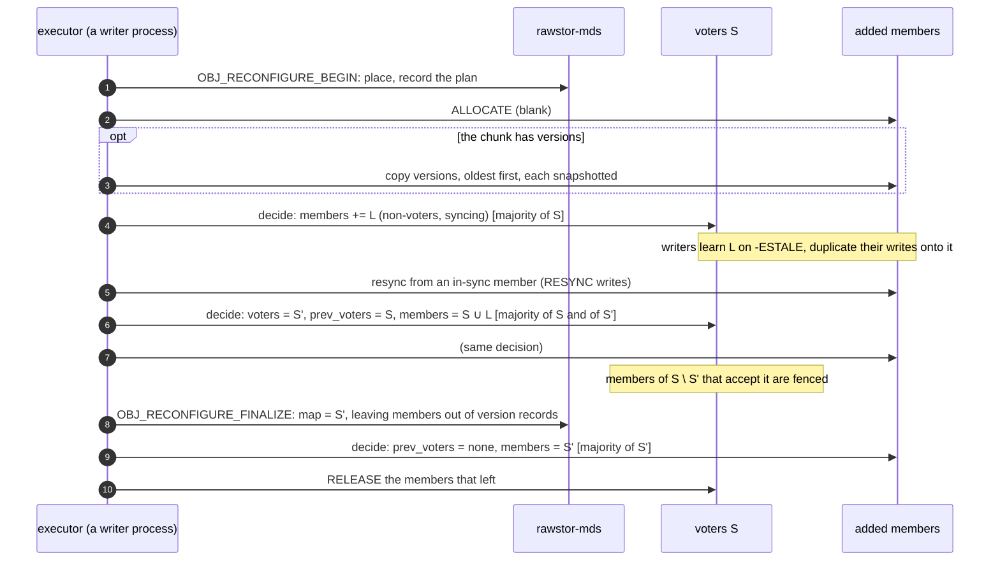

# Changing a chunk's members: mirror count, migration, drain

## Status

Legend: ✅ implemented · 🟡 partial · ❌ not implemented yet. *Stage* is this
document's own numbering (see [Implementation stages](#implementation-stages));
[MDS design](mds.md) and [Mirroring](mirroring.md) number theirs separately.

| Feature | Stage | Status | Where |
|---|---|---|---|
| Weight 0 keeps a location out of every new placement (data and witness) | 0 | ✅ | `mds/src/placement.cpp`; no end-to-end test, not documented for operators |
| Topology refuses to drop a location that still holds chunks or version members | — | ✅ | `mds/src/store.cpp` |
| List the slots and version members held by one location | 0 | ❌ | — |
| `plan_seq`/`plan_gen` in the value; `RELEASE` bounded by epoch; a leftover never adopted | 1 | ❌ | [Idempotency](#idempotency) |
| A one-member chunk keeps a register; epoch 0 refused once recorded | 1 | ❌ | [One copy](#a-one-copy-chunk) |
| Members named in the register value: topology id, `member_role`, voter | 1 | ❌ | [Members in the value](#members-in-the-register-value) |
| Quorum over voters; joint decision for a change of voters | 1 | ❌ | [The change](#the-change-as-register-decisions) |
| A running writer follows a member change (`-ESTALE`, locate) | 1 | ❌ | [Following a change](#how-a-writer-follows-a-change) |
| Placement of added slots next to kept ones | 2 | ❌ | [MDS side](#mds-side) |
| MDS operation and plan records, ownership leases, `OBJ_OPERATION_*`, `OBJ_RECONFIGURE_*`, `LOCATE` | 2 | ❌ | [MDS side](#mds-side) |
| Executor and CLI: `rawstor object migrate`, `rawstor object mirrors` | 3 | ❌ | [Executor](#executor) |
| `rawstor location drain`, drain status in `rawstor location info`; replacing a dead location's slots | 4 | ❌ | [Draining a location](#draining-a-location) |
| Versions copied to a new member | 5 | ❌ | [Versions](#versions) |
| Backend / `chunk_meta` format change by migration | 6 | ❌ | [Changing backend or format](#changing-backend-or-metadata-format) |

Four operations are wanted, and they are one mechanism:

| Operation | In terms of the mechanism |
|---|---|
| Change the number of mirrors of an object | per chunk: add and/or remove members |
| Migrate one disk (object) off a location, to a chosen or a placed one | per chunk: replace the member on that location |
| Drain a location | migrate every slot on it, with the location closed to new placement |
| Change the backend of a disk (`zfs://` → `lvm://`), or its metadata format | migrate to a location that has the other backend or the newer software |

All four are one primitive, `reconfigure(chunk, voters)`, and the orchestration
around it.

A **location** here is one entry of the MDS topology (`<uuid> <location>
<weight> <role> <path>`): the place a member lives, named by its location URI
or by its topology id (`ost_id` on the wire and in the code). Nothing below
depends on its scheme: an entry is normally an `ost://` server, may be
`file://` on a single host, and a witness may live on the MDS's own `ost://`
endpoint. The operations are therefore `rawstor location` and `rawstor object`
subcommands, and they act on the topology of the MDS they are given.

See also: [MDS design](mds.md), [Mirroring](mirroring.md),
[Multi-attach](multiattach.md), [CASPaxos](caspaxos.md).

## What the design builds on

- **A chunk is the unit.** Each chunk has its own members and its own
  configuration register; chunks of one object may have different widths
  ([Mirroring](mirroring.md#overview)). An object-level operation runs per
  chunk, and an object with some chunks changed is a valid state.
- **The register decides.** Every transition of a chunk's configuration is a
  CASPaxos decision; any writer process may propose, the others adopt the
  decided value when a member answers `-ESTALE`
  ([Multi-attach](multiattach.md)). Epoch fencing guarantees that no write is
  acknowledged against an outdated configuration (A3).
- **Resync moves the data.** A *syncing* member receives an online full copy
  from an in-sync member together with the duplicated writes of every writer
  ([Resync across processes](multiattach.md#resync-across-processes)).
- **Member records are the durable ground truth, the MDS is an index**
  ([MDS principles](mds.md#principles)) and stays off the I/O path.

What the present model fixes, and this design has to make changeable:

| Fixed today | Where |
|---|---|
| The member list: positional, `nroles` must equal the member count | `src/chunk.cpp` (`_reconcile_sync_set()`, `_adopt_locked()`) |
| `N`, the quorum denominator, is the member count, excluded and syncing members included | `Chunk::_below_write_quorum()` |
| `width` is the copy's persisted spec, compared at open (F11), not part of the register | `RawstorObjectConfig`, `meta_encode()` |
| The witness is the last location beyond `width` | `src/chunk.cpp` |
| A one-member chunk has no register: its writes carry epoch 0, which no member refuses | `MirrorControl::initialize_single()`, [Epoch on writes](multiattach.md#epoch-on-writes) |

## Weight 0 and draining

`weight 0` in `topology.conf` keeps a location out of **every new placement**:
`place()` skips zero-weight entries before building failure domains, and the
witness candidate filter and the domain-count checks skip them too
(`mds/src/placement.cpp`; unit test
`PlacementTest.zero_weight_ost_never_populates_a_domain`). Existing slots are
untouched: reads and writes go on, a `SIGHUP` reload accepts the new weight, and
only *dropping* a location that still holds chunks or version members is refused.

- Create and grow fail with the usual hard error when the weighted locations
  left cannot satisfy `width` and `failure_domain`; nothing falls back onto the
  drained one.
- With `stripe_width` K=1 the chunks a resize adds land on whichever locations the
  pinned pool now picks, so they may lose locality with the earlier chunks.
- Weight 0 moves nothing: that is [Draining a location](#draining-a-location).

Missing, and stage 0: a test of the whole path (create and resize against a
topology with a zero-weight location) and the operator documentation of `0`.

No separate *decommissioned* mark is needed. A location that is dead is drained
like a live one, except that it is not asked and not released
([Dead location](#dead-location)); weight 0 already keeps placement away from it, and
once no chunk refers to it, removing it from the topology is accepted. The
migration sequence with a `fence` watermark and a *decommissioned* mark in
[MDS design](mds.md#migration-updateplacement-sequence) is replaced by this
document when stage 1 lands.

## Members in the register value

The register value (`RawstorObjectConfig`) names its members:

| Field, per member | Meaning |
|---|---|
| `ost_id` | the topology id of the location holding the member (16 bytes) |
| `member_role` | `DATA` or `WITNESS` (`enum RawstorMemberRole`, as in `META`) |
| `voter` | whether the member counts in `N` and in every majority |
| `role` | in-sync, syncing, excluded (`enum RawstorObjectMemberRole`, the value's `roles`), as now |

and, for the value as a whole:

- `prev_voters`: the voters of the value a commit replaced, while the change is
  not settled (empty otherwise; see [Completing a commit](#completing-a-commit)).
  It is a bitmask over the value's members, so every member it names stays in
  the list until the settle: a member that leaves stays there as a non-voter
  until then;
- `plan_seq`, `plan_gen`: the last plan that changed the members and the
  generation of its owner, so that a decision of an outdated plan or owner is
  refused by the register itself ([Idempotency](#idempotency)).

- **The value, not the MDS map and not the position in a target list, is the
  membership.** A member knows itself by its `ost_id`. A member not named in the
  value is not a member of the chunk.
- **`N` is the number of voters.** Every majority of [Mirroring](mirroring.md#quorum-excluding-split-brain-by-construction)
  and of the register is a majority of voters. A non-voter receives writes and
  takes part in resync according to its role, and is never counted.
- **`voter` is changed by `reconfigure` only.** Degrade, exclusion, the lease
  of a silent resync owner, the reconnect probe and the rejoin change `role` and
  never `voter`: an added member excluded on a failure stays a non-voter, and an
  ordinary rejoin makes it an in-sync non-voter, a full copy with no vote. This
  is why voting is a field and not a role value: no existing transition can
  promote or demote a voter by accident.
- **`width` is derived**: the number of `DATA` voters of the value. A chunk
  whose value names its members takes its width from the value an open
  selects, never from comparing the copies' persisted spec: a member that
  missed a commit keeps the old width in its record, and a spec comparison
  (F11) would hold it stale with no way back. The member rewrites its
  persisted width whenever it accepts a value, a rejoin included, so `META`
  reports the width of the value it holds. Size and chunk size are compared
  as before. The witness rule ("the last location beyond `width`") applies to
  targets whose value names no members.
- **Plain targets** (a user's `ost://a,ost://b` list without an MDS) have no
  `ost_id`s. Their value names no members, membership stays positional as now,
  and they cannot be reconfigured: their members are the user's list.

**Size.** Every backend keeps the record in `META_MAX_SIZE` (1024 bytes): the
`file://` meta file, the LVM tag, the ZFS user property. The present record takes
about 330 bytes; an `ost_id` in hex takes 32 plus a few for `member_role` and voter. A
chunk that names its members is therefore limited to 16 of them, counting,
while a change runs, the members that leave and those being added
(`RAWSTOR_OBJECT_MAX_MEMBERS`, a new constant; `width` stays at most 255 for
plain targets). With `prev_voters` (a bitmask), `plan_seq` and `plan_gen` the
record of a 16-member chunk comes to about 930 bytes. The wire
`RawstorFrameConfig` grows by `16 × 17` bytes for the members and 14 for the
rest. A compact binary encoding of the record could raise the limit; nothing
planned needs it.

### A one-copy chunk

The commonest migration is a one-copy disk (`zfs://` → `lvm://`), and a
one-member chunk today has no register at all: its writes carry epoch 0, which
"is never refused", so a running writer could neither be fenced nor learn of a
new member, and its writes would never reach the copy being filled. So:

- a one-member chunk keeps a register like any other: `ALLOCATE` records epoch
  1 and the member, and the writer stamps its writes with the epoch;
- a member whose record names its members refuses epoch 0 with `-ESTALE`;
  epoch 0 stays legal for plain targets only;
- on `-ESTALE` a one-member writer reads the value from its one voter (a
  majority of one) and adopts it, through the same path as a mirrored one.

Cost: none on the data path (the epoch is already stamped and checked); one
record per decision, of which a one-copy chunk has none until it is reconfigured.

**Chunks created before stage 1** have no register. A writer of stage 1 records
one at its first writable open, in the dirty gate it passes anyway (one fsync
on the one member). `reconfigure` refuses a chunk whose record names no
members (`-EOPNOTSUPP`): it has, or may have, a writer stamping epoch 0 that
cannot be fenced. Such a chunk is reopened by a stage-1 writer first, which for
a VM disk means restarting its `rawstor-vhost` or `rawstor-vduse`. There are no
live installations ([Compatibility stance](mds.md#compatibility-stance)); this
concerns test stands only.

## The change as register decisions

`reconfigure(chunk, S')`, with `S` the current voters and `S'` the wanted ones:

| Operation | `S` → `S'` |
|---|---|
| replace A by B | `{A, …}` → `{B, …}` |
| one copy, A → B | `{A}` → `{B}` |
| 2 → 3 mirrors (an odd width has no witness) | `{A, B, W}` → `{A, B, C}` |
| 3 → 2 mirrors | `{A, B, C}` → `{A, B, W}` |
| 1 → 2 mirrors | `{A}` → `{A, B, W}` |



1. **Begin.** The MDS places the added slots and records the plan
   ([MDS side](#mds-side)); its map is not changed yet.
2. **Allocate** blank copies on the added locations (a witness is a minimum-size
   volume, as today), each record naming the plan's `plan_seq`; a copy left
   there by another plan is released first ([Idempotency](#idempotency)).
   Versions, if any, are copied now, before the copy takes live writes
   ([Versions](#versions)).
3. **Add.** A decision of the voters `S` adds the new members to the value as
   non-voters in role syncing, with the executor as `resync_owner`. Nothing
   about the quorum changes: `N` is still `|S|`.
4. **Fill.** The existing resync copies the data, the writers duplicate their
   writes; a witness has nothing to copy.
5. **Commit.** One decision sets `voter` to `S'`, records `prev_voters = S`,
   leaves the members of `S \ S'` in the list as non-voters in role excluded,
   raises the epoch and moves the `sync_id` on. It is decided only once accepted
   by **a majority of `S` and a majority of `S'`**, and it is sent to every member
   of `S ∪ S'`, the leaving ones included. A leaving member that accepts it
   refuses every write below the new epoch and serves no I/O, but still answers
   the register: it is part of the majority of `S` that completing the commit
   needs.
   It goes to the added members first and to `S` only after all of them
   accepted it. Until it is decided the plan can still be aborted, by a
   conditional decision of `S` that drops the added members or, if the commit is
   found in its majority, completes it instead
   ([Completing a commit](#completing-a-commit)).
6. **Finalize.** In one MDS transaction the chunk's map becomes `S'` and the
   leaving members are removed from the records of the chunk's versions (which
   by then name the added members instead, [Versions](#versions)).
7. **Settle.** A decision of `S'` alone clears `prev_voters` and drops the
   leaving members from the list. From then on the chunk is at rest under `S'`,
   and the leaving members are not asked again.
8. **Release.** The volumes of the members that left, versions included, are
   destroyed, later and without hurry.

The MDS map changes once, after the commit. Until then it lists `S`, afterwards
`S'`; since the commit was accepted by majorities of both, an open that reads
the members the map lists reaches a member holding the newest value either way
([How a writer follows](#how-a-writer-follows-a-change)).

### Why the joint commit is safe

Two participants can act on an outdated view: a writer acknowledging a
write, and a proposer making a decision.

- **A writer that missed the commit** still believes `S` (or a subset) in sync
  and needs every one of them for an acknowledgement. The commit was accepted
  by a majority of `S`, so at least one of them refuses the write with
  `-ESTALE`. With `S = {A}` that member is `A` itself, which is why the commit
  must reach `A` and why a one-copy chunk needs a register.
- **A proposer that missed the commit** prepares a majority of the voters it
  knows, `S`. That majority intersects the majority of `S` that accepted the
  commit, so its prepare returns the commit (or a later value). It does not
  take that value as decided: it completes it as below, and learns `S'` before
  it changes anything.
- **A decision of `S` racing the commit** (an exclusion by another writer) holds
  a higher ballot on some member of every majority of `S`, so the commit fails
  to reach a majority of `S`, is not decided, and is retried on top of that
  decision.
- Decisions before the commit (step 3, exclusions while filling) are ordinary
  decisions of `S`; decisions after the settle are ordinary decisions of `S'`.
  Every decision in between needs both.

### Completing a commit

A commit may be accepted by some members only: the executor dies between its
`SYNC_ACCEPT`s. With `{A, P, Q}` → `{B, P, Q}`, `B` and `P` may hold the commit
while `Q` and `A` still hold the value that added `B`. Whoever then reads the
register (a fresh open, a writer on `-ESTALE`, a proposer) and meets `P` finds
the commit as the highest accepted value. Taking it as decided would let the
writers drop `A` although a majority of `S` never accepted that.

The rule: **a value with `prev_voters` set is decided only by a majority of
`prev_voters` and a majority of `voters`, and every decision built on it needs
both**, until the settle clears it. So whoever finds such a value:

1. prepares a majority of both sets (locating the members it does not know,
   [How a writer follows](#how-a-writer-follows-a-change));
2. takes the highest accepted value among all replies, as CASPaxos does;
3. accepts it again under its own ballot on a majority of both sets, and only
   then uses it (and may settle it, if the MDS map already lists `S'`).

**The order of the commit's accepts.** The executor sends the commit to the
added members (`S' \ S`) first, and to the members of `S` only once every added
member has accepted it; if one of them does not, it stops and sends nothing
to `S`. So a member of `S` holding the commit means every added member holds it
too, and a half-sent commit is of one of two shapes:

- **only added members hold it.** A proposer of `S` prepares a majority of `S`,
  finds no commit and goes on under `S`; its higher ballot overwrites the
  commit on the added members when it next reaches them. The attempt is void,
  and the plan may be aborted or the commit retried.
- **some member of `S` holds it.** A proposer whose prepare majority of `S`
  includes such a member must carry the commit (CASPaxos: the highest accepted
  value in a prepare majority is never dropped), and completes it as above; the
  added members it needs all hold it already. A proposer whose majority does not
  include one goes on under `S`, and its decision overwrites the commit where it
  meets it: the commit was not decided.

A commit is never rolled back by rule, then: it is either carried by the next
proposer that sees it in its majority of `S`, or superseded by one that does not.
**Abort is a conditional decision**: "drop the added members, if the value still
has them as non-voters and no `prev_voters`"; built on a value that turns out to
hold the commit, it completes the commit instead. Once the commit is decided, a
chunk whose `S'` loses its majority is unavailable for writes, as after any lost
majority; an open does not fall back to `S`.


This is the joint-consensus rule (Raft) applied to the one decision that changes
the voters, with the added members first made acceptors that do not count,
which is the order the CASPaxos paper uses for growing its acceptor set (extend
the accept set, make an identity transition so that the new acceptors hold the
value, then extend the prepare quorum). [CASPaxos](caspaxos.md) does not
describe a change of acceptors yet; it should, with this argument, when
stage 1 lands.

### How a writer follows a change

- A writer that adopts a value naming an `ost_id` it has no session to asks the
  MDS for that entry's location (`LOCATE`, a topology lookup), opens a `Slot`
  to it and, for a syncing member, duplicates its writes from then on. It closes
  the sessions of members the value no longer names.
- Until it has done so it acknowledges nothing, exactly as a writer that has just
  been refused `-ESTALE`.
- **A fresh open** resolves the map, reads `META` from the members it lists, and
  takes the value with the highest `accepted` among them. If that value names
  members the map does not (a change in flight), it locates and opens them the
  same way, and a value with `prev_voters` set is completed before the open
  uses it ([Completing a commit](#completing-a-commit)). The map lists either
  `S` or `S'`, and both contain a member that holds the newest value.
- The writer keeps the MDS location for the life of the chunk, which it does not
  today: `Target::open()` expands an `mds://` target into plain chunk targets.
  A writer that has to locate a member while the MDS is unreachable freezes
  writes until it can. Changes are operator-started and rare; this is accepted.

### Failure cases

| Failure | Result |
|---|---|
| Executor dies before the commit | Its resync lease runs out; another writer excludes the added members, which stay non-voters. Its plan lease runs out; the same command resumes the plan (the resync starts over, F8) or `--abort` drops it ([Stuck and repeated runs](#stuck-and-repeated-runs)) |
| Executor dies while sending the commit | Only added members hold it: void, `S` goes on. A member of `S` holds it: every added member does too, and the next reader that meets it completes it ([Completing a commit](#completing-a-commit)) |
| Executor dies after the commit, before finalize or settle | The register has `S'`; writers already run on it. Resuming finds the commit in the value, finalizes and settles |
| MDS unreachable | Begin and finalize wait. Writers are affected only if they must locate a member they do not know |
| An added member fails while filling | Excluded like any member, still a non-voter: `S` keeps serving. The resync restarts when it returns, or the plan is aborted |
| A member of `S` fails | Ordinary decisions of `S`. The commit needs a majority of `S` without it; with `S = {A}`, losing `A` loses the data, a change or not |
| The resync source fails | The owner aborts; another in-sync member is the source, or the plan waits |
| Two runs on one chunk | One owns the chunk's plan at a time ([Stuck and repeated runs](#stuck-and-repeated-runs)) |
| A leaving member that missed the commit comes back | Before the settle it is still named by the value (a non-voter of `prev_voters`) and answers the register, which completing the commit may need. After the settle it names itself in an older value: a stale copy by `sync_id` ancestry, in no map, its volume garbage to release |

## Operations

### Changing the number of mirrors

`rawstor object mirrors TARGET N`:

1. The descriptor's policy `width` is set to `N` first, so that a resize places
   its new chunks with it.
2. Every existing chunk is reconfigured, a bounded number at a time:
   - **grow**: the added slots (and a witness, when the new width is even) are
     placed on locations of weight > 0 in failure domains different from every kept
     member; impossible means that chunk fails and is reported, never placed
     under the policy ([MDS placement](mds.md#placement-function));
   - **shrink**: the executor chooses who leaves: members on weight-0
     locations first, then the fullest; never the only in-sync data copy. The
     operator may name the locations.

The witness follows the parity of the width: 2 → 3 replaces the witness by a
data copy in one change, 3 → 2 does the reverse, 1 → 2 adds a copy and a witness,
2 → 1 removes both.

### Migrating a disk

`rawstor object migrate TARGET --from LOCATION [--to LOCATION] [--chunk OFFSET]`
replaces, in every chunk of the object with a slot on the `--from` location,
that slot by one on another location (`S' = S − {A} + {B}`). A `LOCATION` is a
topology entry of the object's MDS, named by its URI or its topology id:

- with `--to`, there; an explicit target that would put two members of a chunk
  into one failure domain is refused unless the operator says so;
- otherwise placed. With `stripe_width` K < all the destination is chosen
  **once for the object** (HRW keyed by the object id, as the pool itself is),
  so a K=1 disk moves as a whole to one location instead of being scattered chunk by
  chunk; with K = all it is placed per chunk.

The object stays open and writable; the VM is not stopped.

### Draining a location

```
1. weight 0 in topology.conf, SIGHUP                 no new placement
2. rawstor location drain MDS LOCATION               every slot on it migrated,
                                                       one plan per chunk, bounded parallelism
3. rawstor location info MDS LOCATION                slots and version members left: done at 0 and 0
4. remove the entry from topology.conf, SIGHUP       accepted: nothing refers to it
```

`MDS` is the `mds://` location whose topology has the entry; `LOCATION` names
the entry by its URI or its topology id. `rawstor location info mds://…` without
an entry keeps reporting the aggregate it reports now. Step 2 walks the MDS index
of slots by location (stage 0). It is resumable, and runs while the VMs run. A
chunk whose versions are on the location blocks it until stage 5.

### Dead location

`rawstor location drain MDS LOCATION --dead` drains a location that will not
come back: its
members are left out of `S'` without being asked, are never a resync source,
and are not released. The commit still needs a majority of `S`, which the
survivors provide when the chunk had more than one voter; that majority also
fences any writer still reaching the dead location. A chunk whose survivors are not a
majority of `S` stays as it is and is reported. A one-copy chunk on a dead location
has no source: that is a data loss no mechanism repairs.

This is the `updatePlacement` of [the MDS API](mds.md#mds-api), for recovery
and rebalancing alike.

### Changing backend or metadata format

The backend of a copy is a property of its location: what a `file://`,
`lvm://` or `zfs://` location stores on directly, or what the `rawstor-ost`
behind an `ost://` location is backed by (*one copy per server*,
[Mirroring](mirroring.md#one-copy-per-server)). A move from a location backed by
`zfs://` to one backed by `lvm://` is an ordinary migration. Members compare the logical
size from `META`, not the physical allocation, so extent and volblocksize
rounding do not matter (F11).

The same holds for the `chunk_meta` format: the added member is `ALLOCATE`d on
a location served by newer software and writes its record in the newer format; the
register value is carried over by the decisions. There is no in-place
conversion tool. It needs from elsewhere:

- servers (`rawstor-ost`, `rawstor-mds`) upgraded before clients, and members at different format versions in one
  chunk while a change runs;
- the protocol version and feature bits of `SET_OBJECT` that
  [MDS design](mds.md#compatibility-stance) reserves, once a live install exists.

## Versions

A chunk's versions are native snapshots on the members that held it
([Versions](mds.md#versions-stage-2)); `versions[version_id].members` names
those locations.

- **Until stage 5: refuse.** A change that removes a member holding a version is
  refused (`-EBUSY`) unless the versions are removed first. Adding a member is
  allowed: the new member holds the live chunk only, and the version records
  keep their members, as a degraded object's versions already may.
- **Stage 5: copy, before the member takes live writes** (step 2 above). The
  allocated blank volume is written with the oldest version's content (read
  through `SET_OBJECT(id, version_id)` from a member holding it), snapshotted
  natively as `s<version_id>`, then written with the next version, and so on.
  Versions are immutable, so no barrier is needed. Each copied version is added
  to `versions[version_id].members` as it is done (a reader may use it from
  then on). The finalize removes the leaving members from those records in the
  same transaction that moves the map, so no record names a member that is
  about to be released; the release comes after it, and a crash in between
  leaves volumes no record refers to, garbage to collect. Drain status counts
  version records, so it reaches 0 only after the finalize.

The copy writes whole versions, not differences, and the live resync after it
rewrites every block again. On `zfs://` that breaks block sharing between the
snapshots and the live volume: every version costs its full size on the new
member. On `lvm://` (classic snapshots, each `-l 100%ORIGIN`) the cost is the
same as for any version. A native transfer for a move between two locations of the
same backend (`zfs send -i` between snapshots) avoids it and is an optimization
for later; it is the one place where a backend-specific mover pays off.

## MDS side

Stage 2 adds to the MDS database and protocol:

- an `operations` table, at most one row per object: the operation id
  (client-generated), what it asks for (`migrate --from L [--to D]`,
  `mirrors N`, or the drain of `L`), its state (`running`, `aborting`, `done`)
  and the chunks it failed on with their last error;
- a `reconfigurations` table, one row per chunk in flight: the operation, the
  chunk index, `S`, `S'`, the added slots' placement, the phase, and its
  ownership: `owner` (a random id an executor draws once per run), `lease_until`
  and `generation`; written in the same transaction as the mutation, like
  `applied_mutations`;
- `OBJ_OPERATION_START` (creates the object's operation, or returns the one
  that asks for the same; another one is `-EBUSY`), `OBJ_OPERATION_ABORT`
  (state `aborting`);
- `OBJ_RECONFIGURE_BEGIN` (places, records, and gives the plan to the caller),
  `OBJ_RECONFIGURE_CLAIM` (takes over a plan whose lease ran out, `generation++`),
  `OBJ_RECONFIGURE_RENEW` (extends the lease; answers the operation's state, so
  an executor learns of an abort), `OBJ_RECONFIGURE_FINALIZE` (map := `S'`,
  leaving members out of the chunk's version records, `map_epoch++`),
  `OBJ_RECONFIGURE_ABORT` (drops a plan whose abort was decided in the
  register). Every request about a plan carries its `generation`; an older one
  is refused `-ESTALE`. All are idempotent
  ([Idempotent mutations](mds.md#idempotent-mutations)). A chunk plan in flight
  refuses a resize, a version and a removal of its object with `-EBUSY`, so
  these never meet a half-changed chunk on the MDS side;
- `LOCATE(ost_ids)`: the location URIs of topology entries, for writers;
- a placement function for added slots next to `place_chunk()` in
  `mds/src/placement.cpp`: the same hierarchical HRW, with the kept members'
  domains excluded, keyed per object for K < all;
- a paged query of the slots and version members of one location, for drain and
  status.

Resuming a plan is decided by the register, not by the MDS: a commit found in
the value means finalize. `--reconstruct` ([Reconstruct](mds.md#reconstruct-dr))
gets the exact membership of every chunk from the records instead of rebuilding
it from slot positions. It takes the value with the highest `accepted` among the
records it finds, which may be a commit that is not decided yet: the scan only
reads, and does not complete it. So:

- a value without `prev_voters` registers its voters as the map;
- a value with `prev_voters` registers its voters as the map, recreates the plan
  in phase `committed` with `S = prev_voters`, and the next run completes the
  commit (both majorities, [Completing a commit](#completing-a-commit)) or finds
  it superseded, and finalizes and settles accordingly. A fresh open in between
  reaches the leaving members through the value, which still names them;
- a copy is garbage only if it is named neither by that value nor by a plan
  still in flight. The members of `prev_voters` are named by the value until
  the settle, so the old majority a completion needs is never collected.

## Executor

The mover is a client process that opens the chunk as one more writer: it needs
the proposer, the resync engine and the MDS access every writer has, and
multi-attach stage 2 lets it run beside the VM's own process. It is a set of
`rawstor` subcommands (`object migrate`, `object mirrors`, `location drain`); a
balancer daemon over the same code would be a later consumer, not another
mechanism.

- A bounded number of chunks in flight (`--parallel N`); every step idempotent,
  so a killed executor is resumed by the same command from the plan in the MDS
  and the value in the register.
- Progress per chunk in `rawstor object chunks` (`adding`, `filling`,
  `committed`, `releasing`, `done`), with the plan's owner and the age of its
  lease, so that a stuck run is visible
  ([Stuck and repeated runs](#stuck-and-repeated-runs)).
- **Fill rate.** A syncing member records the ranges client writes covered, at
  most 65,536 disjoint ones; a write needing another is refused `-ENOBUFS` and
  the member is excluded ([Resync across processes](multiattach.md#resync-across-processes)).
  A slow sweep under random writes reaches that limit sooner, so throttling the
  fill makes it fail and start over. The fill therefore runs unthrottled, as
  resync does; throttling needs a coarser record (ranges merged into fixed
  blocks once the limit nears) and is not part of this design.

## Idempotency

Two different things repeat, and each has its own guard:

- **A request whose reply was lost** is sent again by the same call: an MDS
  mutation keeps its `idempotency_key` across the retries of one call and the
  MDS replays the recorded result ([Idempotent mutations](mds.md#idempotent-mutations));
  a register request is answered with the member's record either way
  ([The register](multiattach.md#the-register-caspaxos)).
- **A step repeated by a later run**, or by an old owner that wakes up after its
  plan was taken over or finished, carries a new key or none. It is guarded by
  the state: the plan's phase in the MDS, and `plan_seq`/`plan_gen` in the
  register value and the members' records. An idempotency key expires after a
  day; a drain may last longer, and its steps never rely on one across runs.

`plan_seq` is a per-chunk counter the MDS takes at `OBJ_RECONFIGURE_BEGIN`, never
reused; `plan_gen` is the plan's `generation`, raised by every claim. A
reconfiguration decision names both and is a function of the value it finds:

| The value has | A decision of plan `q`, generation `g` |
|---|---|
| its change already | nothing to do: the retry has succeeded |
| `plan_seq < q`, no change in flight | applies (the first decision of a new plan) |
| `plan_seq = q`, `plan_gen ≤ g` | applies, and records `plan_gen = g` (a takeover is written into the register by its first decision) |
| `plan_seq = q`, `plan_gen > g` | refused: the plan has another owner |
| `plan_seq > q` | refused: a later plan has changed the members; this one is over |

Rebuilt by `--reconstruct`, the MDS counter starts above the highest `plan_seq`
the records hold.

| Step | Lost reply, same call | Repeated by a later run or an old owner |
|---|---|---|
| `OBJ_OPERATION_START` | replay | The operation id is generated once per command; a later run with a new id gets the running operation if it asks for the same, `-EBUSY` otherwise |
| `OBJ_RECONFIGURE_BEGIN` | replay; the reply carries the plan, its placement, `plan_seq` and generation, which the caller needs to go on | The chunk has a plan: the caller gets it to claim, never a second placement |
| `OBJ_RECONFIGURE_CLAIM` | replay | The current owner claiming again gets its own generation back; another owner while the lease holds gets `-EBUSY` |
| `OBJ_RECONFIGURE_RENEW` | sets the lease again | `-ESTALE` for an older generation |
| `ALLOCATE` of an added member | `EEXIST`, and the new record names this `plan_seq`: done (as for *resize*) | `EEXIST` with a record of another plan: a leftover of an aborted or finished plan on the same location (the physical name `<id>/<offset>` is the same). It is released (below) and allocated again; a leftover is never adopted as a blank copy |
| Version copy | a version whose snapshot `s<version_id>` exists is done; the content written before it is redone | same; versions are immutable, so a snapshot of a version id has its content whoever took it |
| Add, commit, settle, abort decisions | the register request is idempotent | the table above |
| Fill | restarts from scratch (F8) | same, under the new resync owner |
| `OBJ_RECONFIGURE_FINALIZE` | replay | A finalized plan answers success; an aborted one `-EINVAL` |
| `OBJ_RECONFIGURE_ABORT` | replay | A finalized plan answers `-EINVAL`: the register decided the commit, and the caller has missed it |
| Version records (finalize) | in the finalize's transaction | adding and removing a member of a version record are set operations |
| `RELEASE` of a leaving member | `ENOENT`: done | see below |

**A release must not destroy a member that came back.** A plan moves a chunk
from `B` to `C`, `B` waits in `releasing`, and a later plan places the chunk on
`B` again before the release ran. A late release from the first plan, by its
`releasing` retry or by an old owner, would destroy the new member. `RELEASE`
therefore carries a bound in its `val`: the epoch of the commit that made the
copy a leaving member. The location removes the copy only if its record's epoch is not above
it, under the record lock, and answers `-ESTALE` otherwise; any decision that
names the copy again raises its epoch past the bound. The MDS also does not
place a chunk on a location where a release of it is pending, so the case is
rare, but the bound is what makes it safe.

## Stuck and repeated runs

An operation is the object-level request (`migrate`, `mirrors`, a drain reaching
the object), recorded in the MDS; its chunks are changed by per-chunk plans.
The register keeps the change safe whoever runs it; the MDS records keep it
orderly: one operation per object, one owner per chunk plan at a time.

**Ownership.** An executor draws a random id per run. It takes a chunk's plan by
`OBJ_RECONFIGURE_BEGIN` or, when the plan's lease ran out, by
`OBJ_RECONFIGURE_CLAIM`, which raises the plan's `generation`; it renews the
lease (60 s, renewed every 20 s) while it works on the chunk. The plan's owner is
also the resync owner in the register; a new owner takes the resync over only
after the register's own lease of the previous one ran out
([Resync across processes](multiattach.md#resync-across-processes)), so two
executors never sweep one member at once. An executor that wakes up after losing
a plan gets `-ESTALE` from the MDS on its next request about it, its register
proposals lose to higher ballots or find their change already made, and it
drops the chunk.

### Running a command again

| Second run | Result |
|---|---|
| The same command while the first runs | Joins the operation (`OBJ_OPERATION_START` returns it) and takes chunks nobody owns: two executors share the work, never a chunk |
| The same command after the first died | Resumes: claims the plans whose leases ran out, then the chunks not started |
| The same command after the first finished | Nothing to do: no chunk has a slot on `--from`, or every chunk has width `N`. Exit 0 |
| Another operation on the object (`--to C` while `--to B` runs, `mirrors 3` while `mirrors 2` runs) | `-EBUSY`, naming the running operation. It is aborted first, or waited for |
| `--abort` | State `aborting`; executors learn it at their next renewal. A chunk not yet committed is aborted (the conditional decision, then `OBJ_RECONFIGURE_ABORT`, then the added members' volumes are released); a committed one is finished, as it cannot be undone. The object is left with some chunks moved; moving them back is another `migrate` |
| A drain of `L` reaching an object whose operation removes `L` (`migrate --from L`) | Counts it as covered and goes on: the operation empties `L` |
| A drain of `L` reaching an object with another operation | Skips it, reports it, and comes back to it on its next pass |
| Two drains of one location | The same command twice: they join |
| Resize, version, removal of the object | `-EBUSY` while one of its chunk plans is in flight (begun, not finalized); allowed between chunks. A scheduled snapshot retries |

### When a run gets stuck

| Situation | What happens | What the operator sees and does |
|---|---|---|
| Executor killed, host lost | Writers go on (the added members stay non-voters, excluded once the resync lease runs out). The object refuses resize, version and removal while its plan is in flight | `rawstor object chunks` shows the plan and its lapsed owner. Run the command again, or `--abort` |
| Executor hung (stopped process, blocked I/O) | Its renewals stop: the same as killed for everyone else. When it wakes up it is refused (`-ESTALE`) and exits | As above |
| The fill never completes (the added member keeps failing; `-ENOBUFS` under random writes, [Executor](#executor)) | The executor counts attempts per chunk; after `--attempts` (3 by default) it aborts that chunk's plan, records the error in the operation and goes on with the next chunk | The command ends with the failed chunks listed and a nonzero exit; the object is not blocked by them |
| No location satisfies the placement | `OBJ_RECONFIGURE_BEGIN` fails for that chunk; recorded the same way | Add capacity or relax the operation (`--to`, the failure domain), run again |
| An added member does not accept the commit | The executor sends nothing to `S`, the commit is void; it retries, then counts it as a failed attempt | As for a failing fill |
| `S'` loses its majority after the commit | The chunk is not writable, as after any lost majority; the plan stays committed and cannot be aborted | Bring the members back; the run resumes and finalizes |
| The MDS is unreachable | Begin, claim, renewal and finalize wait with backoff. A lease is counted by the MDS and survives its restart, so an executor that could not renew during an outage may find its plans claimed when the MDS is back | Nothing; the run goes on, or another one has taken over |
| A leaving location cannot be released (dead, unreachable) | The plan stays in `releasing` and is retried by later runs; the map and the version records no longer name it, so drain status is 0 and the entry can leave the topology | Nothing, or remove the entry: its volume is garbage on a location that is gone |
| Settle fails (`S'` briefly short of a majority) | Retried. Until it succeeds every decision needs both majorities ([Completing a commit](#completing-a-commit)) | Nothing |

## Permissions and capacity

- **Who may do what** ([Accounts](accounts.md)): changing the number of mirrors
  of an object is an operation on the object, allowed to its owner like resize.
  Migrating a disk and draining a location choose locations and are allowed to
  the provider administrator only; an account cannot name a location. `LOCATE`
  answers a writer of the chunk for the entries its value names, no others.
- **Capacity.** Adding mirrors multiplies the space an object takes; copied
  versions take their full size on the new member ([Versions](#versions)), and
  a migration holds the space of the added members until the release frees the
  old ones. Account quotas are separate, not yet designed work
  ([Security](security.md)); when they exist, the added members count against
  the owner and a change that would exceed the quota is refused before
  `OBJ_RECONFIGURE_BEGIN`.

## Tests

Each stage is tested at the layer it adds, through existing interfaces:

- stage 1: a one-member chunk refuses epoch 0 once recorded and a running writer
  adopts a new member; replacement of a copy, `{A}` → `{B}`, 2 → 3 with the
  witness swap, 3 → 2, all under a writer process; an added member excluded and
  rejoined stays a non-voter; executor killed at every step; a commit sent to
  the added members only (void) and to a minority of `S` (carried or
  superseded); an abort that meets the commit completes it; a writer and a
  proposer that missed the commit; the ASAN stress shape used for resync;
- stage 2: placement of added slots never reuses a kept domain and keeps K=1 on
  one location; plan rows, idempotent replay, one operation per object and one
  owner per plan, a claim after the lease and `-ESTALE` for the old owner,
  `-EBUSY` for resize and versions; reconstruct of a chunk mid-change;
- stage 3 also: every step repeated after a lost reply and by a second run; a
  decision of an old owner and of a finished plan refused by the register; a
  release from an old plan of a member placed there again by a newer one
  (`-ESTALE`, the copy kept); an allocation that meets a leftover;
  two runs of one command sharing an object, a run stopped
  (`SIGSTOP`) and continued after another took over, `--abort` with chunks on
  both sides of the commit, the attempt limit on a fill that keeps failing;
- stage 3: end to end, `migrate` and `mirrors` under vhost-like writes;
- stage 4: drain of a live and of a dead location in a multi-location topology,
  `ost://` and `file://` entries alike.

## Implementation stages

0. **Preparation.** Test and document `weight 0`; the MDS query of slots and
   version members by location.
1. **Membership in the register.** Member ids, `member_role` and voter in the value, the
   record and the wire; `plan_seq`/`plan_gen` and the decisions guarded by
   them; `ALLOCATE` naming the plan and `RELEASE` bounded by epoch; `N` over voters; derived `width`; the joint commit; a
   register for one-member chunks and epoch 0 refused; writers following a
   change (`LOCATE` from a test resolver at this stage); completing a
   partly accepted commit. Upgrade order: `rawstor-ost` and `rawstor-mds`
   first, since they store and answer the new record and value; clients after.
   A client of an earlier version refuses a record that names members (an
   unknown record field), so it cannot write a chunk that a newer one has
   started to manage; nothing else breaks.
2. **MDS plans.** Operation and plan tables, ownership leases and
   generations, `OBJ_OPERATION_*`, `OBJ_RECONFIGURE_*`, `LOCATE`, placement of
   added slots, `-EBUSY` rules, reconstruct from the value.
3. **Executor and CLI.** `rawstor object migrate`, `rawstor object mirrors`,
   join and resume, `--abort`, `--attempts`, per-chunk progress.
4. **Drain.** `rawstor location drain` (with `--dead`) and its status in
   `rawstor location info`; removal from the topology.
5. **Versions.** Copy before the commit; drain no longer blocks on them.
6. **Backend and format.** Verification of migration across zfs, lvm and file;
   mixed format versions in one chunk; the protocol version handshake.

Stage 1 is the substance; the rest is policy, bookkeeping and tools.

## Open questions

- **Locations in the value.** The value names locations by topology id and a writer asks the
  MDS for locations. Putting locations in the value would remove the MDS from
  that path, at the price of a record past its 1024 bytes and of topology moves
  that rewrite every record; rejected for now.
- **Many chunks, one plan.** A plan per chunk is simple and resumable; an object
  of thousands of chunks may want a coalesced record.
- **Coarser resync record** for a throttled fill (see *Executor*).
- **Automatic rebalancing** by weight is a consumer of `migrate`, not part of
  this design.
