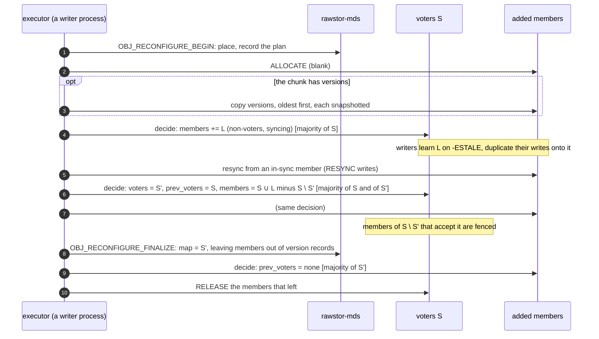

# Changing a chunk's members: mirror count, migration, drain

## Status

Legend: ✅ implemented · 🟡 partial · ❌ not implemented yet. *Stage* is this
document's own numbering (see [Implementation stages](#implementation-stages));
[MDS design](mds.md) and [Mirroring](mirroring.md) number theirs separately.

| Feature | Stage | Status | Where |
|---|---|---|---|
| Weight 0 keeps an OST out of every new placement (data and witness) | 0 | ✅ | `mds/src/placement.cpp`; no end-to-end test, not documented for operators |
| Topology refuses to drop an OST that still holds chunks or version members | — | ✅ | `mds/src/store.cpp` |
| List the slots and version members held by one OST | 0 | ❌ | — |
| A one-member chunk keeps a register; epoch 0 refused once recorded | 1 | ❌ | [One copy](#a-one-copy-chunk) |
| Members named in the register value: OST id, type, voter | 1 | ❌ | [Members in the value](#members-in-the-register-value) |
| Quorum over voters; joint decision for a change of voters | 1 | ❌ | [The change](#the-change-as-register-decisions) |
| A running writer follows a member change (`-ESTALE`, locate) | 1 | ❌ | [Following a change](#how-a-writer-follows-a-change) |
| Placement of added slots next to kept ones | 2 | ❌ | [MDS side](#mds-side) |
| MDS plan record, `OBJ_RECONFIGURE_*`, `OST_LOCATE` | 2 | ❌ | [MDS side](#mds-side) |
| Executor and CLI: `rawstor object migrate`, `rawstor object mirrors` | 3 | ❌ | [Executor](#executor) |
| `rawstor ost drain`, `rawstor ost status`; replacing a dead OST's slots | 4 | ❌ | [Draining an OST](#draining-an-ost) |
| Versions copied to a new member | 5 | ❌ | [Versions](#versions) |
| Backend / `chunk_meta` format change by migration | 6 | ❌ | [Changing backend or format](#changing-backend-or-metadata-format) |

Four operations are wanted, and they are one mechanism:

| Operation | In terms of the mechanism |
|---|---|
| Change the number of mirrors of an object | per chunk: add and/or remove members |
| Migrate one disk (object) off an OST, to a chosen or a placed OST | per chunk: replace the member on that OST |
| Drain an OST | migrate every slot on it, with the OST closed to new placement |
| Change the backend of a disk (`zfs://` → `lvm://`), or its metadata format | migrate to an OST that has the other backend or the newer software |

All four are one primitive, `reconfigure(chunk, voters)`, and the orchestration
around it.

See also: [MDS design](mds.md), [Mirroring](mirroring.md),
[Multi-attach](multiattach.md), [CASPaxos](caspaxos.md).

## What the design builds on

- **A chunk is the unit.** Each chunk has its own members and its own
  configuration register; chunks of one object may have different widths
  ([Mirroring](mirroring.md#overview)). An object-level operation runs per
  chunk, and an object with some chunks changed is a valid state.
- **The register decides.** Every transition of a chunk's configuration is a
  CASPaxos decision; any writer process may propose, the others adopt the
  decided value when a member answers `-ESTALE`
  ([Multi-attach](multiattach.md)). Epoch fencing guarantees that no write is
  acknowledged against an outdated configuration (A3).
- **Resync moves the data.** A *syncing* member receives an online full copy
  from an in-sync member together with the duplicated writes of every writer
  ([Resync across processes](multiattach.md#resync-across-processes)).
- **OST records are the durable ground truth, the MDS is an index**
  ([MDS principles](mds.md#principles)) and stays off the I/O path.

What the present model fixes, and this design has to make changeable:

| Fixed today | Where |
|---|---|
| The member list: positional, `nroles` must equal the member count | `src/chunk.cpp` (`_reconcile_sync_set()`, `_adopt_locked()`) |
| `N`, the quorum denominator, is the member count, excluded and syncing members included | `Chunk::_below_write_quorum()` |
| `width` is the copy's persisted spec, compared at open (F11), not part of the register | `RawstorObjectConfig`, `meta_encode()` |
| The witness is the last location beyond `width` | `src/chunk.cpp` |
| A one-member chunk has no register: its writes carry epoch 0, which no member refuses | `MirrorControl::initialize_single()`, [Epoch on writes](multiattach.md#epoch-on-writes) |

## Weight 0 and draining

`weight 0` in `topology.conf` keeps an OST out of **every new placement**:
`place()` skips zero-weight OSTs before building failure domains, and the
witness candidate filter and the domain-count checks skip them too
(`mds/src/placement.cpp`; unit test
`PlacementTest.zero_weight_ost_never_populates_a_domain`). Existing slots are
untouched: reads and writes go on, a `SIGHUP` reload accepts the new weight, and
only *dropping* an OST that still holds chunks or version members is refused.

- Create and grow fail with the usual hard error when the weighted OSTs left
  cannot satisfy `width` and `failure_domain`; nothing falls back onto the
  drained OST.
- With `stripe_width` K=1 the chunks a resize adds land on whichever OSTs the
  pinned pool now picks, so they may lose locality with the earlier chunks.
- Weight 0 moves nothing: that is [Draining an OST](#draining-an-ost).

Missing, and stage 0: a test of the whole path (create and resize against a
topology with a zero-weight OST) and the operator documentation of `0`.

No separate *decommissioned* mark is needed. An OST that is dead is drained like
a live one, except that it is not asked and not released
([Dead OST](#dead-ost)); weight 0 already keeps placement away from it, and
once no chunk refers to it, removing it from the topology is accepted. The
migration sequence with a `fence` watermark and a *decommissioned* mark in
[MDS design](mds.md#migration-updateplacement-sequence) is replaced by this
document when stage 1 lands.

## Members in the register value

The register value (`RawstorObjectConfig`) names its members:

| Field, per member | Meaning |
|---|---|
| `ost_id` | the topology id of the OST holding the member (16 bytes) |
| `type` | `DATA` or `WITNESS`: the member type, as `member_role` in `META` |
| `voter` | whether the member counts in `N` and in every majority |
| `role` | in-sync, syncing, excluded, as now |

and, for the value as a whole, `prev_voters`: the voters of the value a commit
replaced, while the change is not settled (empty otherwise; see
[Completing a commit](#completing-a-commit)).

- **The value, not the MDS map and not the position in a target list, is the
  membership.** A member knows itself by its `ost_id`. A member not named in the
  value is not a member of the chunk.
- **`N` is the number of voters.** Every majority of [Mirroring](mirroring.md#quorum-excluding-split-brain-by-construction)
  and of the register is a majority of voters. A non-voter receives writes and
  takes part in resync according to its role, and is never counted.
- **`voter` is changed by `reconfigure` only.** Degrade, exclusion, the lease
  of a silent resync owner, the reconnect probe and the rejoin change `role` and
  never `voter`: an added member excluded on a failure stays a non-voter, and an
  ordinary rejoin makes it an in-sync non-voter, a full copy with no vote. This
  is why voting is a field and not a role value: no existing transition can
  promote or demote a voter by accident.
- **`width` is derived**: the number of `DATA` voters of the value. A chunk
  whose value names its members takes its width from the value an open
  selects, never from comparing the copies' persisted spec: a member that
  missed a commit keeps the old width in its record, and a spec comparison
  (F11) would hold it stale with no way back. The member rewrites its
  persisted width whenever it accepts a value, a rejoin included, so `META`
  reports the width of the value it holds. Size and chunk size are compared
  as before. The witness rule ("the last location beyond `width`") applies to
  targets whose value names no members.
- **Plain targets** (a user's `ost://a,ost://b` list without an MDS) have no
  `ost_id`s. Their value names no members, membership stays positional as now,
  and they cannot be reconfigured: their members are the user's list.

**Size.** Every backend keeps the record in `META_MAX_SIZE` (1024 bytes): the
`file://` meta file, the LVM tag, the ZFS user property. The present record takes
about 330 bytes; an `ost_id` in hex takes 32 plus a few for type and voter. A
chunk that names its members is therefore limited to 16 of them
(`RAWSTOR_OBJECT_MAX_MEMBERS`, a new constant; `width` stays at most 255 for
plain targets). The wire `RawstorFrameConfig` grows by `16 × 17` bytes. A
compact binary encoding of the record could raise the limit; nothing planned
needs it.

### A one-copy chunk

The commonest migration is a one-copy disk (`zfs://` → `lvm://`), and a
one-member chunk today has no register at all: its writes carry epoch 0, which
"is never refused", so a running writer could neither be fenced nor learn of a
new member, and its writes would never reach the copy being filled. So:

- a one-member chunk keeps a register like any other: `ALLOCATE` records epoch
  1 and the member, and the writer stamps its writes with the epoch;
- a member whose record names its members refuses epoch 0 with `-ESTALE`;
  epoch 0 stays legal for plain targets only;
- on `-ESTALE` a one-member writer reads the value from its one voter (a
  majority of one) and adopts it, through the same path as a mirrored one.

Cost: none on the data path (the epoch is already stamped and checked); one
record per decision, of which a one-copy chunk has none until it is reconfigured.

**Chunks created before stage 1** have no register. A writer of stage 1 records
one at its first writable open, in the dirty gate it passes anyway (one fsync
on the one member). `reconfigure` refuses a chunk whose record names no
members (`-EOPNOTSUPP`): it has, or may have, a writer stamping epoch 0 that
cannot be fenced. Such a chunk is reopened by a stage-1 writer first, which for
a VM disk means restarting its `rawstor-vhost` or `rawstor-vduse`. There are no
live installations ([Compatibility stance](mds.md#compatibility-stance)); this
concerns test stands only.

## The change as register decisions

`reconfigure(chunk, S')`, with `S` the current voters and `S'` the wanted ones:

| Operation | `S` → `S'` |
|---|---|
| replace A by B | `{A, …}` → `{B, …}` |
| one copy, A → B | `{A}` → `{B}` |
| 2 → 3 mirrors (an odd width has no witness) | `{A, B, W}` → `{A, B, C}` |
| 3 → 2 mirrors | `{A, B, C}` → `{A, B, W}` |
| 1 → 2 mirrors | `{A}` → `{A, B, W}` |



1. **Begin.** The MDS places the added slots and records the plan
   ([MDS side](#mds-side)); its map is not changed yet.
2. **Allocate** blank copies on the added OSTs (a witness is a minimum-size
   volume, as today). Versions, if any, are copied now, before the copy takes
   live writes ([Versions](#versions)).
3. **Add.** A decision of the voters `S` adds the new members to the value as
   non-voters in role syncing, with the executor as `resync_owner`. Nothing
   about the quorum changes: `N` is still `|S|`.
4. **Fill.** The existing resync copies the data, the writers duplicate their
   writes; a witness has nothing to copy.
5. **Commit.** One decision sets `voter` to `S'`, records `prev_voters = S`,
   drops the members of `S \ S'` from the value, raises the epoch and moves the
   `sync_id` on. It is decided only once accepted by **a majority of `S` and a
   majority of `S'`**, and it is sent to every member of `S ∪ S'`, the leaving
   ones included. A leaving member that accepts it no longer finds itself in the
   value: it refuses every write below the new epoch and is not asked again.
   Once any member has accepted it, the plan can only be finished
   ([Completing a commit](#completing-a-commit)); before that it can be aborted
   (a decision of `S` drops the added members).
6. **Finalize.** In one MDS transaction the chunk's map becomes `S'` and the
   leaving members are removed from the records of the chunk's versions (which
   by then name the added members instead, [Versions](#versions)).
7. **Settle.** A decision of `S'` alone clears `prev_voters`. From then on the
   chunk is at rest under `S'`.
8. **Release.** The volumes of the members that left, versions included, are
   destroyed, later and without hurry.

The MDS map changes once, after the commit. Until then it lists `S`, afterwards
`S'`; since the commit was accepted by majorities of both, an open that reads
the members the map lists reaches a member holding the newest value either way
([How a writer follows](#how-a-writer-follows-a-change)).

### Why the joint commit is safe

Two participants can act on an outdated view: a writer acknowledging a
write, and a proposer making a decision.

- **A writer that missed the commit** still believes `S` (or a subset) in sync
  and needs every one of them for an acknowledgement. The commit was accepted
  by a majority of `S`, so at least one of them refuses the write with
  `-ESTALE`. With `S = {A}` that member is `A` itself, which is why the commit
  must reach `A` and why a one-copy chunk needs a register.
- **A proposer that missed the commit** prepares a majority of the voters it
  knows, `S`. That majority intersects the majority of `S` that accepted the
  commit, so its prepare returns the commit (or a later value). It does not
  take that value as decided: it completes it as below, and learns `S'` before
  it changes anything.
- **A decision of `S` racing the commit** (an exclusion by another writer) holds
  a higher ballot on some member of every majority of `S`, so the commit fails
  to reach a majority of `S`, is not decided, and is retried on top of that
  decision.
- Decisions before the commit (step 3, exclusions while filling) are ordinary
  decisions of `S`; decisions after the settle are ordinary decisions of `S'`.
  Every decision in between needs both.

### Completing a commit

A commit may be accepted by some members only: the executor dies between its
`SYNC_ACCEPT`s. With `{A}` → `{B}`, `A` may hold the commit while `B` still holds
the value that added it. Whoever then reads the register (a fresh open, a
writer on `-ESTALE`, a proposer) finds the commit as the highest accepted value
on `A`. Taking it as decided would make `B` the only voter without `B` ever
having accepted it.

The rule: **a value with `prev_voters` set is decided only by a majority of
`prev_voters` and a majority of `voters`, and every decision built on it needs
both**, until the settle clears it. So whoever finds such a value:

1. prepares a majority of both sets (locating the members it does not know,
   [How a writer follows](#how-a-writer-follows-a-change));
2. takes the highest accepted value among all replies, as CASPaxos does;
3. accepts it again under its own ballot on a majority of both sets, and only
   then uses it (and may settle it, if the MDS map already lists `S'`).

The commit cannot be rolled back once any member accepted it: a member of `S'`
that cannot be asked may have accepted it too. When a majority of `S'` is
unreachable, the chunk stays unavailable for writes until it is back, as it
would after a lost majority. An open does not fall back to `S`.


This is the joint-consensus rule (Raft) applied to the one decision that changes
the voters, with the added members first made acceptors that do not count,
which is the order the CASPaxos paper uses for growing its acceptor set (extend
the accept set, make an identity transition so that the new acceptors hold the
value, then extend the prepare quorum). [CASPaxos](caspaxos.md) does not
describe a change of acceptors yet; it should, with this argument, when
stage 1 lands.

### How a writer follows a change

- A writer that adopts a value naming an `ost_id` it has no session to asks the
  MDS for that OST's location (`OST_LOCATE`, a topology lookup), opens a `Slot`
  to it and, for a syncing member, duplicates its writes from then on. It closes
  the sessions of members the value no longer names.
- Until it has done so it acknowledges nothing, exactly as a writer that has just
  been refused `-ESTALE`.
- **A fresh open** resolves the map, reads `META` from the members it lists, and
  takes the value with the highest `accepted` among them. If that value names
  members the map does not (a change in flight), it locates and opens them the
  same way, and a value with `prev_voters` set is completed before the open
  uses it ([Completing a commit](#completing-a-commit)). The map lists either
  `S` or `S'`, and both contain a member that holds the newest value.
- The writer keeps the MDS location for the life of the chunk, which it does not
  today: `Target::open()` expands an `mds://` target into plain chunk targets.
  A writer that has to locate a member while the MDS is unreachable freezes
  writes until it can. Changes are operator-started and rare; this is accepted.

### Failure cases

| Failure | Result |
|---|---|
| Executor dies before the commit | Its resync lease runs out; another writer excludes the added members, which stay non-voters. The plan stays in the MDS: the same command resumes it (the resync starts over, F8) or aborts it |
| Executor dies while sending the commit | Some members hold it. The next reader of the register completes it with both majorities ([Completing a commit](#completing-a-commit)); until a majority of `S'` answers, the chunk is not writable |
| Executor dies after the commit, before finalize or settle | The register has `S'`; writers already run on it. Resuming finds the commit in the value, finalizes and settles |
| MDS unreachable | Begin and finalize wait. Writers are affected only if they must locate a member they do not know |
| An added member fails while filling | Excluded like any member, still a non-voter: `S` keeps serving. The resync restarts when it returns, or the plan is aborted |
| A member of `S` fails | Ordinary decisions of `S`. The commit needs a majority of `S` without it; with `S = {A}`, losing `A` loses the data, a change or not |
| The resync source fails | The owner aborts; another in-sync member is the source, or the plan waits |
| Two plans for one chunk | The MDS refuses the second (`-EBUSY`) |
| A leaving member that missed the commit comes back | It still names itself in an older value: a stale copy by `sync_id` ancestry. It is not in the map, so no open reaches it; its volume is garbage to release |

## Operations

### Changing the number of mirrors

`rawstor object mirrors TARGET N`:

1. The descriptor's policy `width` is set to `N` first, so that a resize places
   its new chunks with it.
2. Every existing chunk is reconfigured, a bounded number at a time:
   - **grow**: the added slots (and a witness, when the new width is even) are
     placed on OSTs of weight > 0 in failure domains different from every kept
     member; impossible means that chunk fails and is reported, never placed
     under the policy ([MDS placement](mds.md#placement-function));
   - **shrink**: the executor chooses who leaves: members on weight-0 OSTs
     first, then the fullest; never the only in-sync data copy. The operator may
     name the OSTs.

The witness follows the parity of the width: 2 → 3 replaces the witness by a
data copy in one change, 3 → 2 does the reverse, 1 → 2 adds a copy and a witness,
2 → 1 removes both.

### Migrating a disk

`rawstor object migrate TARGET --from OST [--to OST] [--chunk OFFSET]`
replaces, in every chunk of the object with a slot on `OST`, that slot by one on
another OST (`S' = S − {A} + {B}`):

- with `--to`, there; an explicit target that would put two members of a chunk
  into one failure domain is refused unless the operator says so;
- otherwise placed. With `stripe_width` K < all the destination is chosen
  **once for the object** (HRW keyed by the object id, as the pool itself is),
  so a K=1 disk moves as a whole to one OST instead of being scattered chunk by
  chunk; with K = all it is placed per chunk.

The object stays open and writable; the VM is not stopped.

### Draining an OST

```
1. weight 0 in topology.conf, SIGHUP                        no new placement
2. rawstor ost drain OST_ID                                  every slot on it migrated,
                                                               one plan per chunk, bounded parallelism
3. rawstor ost status OST_ID -> slots, version members left  done at 0 and 0
4. remove the OST from topology.conf, SIGHUP                 accepted: nothing refers to it
```

Step 2 walks the MDS index of slots by OST (stage 0). It is resumable, and runs
while the VMs run. A chunk whose versions are on the OST blocks it until stage 5.

### Dead OST

`rawstor ost drain OST_ID --dead` drains an OST that will not come back: its
members are left out of `S'` without being asked, are never a resync source,
and are not released. The commit still needs a majority of `S`, which the
survivors provide when the chunk had more than one voter; that majority also
fences any writer still reaching the dead OST. A chunk whose survivors are not a
majority of `S` stays as it is and is reported. A one-copy chunk on a dead OST
has no source: that is a data loss no mechanism repairs.

This is the `updatePlacement` of [the MDS API](mds.md#mds-api), for recovery
and rebalancing alike.

### Changing backend or metadata format

The backend of a copy is a property of the OST that serves it: a topology entry
is an `ost://` server backed by `zfs://`, `lvm://` or `file://` (*one copy per
server*, [Mirroring](mirroring.md#one-copy-per-server)). A move from a `zfs://`
OST to an `lvm://` one is an ordinary migration. Members compare the logical
size from `META`, not the physical allocation, so extent and volblocksize
rounding do not matter (F11).

The same holds for the `chunk_meta` format: the added member is `ALLOCATE`d on
an OST running newer software and writes its record in the newer format; the
register value is carried over by the decisions. There is no in-place
conversion tool. It needs from elsewhere:

- OSTs upgraded before clients, and members at different format versions in one
  chunk while a change runs;
- the protocol version and feature bits of `SET_OBJECT` that
  [MDS design](mds.md#compatibility-stance) reserves, once a live install exists.

## Versions

A chunk's versions are native snapshots on the members that held it
([Versions](mds.md#versions-stage-2)); `versions[version_id].members` names
those OSTs.

- **Until stage 5: refuse.** A change that removes a member holding a version is
  refused (`-EBUSY`) unless the versions are removed first. Adding a member is
  allowed: the new member holds the live chunk only, and the version records
  keep their members, as a degraded object's versions already may.
- **Stage 5: copy, before the member takes live writes** (step 2 above). The
  allocated blank volume is written with the oldest version's content (read
  through `SET_OBJECT(id, version_id)` from a member holding it), snapshotted
  natively as `s<version_id>`, then written with the next version, and so on.
  Versions are immutable, so no barrier is needed. Each copied version is added
  to `versions[version_id].members` as it is done (a reader may use it from
  then on). The finalize removes the leaving members from those records in the
  same transaction that moves the map, so no record names a member that is
  about to be released; the release comes after it, and a crash in between
  leaves volumes no record refers to, garbage to collect. Drain status counts
  version records, so it reaches 0 only after the finalize.

The copy writes whole versions, not differences, and the live resync after it
rewrites every block again. On `zfs://` that breaks block sharing between the
snapshots and the live volume: every version costs its full size on the new
member. On `lvm://` (classic snapshots, each `-l 100%ORIGIN`) the cost is the
same as for any version. A native transfer for a move between two OSTs of the
same backend (`zfs send -i` between snapshots) avoids it and is an optimization
for later; it is the one place where a backend-specific mover pays off.

## MDS side

Stage 2 adds to the MDS database and protocol:

- a `reconfigurations` table, one row per chunk in flight: object, chunk index,
  `S`, `S'`, the added slots' placement, the phase, the executor's idempotency
  key; written in the same transaction as the mutation, like
  `applied_mutations`;
- `OBJ_RECONFIGURE_BEGIN` (places and records), `OBJ_RECONFIGURE_FINALIZE`
  (map := `S'`, leaving members out of the chunk's version records,
  `map_epoch++`), `OBJ_RECONFIGURE_ABORT` (only while no member holds the
  commit); all idempotent ([Idempotent mutations](mds.md#idempotent-mutations)).
  A plan in flight refuses a resize, a version and a removal of its object with
  `-EBUSY`, so these never meet a half-changed chunk on the MDS side;
- `OST_LOCATE(ost_ids)`: the locations of topology entries, for writers;
- a placement function for added slots next to `place_chunk()` in
  `mds/src/placement.cpp`: the same hierarchical HRW, with the kept members'
  domains excluded, keyed per object for K < all;
- a paged query of the slots and version members of one OST, for drain and
  status.

Resuming a plan is decided by the register, not by the MDS: a commit found in
the value means finalize. `--reconstruct` ([Reconstruct](mds.md#reconstruct-dr))
gets the exact membership of every chunk from the records instead of rebuilding
it from slot positions: it takes the value with the highest `accepted` among the
records it finds and registers its voters; a copy whose record is not named by
that value is garbage.

## Executor

The mover is a client process that opens the chunk as one more writer: it needs
the proposer, the resync engine and the MDS access every writer has, and
multi-attach stage 2 lets it run beside the VM's own process. It is a set of
`rawstor` subcommands (`object migrate`, `object mirrors`, `ost drain`); a
balancer daemon over the same code would be a later consumer, not another
mechanism.

- A bounded number of chunks in flight (`--parallel N`); every step idempotent,
  so a killed executor is resumed by the same command from the plan in the MDS
  and the value in the register.
- Progress per chunk in `rawstor object chunks` (`adding`, `filling`,
  `committed`, `done`).
- **Fill rate.** A syncing member records the ranges client writes covered, at
  most 65,536 disjoint ones; a write needing another is refused `-ENOBUFS` and
  the member is excluded ([Resync across processes](multiattach.md#resync-across-processes)).
  A slow sweep under random writes reaches that limit sooner, so throttling the
  fill makes it fail and start over. The fill therefore runs unthrottled, as
  resync does; throttling needs a coarser record (ranges merged into fixed
  blocks once the limit nears) and is not part of this design.

## Permissions and capacity

- **Who may do what** ([Accounts](accounts.md)): changing the number of mirrors
  of an object is an operation on the object, allowed to its owner like resize.
  Migrating a disk and draining an OST choose OSTs and are allowed to the
  provider administrator only; an account cannot name an OST. `OST_LOCATE`
  answers a writer of the chunk for the OSTs its value names, no others.
- **Capacity.** Adding mirrors multiplies the space an object takes; copied
  versions take their full size on the new member ([Versions](#versions)), and
  a migration holds the space of the added members until the release frees the
  old ones. Account quotas are separate, not yet designed work
  ([Security](security.md)); when they exist, the added members count against
  the owner and a change that would exceed the quota is refused before
  `OBJ_RECONFIGURE_BEGIN`.

## Tests

Each stage is tested at the layer it adds, through existing interfaces:

- stage 1: a one-member chunk refuses epoch 0 once recorded and a running writer
  adopts a new member; replacement of a copy, `{A}` → `{B}`, 2 → 3 with the
  witness swap, 3 → 2, all under a writer process; an added member excluded and
  rejoined stays a non-voter; executor killed at every step; a writer and a
  proposer that missed the commit; the ASAN stress shape used for resync;
- stage 2: placement of added slots never reuses a kept domain and keeps K=1 on
  one OST; plan rows, idempotent replay, one plan per chunk, `-EBUSY` for
  resize and versions; reconstruct of a chunk mid-change;
- stage 3: end to end, `migrate` and `mirrors` under vhost-like writes;
- stage 4: drain of a live and of a dead OST in a multi-OST topology.

## Implementation stages

0. **Preparation.** Test and document `weight 0`; the MDS query of slots and
   version members by OST.
1. **Membership in the register.** Member ids, type and voter in the value, the
   record and the wire; `N` over voters; derived `width`; the joint commit; a
   register for one-member chunks and epoch 0 refused; writers following a
   change (`OST_LOCATE` from a test resolver at this stage); completing a
   partly accepted commit. Upgrade order: `rawstor-ost` and `rawstor-mds`
   first, since they store and answer the new record and value; clients after.
   A client of an earlier version refuses a record that names members (an
   unknown record field), so it cannot write a chunk that a newer one has
   started to manage; nothing else breaks.
2. **MDS plans.** Plan table, `OBJ_RECONFIGURE_*`, `OST_LOCATE`, placement of
   added slots, `-EBUSY` rules, reconstruct from the value.
3. **Executor and CLI.** `rawstor object migrate`, `rawstor object mirrors`,
   resume, per-chunk progress.
4. **Drain.** `rawstor ost drain` (with `--dead`) and `status`; removal from the
   topology.
5. **Versions.** Copy before the commit; drain no longer blocks on them.
6. **Backend and format.** Verification of migration across zfs, lvm and file;
   mixed format versions in one chunk; the protocol version handshake.

Stage 1 is the substance; the rest is policy, bookkeeping and tools.

## Open questions

- **Locations in the value.** The value names OSTs by id and a writer asks the
  MDS for locations. Putting locations in the value would remove the MDS from
  that path, at the price of a record past its 1024 bytes and of topology moves
  that rewrite every record; rejected for now.
- **Many chunks, one plan.** A plan per chunk is simple and resumable; an object
  of thousands of chunks may want a coalesced record.
- **Coarser resync record** for a throttled fill (see *Executor*).
- **Automatic rebalancing** by weight is a consumer of `migrate`, not part of
  this design.
