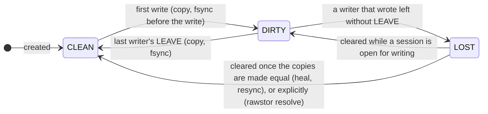
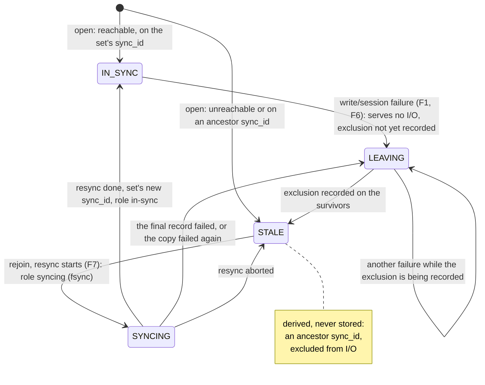
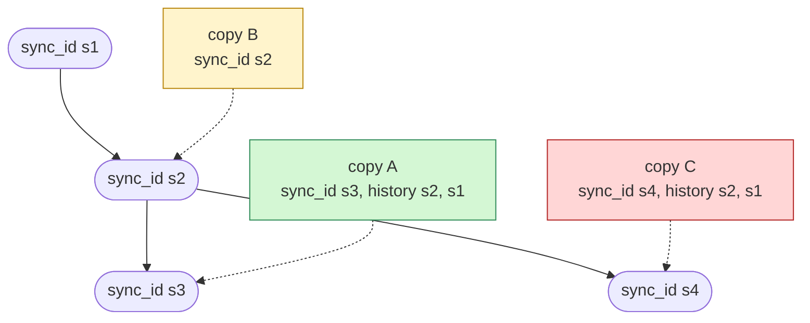
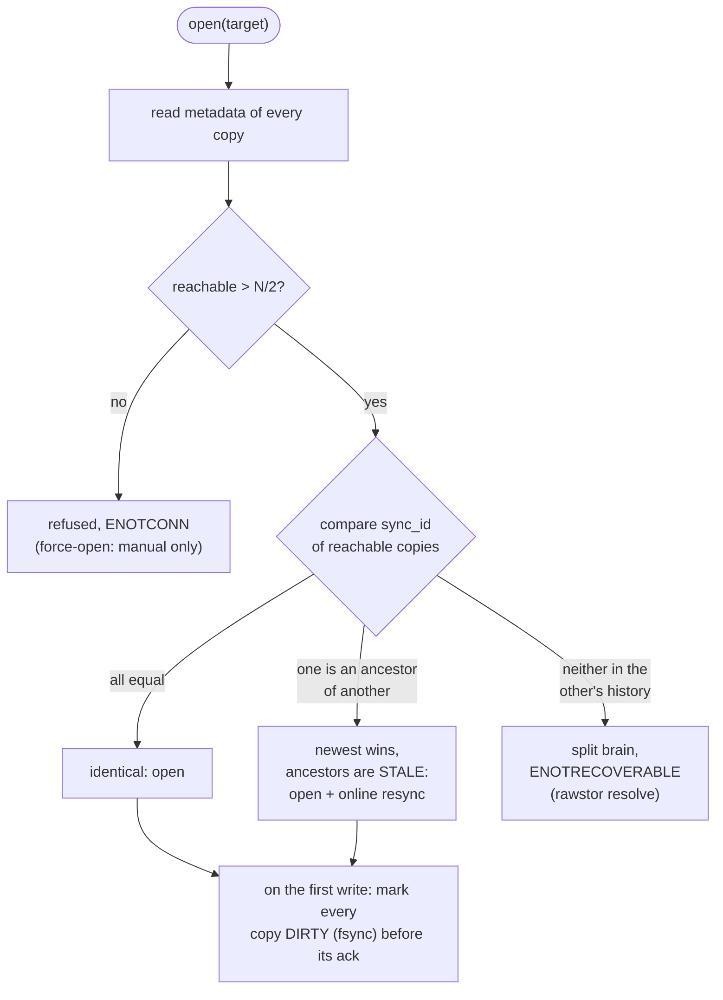
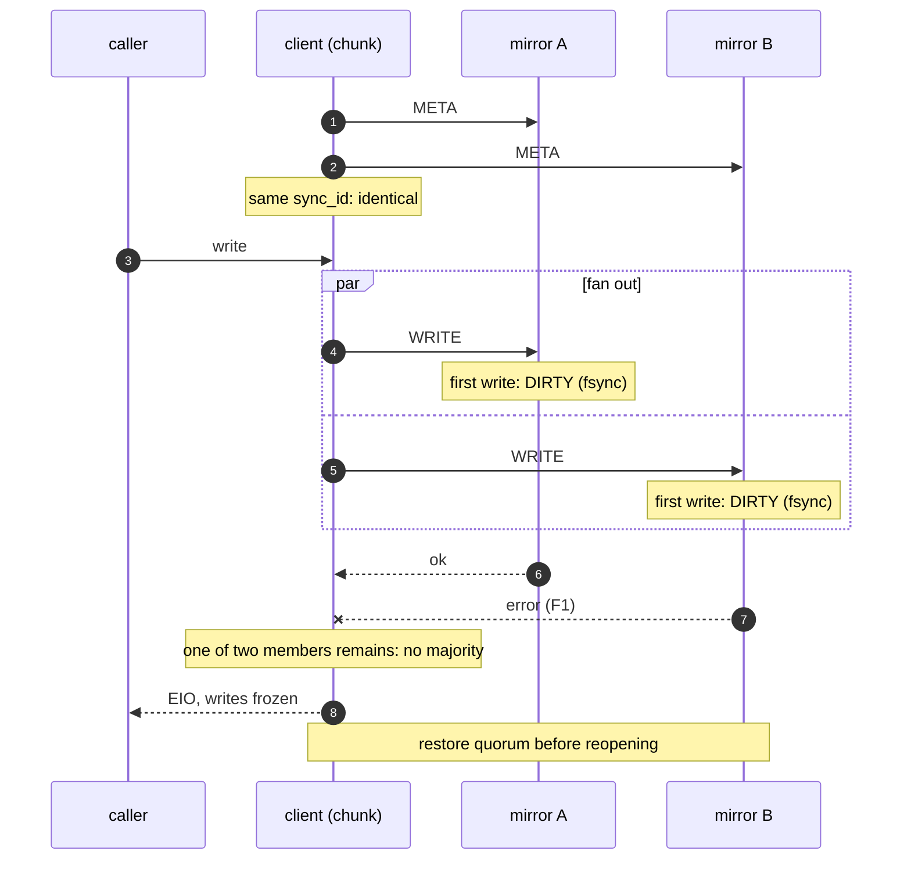
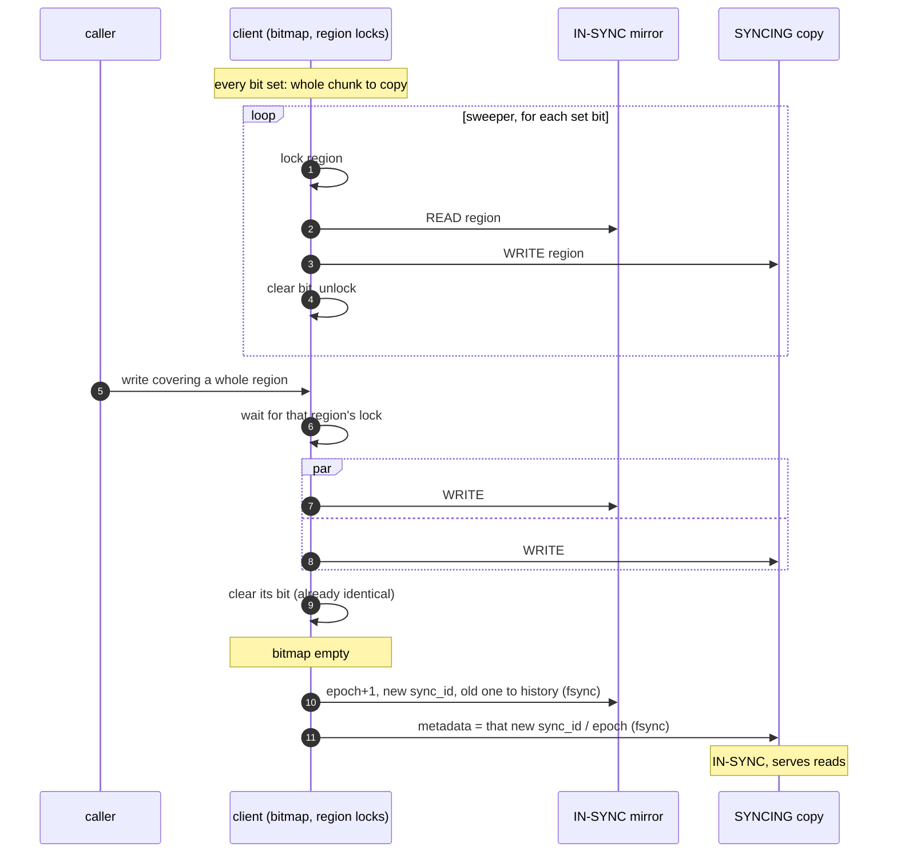

# Mirroring: Failure Model and Recovery

## Status

Legend: ✅ implemented · 🟡 partial · ❌ not implemented yet. *Stage* is this
document's own numbering (see *Implementation stages*); [MDS design](mds.md)
numbers its stages separately.

| Feature | Stage | Status | Where |
|---|---|---|---|
| Per-copy metadata (`state`, `epoch`, `sync_id`, history) on `file://` | 1 | ✅ | `src/file_backend.cpp` |
| Per-copy metadata on `lvm://` / `zfs://` (LVM tags, ZFS user properties) | 1 | ✅ | `src/lvm_backend.cpp`, `src/zfs_backend.cpp` |
| `META`, `SET_CONFIG`, `LEAVE`, `FLUSH` opcodes | 1 | ✅ | `include/rawstor/protocol.h`, `ost/src/client.cpp` |
| Metadata transitions fsynced before the ack | 1 | ✅ | `src/chunk.cpp` |
| `rawstor_target_meta()` / `rawstor_target_set_member_config()` | 1 | ✅ | `include/rawstor/target.h` |
| Quorum at open (> N/2), split-brain detection | 2 | ✅ | `src/chunk.cpp` |
| Degraded open, F10 recreate of a missing copy | 2 | ✅ | `src/chunk.cpp` |
| Degrade & continue (F1), write freeze below quorum | 2 | ✅ | `src/chunk.cpp` |
| Read failover and read-repair (F2) | 2 | ✅ | `src/chunk.cpp` |
| Copies keep their own `DIRTY`/`CLEAN`/`LOST`; clean close with `LEAVE`; `rawstor_object_abandon()` | 2 | ✅ | `src/slot.cpp`, `src/blk_backend.cpp`, `src/chunk.cpp` |
| Every member's role in each record; syncing is a role, not a state | 2 | ✅ | `src/chunk.cpp` |
| A `rawstor-ost` data session opens one copy through a Slot | 2 | ✅ | `ost/src/client.cpp` |
| Online resync with in-memory bitmap, region locks, zero-region `write_zeroes` | 3 | ✅ | `src/chunk.cpp` (`RESYNC_CHUNK`) |
| Reconnect probe and automatic rejoin of STALE mirrors | 3 | ✅ | `src/chunk.cpp` (`_probe_watch()`) |
| Several writable opens in one process (multiqueue) | 3 | ✅ | `src/chunk.cpp` (`MirrorControl`), `tests/test_multiqueue.cpp` |
| Several writer processes (multi-attach) | — | 🟡 | [Multi-attach](multiattach.md): stage 1 (protocol, member side) done, stage 2 (several processes) not |
| `rawstor show -v` per-chunk / per-mirror state | — | ✅ | `cli/show.c` |
| `rawstor resolve TARGET --winner=N [--offset]` | — | ✅ | `cli/resolve.c` |
| Force-open below quorum, read-only (`RAWSTOR_FORCE \| RAWSTOR_READONLY`; `--force` with `--readonly` in the exporters) | 2 | ✅ | `src/chunk.cpp` |
| Force-open below quorum for writing (CLI / opts) | — | ❌ | — |
| Heal of copies a vanished writer may have left different (F5) | 3 | ✅ | `src/chunk.cpp` (`_heal_maybe_start()`) |
| Persistent write-intent bitmap (resumable resync, cheaper heal) | 4 | ❌ | — |
| OST start identity in `META`: the heal never takes an OST-restarted copy as its reference ([known limitation](#known-limitation-the-degrade-barrier-window)) | 4 | ❌ | — |
| Metadata-only witness on MDS, OST or local backend | 4 | ✅ | [Witness](mds.md#witness), `Backend::set_config()`, `src/chunk.cpp` |
| Stored checksums / scrub | 4 | ❌ | — |
| Fastest-mirror read selection | 4 | ❌ | — |

## Overview

A comma-separated target list (see [Concepts](concepts.md)) makes the client keep N identical copies of a chunk on different backends -- each copy is a **slot**, addressed by one URI in the list. A plain (non-`mds://`) target is the degenerate single-chunk case: the whole object it addresses **is** that one chunk, so everything below applies to it directly; an `mds://` object's own chunks (`docs/mds.md`) each get this same treatment independently, possibly with different widths. This document defines the failure model for N-way mirroring: what can fail, how the client reacts, and how byte-for-byte identity of the copies is restored afterwards. Erasure coding is out of scope.

Status: stages 1-3 are implemented (per-copy metadata, quorum open, degrade & continue, read failover/repair, clean close, online resync with automatic rejoin through a periodic reconnect probe) for all backends, including `lvm://`/`zfs://` (native ZFS user properties / LVM tags — see below). Not yet implemented: a persistent write-intent bitmap (a crashed resync restarts from scratch and an unclean shutdown costs a full heal), an OST start identity so the heal can tell an OST restart from a client crash (until then it may overwrite the one copy that kept acknowledged writes, see *Known limitation*), stored checksums/scrub. Witness members and their degraded-open voting rules are implemented; interprocess mirror coordination is deferred to multiattach stage 2.

Error codes: open without quorum (including the case where every mirror is unreachable, F3) fails with `-ENOTCONN`; split brain (or no trusted member) fails with `-ENOTRECOVERABLE`; a write that loses its write quorum, or every member, on an already-open chunk fails with `-EIO`.

---

## Model and assumptions

- **One writer process per object.** An object is a virtual disk used by one client process at a time (e.g. one VM via `rawstor-vhost` or the QEMU driver); multi-attach (several writer processes) is not supported yet ([Multi-attach](multiattach.md)). Enforcing exclusivity (leases / exclusive open) is out of scope and is assumed. Inside that process the object may be open for writing several times -- every virtqueue of a multiqueue `rawstor-vhost`/`rawstor-vduse` device opens it on its own thread -- and those opens act as one writer (*Writers*).
- **Overlapping writes in flight at once** (two writes to the same blocks, the second issued before the first completed, through one open or several) leave those blocks unspecified, and the copies may differ there: each copy applies them in its own order. A guest never relies on that (page-cache writeback never has two writes of one page in flight); it is the same contract a single disk gives racing O_DIRECT writes.
- **Client-side replication.** The client fans out writes to all mirrors; OSTs do not know about each other and never talk to each other.
- **Identity** means: after recovery completes, all IN-SYNC copies are byte-for-byte equal. Writes that were never acknowledged to the caller may land on any subset of copies or none (RAID1 write-hole semantics — the application must not rely on them).
- **Write acknowledgement** to the caller requires completion on **all IN-SYNC mirrors** (latency = slowest mirror).

---

## Per-copy metadata

Each backend stores, next to the chunk's data, a metadata record (an extension of the current `.spec`, which today holds only `size`). The on-disk format is versioned.

| Field | Type | Meaning |
|-------|------|---------|
| `size` | uint64 | Logical chunk size (as today) |
| `state` | enum | `CLEAN` \| `DIRTY` \| `LOST`: the copy's own, kept by the copy (*DIRTY, CLEAN and LOST*) |
| `epoch` | uint64 | Monotonic counter; bumped on every change of mirror-set health/membership |
| `sync_id` | uint64 | Random id of the current sync set; regenerated only when the set's membership changes (see *When `sync_id` changes*) |
| `sync_id_history[4]` | uint64[] | Previous `sync_id`s (ancestry), DRBD-generation-UUID style |
| `roles` | uint8[] | Every member's role in the chunk's configuration, in member order: in-sync \| syncing \| excluded (*States and roles*) |

`STALE` is not stored — it is derived by comparing copies. The epoch,
`sync_id` and its history and the roles are the chunk's configuration as
a writer last set it on the copy (`RawstorObjectConfig`); `state` is the
copy's own.

A copy's `state`, kept by the copy itself (the diagram is the table of
`sync_state_transitions` in `src/slot.cpp`; an explicit `SET_CONFIG`
may record any of the three):

Its place in the sync set, as the writer sees it (the writer's in-memory
member state, `rawstd::Fsm<MemberState>` in `src/chunk.cpp`, whose
table is exactly the transitions below; `STALE` and `LEAVING` are never
stored, the stored role of both is excluded):

A crash mid-resync leaves the copy's record syncing (F8); the next open
derives its member state from the records again, as at any open.

### States and roles

A copy's record says two independent things about it:

| | `state` | role |
|---|---|---|
| About | The copy's own data, as its writers left it | The writer's decision about the copy |
| Values | `CLEAN`, `DIRTY`, `LOST` | in-sync, syncing, excluded (unknown: none recorded) |
| Written by | The copy itself, from the sessions it serves | The writer, `SET_CONFIG` |
| Where | This copy's record only | Every member's record: `roles`, one per member |

They cannot be one field because they are written by different parties at
different places. A copy is excluded precisely when it cannot be reached,
so its exclusion is recorded on the others and its own `state` stays as it
was. `LOST` is set by the copy when a session drops, which the writer may
never learn of. Any pairing occurs:

| | in-sync | syncing | excluded |
|---|---|---|---|
| `CLEAN` | closed cleanly | resync onto an idle copy | went offline while idle |
| `DIRTY` | open, being written | resync with writes duplicated onto it | failed mid-write |
| `LOST` | a writer vanished: copies may differ in its unacknowledged writes | resync onto a copy a writer left `LOST` | a writer vanished, then the copy was excluded |

The roles are in the order the writer lists the chunk's members (a plain
target's URIs, an `mds://` chunk's placement), so a copy's own role is the
entry at its own position in that order; `SET_CONFIG` carries that
position for its receiver. The writer fills `roles` from its
members' states in every configuration it sets. An unreachable copy's
record keeps whatever it last held, which is why only a copy's own role is
read from its record, never another member's: a copy whose own role is
syncing is mid-resync, and an open treats it as stale (F8).

### DIRTY, CLEAN and LOST

Data I/O changes the copy's `state` from the sessions it serves. Explicit
metadata transitions use `SET_CONFIG` with an optional
`RawstorObjectSyncStateValue` for data and witness members alike; omitting
state preserves it.

- **`DIRTY`**: before the first write into a `CLEAN` copy the copy marks
  itself `DIRTY` (fsync), under its record lock. Later writes see a cached
  flag and skip it.
- **`LEAVE`** is a session's clean departure: the writer has flushed and
  wants the copy to count it gone. `rawstor-ost` closes the session's
  object cleanly on `LEAVE`; a client's own direct open does the same at
  `rawstor_object_close()`.
- **`CLEAN`**: when the last session open for writing leaves cleanly, the
  copy marks itself `CLEAN` (fsync). Sessions are counted under the record
  lock, and a session joins before its first write, so the mark never
  races a write. `META` reports the count (`writers`).
- **`LOST`**: a session that wrote and goes without `LEAVE` -- its
  connection dropped, the client called `rawstor_object_abandon()`, or the
  chunk's close found its writes might not all have landed -- leaves a
  `DIRTY` copy `LOST`: the copies may differ in that writer's
  unacknowledged regions. `LOST` sticks: a later clean departure does not
  clear it, and neither does a new configuration. Only
  `RAWSTOR_CONFIG_CLEAR_LOST` does: after a resync or the heal that makes
  the copies equal (F5), and `rawstor resolve`, for copies made consistent
  by hand.
- A session that never wrote leaves the state as it is, cleanly or not.
- A client that replaces a broken connection (a short write, a reset) opens
  the new one before closing the old, under the same session id (one per
  opened object, so per queue in `rawstor-vhost`)
  (`SET_OBJECT`, `docs/protocol.md`). The new connection takes over the
  old one's writes: the client replays every write it has not seen
  acknowledged, so the copy is not `LOST`. A connection the server finds
  gone before its replacement has opened still leaves the copy `LOST`.

The chunk records `CLEAN` only after every intended `LEAVE` succeeds. A failed
departure records `LOST` on the surviving members before closing their Slots.

The chunk's `close()` sends `LEAVE` to every in-sync member only when its
flush succeeded, none of its writes failed outright and every exclusion is
recorded; otherwise it closes without one, and the members it wrote go
`LOST`. An open reads `LOST` as `DIRTY` and heals the copies (F5).

The state, the session count and the record lock live in the process that
opens the copy (`Slot::CopyState`, shared by all its sessions to that copy):
a copy is a member of whichever process stores it.

Witnesses have no data snapshots. Removing a snapshot from a witness Slot
succeeds without changing its live metadata record. Target dispatches snapshot removal
to every member; the Slot handles metadata-only members locally.

Creating a mirrored chunk records the same initial configuration on every
member: epoch 1, a new sync ID, all roles IN_SYNC, and state CLEAN. Members
are recorded in location order, so an optional last witness becomes a voter
only after all data copies have that configuration. Creation rolls back on
failure. A single-member target keeps its backend's initial CLEAN state.

### One copy per server

To its clients a `rawstor-ost` is one copy of the chunk, whatever it
stores it on: the client counts it as one member, with one position in
`roles`, and never sees what is beneath.

A server accepts exactly one backend location and operates on it through
`Slot`. Its location's record is the copy's record: `SET_CONFIG`, `LEAVE`,
`META` and the register requests act on that member. A list of locations
is rejected at startup with `EINVAL`; the client-side `Chunk` coordinates
mirroring across servers.

At the API level (`include/rawstor/target.h`) this record is split by cost and mutability: `RawstorObjectSpec` (`size`, `width`) is the cheap, always-fail-over-safe half read by `rawstor_target_spec()`; the copy's own `state` and session count plus `RawstorObjectConfig` (`epoch`/`sync_id`/`sync_id_history`/`roles`) are the mirror consistency half, read via `rawstor_target_meta()` (which returns them all, composed as `RawstorObjectMeta{spec, member_role, state, writers, config}`, one entry per URI of the one chunk named by its own explicit `offset` parameter — unlike `spec()`'s single-answer fail-over, so a caller can see every copy of that chunk's own state; a URI that doesn't answer gets a zero-filled entry, see its own doc comment). The writer, `rawstor_target_set_member_config()`, sets the configuration and optional state atomically on one real member of one chunk at a time (its own `offset` and `member_index` parameters, the same order `meta()` reports that chunk's own members in), and is part of the public API too, but is a sharp tool: it exists for this project's own tests and tooling that already understands this model (e.g. `rawstor resolve`'s own split-brain recovery flow) — setting mirror consistency state by hand can desynchronize a target's copies in ways the library's own quorum/reconciliation logic isn't designed to recover from automatically, so it isn't meant for routine application use. On an `mds://` object target (docs/mds.md) — which has many chunks, each with its own slots, not addressable through any flat per-URI `_uris` list at all — both calls resolve `offset` to that object's own real chunk via a live MDS round trip first (`-ENOENT` if the object has no chunk there), then operate on that chunk's own real members exactly as for a plain target: the real per-chunk DIRTY/CLEAN state lives one level down, but is fully reachable through the object-level target, not synthesized.

### Comparison rules (at open)

| Observation | Verdict |
|-------------|---------|
| Same `sync_id`, all `CLEAN` | Copies are identical |
| `sync_id` of copy A appears in history of copy B | A is an ancestor → A is stale, resync A ← B |
| Different `sync_id`s, neither is an ancestor of the other | **Split brain** — automatic resync forbidden. Unreachable through automatic paths thanks to quorum rules (below); kept as defense in depth |
| Own role syncing | Copy is untrusted (interrupted resync) — always stale |

How the lineage decides it: copy B's `sync_id` is in copy A's history, so
B is an ancestor (stale, resynced from A); copies A and C forked after
`s2`, so neither is an ancestor of the other — split brain.

### STALE copies

A copy is **STALE** when it lacks acknowledged writes the rest of the sync
set has: its content can't be trusted for reads and must be resynced
before it counts as a full copy again. Nothing on the copy says so — its
own record may well read `CLEAN` (a copy can't know locally what it missed
while offline) — so staleness is always a verdict about a copy relative
to the others, reached one of two ways:

- **At open**, by the comparison rules above: an ancestor `sync_id`, a
  syncing role, or a blank `sync_id` 0 next to an established sync set.
- **At runtime**, when a write or the session to a member fails (F1, F6):
  the survivors move to a new `sync_id` behind a barrier, and the failed
  member — still on the old one — is marked STALE in memory.

A STALE copy is excluded from reads and writes. Once it is reachable again
(the reconnect probe, or the next open), an online resync copies the
authoritative data onto it (role syncing), and on completion it joins the
sync set as IN-SYNC, under the new `sync_id` its joining gives the set.

### When `sync_id` changes

A `sync_id` names a membership: the set of IN-SYNC copies holding every
acknowledged write. It is regenerated (with `epoch`+1, the old one pushed
to history) exactly when that membership changes, in either direction:

- **A copy leaves the set at runtime**: a member degraded by a
  write/session/read-repair failure (F1, F2, F6) — behind the degrade
  barrier if the chunk is `DIRTY`, otherwise by the dirty gate before the
  first write.
- **A copy is left out at open without its own record proving it
  stale**: an unreachable one (F4 — its record may well carry the current
  `sync_id`, nothing tells otherwise) or one excluded by size alone with
  the current `sync_id` (F11). The new `sync_id` is recorded by the dirty
  gate, before the first write is acknowledged.
- **A copy rejoins** (F7): once its resync is done, the IN-SYNC copies move
  to a new `sync_id` first, then the rejoining member adopts it. Interrupted
  in between, the member is still syncing on its old record. A record
  naming the old membership must never match the new composition; this
  applies to DATA and WITNESS alike.

Everything else keeps the identity:

- **Reopening with the same membership**, stale copies included: a copy
  on an ancestor `sync_id`, a blank one (`sync_id` 0), or one marked
  syncing is already excluded by its own record, so a session that
  starts and ends without it — e.g. it stays unreachable to the probe, or
  its resync is interrupted again — writes the same `sync_id`/`epoch`.
- **Mark `DIRTY`, clean close**: only `state` changes.

Two more cases write a new `sync_id`: a legacy set (every copy on
`sync_id` 0) gets its first one at the first write, and `rawstor resolve`
(F9) gives its winners a new dominant one.

The open path cannot tell an unreachable copy excluded in an earlier
session from one that just went down, so every session that starts with a
copy unreachable moves to a new `sync_id` once it writes. This is
conservative: the identity only churns while the copy stays down.

### Durability rule

Metadata transitions (marking `DIRTY`, epoch/`sync_id` bump, resync completion) are performed on the backend **with fsync**, and **before** any dependent operation is acknowledged to the caller. These transitions are rare, so this is cheap. Data writes are *not* fsynced per-request; the resulting exposure is covered by rule F6 below.

---

## Quorum: excluding split brain by construction

The same rules apply to DATA and WITNESS members. N is the total number of members.

Key invariant: **every acknowledged write exists on a set of copies that intersects any future auto-start set.** Therefore the newest `sync_id` is always visible at auto-start, and two disjoint write histories cannot be created through automatic paths.

- **Auto-start (open) requires strictly more than N/2 reachable mirrors** (N=2 → both). Within the reachable majority, the copy with the newest `sync_id` is authoritative (majority intersection guarantees it is present); stale copies get an online resync.
- **Below quorum: manual approval only.** A read-only open needs the same quorum as a writable one; only `RAWSTOR_FORCE | RAWSTOR_READONLY` opens below it, reading from the reachable members as they are (no state recorded, no read-repair or resync). `RAWSTOR_FORCE` alone does not open a writable object without quorum; a force-open for writing is not implemented. There is deliberately no "clean exception": `CLEAN` only means "I was closed correctly" — a copy cannot know locally that it did not miss anything while offline. Alternating offline periods of `CLEAN` copies would produce split brain.
- **Runtime (chunk already open):** continue while more than N/2 members remain IN_SYNC; at or below N/2, writes freeze with EIO. Two data copies without a witness therefore require both copies throughout the writable session.
- **What counts toward a quorum.** Opening counts reachable, existing members, including nonempty stale ones: every acknowledged write set was a majority, so any reachable majority intersects it. The history comparison identifies the newest generation and requires an authoritative data source. Unreachable members and blank records do not count. Runtime writes count only IN_SYNC members with the recorded configuration; stale or syncing members cannot vote until their rejoin completes.
- **`sync_id_history` stays as defense in depth**: it catches consequences of a wrong manual force-open, an OST restored from backup, or bugs.
- **Witness members.** An explicitly declared metadata-only member can
  participate in the same synchronous membership barriers and quorum,
  only for an even number of data copies. With N data copies and one witness,
  both writable open and runtime writes require a majority of N+1 members:
  N/2 matching data copies plus witness, or N/2+1 data copies alone. A failed
  witness update excludes its vote; writes below quorum freeze. See
  [Witness](mds.md#witness). Reads and data writes use only DATA members. All members use the same rejoin transitions; a witness needs no data copy during resync.

The open decision, put together:

---

## Write lifecycle (all mirrors healthy)

1. **Open:** read metadata of all copies, verify identity. The copies stay as they are (`CLEAN` after a clean close) -- opening alone, or a read-only session, never marks them.
2. **First write** of the process (or read-repair): each IN-SYNC copy marks itself `DIRTY` (fsync) before the write reaches it. A membership change not yet recorded (a copy unreachable at open, or degraded while still `CLEAN`) gets a new `sync_id` from the client's dirty gate before the write is sent — stale copies already on an ancestor `sync_id` don't (*When `sync_id` changes*). Later writes, through any open of the process, skip the gate.
3. **Write:** fan out to all IN-SYNC mirrors, acknowledge when all complete.
4. **Clean close:** flush data, then `LEAVE` from every open of the process on its own sessions to the IN-SYNC copies; each copy marks itself `CLEAN` (fsync) once no session open for writing is left.

The same with a mirror failing mid-write (F1, N = 2):

---

## Writers

Every writable open of a chunk gets its own `Chunk` -- its own sessions to
the copies, on the caller's own thread and `rawio` queue -- but the opens of
one process are one writer: they share one control state per chunk,
`MirrorControl`, found in a process-wide registry by object id and chunk
offset. It is the only place the chunk's state lives: the sync set
(`epoch`/`sync_id`/history/size), `DIRTY`, the frozen flag, every member's
state and record, the exclusions not yet recorded with a new `sync_id`,
and the running resync. A `Chunk` keeps only its sessions and whether each
one works. READONLY, bound-version and single-member chunks have a control
state of their own. A process opens a chunk on one member list: an open
naming other locations while the chunk is open fails with `-EINVAL`.

- **Transitions happen once, for every open.** Open, the dirty barrier, the
  degrade barrier, the rejoin and the `LEAVE` at close run under the
  chunk's transition lock. The first open reconciles the copies' records
  (*Comparison rules*); a later one takes the state as it is, since the
  records may be mid-transition. Whichever open passes the dirty gate
  first, the others find it passed. A member one open excludes is excluded for
  all of them, and a member the process counts in-sync but a later open
  cannot reach is excluded before that open returns.
- **The transition lock never blocks a thread.** It is held across metadata
  round trips (fsync on the copies), so a waiter only suspends the
  operation that needs it: it parks on a wakeup of its own (a pipe polled
  on its own queue) that the holder signals on release, and its queue
  keeps serving everything else meanwhile.
- **No lock on the hot path.** A read or write learns the member states,
  `DIRTY` and the frozen flag from atomic loads. A mutex is taken only by
  writes while a resync runs (*Online resync algorithm*, step 4).
- **A member being excluded (`LEAVING`)** serves no I/O from the moment it
  fails. A write that skipped it, through any open, is acknowledged only
  once its exclusion is recorded on the survivors (F1).
- **All member counts use the same majority rule**, including two data copies without a witness.

---

## Failure cases

| # | Case | Detection | Reaction | Identity recovery |
|---|------|-----------|----------|-------------------|
| F1 | Write failure on one mirror M (network / EIO / timeout, per-connection retries exhausted) | error from the connection layer | If survivors > N/2: **suspend acks** → on survivors: `epoch`+1, new `sync_id`, old one pushed to history, fsync → mark M STALE in memory, exclude from I/O → resume acks. If survivors ≤ N/2 — **freeze writes** (see quorum). Log + degradation event | Online resync when M returns (F7) |
| F2 | Read failure / transport hash mismatch on a mirror | error / EPROTO in the read path | Retry the read from another IN-SYNC mirror, return the data. **Read-repair**: rewrite the region on the failing mirror; if the repair write fails → degrade as in F1 | Pointwise via read-repair; on degradation — F7 |
| F3 | All mirrors failed | all connections dead | At open: refused with `ENOTCONN` (degenerate case of F4's below-quorum refusal). On an already-open chunk: `EIO` to the caller on the next write, chunk unavailable. Periodic reconnect attempts | — (no copy available) |
| F4 | OST unreachable at open | connect failure | Reachable > N/2 → degraded open on the majority (it is guaranteed to contain the newest `sync_id`); on survivors `epoch`+1 / new `sync_id` **before the first write ack**. Reachable ≤ N/2 (N=2 with one down falls here) → **auto-start refused**, manual force-open only (not yet implemented) | F7 when it returns |
| F5 | Client crash with writes in flight | at next open: all copies `DIRTY` or `LOST` with the same `sync_id` (`LOST` when the client reached them through `rawstor-ost`, which saw its sessions drop without `LEAVE`) | All copies are "valid" (they diverge only in unacknowledged regions) and stay in the set, voting and taking every write: writes go on at once. Reference: the first `CLEAN` copy, else the first copy in the target list (it may be the copy that lost acknowledged writes in the degrade-barrier window, see *Known limitation*); reads are served from it until the heal is done | Heal: a background sweep overwrites every other not-`CLEAN` data copy with the reference's content, one copy at a time, region by region, mutually exclusive with client writes (a full copy -- the main argument for a persistent bitmap in v2). The `LOST` marks are cleared once every copy is equal; an interrupted heal (close, crash) leaves them, and the next open starts it again. Not run while another session is open for writing on any copy |
| F6 | OST crash/restart → acknowledged writes lost from page cache (data is not fsynced) | **not detectable from metadata** (the copy looks up to date) | **Conservative rule: any session loss to a mirror while the chunk is open `DIRTY` ⇒ that mirror is STALE (run the F1 procedure), even if it reconnects immediately.** We cannot know what it lost, so we do not trust it | Full resync (F7) overwrites whatever was lost |
| F7 | A stale mirror returns (rejoin) | reconnect probe + `sync_id`/`epoch` comparison: ancestor → stale | Record the copy's role as syncing (fsync), start an **online resync** (algorithm below) without stopping client I/O | On completion: the IN-SYNC copies move to a new `sync_id`/`epoch` (fsync), then the copy adopts it, state `DIRTY` if the chunk is (fsync) → mirror is IN-SYNC, reads allowed |
| F8 | Client/OST crash during resync | the copy is left with role syncing / an old `sync_id` | Copy is untrusted | Resync from scratch (v1; resumable with the persistent bitmap in v2) |
| F9 | Split brain (disjoint write histories) | different `sync_id`s, neither in the other's history | **Excluded in automatic paths by the quorum rules.** Can only arise from a wrong manual force-open, an OST restored from backup, or a bug → then: open refused with a clear error, no automatic winner | Operator: `rawstor resolve TARGET --winner=N` (`rawstor show -v`'s own `slot[N]` index) → winner gets a new `sync_id`, the loser gets a full resync |
| F10 | Chunk copy missing on one OST (disk lost, OST reprovisioned) | ENOENT when opening the copy (a `file://` location whose directory is gone altogether is unreachable instead, ENOTCONN -- e.g. an unmounted disk) | At open, recreate that copy blank (ALLOCATE, sized off a surviving copy's own META) and treat it as stale. Only when the surviving copies alone are a majority (> N/2): a blank copy never counts toward the quorum, or a survivor that fell behind could be opened as authoritative. So N=2 with one copy missing is not healed automatically: the open fails the quorum check, and the operator recreates it (`rawstor create` on its location) and records the chosen winner with `rawstor resolve` before reopening. Every copy missing is never recreated (nothing vouches the chunk held no data) and the open fails ENOENT. Not on a read-only open or a version | Full online resync for DATA; metadata rejoin with no data copy for WITNESS (F7) |
| F11 | Copy size mismatch (mixed file/blkdev backends round up to extent/volblocksize — see `src/blk_backend.hpp`) | logical spec comparison at open | If reachable metadata disagrees on logical size, width or chunk size, the same strict majority must agree on both spec and configuration. Other shapes are stale and cannot vote, serve I/O or rejoin until their spec matches. Without an agreeing majority, open fails before any replacement is allocated. Physical allocation does not determine the logical size and is not checked at open; short DATA reads fail with EIO | — |
| F12 | Silent on-disk corruption (bit rot) | the transport hash does **not** catch it (the server hashes already-rotten data). `zfs://` catches it by itself; `file://` has nothing | v1: documented limitation; a scrub tool (chunk-wise comparison of copies) detects divergence under `CLEAN` metadata but cannot tell which copy is right | v1: operator decision. Long term (v3): stored per-chunk checksums |

---

## Online resync algorithm (client-driven, in-memory bitmap)

Requirements: no downtime, and regions already rewritten by the client onto all mirrors must not be copied again.

1. A bitmap lives in client memory; resync granularity ~1 MiB (a 1 TiB chunk → 128 KiB of bitmap) -- an unrelated, smaller-grained meaning of "chunk" than the mirrored entity this whole document is about (`RESYNC_CHUNK` in code). Initially all bits are set = "needs copy" (v1 is always a full resync).
2. Client I/O continues throughout: reads are served **only from IN-SYNC mirrors**; **writes go both to IN-SYNC mirrors and to the SYNCING copy**. A write that fully covers a chunk clears its bit (that region is already identical). A partially covered chunk keeps its bit.
3. A sweeper walks the bitmap: for each set bit it reads the chunk from a source mirror, writes it to the SYNCING copy, clears the bit. A chunk that reads back all zeros (typically never written) goes out as `write_zeroes` with unmap instead -- no payload on the wire, and the SYNCING copy stays sparse. Rate limiting (option) protects foreground I/O.
4. **Ordering hazard, sweeper × client write to the same chunk:** a per-chunk lock in the writer process's memory, shared by all its opens — a client write to a chunk currently being copied waits for the chunk copy to finish (or vice versa). Otherwise the sweeper could overwrite a fresh client write with stale source data.
5. Bitmap empty → under the transition lock, the IN-SYNC copies move to a new `sync_id`/`epoch` (fsync), and the SYNCING copy's metadata is set to it (fsync) → the mirror is IN-SYNC (*When `sync_id` changes*). Client writes go on meanwhile, duplicated onto the copy; one that fails on it after its metadata is set excludes it again (F1) before that write is acknowledged.

One resync runs per chunk at a time, for every open of the process at once.
The open that starts it owns the sweep and the commit; every other one
duplicates its writes onto the SYNCING copy too, opening a session to it if
it has none (an open that cannot reach the copy aborts the resync). Writes
an open started before it joined the resync were not duplicated: the sweep
starts only once every open joined and those writes settled.

If the client or the target OST crashes mid-resync, the copy's role remains syncing and the resync restarts from scratch (F8). Closing the open that owns the resync aborts it the same way, unless the copy's metadata is already being set: `close()` then waits for the rejoin to finish. A persistent write-intent bitmap (v2) makes it resumable and shrinks the F5 full resync to recently-touched regions.

### Known limitation: the degrade-barrier window

Without per-write fsync there is an irreducible window between an
acknowledged write and the durable exclusion of a failed member (one metadata
round trip): if an OST crash (losing acknowledged writes from page cache)
is followed by a client crash *before* the F1/F6 barrier lands, the next
open sees all copies `DIRTY` in the same sync set (F5) and the
reference may be the member that lost data. Closing this window
requires synchronous durable data writes; it is accepted for now and
bounded by the barrier latency.

The F5 heal turns that window from an ambiguity into a loss. When no copy
is `CLEAN` -- which is every restart after a crash -- the first copy is the
reference and the heal overwrites the others with it. If the reference is
the one that lost acknowledged writes, the heal destroys the only copy that
still held them. Metadata cannot tell this case from an ordinary client
crash: both leave the copies `DIRTY` or `LOST` in one sync set. Refusing
to heal when no copy is `CLEAN` would stop the heal in the one case it
exists for, so it runs, and this stays an accepted risk until the
following is done.

Planned (stage 4, *OST start identity*): every OST reports a start
identity in `META`, a value fixed for one run of the server, and a copy
records the identity of the run that marked it `DIRTY`. At open, a copy
whose OST has been restarted since that mark is the suspect: it may have
lost acknowledged writes from the page cache, so it is never the heal's
reference, and when every copy is suspect the heal does not run and the
operator resolves the chunk (`rawstor resolve`). A backend that reports
no identity is never suspect. This needs a new `META` field and a field in the copy's
record, so it is a wire and format change.

### Two data copies and a witness

Two data copies without a witness freeze writes when either member fails.
Adding a witness provides three votes, so a data copy and the witness can
continue together. The witness records membership and generation but holds
no data: acknowledged degraded writes still have only one data copy until
the failed DATA member returns and resyncs. A third DATA copy provides both
a vote and another copy of the contents.

---

## Protocol and code changes

- **`include/rawstor/protocol.h`** — new opcodes:
  - `META` — read full per-copy metadata (size + width/chunk_size/member_role + state/epoch/sync_id/history); the one metadata round trip every backend answers, `rawstor_target_spec()` included (replaces the separate, cheaper `SPEC` opcode -- size only, no mirror-consistency-state lookup -- added in 0.2.3 and retired here: no backend ever answered it with more than a partial `RawstorObjectSpec` anyway);
  - `SET_CONFIG` — write the chunk's configuration to a copy (no `size`, and never the copy's own state), fsynced on the server;
  - `LEAVE` — a session's clean departure; the copy marks itself `CLEAN` once no session open for writing is left;
  - `FLUSH` — fdatasync of object data; needed for clean close and so that `rawstor-vhost`/QEMU can forward guest flushes.
  - An old server receiving an unknown opcode must answer `-ENOSYS`. There is no wire version field — acceptable before 1.0.
- **`src/file_backend.cpp`** — versioned `.spec` format; fsync of metadata.
- **`src/lvm_backend.cpp`/`src/zfs_backend.cpp`** — a raw block device has no `.spec` file and a reserved header/footer region is incompatible with objects already created (data occupies the device from byte 0). Logical size and copy metadata use each backend's own native, transactional storage: a ZFS user property (`rawstor:meta`, set/read via `zfs set`/`zfs get`) or an LVM tag (`rawstor.meta=...`, via `lvchange --addtag`/`--deltag` and `lvs -o lv_tags`), encoded as a compact colon-separated hex string (`meta_encode()`/`meta_decode()` in `src/blk_backend.{hpp,cpp}`). The logical size is persisted at creation and is independent of physical allocation; witnesses retain it too. Both mechanisms share the device/dataset's own failure domain and are set in the same command as creation, so there is never a window where the volume exists without one. A volume with no recorded value (created before this existed, or by something else) is **not** trusted as legacy-CLEAN the way an old `.spec` record is — it fails `meta()`, which the caller already treats as case F10 (untrusted member, needs a resync).
- **`ost/session.cpp`** — handlers for the new opcodes.
- **`src/chunk.cpp`** — per-mirror state machine (IN-SYNC/LEAVING/STALE/SYNCING per member, recorded as every member's role, in the chunk's `MirrorControl` shared by the opens of one process, *Writers*), quorum checks at open, degraded open, the degradation procedure (F1: suspend acks → bump survivors' metadata → resume), read failover + read-repair, the resync engine (bitmap + sweeper + per-chunk locks), reconnect probes for STALE mirrors. Cross-mirror logic lives in `Chunk`; `Slot` keeps only per-location retry/reopen.
- **`cli/`** — `rawstor show -v` prints one `chunk[OFFSET]` block per chunk (`rawstor_target_spec()`'s own size/chunk_size say how many), each with a `mirror[N]` per copy of that chunk and its own state; `rawstor resolve TARGET --winner=N[,N...] [--offset OFFSET]` declares one or more mirrors of the targeted chunk(s) jointly authoritative after split brain (F9) -- every chunk in the object if `--offset` is omitted -- writing them all the same new dominant `sync_id`, one member at a time via `rawstor_target_set_member_config()` with `RAWSTOR_CONFIG_CLEAR_LOST`, so every mirror of that chunk NOT listed gets a full resync on the next open. Still missing: `rawstor-cli force-open` / an opts flag (below-quorum start, explicit manual approval).

### Implementation stages

1. Metadata + new opcodes + the fsync protocol for metadata.
2. Quorum rules at open + degrade & continue / write freeze + read failover and read-repair.
3. Online resync.
4. Witness members are implemented; v2+ work includes persistent write-intent bitmap, OST start identity, stored checksums / scrub, fastest-mirror read selection.
