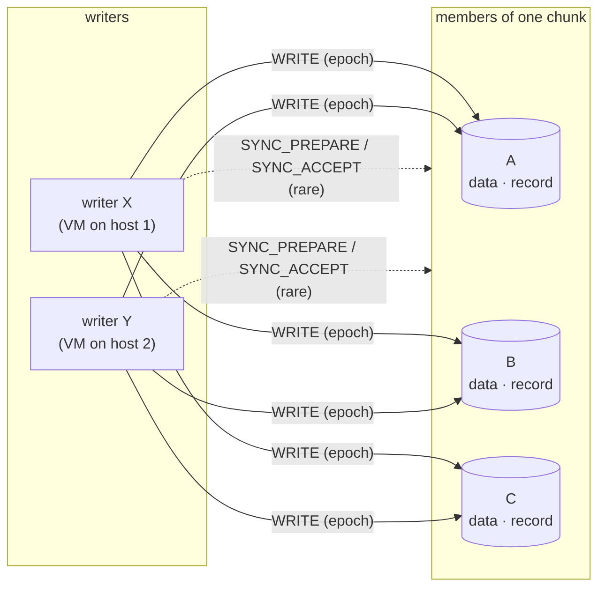
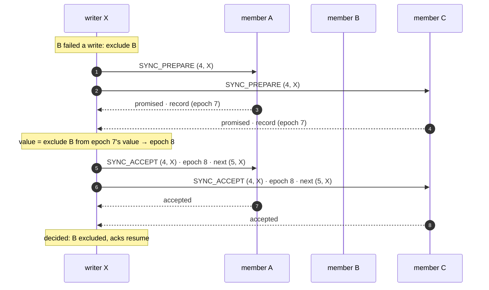
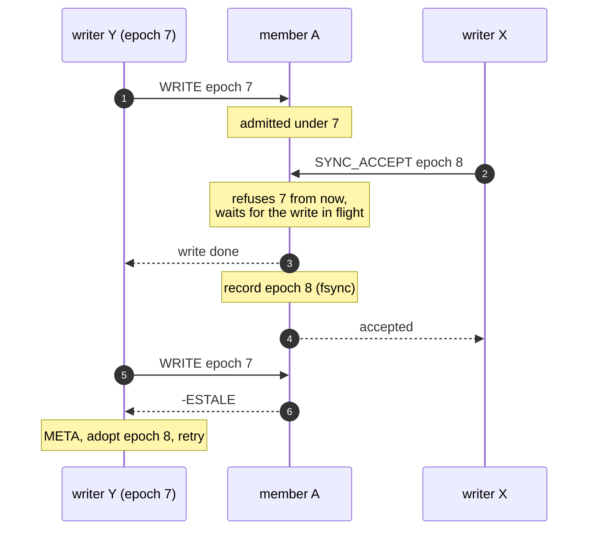
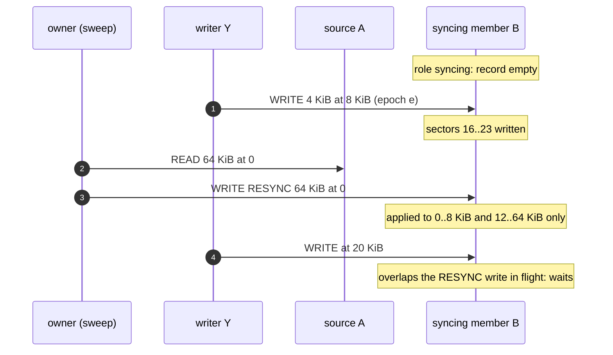

# Multi-attach: several writers of one mirrored object

## Status

Legend: ✅ implemented · 🟡 partial · ❌ not implemented yet. *Stage* is this
document's own numbering (see *Implementation stages*);
[Mirroring](mirroring.md) and [MDS design](mds.md) number their stages
separately.

| Feature | Stage | Status | Where |
|---|---|---|---|
| Writable opens of one process share the chunk's state; transitions once per process | 1 | ✅ | [Mirroring](mirroring.md#writers), `src/chunk.cpp` (`MirrorControl`) |
| Acceptor rules (`rawstd::caspaxos::Acceptor<V>::prepare()` / `accept()`) | 1 | ✅ | `librawstd/include/rawstd/caspaxos.hpp`, [CASPaxos](caspaxos.md) |
| A copy's record carries the register: `promised`, `accepted`, and `resync_owner` in the configuration | 1 | ✅ | `src/blk_backend.cpp` (`meta_encode()`) |
| `SYNC_PREPARE` / `SYNC_ACCEPT` on every member, reply carries the actual record | 1 | ✅ | `src/slot.cpp`, `ost/src/client.cpp` (`_sync`), `rawstor_target_sync_prepare()` / `_accept()` |
| One record lock and one writer count per copy in a process (`Slot::CopyState`) | 1 | ✅ | `src/slot.cpp` |
| Copies keep their own `DIRTY` / `CLEAN`; `LOST`; `LEAVE`; `rawstor_object_abandon()` | 1 | ✅ | [Mirroring](mirroring.md#dirty-clean-and-lost) |
| Live writer count in `META` | 1 | ✅ | `RawstorObjectMeta.writers` |
| A `rawstor-ost` data session opens one copy through a Slot | 1 | ✅ | [Mirroring](mirroring.md#one-copy-per-server) |
| Syncing is a role, not a `state`; a copy learns its own from its position in the request | 1 | ✅ | [Mirroring](mirroring.md#states-and-roles), `member_index` in `SYNC_ACCEPT` |
| `epoch` on write frames, `-ESTALE` below the copy's epoch, drain on raise | 1 | ✅ | `src/slot.cpp` (`Admission`) |
| `RESYNC` flag on writes; client-write record of a syncing copy | 1 | ✅ | `src/slot.cpp` (`Resync`) |
| `Proposer<V>`: a change as a coroutine over a pluggable transport | 2 | ✅ | `librawstd/include/rawstd/caspaxos.hpp`, [CASPaxos](caspaxos.md#api) |
| Every transition of the client through the register: dirty gate, exclusion, resync start and rejoin, end of a heal | 2 | ✅ | `src/chunk.cpp` (`Chunk::_decide()`, `_record()`) |
| The client stamps writes with its chunk configuration epoch | 1 | ✅ | ordinary Chunk operations supply the current epoch |
| Adoption of the register value on `-ESTALE` from another writer process | 2 | ✅ | `src/chunk.cpp` (`Chunk::_adopt()`, `_adopt_locked()`, `_fan_out_write()`) |
| `LOST` at open and at runtime: resync of the losers | 2 | 🟡 | one process: its open heals the copies in the set and then clears `LOST` ([Mirroring](mirroring.md), F5); several writers: not implemented |
| Resync across processes (`resync_owner`, sweep with `RESYNC`, lease of a silent owner) | 2 | ✅ | `src/chunk.cpp` (`_resync_run()`, `_resync_renew()`, `_lease_watch()`, `_resync_release()`) |
| `LOST` cleared by a rule on the accepted value | 2 | ✅ | [Clearing `LOST`](#clearing-lost), `src/slot.cpp` (`clears_lost()`) |
| `SET_CONFIG` and `rawstor_target_set_member_config()` removed; `rawstor resolve` decides through the register | 2 | ✅ | `cli/resolve.c` |
| The client keeps the register value once per chunk, not per member | 2 | ✅ | `MirrorControl` (the decided configuration and the `Proposer`), [The register](#the-register-caspaxos) |
| OST serves one backend Slot; mirroring is coordinated by the client | 1 | ✅ | [Mirroring](mirroring.md#one-copy-per-server) |
| Witness participation in the configuration register for N = 2 | Before 2 | ✅ | `SYNC_PREPARE` / `SYNC_ACCEPT` on OST, file, LVM, ZFS and MDS (SQLite) witnesses; [MDS design](mds.md#witness) |

Stage 1 introduced the public ABI, wire layouts and data-member behavior
needed by multi-attach while the client still operates as one writer
process. Witness support, a prerequisite, is implemented. Stage 2 integrates
clients on different processes and machines with the configuration register,
including the witness vote for two data copies: the client's own transitions
already go through it, and the adoption of another writer's decision and
the resync across processes are what is left. There is no single-acceptor
exception to the register quorum.

## Overview

A **writer** is a process with the object open for writing: one VM's
`rawstor-vhost`/`rawstor-vduse`, both ends of a live migration for a
moment, every node of a cluster filesystem on a shared disk.

**Stage 1** makes the threads of one process one writer: every virtqueue
of a multiqueue device opens the object on its own thread, and those opens
share one control state per chunk, so they never race each other's
metadata updates on the members ([Mirroring](mirroring.md#writers)). It
also makes every change to the wire protocol, the stored record and the
member's behavior that several writer processes need, so that stage 2 is a
client-side change only: servers are upgraded first. With stage 1 the
client still runs as the one writer process of a chunk: it makes its
transitions through the register, never meeting another proposer, and
stamps its writes with the current chunk configuration epoch. Several
processes writing one object at once are not supported yet, and nothing
refuses them.

**Stage 2** lets several processes write. There is no primary: no member,
server or client is the place every write goes through (unlike Ceph's
primary OSD). Data fans out from each writer straight to the members, as
with one writer. Only the rare **control transitions** -- membership
changes, resync -- are agreed on, through a register the members
themselves hold. `DIRTY` and `CLEAN` are no transition at all: each copy
keeps them by itself, from the sessions it serves.

---

## Requirements

| # | Requirement | What breaks without it | Mechanism | Stage |
|---|---|---|---|---|
| A1 | One sync set at a time: a transition is decided once, and every writer builds on the decided configuration | Two writers each write their own new `sync_id`; the copies end up on sibling sync sets, and the next open refuses with `ENOTRECOVERABLE` (split brain) | The register | members 1, writers 2 |
| A2 | `CLEAN` only once every writer left cleanly; a writer that vanished while writing is never hidden | A writer that crashed while others went on left copies that differ in its unacknowledged regions; a `CLEAN` mark hides that from the next open (no F5 resync) | Copies' own `DIRTY`/`CLEAN`, the writer count, `LEAVE`, `LOST` | 1 |
| A3 | No write is acknowledged against a configuration that misses a member it should reach | A writer that did not see a resync start never duplicates onto the syncing member, which then rejoins without that write | `epoch` on write frames, `-ESTALE` | members 1, writers 2 |
| A4 | A rejoining member gets every writer's writes, and the sweep never overwrites one of them | Silent corruption on the rejoined copy | A3, plus the `RESYNC` flag and the copy's record of client writes | members 1, writers 2 |

Reads are not fenced: a writer may read from a copy another writer has
just excluded, until it learns of the exclusion at its next write or
transition. The excluded copy holds every write acknowledged before it was
excluded, so such a read is at worst slightly stale -- the same as reading
a block another writer is overwriting right now.

Overlapping writes in flight at once (two writes to the same blocks, the
second issued before the first completed, from one writer or several)
leave those blocks unspecified, as in
[Mirroring](mirroring.md#model-and-assumptions). So does a write that
failed: its blocks may hold the new data on some copies and the old on
others until they are written again or resynced.

---

## The member

Each copy of a chunk is a **member**: a `file://`, `lvm://` or `zfs://`
location holding the data and, next to it, the record
([Mirroring](mirroring.md#per-copy-metadata)). Writers reach it directly
(a local location) or through the `rawstor-ost` serving it, which is one
copy to its clients whatever it stores the chunk on
([Mirroring](mirroring.md#one-copy-per-server)).

Every `Slot` serving the same location, object id and chunk offset in one
process shares one `Slot::CopyState`, including metadata-only Slots and
Slots using remote backends. The same coordination runs in the client and
in the `rawstor-ost` serving the copy. It holds what the member knows in
memory:

| Field | Meaning |
|---|---|
| record lock | Serializes every change of the record (`SYNC_PREPARE`, `SYNC_ACCEPT`, the copy's own `DIRTY`/`CLEAN`/`LOST`): read, decide, write back with fsync as one step |
| `writers` | Sessions open for writing on the copy right now; reported in `META` |
| `epoch`, admitted writes | Fencing, *Epoch on writes* |
| written sectors | While the copy's role is syncing, *Resync across processes* |

All of it is lost with the process. That is deliberate: what a crashed
`rawstor-ost` leaves behind is the record alone, and the record is enough
(*Failure scenarios*). The record itself cannot live in memory: an
acceptor must not forget its promises, `sync_id` and its history are how
a copy is told stale across restarts, and `DIRTY`/`LOST` exist to outlive
a crash.

A copy's role is the entry of `roles` at its position among the chunk's
members ([Mirroring](mirroring.md#states-and-roles)). The record does not
store that position: every request that records a configuration
(`SYNC_ACCEPT`) carries it for its receiver, which takes its
own role from it as it records the value. `Target` uses the same
`member_index` to select the destination and the role. An OST receives that
index but always addresses its sole local copy; it uses the received index
only to select `config.roles[member_index]`. The position is the same for
every writer -- the order of a plain target's URIs, of an `mds://`
chunk's placement -- and a `rawstor-ost` passes its client's on to the
copy beneath it, never its own location's index.

## The register (CASPaxos)

The chunk's configuration is a single-value register replicated over its
members with CASPaxos ([CASPaxos](caspaxos.md)). A plain compare-and-swap
on each member is not enough: two writers can each win on a different
minority with the same new version and different content, and no later
reader could tell which one a majority holds.

Every copy's record keeps, next to its own `state`:

| Field | Meaning |
|---|---|
| `promised` | Highest ballot this member promised |
| `accepted` | Ballot under which the value below was accepted |
| value: `epoch` | Configuration version; changes with every transition |
| value: `sync_id`, `sync_id_history[4]` | The sync set, as in [Mirroring](mirroring.md#per-copy-metadata); changes together with `epoch` |
| value: `roles` | One per member of the chunk, in member order: in-sync, syncing, excluded (`RawstorObjectMemberRole`) |
| value: `resync_owner` | Proposer running the resync of the syncing member, 0 when none |

The value is `RawstorObjectConfig`; the ballots are `RawstorObjectMeta`'s
`promised` and `accepted`.

A **ballot** is `(counter, proposer)`, compared lexicographically, so two
attempts never share one. The proposer is a random nonzero 64-bit value a
writer draws once per process; nothing else identifies a writer. A member
refuses a request (`-EINVAL`) whose counter, or whose `next`, is more than
2^28 above the highest counter it holds: a proposer raises its counter by
one per attempt from the counters the members report, so a legitimate ballot
is only as far ahead as a member is behind its peers, while a larger step
could only exhaust the counter space and leave every proposer without a
ballot above the member's promise.

Two requests, each persisted with fsync before the reply:

- **`SYNC_PREPARE(ballot)`**: the member promises if `ballot` is above both
  `promised` and `accepted`.
- **`SYNC_ACCEPT(ballot, value, next)`**: the member accepts if `ballot` is
  not below `promised` and above `accepted`, setting
  `promised = max(ballot, next)`, `accepted = ballot`.

**Every reply carries the member's actual record** -- `promised`,
`accepted`, the value, the live writer count -- whether the request
succeeded or not. A writer changing the configuration:

1. Sends `SYNC_PREPARE` with a ballot above any it has seen, to every
   reachable member, and waits for promises from a majority.
2. Takes the value with the highest `accepted` among the replies -- the
   actual current configuration -- and applies its change to it. The change
   is a function of that value: "exclude member 2", "member 1 → syncing,
   owner w". **If the actual value already has the change -- another
   writer made it -- there is nothing to do**, and the writer adopts that
   value instead.
3. Sends `SYNC_ACCEPT` with the new value; decided once a majority accepted.

A rejection carries the higher `promised` it saw: the writer retries from
step 1 with a higher counter. The writer that decided a chunk's last
transition passes its next ballot as `next` and sends its next
`SYNC_ACCEPT` without `SYNC_PREPARE`: the common case is one record write
per member ([CASPaxos](caspaxos.md#one-round-changes)).

Every member that takes part in a decision stores the whole value -- that
is what replicating the register means, and it is cheap on disk: `roles`
takes one digit per member. A writer needs it once per chunk, though: it
keeps the decided value in the chunk's shared state (`MirrorControl`)
together with its `Proposer`, and, per member, only what is that member's
own -- `state`, `epoch`, `sync_id` and its history.

A decision needs a majority of all the members, but only the members that
take part in the new configuration are asked: the in-sync members, and a
member whose role the decision changes to or from syncing. An excluded
member is not asked and keeps the record it has, so its older `sync_id` and
ballots are how a later open knows it for stale. A member that fails the
request is excluded by the next decision. The writers of one process make
their decisions one at a time under the chunk's transition lock.

A resync is a sequence of decisions: its start names the member syncing
and the writer its owner and moves the epoch; the rejoin names it in-sync
again with a new `sync_id`. The member takes the rejoin decision after the
in-sync members and the writer have moved to its epoch (the writer teaches
it the decided value under the decision's own ballot), so the writes the
writer duplicates onto the member are never stamped below it. A chunk
without a majority among its in-sync members lets the member take part in
the decision itself; no write goes on then.

`rawstor-ost` applies both requests to the copy it is, on its one
location; multiple locations are rejected at startup
([Mirroring](mirroring.md#one-copy-per-server)).

### Clearing `LOST`

A copy goes `LOST` when a session that wrote it vanished
([Mirroring](mirroring.md#dirty-clean-and-lost)). Accepting a value ends
that state, after the copy is made durable, when the copies are equal again:

- its own role turns from syncing to in-sync: the resync finished;
- `resync_owner` leaves, the roles stay and the `sync_id` moves on, with the
  copy in-sync: the heal of the in-sync copies after a vanished writer
  finished. The healing writer names itself the owner first and ends the
  heal with the second decision.

The copy is then `CLEAN` when no session writes it and `DIRTY` otherwise.
Nothing else clears it: a value that changes only the set, an exclusion
included, leaves `LOST` where it is.

A witness holds no copy and no writer session: its state stays as it was
created.

### `rawstor resolve`

`rawstor resolve` decides a configuration by hand: it chooses a ballot above
every one the chunk's members report and has every reachable member promise
it with `SYNC_PREPARE`, so that no writer can decide under a lower ballot
while the members are changed one at a time. A member that refuses has a
writer running: nothing has been changed, and the resolve is to be repeated.
It then sends `SYNC_ACCEPT` of the resolved configuration to every reachable
member -- the winners in-sync, everyone else excluded -- and, for a winner
that was `LOST`, the two decisions that end a heal (*Clearing `LOST`*). The
resolve replaces whatever was decided before it: it does not adopt the value
the members hold.

The value carries no `state` of the copy itself: `DIRTY`, `CLEAN` and
`LOST` stay the copy's own ([Mirroring](mirroring.md#states-and-roles)).

## Epoch on writes

`WRITE`, `WRITE_ZEROES`, `DISCARD` and `FLUSH` carry the `epoch` of the
configuration the writer uses (`FLUSH` in Basic's `val`). A copy whose
accepted `epoch` is higher refuses the request with `-ESTALE`; `0` is never
refused (an unconfigured chunk or an explicitly unstamped request).
Ordinary Chunk operations supply their current configuration epoch; OST
passes the remote writer's epoch directly to its Slot, including zero.
Cost on the hot path: two atomic operations in the member's memory.

`rawstor-ost` admits every request of a session on the `Slot::CopyState` of
the copy it is. The member learns its epoch from the record when a
session opens the copy for writing, and raises it whenever a record with
a higher epoch is about to be persisted (an accepted `SYNC_ACCEPT`). Raising refuses the older epoch at once and **waits for
every write admitted under it to complete** before the record is
written, so nothing stamped with the old configuration lands once the
new one is recorded. While it waits it lets go of the record lock -- an
admitted write may need it for the copy's `DIRTY` mark -- and decides on
the record as it finds it once it has the lock back. A server with its copy reached through another
server has no local copy to fence on, and refuses a stamped request with
`-EOPNOTSUPP` rather than let it through.

A writer that gets `-ESTALE` and has no transition of its own in flight
reads the register from a majority (an unchanged value decided anew, so
that what it reads is decided), adopts the configuration -- the members it
excludes turn stale here too, a syncing member is duplicated onto, a
rejoined member is in-sync -- and writes again from the start, on the
members the configuration names. What the first attempt wrote is written
again to the same place. A transition of this writer that finds a
configuration newer than its own takes it over the same way and makes its
change on top of it. A decided
transition is accepted by a majority, and every write needs every member
its writer believes in-sync; both sets are majorities and therefore intersect, so a writer
can never acknowledge a write against an outdated configuration (A3).
For two data copies, see below.

## Resync across processes

- **Start** is a transition "member m → syncing, `resync_owner` = w". It
  moves the epoch, so every writer learns of it through `-ESTALE` at its
  next write and duplicates its writes onto m from then on.
- **The sweep** copies regions from an in-sync source with writes flagged
  **`RESYNC`**. From the moment m records a configuration naming it
  syncing, its `Slot::CopyState` records the exact byte ranges client
  writes covered, and a `RESYNC` write is applied only to the gaps
  between them; a client write overlapping a `RESYNC` write in
  flight waits for it. The sweep therefore never overwrites a fresher
  client write of any writer, with no lock between writers (A4). A
  `RESYNC` write still answers with its full length. A configuration that
  keeps m syncing keeps the record; any other role drops it.
- **Rejoin** is a transition "m → in-sync, `resync_owner` = 0". Stage 1
  flushes the restored copy before clearing `LOST` in this transition.
- The owner renews the register on a timer of its own while the resync
  runs, three times within the lease (`mirror_resync_lease`, 30 s): a
  decision that changes nothing but the ballot, whatever the sweep is
  waiting for. A renewal that fails is tried again at the next step; if none
  succeeds for a whole lease, the other writers have excluded the member by
  then, and the owner ends the resync. A writer that duplicates onto m for a resync it does not run
  watches the ballot the register was last accepted under; if it has not
  moved for a whole lease, the owner is gone, and the writer decides "m →
  excluded, `resync_owner` = 0". The next reconnect probe of any writer may
  start the resync anew.
- An owner that closes before the rejoin, or whose resync ends for any other
  reason without one, takes the same decision when it closes, so that no
  writer goes on duplicating for a resync nobody runs.

The record of client writes lives in memory only. A copy that keeps none
-- not syncing, or syncing since before its `rawstor-ost` started --
refuses a `RESYNC` write with `-ESTALE`: it cannot tell which bytes a
client wrote, and copying over all of them could overwrite one. The owner
takes over what the register holds, in case another writer decided, and
repeats the write; if the member still refuses, the owner ends the resync,
and the next reconnect probe starts it anew with the syncing role recorded
again, which starts an empty record. A server with no copy of its own
refuses `RESYNC` with `-EOPNOTSUPP`.

Partial-sector writes are preserved byte for byte; the sweep restores the
remaining bytes of the sector. Overlapping and adjacent written ranges
are merged. A copy tracks at most 65,536 disjoint ranges while syncing;
a write requiring another range is rejected with `-ENOBUFS` before any
of its data is written. Updating or merging existing ranges remains
possible. Leaving the syncing role releases the range record.

## N = 2

Here N counts data copies. Stage 2 uses two data acceptors A and B plus
one witness W: three configuration-register votes, with a majority of two.
The witness stores the register's ballots and configuration, not object
data. It participates in `prepare` and `accept` with the same CASPaxos
rules as data acceptors; a cached or asynchronously updated witness record
alone is not a configuration-register vote.

If B is unavailable, A and W can decide a configuration excluding B. The
client then writes data to A under the decided epoch. If W is unavailable,
A and B can still decide together. If only A is reachable, no configuration
transition has a quorum; the client must freeze writes when proceeding
requires such a transition. A witness alone cannot serve object data.

In a partition where one writer reaches A and another reaches B, neither
may decide alone. Competing proposals must obey the same witness
promises and accepted configuration; a retry adopts the highest accepted
value before applying its change. Data-copy epoch fencing prevents writes
under an older configuration after a newer one is adopted. Writer counts
and `LOST` remain useful for copy lifecycle and recovery; they never replace
a register quorum. No `ALONE` flag or session allowance is needed in the
public ABI or wire request.

The witness is a durable CASPaxos acceptor on every member type
([MDS](mds.md#witness)), and the client's transitions take its vote. The
strict majority rule described in
[Mirroring](mirroring.md#two-data-copies-and-a-witness) applies to the
writes. Without a majority among the members already in the set, a member
a resync is bringing back takes part in the decision that brings it back;
no write goes on then.

---

## Failure scenarios

How each failure is covered. *Stage 1* is what the code does now, with one
writer process per chunk; *Stage 2* is the design with several. F-numbers
refer to [Mirroring](mirroring.md#failure-cases).

### Writers

| Scenario | What the members see | Stage 1 | Stage 2 |
|---|---|---|---|
| The only writer crashes (VM, `rawstor-vhost` killed) | Through `rawstor-ost`: its sessions drop without `LEAVE`, every copy it wrote goes `LOST`. Direct local open: nobody marks, the copies stay `DIRTY` | ✅ Next open: same `sync_id`, not `CLEAN` → F5, served from the first in-sync member | Same, and `LOST` makes the losers' resync mandatory |
| One of several writers crashes | Its sessions drop: the copies it wrote go `LOST`, `writers` drops; the other writers' writes go on | — (one writer) | The copies may differ only in its unacknowledged regions; the next writer to see `LOST` (any `META`, transition or reply) resyncs the losers from the first in-sync member while writes continue. The chunk is never marked `CLEAN` over it |
| A writer closes cleanly while others go on | `LEAVE` on each session, `writers` drops, the copy stays `DIRTY` | ✅ (member side, tested with several sessions) | The last `LEAVE` marks it `CLEAN` |
| A writer hangs (alive, not writing, sessions open) | Nothing: its sessions count | — | Does not prevent a quorum-backed transition; stale writes are fenced by epoch |
| A writer's close fails to flush, a write failed outright, or an exclusion is unrecorded | The chunk closes without `LEAVE`: the copies it wrote go `LOST` | ✅ | Same |
| A writer reconnects after a dropped session (F6) | The dropped session left the copy `LOST`; the new one counts in `writers` again | ✅ The writer excludes that member anyway (F6) and resyncs it on rejoin | Same; `LOST` stays until the resync |

### Servers

| Scenario | What happens | Stage 1 | Stage 2 |
|---|---|---|---|
| A `rawstor-ost` crashes or restarts | Its in-memory state is gone (`writers`, epoch admissions, a record of client writes); the record stays as last persisted (`DIRTY`, or `LOST`). Every writer loses its session to it | ✅ F6: the writer excludes it (new `sync_id` on the survivors), rejoins it with a full resync (F7) | Each writer sees the session loss on its own; the first to propose decides the exclusion, the others find it decided in step 2 and adopt it. A writer that reconnected to the restarted member before learning of the exclusion writes at the old epoch: the restarted member accepts it (it knows only its record's epoch), but the survivors refuse it `-ESTALE`, so it is never acknowledged; the member is excluded and resynced anyway |
| A `rawstor-ost` restarts during a resync onto its copy | The copy's role in its record is syncing; its record of client writes is gone | ✅ Stale (F8), resync from scratch | Its `RESYNC` writes are refused `-ESTALE`; its sessions dropped, so the writers exclude it, and the resync starts over with the syncing role recorded anew and an empty record |
| The source of a resync fails | Writes to it fail | ✅ F1 on the source; the resync stops | Exclusion through the register; the owner aborts the resync (m → excluded) |
| Silent page-cache loss on a restart (F6) | Not visible in the record | ✅ Conservative F6 rule | Same, per writer |

### Network

| Scenario | What happens | Stage 1 | Stage 2 |
|---|---|---|---|
| A writer loses one member (N ≥ 3) | Its writes to it fail | ✅ F1: exclude, continue on the majority | The exclusion is a transition: one writer decides, the others get `-ESTALE` at their next write to the survivors and adopt it |
| Partition {X, A} \| {Y, B, C} (N = 3) | X reaches a minority, Y a majority | — | Y excludes A (majority B, C → epoch e+1) and goes on. X cannot reach a majority to exclude B and C: its writes freeze (`EIO`), unacknowledged. Its writes may still land on A at epoch e -- A is excluded, they are resynced away. X's reads from A are stale until it learns of the exclusion (allowed, *Requirements*). After the heal X gets `-ESTALE` from B and C and adopts |
| Partition {X, A} \| {Y, B} (N = 2) | Neither side has a majority | ✅ Writes freeze below a member majority; A and W can continue together | Only a side with a data acceptor and W can decide exclusion; without a register quorum, transitions freeze |
| Asymmetric: X reaches A, B, C; Y only C (N = 3) | Y's writes to A and B fail | — | Y cannot exclude A and B (no majority): it freezes. Its failed writes may have landed on C only: those regions differ on C until written again -- when Y gives up, its sessions drop and C goes `LOST`, so the divergence is resynced away. X goes on |
| Only the server side of a session hangs (no FIN) | The member keeps counting the session | — | The writer count may stay high; it does not gate register votes. TCP keepalive / reconnect bound how long |
| A reply is lost | The proposer cannot tell whether its request took effect | ✅ (acceptor side: every reply is the record, repeated requests are refused or idempotent) | The proposer retries with a higher ballot; step 2 finds its own change already in the value and adopts it |

### Transitions

| Scenario | What happens | Stage 1 | Stage 2 |
|---|---|---|---|
| Two writers transition at once | Both prepare; ballots are ordered | ✅ acceptor rules | At most one value is decided; the loser's retry finds the change made (or builds on it) |
| A proposer crashes between prepare and accept | Promises left, nothing accepted | ✅ | The next proposer uses a higher ballot; nothing is lost |
| A proposer crashes after accepting on a minority | That value may or may not be decided | ✅ | The next proposer's prepare majority intersects the minority that accepted it and picks it up if it was decided -- CASPaxos's own guarantee |
| The resync owner disappears | The member stays syncing, `resync_owner` set | ✅ (one writer: the resync restarts with it) | The owner's renewals stop; after the lease any writer that duplicates onto the member decides "m → excluded, owner 0" and may start a new resync |
| A write races a transition on one member | Admitted under epoch e, record of e+1 about to be written | ✅ The raise waits for the write, letting go of the record lock meanwhile; later e-writes get `-ESTALE` | Same |

---

## Protocol and ABI changes

All in stage 1. There is no wire version field; an older peer answers
`-ENOSYS` to the new commands. Nothing has been released with the current
record or frames, so both change in place. Details in
[OST protocol](protocol.md).

- `include/rawstor/protocol.h`:
  - `SYNC_PREPARE` (`0x10`) and `SYNC_ACCEPT` (`0x11`):
    `{object_id, chunk_offset, ballot, next, config, member_index}`; both
    reply with the member's record
    (`RawstorFrameSyncReplyPayload`).
  - `META` reply carries the copy's ballots next to its configuration.
  - `RawstorFrameIOPayload` carries `epoch`, `FLUSH` carries it in `val`;
    `-ESTALE` from a copy past it; flag `RESYNC` on
    `WRITE`/`WRITE_ZEROES`.
- `include/rawstor/target.h`: `RawstorObjectConfig` carries
  `resync_owner`, `RawstorObjectMeta` the ballots (`RawstorObjectBallot`).
  `rawstor_target_sync_prepare()` and `rawstor_target_sync_accept()` apply
  the requests to one member of a target, with `member_index` as its
  position.
- The epoch and the `RESYNC` flag need no C API: `rawstor-ost` checks them
  in the server's `Slot`.
- `src/blk_backend.cpp`: the record's encoding carries the ballots and
  `resync_owner` -- colon-separated fields, valid in an LVM tag and a ZFS
  property. `META_MAX_SIZE` is 1024: a width-255 record with every field
  at its largest fits (`tests/test_blk_backend.cpp`), well within a ZFS
  user property's 8192 bytes.

## Implementation stages

1. **One process, and the protocol.** ✅ The threads of a process share the
   chunk's state ([Mirroring](mirroring.md#writers)); every protocol, record
   and ABI change above, with the member-side behavior: acceptor rules,
   copies' own `DIRTY`/`CLEAN`/`LOST`, roles in every record, `LEAVE`, the
   writer count, `-ESTALE`, and the record of client writes for `RESYNC`.
   The client keeps working as one writer process:
   the current chunk epoch on its writes.

   **Prerequisite for Stage 2: witness support.** ✅ The witness planned in
   [MDS](mds.md#witness) is a durable CASPaxos acceptor of the chunk
   configuration register on every member type, the SQLite witness of
   `rawstor-mds` included. Two data copies plus the witness form three
   acceptors; there is no single-copy override.
2. **Several processes and machines.** 🟡 Done: the
   `rawstd::caspaxos::Proposer` integrated; every transition of the client
   through the register; a rule for clearing `LOST`; `SET_CONFIG` and
   `rawstor_target_set_member_config()` removed; the register value kept
   once per chunk in the client; adoption of another writer's decision on
   `-ESTALE`, in a write and in a transition; resync across processes (the
   sweep as `RESYNC` writes, a lease for the owner). Left: resync of `LOST`
   chunks with several writers (the heal).
