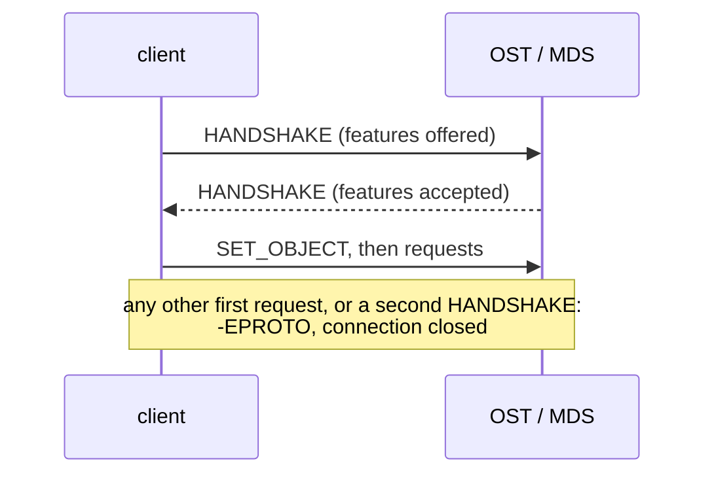

# Rawstor wire protocol

## Native conversions

`<rawstor/protocol.h>` provides C-compatible `static inline` conversions in
both directions: `rawstor_frame_{config,meta,allocate}_{encode,decode}`
for configuration, metadata and allocation. Encode writes a wire
record; decode writes the corresponding native rawstor structure. The first
argument is always the `RawstorFrame*` record (destination for encode, source
for decode). Fallible conversions return zero on success or a positive errno
value; output is unspecified on failure. Ballots use `RawstorObjectBallot`
directly, with a compile-time wire-size check in the same header. These functions
check representation. Unknown metadata sync-state bytes are rejected with
`EPROTO`; `UNREACHABLE` (0) remains a valid decoded state. Slot and backends
validate state transitions. The allocation encoder preserves
`object_id` and `chunk_offset`, which the caller sets separately.

## Status

Legend: ✅ implemented · 🟡 partial · ❌ not implemented yet.

| Area | Status | Where |
|---|---|---|
| Frame head, `rstr` magic, `cid` pipelining | ✅ | `include/rawstor/protocol.h` |
| Response `hash` (xxh3 with libxxhash) | ✅ | `librawstd/src/hash.c` |
| Session: `SET_OBJECT` | ✅ | OST `ost/src/client.cpp`, MDS `mds/src/client.cpp` |
| Data: `READ` `WRITE` `DISCARD` `ALLOCATE` `RELEASE` `FLUSH` `WRITE_ZEROES` | ✅ | OST server + `src/ost_backend.cpp` (I/O), `src/wire_backend.cpp` (member lifecycle) |
| Metadata: `META` `LEAVE` `CREATE_VERSION` `LIST_VERSIONS` | ✅ | OST server + `src/wire_backend.cpp` |
| Write barrier: `FREEZE` `THAW` | ✅ | OST `ost/src/freeze_gate.cpp`, `ost/src/client.cpp` + `src/wire_backend.cpp` |
| `LIST`, `LOCATION_INFO` | ✅ | OST and MDS servers, both clients |
| Object: `OBJ_CREATE` `RESOLVE` `OBJ_RESIZE` `OBJ_REMOVE` | ✅ | MDS server + `src/mds_backend.cpp` |
| Object versions: `OBJ_COMMIT_VERSION` `OBJ_REMOVE_VERSION` | ✅ | MDS server + `src/mds_backend.cpp` |
| `idempotency_key` on mutating `OBJ_*` | ✅ | `mds/src/store.cpp` (`applied_mutations`) |
| `-ENOSYS` for commands outside a server's role | ✅ | `ost/src/client.cpp`, `mds/src/client.cpp` |
| `HANDSHAKE`: the first request of every connection, feature bits (no protocol version) | ✅ | `include/rawstor/protocol.h`, OST `ost/src/client.cpp`, MDS `mds/src/client.cpp`, `src/wire_backend.cpp` |
| Tenant: owner of an object (`ALLOCATE`, `OBJ_CREATE`, `META`), filter of `LIST`; registry `LIST_TENANTS`, `TENANT_CREATE` / `TENANT_REMOVE` on the MDS | ✅ | OST `ost/src/client.cpp`, MDS `mds/src/client.cpp`; [Tenants](tenants.md) |
| Explicit `len` field in the response (`{res, len, hash}`) | ❌ | `res` still carries the payload size |
| `map_epoch` in the IO frame (epoch-fence) | ❌ | planned in [MDS design](mds.md) |
| Authentication: mutual TLS on every connection, identity from the certificate | ❌ | planned in [Security design](security.md) (stage 2) |
| Authorization: capability tokens issued by `RESOLVE` and checked by the OST, per-command rights | ❌ | planned in [Security design](security.md) (stage 3) |

One binary protocol is spoken by every rawstor server role: `rawstor-ost`
(object storage) and `rawstor-mds` (metadata server). The authoritative
definition is [`include/rawstor/protocol.h`](https://github.com/rawstor/librawstor/blob/main/include/rawstor/protocol.h);
this page describes the same layouts for a reader.

- **Transport:** a stateful TCP connection.
- **Byte order:** host order, i.e. little-endian on every supported platform.
- **Structs:** packed (no padding, no reserved fields), with every multi-byte
  field on its natural alignment inside the struct. Every struct's size is
  checked at compile time.
- **Magic:** `0x72737472` (`"rstr"` in ASCII) opens every frame, as a sanity
  and endianness check.
- **Names:** `RawstorFrame*` for frames and payloads any role may use,
  `RawstorFrameObj*` for the payloads of the object (`OBJ_*`) commands.

In the diagrams below every row is 8 bytes: the left column is the row's
byte offset, the ruler on top each byte's position within the row. A
field's height is its size (a 64-bit field takes one row, a 16-byte id
two), fields smaller than 8 bytes share a row, and a `~` edge marks data
that follows the struct.

## Connection

A client may pipeline requests: each carries a `cid` (command id) and its
response echoes it back, so responses are matched by `cid`, not by order.

The first request on a connection is `HANDSHAKE`: the client offers its
features and the server answers with the ones it accepts. A server serves
nothing before it: any other first request is answered `-EPROTO` and the
connection is closed, and so is a second `HANDSHAKE`. Then, on an OST,
`SET_OBJECT` binds the connection to a copy through a Slot, identified by `object_id`, `offset`
(the chunk offset within the object), and `version_id`. I/O offsets are
relative to that chunk; the OST does not open an Object or route I/O
between chunks; on the MDS it binds nothing. A server answers any
command outside its role with `res = -ENOSYS`.



## Frame head

Every request and every response starts with the same 8-byte head.

```text
     +0         +1         +2         +3         +4         +5         +6         +7
     +-------------------------------------------+---------------------+---------------------+
  0  |              uint32_t magic               |    uint16_t cmd     |    uint16_t cid     |
     |                                           |                     |                     |
     +-------------------------------------------+---------------------+---------------------+
```

## Commands

One command space for every role, grouped into ranges: `0x00` session (every
role), `0x01..0x1f` data (OST), `0x20..0x3f` metadata shared by OST and MDS,
`0x40..0x5f` object (MDS). `META` predates the grouping and keeps `0x0c`.

| cmd | name | role | request payload | response payload |
|---|---|---|---|---|
| `0x00` | `SET_OBJECT` | all | SetObject (`val` = open flags, e.g. `RAWSTOR_READONLY`) | — |
| `0x01` | `READ` | OST | IO | data (`res` bytes) |
| `0x02` | `WRITE` | OST | IO (`flags`: `SYNC`, `RESYNC`), then `len` bytes of data | — |
| `0x03` | `DISCARD` | OST | IO | — |
| `0x04` | `ALLOCATE` | OST / MDS (witness only) | Allocate | — |
| `0x05` | `RELEASE` | OST / MDS (witness only) | Basic (non-nil `version_id`: that version only) | — |
| `0x06` | `LIST` | OST, MDS | List | List rows |
| `0x07` | `HANDSHAKE` | all | Handshake | Handshake |
| `0x08` | `LOCATION_INFO` | OST / MDS | Basic (unused) | `RawstorLocationInfo` |
| `0x09` | `FLUSH` | OST | Basic (`val` = epoch) | — |
| `0x0a` | `WRITE_ZEROES` | OST | IO (`flags`: `SYNC`, `UNMAP`, `RESYNC`) | — |
| `0x0c` | `META` | OST / MDS (witness only) | Basic (`offset` = chunk offset, `version_id`, nil = live) | Meta |
| `0x0d` | `CREATE_VERSION` | OST | Basic (`version_id` = new version) | — |
| `0x0e` | `LIST_VERSIONS` | OST / MDS | Basic (`offset` = chunk offset on an OST, unused on the MDS) | Version rows |
| `0x0f` | `LEAVE` | OST | Basic (unused) | — |
| `0x10` | `SYNC_PREPARE` | OST / MDS (witness only) | SyncPropose (`ballot` only) | SyncReply |
| `0x11` | `SYNC_ACCEPT` | OST / MDS (witness only) | SyncPropose | SyncReply |
| `0x12` | `FREEZE` | OST | Basic (`offset` = chunk offset, `version_id` = the holder's token, `val` = lease in ms) | — |
| `0x13` | `THAW` | OST | Basic (`offset` = chunk offset, `version_id` = the holder's token) | — |
| `0x14` | `SET_OWNER` | OST / MDS (witness only) | Basic (`offset` = chunk offset, `version_id` = the new owner) | — |
| `0x20` | `LIST_TENANTS` | MDS | ListTenants | Tenant rows |
| `0x40` | `OBJ_CREATE` | MDS | ObjCreate | ObjCreated |
| `0x41` | `RESOLVE` | MDS | Basic (`version_id`, nil = live) | ObjDescriptor + chunks |
| `0x42` | `OBJ_RESIZE` | MDS | ObjOp (`val` = new size) | ObjResized |
| `0x43` | `OBJ_REMOVE` | MDS | ObjOp | ObjDescriptor + chunks (the removed map) |
| `0x45` | `OBJ_COMMIT_VERSION` | MDS | ObjCommitVersion + members | ObjVersionCommitted |
| `0x46` | `OBJ_REMOVE_VERSION` | MDS | ObjOp (`version_id`) | ObjVersionMember records |
| `0x47` | `TENANT_CREATE` | MDS | TenantOp | — |
| `0x48` | `TENANT_REMOVE` | MDS | TenantOp | — |
| `0x49` | `OBJ_TRANSFER` | MDS | ObjOp (`version_id` = the new owner) | ObjTransferred |

Ids (`object_id`, `version_id`, `ost_id`, ...) are 16-byte UUIDs; a nil
`version_id` means the live version. Object and version ids are generated by
the client.

Every mutating `OBJ_*` request (`OBJ_CREATE`, `OBJ_RESIZE`, `OBJ_REMOVE`,
`OBJ_COMMIT_VERSION`, `OBJ_REMOVE_VERSION`, `OBJ_TRANSFER`) carries an `idempotency_key`: a UUID the client
generates once per operation and keeps across its retries. The MDS records
the result of the first request that applies an `idempotency_key` and answers any
repeat of it with that same result instead of applying it again, so a
request resent after a lost reply is safe (see
[MDS design](mds.md), "Idempotent mutations"). Replies that a retry needs
in order to finish the client's side of the operation carry it:
`OBJ_RESIZE` the chunk count it grew from and the owner, `OBJ_REMOVE` the map
the object had, `OBJ_TRANSFER` the owner the object has.

## Responses

Every response is the head followed by a 12-byte body; a payload, if any,
follows right after.

```text
     +0         +1         +2         +3         +4         +5         +6         +7
     +-------------------------------------------+---------------------+---------------------+
  0  |              uint32_t magic               |    uint16_t cmd     |    uint16_t cid     |
     |                                           |                     |                     |
     +-------------------------------------------+---------------------+---------------------+
  8  |                                     uint64_t hash                                     |
     |                                                                                       |
     +-------------------------------------------+-------------------------------------------+
 16  |                int32_t res                |          payload (res bytes)...           |
     |                                           |                                           |
     +-------------------------------------------+~~~~~~~~~~~~~~~~~~~~~~~~~~~~~~~~~~~~~~~~~~~+
```

- `res < 0` is `-errno`; no payload follows.
- `res >= 0` is the payload size in bytes (for `READ`/`WRITE`/`DISCARD`/
  `WRITE_ZEROES`, the number of bytes handled); `0` means no payload.
- `hash` covers the payload (the data, for `READ`) and is checked by the
  receiver: xxh3 when built with libxxhash, 0 otherwise and whenever the
  sender doesn't compute one (the MDS never does).

## Request payloads

### Basic — 48 bytes

Shared by every command that only names an object: `RELEASE`,
`CREATE_VERSION`, `META`, `LOCATION_INFO`, `FLUSH`, `FREEZE`, `THAW` and the
MDS's `RESOLVE`. `offset` is the chunk offset of the object `object_id` names
(0 for a plain object); `version_id` binds a version for `RELEASE`,
`CREATE_VERSION`, `META` and `RESOLVE` (nil = live), and is the holder's token
for `FREEZE`/`THAW`; `val` is command-specific: `FLUSH` carries the writer's
epoch in it, as IO does, `FREEZE` the lease in milliseconds.

`FREEZE`/`THAW` are the write barrier of a consistent version
([design](mds.md#the-write-barrier)). `FREEZE` makes the OST hold new `WRITE`,
`WRITE_ZEROES` and `DISCARD` to the member (they wait, they do not fail), wait
for the ones already admitted, `FLUSH` the member and only then answer; it
answers `-ETIMEDOUT`, with the barrier lifted, if that outlasts the lease
(`val`, 0 = 30 s, capped at 10 min) and `-EINVAL` for a nil token. A `FREEZE`
by the token already holding the member renews the lease, another token's waits
its turn. `THAW` lifts the barrier; it answers `-ESTALE` when the token holds
none any more -- the lease ran out and the barrier lifted itself.

```text
     +0         +1         +2         +3         +4         +5         +6         +7
     +---------------------------------------------------------------------------------------+
  0  |                                                                                       |
     |                                 uint8_t object_id[16]                                 |
     |                                                                                       |
  8  |                                                                                       |
     |                                                                                       |
     +---------------------------------------------------------------------------------------+
 16  |                                    uint64_t offset                                    |
     |                                                                                       |
     +---------------------------------------------------------------------------------------+
 24  |                                                                                       |
     |                                uint8_t version_id[16]                                 |
     |                                                                                       |
 32  |                                                                                       |
     |                                                                                       |
     +---------------------------------------------------------------------------------------+
 40  |                                     uint64_t val                                      |
     |                                                                                       |
     +---------------------------------------------------------------------------------------+
```

### Handshake — 8 bytes

`HANDSHAKE`'s request and response payload. `features` is the set of optional
protocol features, a bit mask; no bit is defined yet. The client offers what it
has and the server answers with the subset it accepts, which the connection
then uses; each side ignores the bits it does not know. There is no protocol
version: features are the only negotiation.

```text
     +0         +1         +2         +3         +4         +5         +6         +7
     +---------------------------------------------------------------------------------------+
  0  |                                   uint64_t features                                   |
     |                                                                                       |
     +---------------------------------------------------------------------------------------+
```

### SetObject — 64 bytes

`SET_OBJECT`: names the session the connection serves, then the copy to bind
(Basic's `object_id`, `offset`, `version_id`, `val`). `session_id` identifies
the client session (never nil). `val` is the open flags (`RAWSTOR_READONLY` or
0); `version_id` binds a version (nil = live), which is always opened
read-only.

```text
     +0         +1         +2         +3         +4         +5         +6         +7
     +---------------------------------------------------------------------------------------+
  0  |                                                                                       |
     |                                 uint8_t session_id[16]                                |
     |                                                                                       |
  8  |                                                                                       |
     |                                                                                       |
     +---------------------------------------------------------------------------------------+
 16  |                                                                                       |
     |                                 uint8_t object_id[16]                                 |
     |                                                                                       |
 24  |                                                                                       |
     |                                                                                       |
     +---------------------------------------------------------------------------------------+
 32  |                                    uint64_t offset                                    |
     |                                                                                       |
     +---------------------------------------------------------------------------------------+
 40  |                                                                                       |
     |                                uint8_t version_id[16]                                 |
     |                                                                                       |
 48  |                                                                                       |
     |                                                                                       |
     +---------------------------------------------------------------------------------------+
 56  |                                     uint64_t val                                      |
     |                                                                                       |
     +---------------------------------------------------------------------------------------+
```

### IO — 29 bytes

`READ`, `WRITE`, `DISCARD`, `WRITE_ZEROES` on the bound object. `hash`
covers the data that follows a `WRITE` (same hash as a response's), 0
otherwise. `flags`:
`RAWSTOR_FLAG_SYNC` (durable before the response; `WRITE`, `WRITE_ZEROES`),
`RAWSTOR_FLAG_UNMAP` (may deallocate; `WRITE_ZEROES`),
`RAWSTOR_FLAG_RESYNC` (a resync's copy onto a `SYNCING` member: written
only where no client write reached since the member became `SYNCING`,
answered with the whole length; `WRITE`, `WRITE_ZEROES`). A copy that
keeps no record of client writes -- not `SYNCING`, or `SYNCING` since
before the server started -- refuses it with `-ESTALE`
([multi-attach](multiattach.md#resync-across-processes)).

`epoch` is the epoch of the configuration the writer uses (`WRITE`,
`DISCARD`, `WRITE_ZEROES`; `FLUSH` carries it in Basic's `val`): the
copy refuses the request with `-ESTALE` once its accepted configuration
is newer ([multi-attach](multiattach.md#epoch-on-writes)). 0 is never
refused; `READ` leaves it 0. A server with no copy of its own -- several
locations, or one it reaches through another server -- refuses a
stamped or `RESYNC` request with `-EOPNOTSUPP`.

```text
     +0         +1         +2         +3         +4         +5         +6         +7
     +---------------------------------------------------------------------------------------+
  0  |                                    uint64_t offset                                    |
     |                                                                                       |
     +---------------------------------------------------------------------------------------+
  8  |                                     uint64_t hash                                     |
     |                                                                                       |
     +---------------------------------------------------------------------------------------+
 16  |                                    uint64_t epoch                                     |
     |                                                                                       |
     +-------------------------------------------+----------+--------------------------------+
 24  |               uint32_t len                |  flags   |         WRITE data...          |
     |                                           |          |                                |
     +-------------------------------------------+----------+~~~~~~~~~~~~~~~~~~~~~~~~~~~~~~~~+
```

### List — 36 bytes

`limit` ids per page, starting after `token_id` (nil = from the start). `tenant_id`
limits the listing to the objects that tenant owns; nil lists every object
([Tenants](tenants.md)).

```text
     +0         +1         +2         +3         +4         +5         +6         +7
     +---------------------------------------------------------------------------------------+
  0  |                                                                                       |
     |                                 uint8_t tenant_id[16]                                 |
     |                                                                                       |
  8  |                                                                                       |
     |                                                                                       |
     +---------------------------------------------------------------------------------------+
 16  |                                                                                       |
     |                                 uint8_t token_id[16]                                  |
     |                                                                                       |
 24  |                                                                                       |
     |                                                                                       |
     +-------------------------------------------+-------------------------------------------+
 32  |              uint32_t limit               |
     |                                           |
     +-------------------------------------------+
```

### ListTenants — 20 bytes

`limit` tenants per page (0 = the server's own cap), starting after `token_id`
(nil = from the start).

```text
     +0         +1         +2         +3         +4         +5         +6         +7
     +---------------------------------------------------------------------------------------+
  0  |                                                                                       |
     |                                  uint8_t token_id[16]                                 |
     |                                                                                       |
  8  |                                                                                       |
     |                                                                                       |
     +-------------------------------------------+-------------------------------------------+
 16  |              uint32_t limit               |
     |                                           |
     +-------------------------------------------+
```

### Config — 312 bytes

The chunk's configuration (`RawstorObjectConfig`): its sync set, the
writer running the resync of the syncing member and its run (`resync_owner`:
the proposer in the high 48 bits, the number of the run in the low 16, 0 when
none) and every member's role, `nroles` entries of `enum RawstorObjectMemberRole` (0
unknown, 1 in-sync, 2 syncing, 3 excluded), the rest zero. Carried in
SyncPropose and Meta; see [mirroring](mirroring.md#states-and-roles).

```text
     +0         +1         +2         +3         +4         +5         +6         +7
     +---------------------------------------------------------------------------------------+
  0  |                                    uint64_t epoch                                     |
     |                                                                                       |
     +---------------------------------------------------------------------------------------+
  8  |                                   uint64_t sync_id                                    |
     |                                                                                       |
     +---------------------------------------------------------------------------------------+
 16  |                            uint64_t sync_id_history[0..3]                             |
     |                                      (32 bytes)                                       |
     +---------------------------------------------------------------------------------------+
 48  |                                 uint64_t resync_owner                                 |
     |                                                                                       |
     +----------+----------------------------------------------------------------------------+
 56  |  nroles  |                              uint8_t roles[255]                            |
     |          |                                    ...                                     |
     +----------+----------------------------------------------------------------------------+
312
```

### Ballot — 16 bytes

A ballot of the configuration register (`RawstorObjectBallot`):
`(counter, proposer)`, ordered by counter, then by proposer
([CASPaxos](caspaxos.md)).

```text
     +0         +1         +2         +3         +4         +5         +6         +7
     +---------------------------------------------------------------------------------------+
  0  |                                   uint64_t counter                                    |
     |                                                                                       |
     +---------------------------------------------------------------------------------------+
  8  |                                   uint64_t proposer                                   |
     |                                                                                       |
     +---------------------------------------------------------------------------------------+
16
```

`LEAVE` (Basic, unused) is a session's clean departure from the object it
set: the server closes it cleanly, and a copy with no session open for
writing left marks itself `CLEAN`. A session that wrote and ends any other
way -- disconnect, a new `SET_OBJECT` -- leaves a `DIRTY` copy `LOST`.

`SET_OBJECT` names the connection's session in `session_id`: the identity of
the client session, which the client keeps when it replaces a broken
connection. If another connection with the same session id is open on the
copy when the departed one ends without `LEAVE`, it takes over what the
departed one wrote instead of leaving the copy `LOST` and answers for it in
turn. So does a connection with the same session id that opens within two
seconds after the departed one ended; the server leaves the copy `DIRTY` for
that time and counts the departed writer in the `writers` of `META`.
OST shutdown stops socket reception, including incomplete requests, then
drains admitted requests and slot departures before destroying the I/O queue,
allowing the final consistency state to reach storage.

```text
     +0         +1         +2         +3         +4         +5         +6         +7
     +---------------------------------------------------------------------------------------+
  0  |                                                                                       |
     |                                 uint8_t object_id[16]                                 |
     |                                                                                       |
  8  |                                                                                       |
     |                                                                                       |
     +---------------------------------------------------------------------------------------+
 16  |                                 uint64_t chunk_offset                                 |
     |                                                                                       |
     +---------------------------------------------------------------------------------------+
 24  Config (312 bytes)
     +----------+----------+----------+
336  |  flags   | member_  |  state   |
     |          |  index   |          |
     +----------+----------+----------+
339
```

### SyncPropose — 369 bytes

The two requests of a chunk's configuration register
([multi-attach](multiattach.md#the-register-caspaxos),
[CASPaxos](caspaxos.md)). `SYNC_PREPARE` asks the member to promise
`ballot` and leaves the rest zero. `SYNC_ACCEPT` asks it to accept the
register's value -- the Config -- under `ballot`, and to promise `next` on
success (zero for none). Each successful accept is one vote; the client
must obtain a majority of register acceptors. With two data copies, the
witness supplies the third vote (multi-attach Stage 2 follows witness
support). `member_index` is the copy's position among the chunk's members, which the Config's roles are indexed by: the copy takes its own role from it. OST accepts one backend location ([mirroring](mirroring.md#one-copy-per-server)).

```text
     +0         +1         +2         +3         +4         +5         +6         +7
     +---------------------------------------------------------------------------------------+
  0  |                                                                                       |
     |                                 uint8_t object_id[16]                                 |
     |                                                                                       |
  8  |                                                                                       |
     |                                                                                       |
     +---------------------------------------------------------------------------------------+
 16  |                                 uint64_t chunk_offset                                 |
     |                                                                                       |
     +---------------------------------------------------------------------------------------+
 24  Ballot ballot (16 bytes)
 40  Ballot next (16 bytes)
 56  Config (312 bytes)
     +----------+
368  | member_  |
     |  index   |
     +----------+
369
```

### Allocate — 60 bytes

Creates one copy of one chunk. `tenant_id` is the tenant that owns the
object (nil for none), recorded in the copy's metadata. `chunk_shift` is `log2(chunk_size)`, 0 for an
unchunked object; `stripe_width`/`failure_domain`/`width`/`member_role` are the
chunk's placement identity, stored with it.

```text
     +0         +1         +2         +3         +4         +5         +6         +7
     +---------------------------------------------------------------------------------------+
  0  |                                                                                       |
     |                                 uint8_t tenant_id[16]                                 |
     |                                                                                       |
  8  |                                                                                       |
     |                                                                                       |
     +---------------------------------------------------------------------------------------+
 16  |                                                                                       |
     |                                 uint8_t object_id[16]                                 |
     |                                                                                       |
 24  |                                                                                       |
     |                                                                                       |
     +---------------------------------------------------------------------------------------+
 32  |                                 uint64_t chunk_offset                                 |
     |                                                                                       |
     +---------------------------------------------------------------------------------------+
 40  |                                     uint64_t size                                     |
     |                                                                                       |
     +---------------------------------------------------------------------------------------+
 48  |                                 uint64_t stripe_width                                 |
     |                                                                                       |
     +----------+----------+----------+----------+-------------------------------------------+
 56  |  chunk_  | failure_ |  width   | member_  |
     |  shift   |  domain  |          |   role   |
     +----------+----------+----------+----------+
60
```

## Response payloads

### List rows — 48 bytes each

One row per (id, chunk offset); an id with several chunks spans consecutive
rows. `type` says what the row addresses: `CHUNK` (1) is one chunk stored at
`chunk_offset`; `OBJECT` (2) is a whole object addressed by id alone, with
`chunk_offset` 0. The MDS answers one `OBJECT` row per `mds://` object and one
`CHUNK` row per witness member. `tenant_id` is the owner of the object, all
zero when it has none, whoever asked. `reserved` is all 0. The **last** row is
always the resume cursor for the next page (a nil id once nothing is left),
never a result. An empty payload means the far end is already exhausted.

```text
     +0         +1         +2         +3         +4         +5         +6         +7
     +---------------------------------------------------------------------------------------+
  0  |                                                                                       |
     |                                    uint8_t id[16]                                     |
     |                                                                                       |
  8  |                                                                                       |
     |                                                                                       |
     +---------------------------------------------------------------------------------------+
 16  |                                                                                       |
     |                                 uint8_t tenant_id[16]                                 |
     |                                                                                       |
 24  |                                                                                       |
     |                                                                                       |
     +---------------------------------------------------------------------------------------+
 32  |                                 uint64_t chunk_offset                                 |
     |                                                                                       |
     +----------+----------------------------------------------------------------------------+
 40  | uint8_t  |                            uint8_t reserved[7]                             |
     |   type   |                                                                            |
     +----------+----------------------------------------------------------------------------+
```

### Version rows — 16 bytes each

`LIST_VERSIONS`' answer: one row per version id,
in no particular order. An empty payload means the object has no versions
(always, on a backend without them).

```text
     +0         +1         +2         +3         +4         +5         +6         +7
     +---------------------------------------------------------------------------------------+
  0  |                                                                                       |
     |                                uint8_t version_id[16]                                 |
     |                                                                                       |
  8  |                                                                                       |
     |                                                                                       |
     +---------------------------------------------------------------------------------------+
```


### Tenant rows — 16 bytes each

`LIST_TENANTS`' answer: one row per tenant of the page, in ascending order,
then one more row: the resume cursor, the last tenant of the page while more
follow and nil once nothing is left. An empty payload means the registry is
already exhausted. An OST answers `-ENOSYS`.

```text
     +0         +1         +2         +3         +4         +5         +6         +7
     +---------------------------------------------------------------------------------------+
  0  |                                                                                       |
     |                                 uint8_t tenant_id[16]                                 |
     |                                                                                       |
  8  |                                                                                       |
     |                                                                                       |
     +---------------------------------------------------------------------------------------+
```

### Meta — 376 bytes

Everything about one stored copy: the tenant that owns its object
(`tenant_id`), its size, its placement identity, its own
state (`CLEAN`, `DIRTY`, `LOST`), how many sessions have it open for
writing right now (`writers`), and the chunk's configuration as last set on
it (a [Config](#config--312-bytes), at offset 32), and the copy's
replica of the register's ballots: the highest it promised and the one
its Config was accepted under. OST reports the record of its one backend Slot.
`width` is the non-zero number of data members; witness members are excluded
from this count. A zero width in received metadata is a protocol error.
Member roles are `DATA = 1` and `WITNESS = 2` (metadata-only witnesses); zero
is reserved for an unknown role in an unavailable member's local placeholder.

```text
     +0         +1         +2         +3         +4         +5         +6         +7
     +---------------------------------------------------------------------------------------+
  0  |                                                                                       |
     |                                 uint8_t tenant_id[16]                                 |
     |                                                                                       |
  8  |                                                                                       |
     |                                                                                       |
     +---------------------------------------------------------------------------------------+
 16  |                                     uint64_t size                                     |
     |                                                                                       |
     +----------+----------+----------+----------+-------------------------------------------+
 24  |  state   |  chunk_  |  width   | member_  |              uint32_t writers             |
     |          |  shift   |          |   role   |                                           |
     +----------+----------+----------+----------+-------------------------------------------+
 32  Config (312 bytes)
344  Ballot promised (16 bytes)
360  Ballot accepted (16 bytes)
376
```

### SyncReply — 377 bytes

The C API writes the member's record into `RawstorObjectMeta* meta` and
reports acceptance through the callback's `ssize_t result`: 1 for acceptance,
0 for refusal, or negative errno on failure. Metadata is available for both
nonnegative results. Internally, register methods return `bool` and fill a
`RawstorObjectMeta&` output argument.

`SYNC_PREPARE`/`SYNC_ACCEPT`'s reply, sent whether the member promised or
accepted (`ok` = 1) or refused (`ok` = 0): its whole record, a
[Meta](#meta--376-bytes), follows at offset 1, so a refused proposer sees
the actual value.

```text
     +0         +1         +2         +3         +4         +5         +6         +7
     +----------+----------------------------------------------------------------------------+
  0  |    ok    |                              Meta (376 bytes)                              |
     |          |                                                                            |
     +----------+~~~~~~~~~~~~~~~~~~~~~~~~~~~~~~~~~~~~~~~~~~~~~~~~~~~~~~~~~~~~~~~~~~~~~~~~~~~~+
377
```

### RawstorLocationInfo — 16 bytes

`uint64_t used`, `uint64_t total` (see `<rawstor/location.h>`).

## Object (MDS) payloads

### ObjPolicy — 19 bytes

Embedded in ObjCreate and ObjDescriptor, at an 8-byte offset in both; the
`chunk_shift` that follows it there rounds its 3 trailing bytes out to 4, so
ObjDescriptor's `nchunks` stays aligned.

```text
     +0         +1         +2         +3         +4         +5         +6         +7
     +---------------------------------------------------------------------------------------+
  0  |                                 uint64_t stripe_width                                 |
     |                                                                                       |
     +---------------------------------------------------------------------------------------+
  8  |                                uint64_t placement_seed                                |
     |                                                                                       |
     +----------+----------+----------+------------------------------------------------------+
 16  |redundancy|  width   | failure_ |
     |          |          |  domain  |
     +----------+----------+----------+
```

### ObjCreate — 76 bytes

`chunk_shift` is `log2(chunk_size)`; an mds:// object's `chunk_size` is always
a nonzero power of two, so 0 (and anything from 64 on) is rejected.

```text
     +0         +1         +2         +3         +4         +5         +6         +7
     +---------------------------------------------------------------------------------------+
  0  |                                                                                       |
     |                                 uint8_t tenant_id[16]                                 |
     |                                                                                       |
  8  |                                                                                       |
     |                                                                                       |
     +---------------------------------------------------------------------------------------+
 16  |                                                                                       |
     |                                    uint8_t id[16]                                     |
     |                                                                                       |
 24  |                                                                                       |
     |                                                                                       |
     +---------------------------------------------------------------------------------------+
 32  |                                                                                       |
     |                              uint8_t idempotency_key[16]                              |
     |                                                                                       |
 40  |                                                                                       |
     |                                                                                       |
     +---------------------------------------------------------------------------------------+
 48  |                                 uint64_t logical_size                                 |
     |                                                                                       |
     +---------------------------------------------------------------------------------------+
 56  |                                  policy.stripe_width                                  |
     |                                                                                       |
     +---------------------------------------------------------------------------------------+
 64  |                                 policy.placement_seed                                 |
     |                                                                                       |
     +----------+----------+----------+----------+-------------------------------------------+
 72  |redundancy|  width   | failure_ |  chunk_  |
     |          |          |  domain  |  shift   |
     +----------+----------+----------+----------+
```

ObjCreated and ObjVersionCommitted are a single `uint64_t map_epoch`.

### ObjOp — 56 bytes

`OBJ_RESIZE` (`val` = the new size), `OBJ_REMOVE` and `OBJ_REMOVE_VERSION`
(`version_id` = the version to remove); fields a command doesn't use are
0/nil.

```text
     +0         +1         +2         +3         +4         +5         +6         +7
     +---------------------------------------------------------------------------------------+
  0  |                                                                                       |
     |                                    uint8_t id[16]                                     |
     |                                                                                       |
  8  |                                                                                       |
     |                                                                                       |
     +---------------------------------------------------------------------------------------+
 16  |                                                                                       |
     |                              uint8_t idempotency_key[16]                              |
     |                                                                                       |
 24  |                                                                                       |
     |                                                                                       |
     +---------------------------------------------------------------------------------------+
 32  |                                                                                       |
     |                                uint8_t version_id[16]                                 |
     |                                                                                       |
 40  |                                                                                       |
     |                                                                                       |
     +---------------------------------------------------------------------------------------+
 48  |                                     uint64_t val                                      |
     |                                                                                       |
     +---------------------------------------------------------------------------------------+
```

### ObjTransferred — 16 bytes

`OBJ_TRANSFER`'s reply: the `tenant_id` that owns the object when the MDS
answers. A repeat of the request (the same `idempotency_key`) applies nothing
and reports the owner as it is then, which tells the client whether another
transfer has come in since its own.

```text
     +0         +1         +2         +3         +4         +5         +6         +7
     +---------------------------------------------------------------------------------------+
  0  |                                                                                       |
     |                                 uint8_t tenant_id[16]                                 |
     |                                                                                       |
  8  |                                                                                       |
     |                                                                                       |
     +---------------------------------------------------------------------------------------+
```

### ObjResized — 28 bytes

`OBJ_RESIZE`'s reply: the new `map_epoch` and the chunk count the object grew
from, so a retried resize still knows which chunks it has to create, and the
`tenant_id` that owns the object now, which they are created for.

```text
     +0         +1         +2         +3         +4         +5         +6         +7
     +---------------------------------------------------------------------------------------+
  0  |                                  uint64_t map_epoch                                   |
     |                                                                                       |
     +-------------------------------------------+-------------------------------------------+
  8  |           uint32_t old_nchunks            |           tenant_id[0..3]     |
     |                                           |                               |
     +-------------------------------------------+-------------------------------+
 16  |                                 uint8_t tenant_id[4..11]                              |
     |                                                                                       |
     +-------------------------------------------+-------------------------------------------+
 24  |         uint8_t tenant_id[12..15]         |
     |                                           |
     +-------------------------------------------+
```

### ObjDescriptor — 56 bytes, then the chunk map

`RESOLVE`'s reply (and `OBJ_REMOVE`'s: the map the object had): the
descriptor, then `nchunks` chunk entries, each a
`uint8_t width` followed by `width` slots. A slot is 19 bytes followed by
`location_len` bytes of its OST's location URI (e.g. `ost://host:7777`, not
null-terminated); `location_len` is 0 when the topology no longer lists that
OST.

```text
     +0         +1         +2         +3         +4         +5         +6         +7
     +---------------------------------------------------------------------------------------+
  0  |                                                                                       |
     |                                    uint8_t id[16]                                     |
     |                                                                                       |
  8  |                                                                                       |
     |                                                                                       |
     +---------------------------------------------------------------------------------------+
 16  |                                 uint64_t logical_size                                 |
     |                                                                                       |
     +---------------------------------------------------------------------------------------+
 24  |                                  uint64_t map_epoch                                   |
     |                                                                                       |
     +---------------------------------------------------------------------------------------+
 32  |                                  policy.stripe_width                                  |
     |                                                                                       |
     +---------------------------------------------------------------------------------------+
 40  |                                 policy.placement_seed                                 |
     |                                                                                       |
     +----------+----------+----------+----------+-------------------------------------------+
 48  |redundancy|  width   | failure_ |  chunk_  |             uint32_t nchunks              |
     |          |          |  domain  |  shift   |                                           |
     +----------+----------+----------+----------+-------------------------------------------+
```

The descriptor policy width counts DATA copies. A live chunk with a newly
placed even DATA width has one additional witness; its slot index equals the
policy width, after all DATA slots. The chunk entry width counts every slot,
including that witness. Version maps contain DATA members only.

Each chunk entry:

```text
     +0         +1         +2         +3         +4         +5         +6         +7
     +----------+----------------------------------------------------------------------------+
  0  |  width   |                               width slots...                               |
     |          |                                                                            |
     +----------+~~~~~~~~~~~~~~~~~~~~~~~~~~~~~~~~~~~~~~~~~~~~~~~~~~~~~~~~~~~~~~~~~~~~~~~~~~~~+
```

Each slot:

```text
     +0         +1         +2         +3         +4         +5         +6         +7
     +---------------------------------------------------------------------------------------+
  0  |                                                                                       |
     |                                  uint8_t ost_id[16]                                   |
     |                                                                                       |
  8  |                                                                                       |
     |                                                                                       |
     +---------------------+----------+------------------------------------------------------+
 16  |uint16_t location_len|slot_index|                     location...                      |
     |                     |          |                                                      |
     +---------------------+----------+~~~~~~~~~~~~~~~~~~~~~~~~~~~~~~~~~~~~~~~~~~~~~~~~~~~~~~+
```

### ObjCommitVersion — 52 bytes, then members

Registers a version: `nmembers` ObjVersionMember records follow, one per
chunk copy that holds it. `OBJ_REMOVE_VERSION` replies with the same records (the
copies to destroy).

```text
     +0         +1         +2         +3         +4         +5         +6         +7
     +---------------------------------------------------------------------------------------+
  0  |                                                                                       |
     |                                    uint8_t id[16]                                     |
     |                                                                                       |
  8  |                                                                                       |
     |                                                                                       |
     +---------------------------------------------------------------------------------------+
 16  |                                                                                       |
     |                                uint8_t version_id[16]                                 |
     |                                                                                       |
 24  |                                                                                       |
     |                                                                                       |
     +---------------------------------------------------------------------------------------+
 32  |                                                                                       |
     |                              uint8_t idempotency_key[16]                              |
     |                                                                                       |
 40  |                                                                                       |
     |                                                                                       |
     +-------------------------------------------+-------------------------------------------+
 48  |             uint32_t nmembers             |
     |                                           |
     +-------------------------------------------+
```

ObjVersionMember — 24 bytes:

```text
     +0         +1         +2         +3         +4         +5         +6         +7
     +---------------------------------------------------------------------------------------+
  0  |                                uint64_t logical_index                                 |
     |                                                                                       |
     +---------------------------------------------------------------------------------------+
  8  |                                                                                       |
     |                                  uint8_t ost_id[16]                                   |
     |                                                                                       |
 16  |                                                                                       |
     |                                                                                       |
     +---------------------------------------------------------------------------------------+
```


### TenantOp — 32 bytes

`TENANT_CREATE` registers `tenant_id` (a client-generated UUID, never nil;
`-EEXIST` if registered); `TENANT_REMOVE` removes a tenant that owns no object
(`-ENOENT` if unknown, `-EBUSY` while it owns objects). Both are idempotent
through `idempotency_key`, like every mutating `OBJ_*` request.

```text
     +0         +1         +2         +3         +4         +5         +6         +7
     +---------------------------------------------------------------------------------------+
  0  |                                                                                       |
     |                                 uint8_t tenant_id[16]                                 |
     |                                                                                       |
  8  |                                                                                       |
     |                                                                                       |
     +---------------------------------------------------------------------------------------+
 16  |                                                                                       |
     |                              uint8_t idempotency_key[16]                              |
     |                                                                                       |
 24  |                                                                                       |
     |                                                                                       |
     +---------------------------------------------------------------------------------------+
```

## Witness member operations

URI schemes do not encode member roles. `META.member_role` identifies the
addressed member. If the last member is unavailable, its role follows from
the complete target and data width. A quorum always uses the complete
address count.

Both OST and MDS accept `ALLOCATE` with `member_role = 2` to create a
metadata-only member, `META` to read it and `RELEASE` to remove it.
The register's `SYNC_PREPARE` and `SYNC_ACCEPT` requests record the
configuration and the ballots atomically, serialized with member state
transitions and persisted before the reply. `config.roles` records all
members in the target's stable order; the witness entry is IN_SYNC while it
takes part and EXCLUDED when the data quorum continues without it. A
witness holds no copy and no writer session: its `state` stays as created.
MDS accepts these operations independently of its `OBJ_*` map registry.
`width` is data-copy redundancy; the configuration role array includes the
witness. One witness per chunk is allowed only with an even data-member count.

A manual branch resolution records EXCLUDED for every non-winner through
`SYNC_ACCEPT` under a ballot above every one seen, regardless of its member
type.
Witnesses do not accept data I/O or object versions.

Ordinary `LIST` reports every registered MDS object and native witness member,
using `RawstorFrameListEntry` rows plus the final pagination cursor row.
Registered objects are `OBJECT` rows at offset zero; witness records are
`CHUNK` rows carrying their real chunk offsets. Limits count IDs, and all
offsets of an ID stay on one page. The row type alone says which kind of
address was listed.
