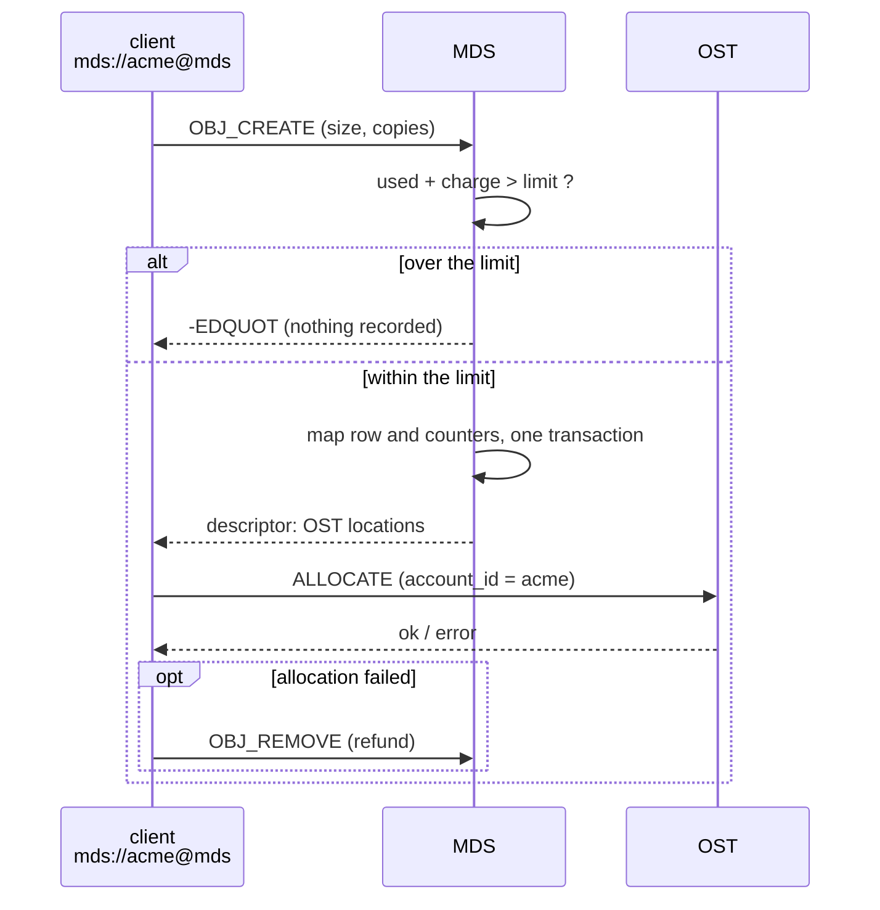

# Account quotas

A **quota** bounds what one [account](accounts.md) may provision on an MDS: how
many bytes its objects and versions reserve, and how many objects and versions
it owns. The provider administrator sets it; the MDS enforces it when the
account's objects are created, grown, versioned or transferred in, and refuses
the request that would exceed it with `-EDQUOT`. An OST applies the same idea to
what is allocated on it directly, which also bounds the damage of one account
[squatting](accounts.md#planned-allocation-namespace-isolation) another
account's object UUIDs on a node.

A quota is a **provisioning limit**, not a measure of physical use. It is
checked against the sizes the MDS records, never against what an OST holds
(sparse files, compression and ZFS sharing make that unknowable to the MDS, see
[MDS design](mds.md#backend-health-and-location-information)), and it does not
replace the free-space accounting that placement already uses.

## Status

Legend: ✅ implemented · 🟡 partial · ❌ not implemented yet. *Stage* is this
document's own numbering (see [Implementation stages](#implementation-stages)).

| Feature | Stage | Status | Where |
|---|---|---|---|
| Quota limits and usage counters of an account in the MDS store | 1 | ❌ | [MDS side](#mds-side) |
| `OBJ_CREATE`, `OBJ_RESIZE` refused with `-EDQUOT` | 1 | ❌ | [What is charged](#what-is-charged) |
| Removal and failed creation refund the account | 1 | ❌ | [Usage counters](#usage-counters) |
| `ACCOUNT_SET_QUOTA`, `ACCOUNT_INFO`; `LIST_ACCOUNTS` rows carry quota and usage | 2 | ❌ | [Wire protocol](#wire-protocol) |
| CLI `rawstor account quota`, C API, pyrawstor | 2 | ❌ | [CLI](#cli) |
| Versions charged and counted | 3 | ❌ | [Versions](#versions) |
| Transfer into an account checks its quota; usage moves with the object | 3 | ❌ | [Transfer](#transfer) |
| `--reconstruct` recomputes usage; limits survive it | 4 | ❌ | [Reconstruct](#reconstruct) |
| Mirror count change and migration charge the owner | — | ❌ | depends on [Migration](migration.md#permissions-and-capacity) |
| OST: per-account limits and usage of members allocated on it, `ALLOCATE` refused with `-EDQUOT` | 5 | ❌ | [OST side](#ost-side) |
| Default OST limit for an account without an explicit one | 5 | ❌ | [OST side](#ost-side) |

## Model

- A quota belongs to an account and has three independent limits, each
  optional: **`bytes`**, **`objects`** and **`versions`**. An account without a
  limit is unlimited in that dimension; a new account has no limits at all, so
  adding the feature changes nothing for existing deployments.
- A limit of `0` means *no new provisioning*, not *unlimited*: the account may
  keep and remove what it has and nothing else. Unlimited is the absence of a
  limit (`NULL` in the store, `-` in the CLI), so a mistyped `0` cannot lift a
  limit by accident, and an account can be frozen without being removed.
- **Usage** is what the account's objects hold at the moment, kept next to the
  limits. A limit may be set below the current usage: nothing is removed, the
  account just cannot grow until it is back under it (shrinking, removing and
  version removal are never refused).
- Quotas are **per MDS**. An account registered on two MDSes has two
  independent quotas; there is no cluster-wide total.
- Only the provider administrator sets quotas. An account client may read its
  own quota and usage, which is what lets a control plane show the limit
  without admin credentials, and nothing else about it.

## What is charged

The unit of `bytes` is the **provisioned size**, the same number a client asks
for and the MDS records as `logical_size`, multiplied by the number of **data
copies** of the object's chunks (the mirror count; a witness stores no data and
is not counted). So a 10 GiB object mirrored twice charges 20 GiB. The reasons:

- It is known when the request arrives, before anything is allocated, so the
  decision is made once, in the MDS, without asking an OST.
- It does not depend on the backend. A sparse `file://` object and a `zfs://`
  one with a reservation charge the same; an account cannot gain space by
  choosing the thinner backend, and the provider cannot be surprised by a
  guest that fills a thin disk.
- It makes the limit predictable for the account: the bill and the limit are
  the sum of what it asked for.

What each operation does to the counters:

| Operation | `bytes` | `objects` | `versions` | Refused with `-EDQUOT` when |
|---|---|---|---|---|
| `OBJ_CREATE` | `+ size × copies` | `+ 1` | | either would pass its limit |
| `OBJ_RESIZE` (grow) | `+ added × copies` | | | `bytes` would pass its limit |
| `OBJ_REMOVE` | `− size × copies` (and its versions) | `− 1` | `− its versions` | never |
| `OBJ_COMMIT_VERSION` | `+ size × copies` (worst case, see [Versions](#versions)) | | `+ 1` | either would pass its limit |
| `OBJ_REMOVE_VERSION` | `− version's charge` | | `− 1` | never |
| `OBJ_TRANSFER` / `SET_OWNER` | moves with the object | moves | moves | the destination would pass a limit |

Sizes are charged in whole chunks, as the map is: a 10 GiB + 1 byte object with
256 MiB chunks charges 41 chunks. The granularity is the allocation unit, so a
refused `resize` and a later one never disagree about what fits.

A request that charges nothing (a read, a `LIST`, `META`, a shrink that the
MDS does not implement) is never refused for a quota. The MDS charges only what
passes through it; a direct `ALLOCATE` on an OST with no MDS involved is
bounded by the OST's own quota, see [OST side](#ost-side).

## Usage counters

The MDS keeps `used_bytes`, `used_objects` and `used_versions` as columns of the
account's row and updates them **in the same SQLite transaction** as the
mutation that causes the change: the map row and the counter either both change
or neither does. The check and the update are one read-modify-write inside that
transaction, so two concurrent creates cannot both pass a limit that only one
of them fits under, whichever worker thread serves them (and whichever MDS
instance, in the [shared-database design](mds.md#mds-server-v1-single-instance)).

Reasons not to compute the usage with `SUM()` over `objects` on every request:
the cost grows with the account, the check would also need the version members
and the per-object copy count, and a counter is what `ACCOUNT_INFO` and
`LIST_ACCOUNTS` should answer cheaply. A counter that drifts is a bug; the
defence is that `--reconstruct` recomputes it from the map, and a debug check
compares the counters with the sums at start-up and fails loudly if they
differ.

[Idempotency](mds.md#idempotent-mutations) already keeps a retried mutation
from being applied twice, so a replay of `OBJ_CREATE` after a lost reply
charges once: the recorded result is returned and the counters are not touched.

### Reserving before the OSTs are touched

`OBJ_CREATE` charges the account when the MDS commits the map, which is before
the client `ALLOCATE`s the chunks on the OSTs. The sequence is therefore:



This is the order the client already follows for any create, and the existing
cleanup of a half-created object is what refunds the quota. An object whose
client died between the two steps stays charged until it is removed; it is
listed like any other, so the administrator sees it and `account remove`
clears it. The window is the same one that already exists for the object
itself, and the quota does not widen it.

## Versions

A version is the costly part, because what it takes on disk depends on the
backend: a `zfs://` snapshot shares blocks with the object and costs almost
nothing until they diverge, while an `lvm://` classic snapshot reserves a
copy-on-write area the size of the whole origin ([MDS design](mds.md#versions-stage-2)).

The first implementation charges every version the **worst case**,
`logical_size × copies` of the object when it is committed, and counts it
in `versions`. It is backend-independent and never under-charges, at the price
of over-charging on ZFS. The two limits can be used apart: a provider that
wants "snapshots are free in bytes, at most 5 per account" sets `versions` and
leaves `bytes` to the objects; this is the knob provided rather than a
per-backend estimate. Whether to let a ZFS-only deployment charge less is an
[open question](#open-questions).

## Transfer

The destination account's quota is checked when ownership changes, like a
create: the object's whole charge (live copies and every version) must fit
under the destination's limits, otherwise the transfer is refused with
`-EDQUOT` and nothing moves. On success the charge leaves the source and joins
the destination in the one MDS transaction that records the new owner
(`OBJ_TRANSFER`); the members are then updated by the client as today.

The administrator is not exempt. A transfer is how provisioned space moves
between accounts, and bypassing a limit is better done by raising it first. An
administrator who really wants to overcommit sets the limit above the usage and
transfers, and the account stays visible as over its old limit.

The planned [transfer by mutual consent](accounts.md#planned-transfer-by-mutual-consent)
checks the destination at **accept**, and again at commit, since the quota can
change while an offer is pending. An offer does not reserve quota.

## Wire protocol

Two commands on the MDS, in the account range of [Protocol](protocol.md); an
OST answers `-ENOSYS`:

| Command | Who | Does |
|---|---|---|
| `ACCOUNT_SET_QUOTA` | `admin` | sets or clears the three limits of an account; `-ENOENT` for an unknown one, `-EINVAL` for the nil account |
| `ACCOUNT_INFO` | `admin` for any account, an account client for its own | returns the limits and the usage of one account |

`ACCOUNT_SET_QUOTA` carries all three limits at once, each either a value or
"unlimited", and replaces the previous ones; it is idempotent and an
`idempotency_key` is not needed. An unlimited limit is a flag, not a magic
number, so that `UINT64_MAX` is an ordinary value.

`LIST_ACCOUNTS` rows grow the limits and the usage, so a provider's console
lists every account with its figures in one paged call, and the answer to
`ACCOUNT_INFO` is the row of one account.

Refusals use `-EDQUOT` (the standard errno for this) on `OBJ_CREATE`,
`OBJ_RESIZE`, `OBJ_COMMIT_VERSION` and `OBJ_TRANSFER`. A client that opens a
mirror, a transfer or a resize through the library gets it back unchanged;
`rawstor_strerror`-style text and the CLI say "quota exceeded", naming the
dimension that failed (bytes, objects or versions) in the CLI message so that
the user does not have to guess.

The frame layouts change with the account rows, behind the compatibility rule
in [MDS design](mds.md#compatibility-stance): a wire change is a feature bit in
`HANDSHAKE`, and a client and a server that do not share it refuse each
other.

## MDS side

The `accounts` table grows six columns: three nullable limits and three usage
counters, all 64-bit integers:

```text
accounts(id, created_at,
         quota_bytes, quota_objects, quota_versions,      -- NULL = unlimited
         used_bytes,  used_objects,  used_versions)
```

The default account is registered at creation with no limits and is charged like
any other; the administrator can limit it, for it is where unnamed creates of
providers and insecure clients land. A database written before quotas is
refused at start (`-EPROTO`) like one written before accounts: there are no
installations to migrate ([Accounts](accounts.md#mds)).

`MDSStore` gets one internal function, `charge(account, delta)`, called from
inside the transaction of every mutation of the table above, and a matching
refund path; no command updates the counters any other way. Placement does not
look at quotas: a request that passes the quota is placed as before, and one
that fails it never reaches placement.

`ACCOUNT_REMOVE` is unchanged: it still answers `-EBUSY` while the account owns
an object, and so also while any usage is non-zero. A quota does not make
removal harder.

## OST side

An account with a `manage` certificate may `ALLOCATE` a member directly on an
OST, without the MDS. Its certificate authorizes the account, but not a
particular object UUID, so such an account can fill a node with members of
UUIDs it does not own, obstructing the legitimate owner's later placement
(see [allocation namespace isolation](accounts.md#planned-allocation-namespace-isolation)).
The MDS quota does not see these allocations. An OST therefore enforces a quota
of its own, and the squatting is then **bounded** instead of unlimited: an
account can occupy at most its quota of the node, whatever UUIDs it names.

- The OST keeps, per account, the number of members and the bytes allocated for
  it on this OST, and limits for both. `ALLOCATE` for an account that would pass
  a limit is refused with `-EDQUOT`, before anything is created. Removing a
  member refunds. The owner is already a field of every member's metadata
  record, so the counters are rebuilt from the records at start and need no
  separate store.
- An account with no explicit limit gets the **OST's default limit**
  (configured per OST, e.g. in `/etc/rawstor/ost/<uuid>.conf`, see
  [rawstor-ost](ost.md)). Without a default the mitigation does not exist for
  accounts nobody configured, so a default is part of this stage, and a
  provider that wants no limit sets it to unlimited explicitly.
- Limits on an OST are set by the provider, the same way as on the MDS
  (`ACCOUNT_SET_QUOTA` is accepted by an OST for an `admin`; `ACCOUNT_INFO`
  reports the OST's own figures). The MDS does not push limits: the OST works
  with no MDS online, as direct I/O does today.
- The two counters are different quantities and are not added up: the MDS one
  is what the account provisioned across the whole cluster, the OST one is what
  sits on one node. An object created through the MDS is charged at both, and
  that is intended. A provider keeps the OST default well above the largest
  MDS quota an account can be given per node, or sets explicit limits.
- What it does **not** do: it does not stop account B from taking A's UUID at a
  missing offset, only from taking more than B's share of the node. Because it
  bounds B, A's unsquatted share stays reachable as long as the provider
  does not oversubscribe the node's capacity with limits. The
  [acceptance criteria of the namespace plan](accounts.md#acceptance-tests) that
  require B to be unable to obstruct A remain open until a namespace model is
  chosen; they are met by this quota only as "an obstruction costs B quota and
  is bounded".

## Reconstruct

`--reconstruct` rebuilds the map from the OSTs, so the **usage** is recomputed
from the objects it restores (the chunk sizes and copy counts it finds), and
the counters match the map by construction. The **limits** are
administration, not a property of a chunk; no OST holds them. A reconstructed
account therefore comes back **unlimited**, the same way it comes back with no
name. The administrator who needs the limits restores them with `account quota
set` afterwards; the control plane that sets them keeps its own record, as it
already does for account names. A database that is merely restored from a
backup keeps them.

## CLI

```bash
rawstor account quota show mds://10.0.0.2:7776 <uuid>
rawstor account quota set  mds://10.0.0.2:7776 <uuid> --bytes 1T --objects 100 --versions 20
rawstor account quota set  mds://10.0.0.2:7776 <uuid> --bytes -        # unlimited again
rawstor account quota set  mds://10.0.0.2:7776 <uuid> --bytes 0        # no new provisioning
rawstor account list       mds://10.0.0.2:7776                         # + quota and usage columns
rawstor account quota show mds://<uuid>@10.0.0.2:7776                 # an account client: its own
```

`set` changes only the limits it names and leaves the rest as they are (the
client reads the account, merges, and writes the three, retrying on a
concurrent change). Sizes use the suffixes `object create --size` already
takes. `show` prints each limit, the usage and what remains. `-` means
unlimited, `0` means none.

The C API (`rawstor_location_account_quota()`, `rawstor_location_set_account_quota()`)
and pyrawstor (`Location.account_quota(account)`, `Location.set_account_quota(account,
bytes=..., objects=..., versions=...)`) take the same fields.

## Permissions

`ACCOUNT_SET_QUOTA` is a provider `admin` operation, in the class of account
creation and transfer: an account manager must never be able to raise its own
limit, so no certificate permission bit enables it for an account client.
`ACCOUNT_INFO` for the caller's own account needs only a valid account
certificate of any role, since it reveals nothing the account cannot already
derive from its own objects. An insecure client is an administrator by
definition ([Security](security.md)) and can do both.

## Not here

- **A complete fix of UUID squatting.** The [OST quota](#ost-side) bounds how
  much of a node an account can occupy, squatted UUIDs included, but it does
  not tell whose an arbitrary UUID is: the namespace decision stays with
  [the allocation plan](accounts.md#planned-allocation-namespace-isolation).
- **Physical usage and thin accounting.** Neither quota reads what an OST
  actually stores; the OST counts what was allocated for the account. Overcommitment of the pool (the sum of quotas above its free space) is
  an operator's decision; the existing free-space report tells whether the
  pool is in trouble.
- **Rate limits, IOPS and bandwidth, noisy-neighbour control.** Separate work;
  nothing here limits the speed of an account.
- **Soft limits, grace periods, warnings.** A limit is a hard one. A control
  plane that wants a warning level reads `ACCOUNT_INFO` and acts on the figure.
- **A cluster-wide quota over several MDSes.**

## Tests

Each stage is tested at the layer it adds, through existing interfaces:

- stage 1 (MDS store): create and grow up to the limit and refuse the next
  chunk with `-EDQUOT` leaving the map and the counters untouched; the limit
  `0` freezes an account and an absent one lifts it; removal and a failed
  create refund exactly what was charged; a replayed `OBJ_CREATE` and
  `OBJ_RESIZE` charge once; counters equal the sum over the map after a mixed
  run; two concurrent creates that cannot both fit produce one success and one
  `-EDQUOT`; a limit below the usage refuses growth and allows removal;
- stage 2: set, clear and merge of limits; an account client reads its own
  figures and is refused another account's and `ACCOUNT_SET_QUOTA`; an OST
  answers `-ENOSYS`; `LIST_ACCOUNTS` pages carry the figures; the CLI message
  names the failing dimension; `show` and `set` over TLS with an account
  certificate and an admin one;
- stage 3: a version charges its worst case and counts once, removal refunds
  it; `versions` limit alone; transfer refused when the destination would
  overflow and leaving both accounts as they were, accepted when it fits and
  moving the whole charge, versions included; a transfer replayed after a lost
  reply does not move the charge twice;
- stage 4: `--reconstruct` yields counters equal to the map and accounts
  without limits; a restored database keeps both; the start-up consistency
  check detects a hand-corrupted counter.

- stage 5: an account at its OST limit cannot allocate another member, direct or
  through the MDS, and a second account is unaffected; account B squatting A's
  UUIDs at missing offsets stops at B's limit and A's own allocation still
  succeeds; removal refunds; counters are rebuilt equal after an OST restart;
  an account with no explicit limit gets the default; the OST works with the
  MDS down.

An end-to-end test creates objects under a vhost-like writer until the quota
is hit and checks that the writer on the objects it already has is not
disturbed by the refusal.

## Implementation stages

1. **The store.** The six columns, `charge`/refund inside the mutations'
   transactions, `-EDQUOT` on `OBJ_CREATE` and `OBJ_RESIZE`, and the limits set
   for tests through the store API only. No protocol, no CLI: the value is the
   enforcement and its tests.
2. **Administration.** `ACCOUNT_SET_QUOTA`, `ACCOUNT_INFO`, the extended
   `LIST_ACCOUNTS`, the feature bit; the CLI, C API and pyrawstor; the docs
   ([Accounts](accounts.md), [Security](security.md), [Protocol](protocol.md),
   [Known limitations](limitations.md)) updated with the final surface.
3. **Versions and transfer.** The worst-case charge of a version and the
   `versions` limit; the destination check and usage move of `OBJ_TRANSFER`.
4. **Reconstruct and consistency.** Recomputing the usage in `--reconstruct`;
   the start-up counter check.

5. **OST quota.** Per-account counters rebuilt from the member records, limits
   and the default limit in the OST's configuration, `-EDQUOT` on `ALLOCATE`,
   `ACCOUNT_SET_QUOTA`/`ACCOUNT_INFO` on an OST, refund on removal. Independent
   of stages 1-4 (an OST needs no MDS) and the stage that addresses the
   squatting problem; it can be done first if that is the priority.

Stage 1 is the substance; the rest is surface and bookkeeping. Changing the
number of mirrors and migration ([Migration](migration.md#permissions-and-capacity))
pick up the same `charge` call when they are implemented: a mirror added
charges the owner and one that would exceed the quota is refused before
`OBJ_RECONFIGURE_BEGIN`.

## Open questions

- **Charging a version on ZFS.** Worst case over-charges a snapshot that shares
  almost everything. A backend-aware charge needs the OST to report a real
  figure on commit, which the MDS does not have today. Keep the worst case until
  somebody needs the difference.
- **Logical or raw bytes in the limit.** The limit multiplies by copies, so an
  account that is moved from 1 to 2 mirrors doubles its use. The alternative,
  charging the logical size only and letting the provider price redundancy, is
  simpler for a user and wrong for a provider who sells capacity. Chosen: raw.
  Revisit if accounts want to see logical figures too (both can be reported
  without changing what is limited).
- **Limits and `--reconstruct`.** Restoring limits from the OSTs would need them
  in the chunk record, which would put administration into the data. Rejected
  for now; the control plane keeps them.
- **Reservation of a pending create.** An object created and never allocated
  stays charged. A lease on the charge, released if the client does not confirm
  within a time, would close it at the price of a new protocol step; the
  existing leftover is visible and removable, so left as is.
- **Default OST limit value.** A safe default needs a number a provider can
  live with on day one; candidates are a fraction of the node's capacity or
  unlimited with a warning. Unlimited keeps the squatting exposure, a hard
  default can surprise a legitimate large account, so the default must be
  decided together with how limits are provisioned on a new node.
- **Per-location limits from the MDS.** Limiting an account to chosen locations
  is placement policy, not a quota, and belongs with [Migration](migration.md)
  location control.
