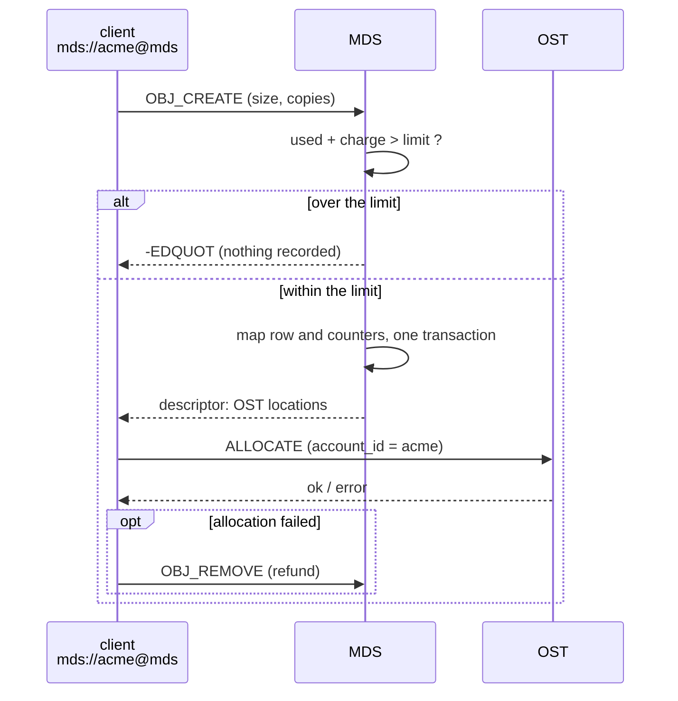

# Account quotas

A **quota** bounds what one [account](accounts.md) may provision on an MDS: how
many bytes its objects and versions reserve, and how many objects and versions
it owns. The provider administrator sets it; the MDS enforces it when the
account's objects are created, grown, versioned or transferred in, and refuses
the request that would exceed it with `-EDQUOT`. The quota exists only on the
MDS; an OST has no limits of its own, and what an account allocates on an OST
directly is a separate problem, see
[Direct OST allocation](#direct-ost-allocation).

A quota is a **provisioning limit**, not a measure of physical use. It is
checked against the sizes the MDS records, never against what an OST holds
(sparse files, compression and ZFS sharing make that unknowable to the MDS, see
[MDS design](mds.md#backend-health-and-location-information)), and it does not
replace the free-space accounting that placement already uses.

## Status

Legend: ✅ implemented · 🟡 partial · ❌ not implemented yet. *Stage* is this
document's own numbering (see [Implementation stages](#implementation-stages)).

| Feature | Stage | Status | Where |
|---|---|---|---|
| Quota limits and usage counters of an account in the MDS store | 1 | ❌ | [MDS side](#mds-side) |
| `OBJ_CREATE`, `OBJ_RESIZE` refused with `-EDQUOT` | 1 | ❌ | [What is charged](#what-is-charged) |
| Removal and failed creation refund the account | 1 | ❌ | [Usage counters](#usage-counters) |
| `ACCOUNT_SET_QUOTA`, `ACCOUNT_INFO`; `LIST_ACCOUNTS` rows carry quota and usage | 2 | ❌ | [Wire protocol](#wire-protocol) |
| CLI `rawstor account quota`, C API, pyrawstor | 2 | ❌ | [CLI](#cli) |
| Versions charged and counted | 3 | ❌ | [Versions](#versions) |
| Transfer into an account checks its quota; usage moves with the object | 3 | ❌ | [Transfer](#transfer) |
| `--reconstruct` recomputes usage and closes the account until its limits are restored | 4 | ❌ | [Reconstruct](#reconstruct) |
| Mirror count change and migration charge the owner | — | ❌ | depends on [Migration](migration.md#permissions-and-capacity) |
| OST reports per-account usage of the members it holds (no limits) | 5 | ❌ | [Direct OST allocation](#direct-ost-allocation) |
| MDS-issued allocation grants, charged to the quota and verified by the OST | 6 | ❌ | [Direct OST allocation](#direct-ost-allocation) |

## Model

- A quota belongs to an account and has three independent limits, each
  optional: **`bytes`**, **`objects`** and **`versions`**. An account without a
  limit is unlimited in that dimension; a new account has no limits at all, so
  adding the feature changes nothing for existing deployments.
- A limit of `0` means *no new provisioning*, not *unlimited*: the account may
  keep and remove what it has and nothing else. Unlimited is the absence of a
  limit (`NULL` in the store, `-` in the CLI), so a mistyped `0` cannot lift a
  limit by accident, and an account can be frozen without being removed.
- **Usage** is what the account's objects hold at the moment, kept next to the
  limits. A limit may be set below the current usage: nothing is removed, the
  account just cannot grow until it is back under it (shrinking, removing and
  version removal are never refused).
- Quotas are **per MDS**. An account registered on two MDSes has two
  independent quotas; there is no cluster-wide total.
- Only the provider administrator sets quotas. An account client may read its
  own quota and usage, which is what lets a control plane show the limit
  without admin credentials, and nothing else about it.

## What is charged

The unit of `bytes` is the **provisioned size**, the same number a client asks
for and the MDS records as `logical_size`, multiplied by the number of **data
copies** of the object's chunks (the mirror count; a witness stores no data and
is not counted). So a 10 GiB object mirrored twice charges 20 GiB. The reasons:

- It is known when the request arrives, before anything is allocated, so the
  decision is made once, in the MDS, without asking an OST.
- It does not depend on the backend. A sparse `file://` object and a `zfs://`
  one with a reservation charge the same; an account cannot gain space by
  choosing the thinner backend, and the provider cannot be surprised by a
  guest that fills a thin disk.
- It makes the limit predictable for the account: the bill and the limit are
  the sum of what it asked for.

What each operation does to the counters:

| Operation | `bytes` | `objects` | `versions` | Refused with `-EDQUOT` when |
|---|---|---|---|---|
| `OBJ_CREATE` | `+ size × copies` | `+ 1` | | either would pass its limit |
| `OBJ_RESIZE` (grow) | `+ added × copies` | | | `bytes` would pass its limit |
| `OBJ_REMOVE` | `− size × copies` (and its versions) | `− 1` | `− its versions` | never |
| `OBJ_COMMIT_VERSION` | `+ size × copies` (worst case, see [Versions](#versions)) | | `+ 1` | either would pass its limit |
| `OBJ_REMOVE_VERSION` | `− version's charge` | | `− 1` | never |
| `OBJ_TRANSFER` / `SET_OWNER` | moves with the object | moves | moves | the destination would pass a limit |

Sizes are charged in whole chunks, as the map is: a 10 GiB + 1 byte object with
256 MiB chunks charges 41 chunks. The granularity is the allocation unit, so a
refused `resize` and a later one never disagree about what fits.

A request that charges nothing (a read, a `LIST`, `META`, a shrink that the
MDS does not implement) is never refused for a quota. The MDS charges only what
passes through it; a direct `ALLOCATE` on an OST with no MDS involved is
not charged, see [Direct OST allocation](#direct-ost-allocation).

## Usage counters

The MDS keeps `used_bytes`, `used_objects` and `used_versions` as columns of the
account's row and updates them **in the same SQLite transaction** as the
mutation that causes the change: the map row and the counter either both change
or neither does. The check and the update are one read-modify-write inside that
transaction, so two concurrent creates cannot both pass a limit that only one
of them fits under, whichever worker thread serves them (and whichever MDS
instance, in the [shared-database design](mds.md#mds-server-v1-single-instance)).

Reasons not to compute the usage with `SUM()` over `objects` on every request:
the cost grows with the account, the check would also need the version members
and the per-object copy count, and a counter is what `ACCOUNT_INFO` and
`LIST_ACCOUNTS` should answer cheaply. A counter that drifts is a bug; the
defence is that `--reconstruct` recomputes it from the map, and a debug check
compares the counters with the sums at start-up and fails loudly if they
differ.

[Idempotency](mds.md#idempotent-mutations) already keeps a retried mutation
from being applied twice, so a replay of `OBJ_CREATE` after a lost reply
charges once: the recorded result is returned and the counters are not touched.

### Reserving before the OSTs are touched

`OBJ_CREATE` charges the account when the MDS commits the map, which is before
the client `ALLOCATE`s the chunks on the OSTs. The sequence is therefore:



This is the order the client already follows for any create, and the existing
cleanup of a half-created object is what refunds the quota. An object whose
client died between the two steps stays charged until it is removed; it is
listed like any other, so the administrator sees it and `account remove`
clears it. The window is the same one that already exists for the object
itself, and the quota does not widen it.

## Versions

A version is the costly part, because what it takes on disk depends on the
backend: a `zfs://` snapshot shares blocks with the object and costs almost
nothing until they diverge, while an `lvm://` classic snapshot reserves a
copy-on-write area the size of the whole origin ([MDS design](mds.md#versions-stage-2)).

The first implementation charges every version the **worst case**,
`logical_size × copies` of the object when it is committed, and counts it
in `versions`. It is backend-independent and never under-charges, at the price
of over-charging on ZFS. Versions therefore share the `bytes`
limit with the objects, and there is no way to make snapshots free in bytes
while limiting objects; `versions` is the separate control, it caps how many
an account keeps ("at most 5 per account"). A separate byte limit for versions
is not provided. Whether to let a ZFS-only deployment charge less is an
[open question](#open-questions).

## Transfer

The destination account's quota is checked when ownership changes, like a
create: the object's whole charge (live copies and every version) must fit
under the destination's limits, otherwise the transfer is refused with
`-EDQUOT` and nothing moves. On success the charge leaves the source and joins
the destination in the one MDS transaction that records the new owner
(`OBJ_TRANSFER`); the members are then updated by the client as today.

The administrator is not exempt. A transfer is how provisioned space moves
between accounts, and bypassing a limit is better done by raising it first. An
administrator who really wants to overcommit sets the limit above the usage and
transfers, and the account stays visible as over its old limit.

The planned [transfer by mutual consent](accounts.md#planned-transfer-by-mutual-consent)
checks the destination at **accept**, and again at commit, since the quota can
change while an offer is pending. An offer does not reserve quota.

## Wire protocol

Two commands on the MDS, in the account range of [Protocol](protocol.md); an
OST answers `-ENOSYS`:

| Command | Who | Does |
|---|---|---|
| `ACCOUNT_SET_QUOTA` | `admin` | sets or clears the three limits of an account; `-ENOENT` for an unknown one, `-EINVAL` for the nil account |
| `ACCOUNT_INFO` | `admin` for any account, an account client for its own | returns the limits and the usage of one account |

`ACCOUNT_SET_QUOTA` carries, for each of the three limits, one of three
actions: **keep** it, **set** it to a value, or make it **unlimited**. The MDS
applies them to the account's row in one transaction, so two administrators
changing different limits at once both succeed and neither overwrites the
other; a client never reads a row and writes it back. Setting the same limit
twice is the last writer's, which is the intent of setting. The command is
idempotent, so no `idempotency_key` is needed. Unlimited is an action, not a
magic number.

A limit is a value of `0` to `INT64_MAX` (2^63 − 1 bytes or items), the range
of the store's signed 64-bit integers; a larger one is refused with `-EINVAL`.
That is eight exbibytes, past any real provisioning, and "unlimited" covers
what is meant by more. Usage counters are in the same range and cannot reach
it before the limit does.

`LIST_ACCOUNTS` rows grow the limits and the usage, so a provider's console
lists every account with its figures in one paged call, and the answer to
`ACCOUNT_INFO` is the row of one account.

Refusals use `-EDQUOT` (the standard errno for this) on `OBJ_CREATE`,
`OBJ_RESIZE`, `OBJ_COMMIT_VERSION` and `OBJ_TRANSFER`. A client that opens a
mirror, a transfer or a resize through the library gets it back unchanged;
`rawstor_strerror`-style text and the CLI say "quota exceeded", naming the
dimension that failed (bytes, objects or versions) in the CLI message so that
the user does not have to guess.

The frame layouts change with the account rows, behind the compatibility rule
in [MDS design](mds.md#compatibility-stance): a wire change is a feature bit in
`HANDSHAKE`, and a client and a server that do not share it refuse each
other.

## MDS side

The `accounts` table grows six columns: three nullable limits and three usage
counters, all signed 64-bit integers (`0` to `INT64_MAX`, see
[Wire protocol](#wire-protocol)):

```text
accounts(id, created_at,
         quota_bytes, quota_objects, quota_versions,      -- NULL = unlimited
         used_bytes,  used_objects,  used_versions)
```

The default account is registered at creation with no limits and is charged like
any other; the administrator can limit it, for it is where unnamed creates of
providers and insecure clients land. A database written before quotas is
refused at start (`-EPROTO`) like one written before accounts: there are no
installations to migrate ([Accounts](accounts.md#mds)).

`MDSStore` gets one internal function, `charge(account, delta)`, called from
inside the transaction of every mutation of the table above, and a matching
refund path; no command updates the counters any other way. Placement does not
look at quotas: a request that passes the quota is placed as before, and one
that fails it never reaches placement.

`ACCOUNT_REMOVE` is unchanged: it still answers `-EBUSY` while the account owns
an object, and so also while any usage is non-zero. A quota does not make
removal harder.

## Direct OST allocation

An account with a `manage` certificate may `ALLOCATE` a member directly on an
OST, without the MDS. Its certificate authorizes the account, but not a
particular object UUID, so such an account can fill nodes with members of UUIDs
it does not own and obstruct the legitimate owner's later placement (see
[allocation namespace isolation](accounts.md#planned-allocation-namespace-isolation)).
The MDS never sees these allocations, so its quota does not cover them.

**An OST gets no limits.** A per-OST limit is not an account quota: objects are
spread over many nodes unevenly, so a node's limit either cuts an honest account
that happens to hold much there or is too high to protect anything, and a
squatter can take the limit on every node. The total over the cluster is
the only meaningful bound, and only the MDS knows it. The quota is therefore a
guarantee for objects the MDS manages and **not** a cap on what an account can
force onto an OST directly.

What can be done about direct allocation, in the order of cost:

1. **Visibility (stage 5).** The OST already keeps every member's owner in its
   metadata record, so it can report, per account, how many members and bytes it
   holds, and `ACCOUNT_INFO` on an OST answers with these figures and no limit.
   The administrator (or a control plane) sums them over the OSTs and compares
   them with the MDS usage of the account; the difference is what was allocated
   behind the MDS's back. Nothing is refused; it makes squatting visible and
   removable.
2. **Allocation grants (stage 6).** The MDS issues a signed grant naming the
   account, the object UUID, the OST, the offset and the size, and charges it to
   the quota when it issues it (the `OBJ_CREATE` and `OBJ_RESIZE` descriptors
   would carry them). An OST verifies the signature against a trusted MDS key,
   the way it verifies a certificate, without an online MDS, and an `ALLOCATE`
   that carries a valid grant is within the quota by construction. This is both
   the global bound and the *verifiable ownership evidence* that the
   [namespace plan](accounts.md#planned-allocation-namespace-isolation) asks
   for: B cannot obtain a grant for A's UUID, so it cannot occupy A's key. The
   price is that a direct allocation without an MDS stops being possible where
   an OST requires grants, which today is an intended feature of `manage`. It is
   therefore designed together with the ownership model there, not here, and
   until that decision this document does not specify the grant format.

Until stage 6 a direct allocation is not bounded by any quota, and the
[acceptance criteria of the namespace plan](accounts.md#acceptance-tests) that
require B to be unable to obstruct A are not met by anything in this document.

## Reconstruct

`--reconstruct` rebuilds the map from the OSTs, so the **usage** is recomputed
from the objects it restores (the chunk sizes and copy counts it finds), and
the counters match the map by construction. The **limits** are
administration, not a property of a chunk; no OST holds them. A reconstructed
account therefore comes back **closed**, with every limit `0`, rather than
unlimited: until the administrator restores its limits with `account quota set`
(or `--bytes - --objects - --versions -` for an account that never had any), it
can read, write and remove what it has but cannot provision anything new, so
the period between the reconstruction and the restoration cannot be used to
exceed the former quota. The control plane that sets the limits keeps its own
record, as it already does for account names. A database that is merely
restored from a backup keeps its limits and is not closed.

## CLI

```bash
rawstor account quota show mds://10.0.0.2:7776 <uuid>
rawstor account quota set  mds://10.0.0.2:7776 <uuid> --bytes 1T --objects 100 --versions 20
rawstor account quota set  mds://10.0.0.2:7776 <uuid> --bytes -        # unlimited again
rawstor account quota set  mds://10.0.0.2:7776 <uuid> --bytes 0        # no new provisioning
rawstor account list       mds://10.0.0.2:7776                         # + quota and usage columns
rawstor account quota show mds://<uuid>@10.0.0.2:7776                 # an account client: its own
```

`set` changes only the limits it names and leaves the rest as they are; the
MDS applies the named ones atomically (see [Wire protocol](#wire-protocol)),
so concurrent `set`s of different limits do not interfere. Sizes use the suffixes `object create --size` already
takes. `show` prints each limit, the usage and what remains. `-` means
unlimited, `0` means none.

The C API (`rawstor_location_account_quota()`, `rawstor_location_set_account_quota()`)
and pyrawstor (`Location.account_quota(account)`, `Location.set_account_quota(account,
bytes=..., objects=..., versions=...)`) take the same fields.

## Permissions

`ACCOUNT_SET_QUOTA` is a provider `admin` operation, in the class of account
creation and transfer: an account manager must never be able to raise its own
limit, so no certificate permission bit enables it for an account client.
`ACCOUNT_INFO` for the caller's own account needs only a valid account
certificate of any role, since it reveals nothing the account cannot already
derive from its own objects. An insecure client is an administrator by
definition ([Security](security.md)) and can do both.

## Not here

- **Physical usage and thin accounting.** The quota never reads what an OST
  actually stores. Overcommitment of the pool (the sum of quotas above its free space) is
  an operator's decision; the existing free-space report tells whether the
  pool is in trouble.
- **Rate limits, IOPS and bandwidth, noisy-neighbour control.** Separate work;
  nothing here limits the speed of an account.
- **Soft limits, grace periods, warnings.** A limit is a hard one. A control
  plane that wants a warning level reads `ACCOUNT_INFO` and acts on the figure.
- **A cluster-wide quota over several MDSes.**

## Tests

Each stage is tested at the layer it adds, through existing interfaces:

- stage 1 (MDS store): create and grow up to the limit and refuse the next
  chunk with `-EDQUOT` leaving the map and the counters untouched; the limit
  `0` freezes an account and an absent one lifts it; removal and a failed
  create refund exactly what was charged; a replayed `OBJ_CREATE` and
  `OBJ_RESIZE` charge once; counters equal the sum over the map after a mixed
  run; two concurrent creates that cannot both fit produce one success and one
  `-EDQUOT`; a limit below the usage refuses growth and allows removal;
- stage 2: set, clear and merge of limits; an account client reads its own
  figures and is refused another account's and `ACCOUNT_SET_QUOTA`; an OST
  answers `-ENOSYS`; `LIST_ACCOUNTS` pages carry the figures; the CLI message
  names the failing dimension; `show` and `set` over TLS with an account
  certificate and an admin one;
- stage 3: a version charges its worst case and counts once, removal refunds
  it; `versions` limit alone; transfer refused when the destination would
  overflow and leaving both accounts as they were, accepted when it fits and
  moving the whole charge, versions included; a transfer replayed after a lost
  reply does not move the charge twice;
- stage 2 also: two concurrent `ACCOUNT_SET_QUOTA` naming different limits both
  take effect; a limit above `INT64_MAX` is `-EINVAL`;
- stage 4: `--reconstruct` yields counters equal to the map and accounts
  closed (limits `0`) until restored; a restored database keeps both; the start-up consistency
  check detects a hand-corrupted counter.

- stage 5: an OST reports per-account counters equal to its member records,
  rebuilt equal after a restart, and an account client reads only its own;
  the sum over the OSTs matches the MDS usage when nothing was allocated
  directly and exceeds it by exactly the direct allocations otherwise;
- stage 6: tests are defined with the grant format and the ownership model.

An end-to-end test creates objects under a vhost-like writer until the quota
is hit and checks that the writer on the objects it already has is not
disturbed by the refusal.

## Implementation stages

1. **The store.** The six columns, `charge`/refund inside the mutations'
   transactions, `-EDQUOT` on `OBJ_CREATE` and `OBJ_RESIZE`, and the limits set
   for tests through the store API only. No protocol, no CLI: the value is the
   enforcement and its tests.
2. **Administration.** `ACCOUNT_SET_QUOTA`, `ACCOUNT_INFO`, the extended
   `LIST_ACCOUNTS`, the feature bit; the CLI, C API and pyrawstor; the docs
   ([Accounts](accounts.md), [Security](security.md), [Protocol](protocol.md),
   [Known limitations](limitations.md)) updated with the final surface.
3. **Versions and transfer.** The worst-case charge of a version and the
   `versions` limit; the destination check and usage move of `OBJ_TRANSFER`.
4. **Reconstruct and consistency.** Recomputing the usage in `--reconstruct`;
   the start-up counter check.

5. **OST usage report.** Per-account counters of the members an OST holds,
   built from their metadata records, `ACCOUNT_INFO` on an OST (usage only, no
   limits, and `ACCOUNT_SET_QUOTA` is still `-ENOSYS` there). Independent of
   stages 1-4.
6. **Allocation grants.** MDS-issued signed grants charged to the quota and
   verified by the OST, which close squatting and make the quota a bound on
   direct allocation. Designed with the ownership model of the
   [namespace plan](accounts.md#planned-allocation-namespace-isolation).

Stage 1 is the substance; the rest is surface and bookkeeping. Changing the
number of mirrors and migration ([Migration](migration.md#permissions-and-capacity))
pick up the same `charge` call when they are implemented: a mirror added
charges the owner and one that would exceed the quota is refused before
`OBJ_RECONFIGURE_BEGIN`.

## Open questions

- **Charging a version on ZFS.** Worst case over-charges a snapshot that shares
  almost everything. A backend-aware charge needs the OST to report a real
  figure on commit, which the MDS does not have today. Keep the worst case until
  somebody needs the difference.
- **Logical or raw bytes in the limit.** The limit multiplies by copies, so an
  account that is moved from 1 to 2 mirrors doubles its use. The alternative,
  charging the logical size only and letting the provider price redundancy, is
  simpler for a user and wrong for a provider who sells capacity. Chosen: raw.
  Revisit if accounts want to see logical figures too (both can be reported
  without changing what is limited).
- **Limits and `--reconstruct`.** Restoring limits from the OSTs would need them
  in the chunk record, which would put administration into the data. Rejected
  for now; the control plane keeps them.
- **Reservation of a pending create.** An object created and never allocated
  stays charged. A lease on the charge, released if the client does not confirm
  within a time, would close it at the price of a new protocol step; the
  existing leftover is visible and removable, so left as is.
- **Per-location limits from the MDS.** Limiting an account to chosen locations
  is placement policy, not a quota, and belongs with [Migration](migration.md)
  location control.
