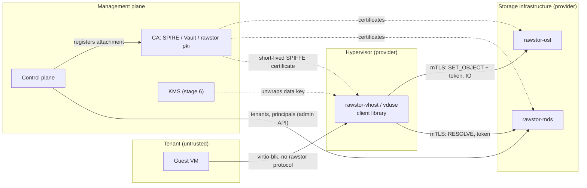
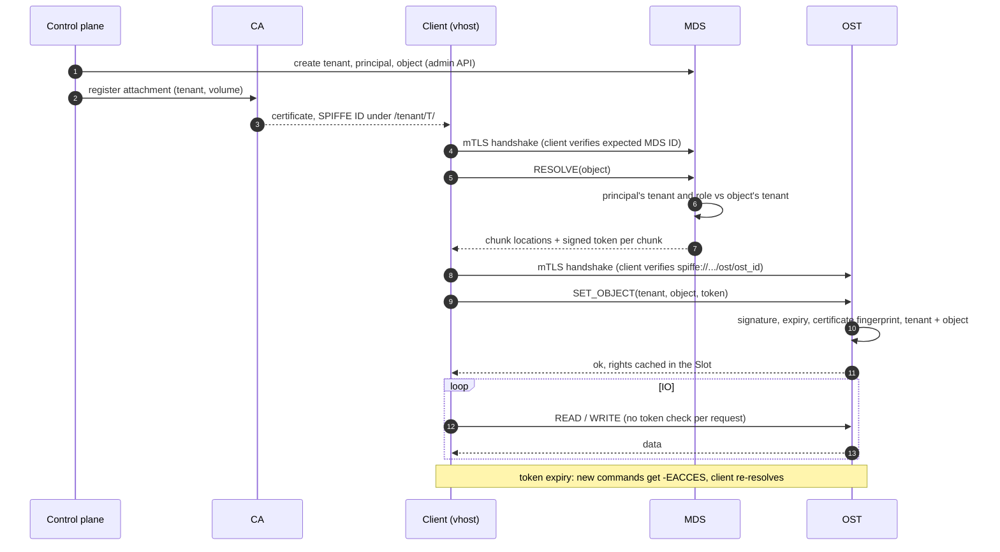
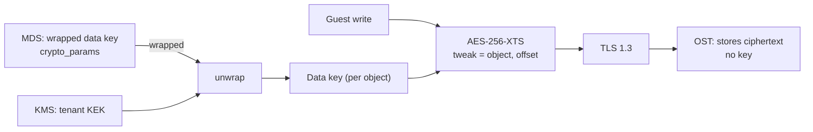
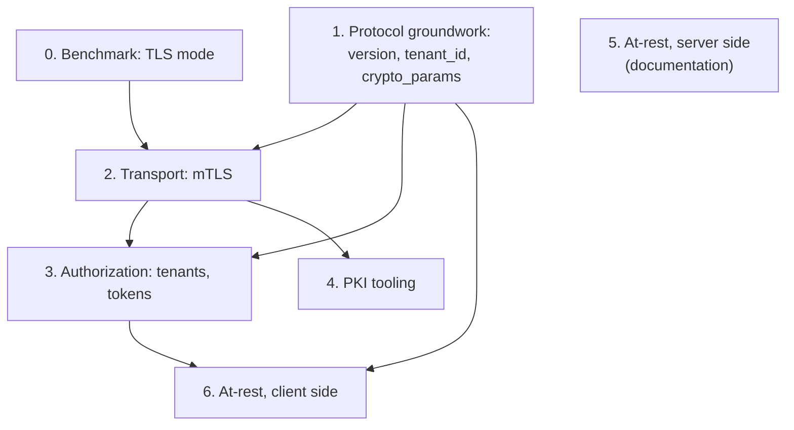

# Rawstor security design (DRAFT)

Authentication, authorization, transport and at-rest encryption, and the
groundwork for multi-tenancy. The deployment target is a **public cloud
service**: tenants are mutually untrusted, the storage network is not assumed
private, and the operator of an OST must not be able to read tenant data.
A deployment whose storage network is isolated from every untrusted party may
instead run with [`--insecure`](#insecure-mode), which turns all of this off.

## Decision

- **Transport: TLS 1.3 with mutual authentication on every port**, by default
  and as the only secured mode. Userspace OpenSSL over memory BIOs inside
  `rawio` is the first transport; kTLS is an option, off by default.
- **Identity: a SPIFFE ID** (one URI SAN) in the peer's certificate, issued by
  any CA that can write it: the project's own (`rawstor pki`) or an external
  one.
- **Authorization: tokens signed by the MDS**, bound to the client's
  certificate, with a closed rights table per command.
- **`--insecure`** for a storage network isolated from every untrusted party:
  plaintext and no authentication at all.
- **There is no mode with authentication but without encryption.** In this
  design authentication is the TLS handshake, and TLS 1.3 always encrypts. A
  weaker mode that authenticates only when the connection is opened (Ceph's
  `crc` mode) does not stop an attacker on the path from taking over the
  connection; a stronger one (authentication plus a MAC on every frame, keyed
  from the handshake) needs a record layer of our own, which is security
  code to write and test for a saving that was not measured. It is revisited
  only if production measurements show the cost of TLS to be unacceptable.
- **Client-side encryption of volumes** is a later stage and does not replace
  TLS.

## Status

Legend: ✅ implemented · 🟡 partial · ❌ not implemented yet. *Stage* is this
document's own numbering (see [Implementation stages](#implementation-stages)).

| Feature | Stage | Status | Where |
|---|---|---|---|
| Benchmark: TLS 1.3 / kTLS on the io_uring hot path | 0 | ✅ | `bench/tls/` ([results](https://github.com/rawstor/librawstor/blob/main/bench/tls/RESULTS.md)) |
| Protocol version + feature bits in the `SET_OBJECT` handshake | 1 | ❌ | also planned in [MDS design](mds.md) |
| `tenant_id` in the protocol and in the MDS store (single `default` tenant) | 1 | ❌ | — |
| mTLS (OpenSSL) on every port: OST, MDS, witness, client side | 2 | ❌ | — |
| kTLS offload of the data path | 2 | ❌ | optional, off by default (stage 0) |
| `--insecure`: plaintext, no authentication, per service | 2 | ❌ | — |
| Certificate and CA reload without downtime | 2 | ❌ | — |
| Principals, roles, tenants in the MDS store, admin API | 3 | ❌ | — |
| Capability tokens issued by `RESOLVE`, checked by OST | 3 | ❌ | — |
| `rawstor pki` helper (own CA), external CA support | 4 | ❌ | — |
| At-rest encryption, server side (ZFS / dm-crypt) | 5 | ❌ | documentation only |
| At-rest encryption, client side (AES-XTS, wrapped per-object key) | 6 | ❌ | — |

## Threat model

- Everything below assumes TLS. Under `--insecure` none of the guarantees
  hold.
- A network attacker can read, modify and inject traffic between any two
  rawstor processes, and can connect to any listening port.
- A tenant is untrusted: it must not read, write, list or delete another
  tenant's objects, and must not learn that they exist.
- An OST/MDS host administrator (or someone who steals a disk) is untrusted
  with respect to tenant **data** (stage 6). They are trusted with
  availability and with metadata. Integrity of encrypted data is not
  protected (see [At-rest encryption](#at-rest-encryption)): such an
  administrator can corrupt or roll back sectors.
- Clients (`rawstor-vhost`, `rawstor-vduse`, the CLI) run on hypervisors that
  the provider operates. A guest VM never speaks the rawstor protocol itself,
  so a compromised guest reaches rawstor only through the volume it owns.
  Unlike an ordinary SDS client, the identity therefore belongs to a
  **volume attachment**, not to the host.

### Trust zones



## Identity: mTLS

Every connection, whatever the role at the other end, is TLS 1.3 with mutual
authentication, implemented with OpenSSL. This gives transport encryption and
peer authentication in one mechanism and avoids a home-made handshake.

The identity of a peer is a [SPIFFE ID](https://github.com/spiffe/spiffe/blob/main/standards/SPIFFE-ID.md)
in the certificate, as defined by the
[X509-SVID](https://github.com/spiffe/spiffe/blob/master/standards/X509-SVID.md)
standard: exactly one URI SAN, scheme `spiffe`. Rawstor uses the standard
format and invents none:

```text
spiffe://<trust_domain>/ost/<ost_id>               OST      (provider infrastructure)
spiffe://<trust_domain>/mds/<name>                 MDS      (provider infrastructure)
spiffe://<trust_domain>/admin/<name>               operator / control plane
spiffe://<trust_domain>/tenant/<tenant_id>/client/<name>   a tenant's client
```

- `<trust_domain>` names the cluster or cloud (lowercase letters, digits,
  `.`, `-`, `_`, at most 255 bytes). A service accepts only IDs of its own
  trust domain, so a certificate from another cluster is rejected even if the
  same CA signed it.
- Path segments are letters, digits, `.`, `-`, `_`, case-sensitive; the whole
  ID is at most 2048 bytes. Ids are UUIDs in their canonical text form.
- Only clients carry a tenant. OSTs and MDSs belong to the provider, so
  their IDs have none. A tenant's client can never present an ID under
  `/ost/`, `/mds/` or `/admin/`: the issuing side decides the path, the
  service only parses it.
- The ID is taken from the URI SAN alone, never from the subject or a DNS
  name. A certificate with zero or several URI SANs is rejected.

Any CA that can write a URI SAN fits: SPIRE, Vault PKI, step-ca, cert-manager
or the project's own helper (stage 4). See [Issuing certificates](#issuing-certificates).
The certificate proves *who* the peer is; it carries no permissions (stage 3),
so rights can change without reissuing it.

A client never accepts "any certificate from the trusted CA" as the server.
Every connection has an **expected server identity** that comes from trusted
configuration, not from the peer: for an MDS, the identity configured next to
its address; for an OST, `spiffe://<trust_domain>/ost/<ost_id>` where `ost_id` is
the one the MDS returns in `RESOLVE` (the topology's OST UUID). A handshake
whose peer SAN differs fails. Servers verify the client the same way against
the tenant and role rules of stage 3.

Services verify the peer chain against a configured CA bundle, check
`extendedKeyUsage`, and take the identity from the URI SAN. A server role
(`/ost/`, `/mds/` in the path) is what stops a client from impersonating an
OST.

### Issuing certificates

Rawstor consumes certificates from files and does not depend on how they are
produced. Tools that fit (versions as of November 2026, from the projects'
published pages, to be re-checked when the choice is made):

- **SPIRE** (latest release listed on spiffe.io: 1.15.2). A server plus an
  agent per host. The agent attests the *process* asking for an identity (the
  Unix workload attestor offers selectors such as `unix:uid`, `unix:gid`, and
  the binary path and `sha256` when path discovery is enabled; the systemd one
  offers `systemd:id`, the unit name, and `systemd:fragment_path`) and issues a
  short-lived X.509-SVID; registration entries map selectors to a SPIFFE ID.
  Node attestors cover Kubernetes, AWS, Azure and others. This is the closest
  match for per-attachment identities: a `rawstor-vhost` process on a
  hypervisor gets an ID under its tenant. The control plane must create a
  registration entry per attach, which is integration work outside rawstor.
- **spiffe-helper** (latest release I could confirm: v0.9.1, January 2025;
  check for newer). Fetches X.509-SVIDs and bundles from the agent's Workload
  API and writes them to disk; on renewal it sends a configurable signal
  (default `SIGUSR1`) to a managed process or to the PID in a file. It does
  not forward signals or exit codes, so the service runs under systemd and
  is signalled by pid file. Rawstor therefore needs to reload on that signal
  as well as on `SIGHUP`, and needs no SPIFFE client library.
- **Vault PKI**, **step-ca**, **cert-manager**: issue a certificate with a
  URI SAN on request or by ACME, without attestation. Adequate when the
  deployment tool already knows which process gets which tenant.
- The project's own `rawstor pki` (stage 4) for installations with none of
  the above.

### Rotation without downtime

- Certificates are short-lived (hours to days). Revocation is by expiry, plus
  an optional CRL file reloaded with the rest.
- On `SIGHUP` (and `SIGUSR1`, which spiffe-helper sends by default) a service rebuilds its `SSL_CTX` (certificate, key, CA bundle,
  CRL) and uses the new one for **new** connections. Established connections
  keep their session until they close or reach a configured maximum age, after
  which the peer reconnects. The client already survives reconnects (see
  [Mirroring](mirroring.md)).
- A CA bundle may hold several CAs, so CA rotation is: add the new CA
  everywhere, start issuing from it, remove the old CA.
- Clients re-read their certificate on every reconnect, so a renewal agent
  needs only to replace the files.

## External certificate source

Rawstor never talks to a CA. It reads a certificate, a key and a CA bundle
from files and reloads them on a signal; everything that decides *who gets
which certificate* lives outside it. This section shows what an operator
sets up with an external source and what changes for security.

### What a source must provide

- Exactly one URI SAN, `spiffe://<trust_domain>/...`, whose path **the CA
  chooses**, not the requester (see [Identity](#identity-mtls)).
- `extendedKeyUsage` with both `serverAuth` and `clientAuth`: a process is a
  client towards one peer and a server towards another.
- The CA bundle as a file that is updated when the CA rotates.
- A short lifetime. SPIRE's X.509-SVID default is commonly quoted as one
  hour, renewed at about half of it. SPIRE relies on expiry rather than
  revocation (forced revocation has been a long-standing roadmap item there),
  so with it the exposure window after a compromise is the certificate
  lifetime plus the token lifetime, hours plus minutes. Vault PKI and step-ca
  can publish a CRL, which rawstor reloads with the other files.

### With SPIRE

1. A SPIRE server for the trust domain, an agent on every host (OST, MDS,
   hypervisors). `spiffe-helper` next to each rawstor service writes
   `cert.pem`, `key.pem` and `bundle.pem` and signals the service on every
   renewal.
2. Services are started with the paths of those three files. An OST or MDS
   has a fixed registration entry, for example `/ost/<ost_uuid>` for the unit
   `rawstor-ost@<name>`.
3. On attach, the control plane creates one registration entry for the
   volume's process and starts the unit; on detach it deletes the entry, and
   the certificate is not renewed again:

   ```bash
   spire-server entry create \
       -parentID  <SPIFFE ID of this hypervisor's agent> \
       -spiffeID  spiffe://cloud1.example/tenant/acme/client/vm42-disk0 \
       -selector  systemd:id:rawstor-vhost@<object_id>.service
   ```

   (Illustrative: check the exact flags and selector format against the
   installed release.) The systemd attestor is what tells apart the
   instances of one template unit that run the same binary as the same user;
   with only the Unix attestor every instance would need a uid of its own.
   Under Kubernetes the k8s attestor does the same per pod.

### With Vault PKI, step-ca or cert-manager

There is no attestation: the control plane asks the CA for a certificate
with the wanted URI SAN, puts the files beside the process and starts it.
Renewal is done by an agent or by cert-manager, and the service reloads on
`SIGHUP`. Anything that lets a caller request an arbitrary path for itself
defeats the model, so the CA's issuing policy must allow a caller only the
paths it is entitled to.

### What changes for security

- **The CA's registration interface becomes the tenant boundary.** The MDS
  believes the tenant in the SPIFFE ID, so whoever can create a SPIRE entry
  or request a certificate under `/tenant/acme/` can act as `acme`. Only
  the control plane may have that right; a deployment guide must say so.
- **CA says who, MDS says what.** Roles (`reader`, `writer`, `manager`) stay
  in MDS records created by the same control plane through the admin API.
  A certificate without a matching principal gets `-EACCES` on every
  command that needs one.
- **The trust domain and the CA bundle are configuration of every service.**
  A bundle from federation or a second CA is accepted only if listed.
- **Failure of the CA does not stop IO.** Established connections and
  tokens keep working until their lifetime ends; new volumes cannot be
  attached and expired certificates are not renewed. Certificate lifetime
  is therefore also the time an operator has to bring a CA back.

## Authorization: capability tokens

mTLS says who is calling. Whether they may touch an object is decided once,
by the MDS, and then proven to the OST by a token, so the OST never calls the
MDS on the IO path.

1. The client sends `RESOLVE` / `OBJ_*` to the MDS. The MDS checks the
   principal's tenant and role against the object's tenant.
2. `RESOLVE` returns, with each chunk location, a **token**:
   `{tenant_id, object_id, rights (read | write | discard | manage),
   not_after, client certificate fingerprint}`, signed by the MDS.
3. The client sends the token in `SET_OBJECT` to the OST. The OST verifies the
   signature, the expiry, that the fingerprint equals that of the connection's
   TLS peer, and that **both** `tenant_id` and `object_id` match those in the
   `SET_OBJECT` (object ids are only unique within a tenant, so the pair is the
   key). The tenant of the token must also equal the tenant in the peer's
   certificate. The result is cached
   in the connection's Slot. The token is verified once per connection, not
   per request.

### Request flow



Choices:

- **Ed25519 signature, not HMAC.** The OSTs hold only the MDS public key, so
  a compromised OST cannot mint tokens for other OSTs. The key is identified
  by a key id, so it can be rotated with two keys valid at once.
- **Binding to the connection's certificate** makes a leaked token useless
  without the matching private key.
- **Short lifetime** (minutes). Long-lived connections renew by sending a new
  token in a fresh `SET_OBJECT`-like command (`RENEW`, to be defined in the
  protocol page); an expired token on an open connection fails new
  commands with `-EACCES` and the client re-resolves.
- `FREEZE`/`THAW` and the other lease holders keep their own tokens; they
  additionally require the `manage` right.

### Roles and rights per command

Two kinds of principals, told apart by the path of their SPIFFE ID:

- **Tenant principals** (`/tenant/<id>/client/...`) hold one role inside
  their own tenant; the role bounds the rights `RESOLVE` puts into a token:
  `reader` → `read`; `writer` → `read`, `write`, `discard`; `manager` →
  those plus `manage` (structural changes: allocate, release, versions,
  freeze). Rights on a single object narrower than the role may be granted
  per object (stage 3).
- **Provider principals**: `mds` (`/mds/...`), `admin` (`/admin/...`). They
  are not tenant-scoped and authorize by role, not by token.

The list is closed: a command that is not in the table is refused with
`-EACCES`. `—` means the role may not use the command.

OST commands:

| Command | Tenant principal: token right | `mds` | `admin` |
|---|---|---|---|
| `SET_OBJECT` | any right in the token; `RAWSTOR_READONLY` needs `read`, a read-write open needs `write` | role | role |
| `READ`, `META`, `LIST_VERSIONS` | `read` | role | role |
| `WRITE`, `FLUSH`, `LEAVE` | `write` | — | — |
| `DISCARD`, `WRITE_ZEROES` with `UNMAP` | `discard` | — | — |
| `WRITE_ZEROES` without `UNMAP` | `write` | — | — |
| `ALLOCATE`, `RELEASE`, `CREATE_VERSION`, `FREEZE`, `THAW` | `manage` | — | role |
| `LIST` | — | role | role |
| `LOCATION_INFO` | — | role | role |

MDS commands:

| Command | Tenant principal: role | `mds` | `admin` |
|---|---|---|---|
| `SET_OBJECT` (plain handshake) | any | — | role |
| `RESOLVE` | `reader`; the token carries at most the rights of the role | — | role |
| `LIST_VERSIONS` | `reader` | — | role |
| `LIST` | any, answers only the tenant of the certificate | — | role: any tenant or all |
| `OBJ_CREATE`, `OBJ_RESIZE`, `OBJ_REMOVE`, `OBJ_COMMIT_VERSION`, `OBJ_REMOVE_VERSION` | `manager` | — | role |
| `ALLOCATE`, `RELEASE`, `META`, `SYNC_PREPARE`, `SYNC_ACCEPT` on a witness hosted by the MDS | as the same command on an OST, by token | — | as on an OST |
| `LOCATION_INFO` | — | — | role |
| tenant, principal and role management (admin API) | — | — | role |

Rules that apply to every row:

- The tenant is taken from the certificate, never from the request. A tenant
  principal whose request names another `tenant_id` is refused as if the
  object did not exist.
- An object of another tenant is `-ENOENT`, in every command, so a tenant
  cannot probe for ids. A known object of its own tenant that the role does
  not allow is `-EACCES`.
- "role" for `mds` and `admin` means no token is needed; the OST decides
  by the identity in the certificate. A tenant principal always needs a
  token for an OST command, except `LIST` and `LOCATION_INFO`, which no
  tenant principal may call on an OST.
- `LIST` on an OST names every chunk of every tenant, which is why it is
  reserved for `mds` and `admin`; rows carry `tenant_id`.

## Tenants

A tenant is the unit of isolation, ownership and (later) quota. Options
considered:

| Option | For | Against |
|---|---|---|
| A. Static file (like `topology.conf`) | trivial | no API, every change is a reload, cannot be driven by a cloud control plane |
| B. Records in the MDS store, small admin API | the control plane drives it; same store and failover as everything else; offline `--reconstruct` stays honest | rawstor grows a (small) user model |
| C. Delegate to an external IdP (OIDC), MDS only validates tokens | no user model in rawstor | an IdP becomes a hard dependency of the data path's setup; token format work |

**Recommendation: B**, with the CA (own or external) being the only trust
anchor shared with the outside. The MDS stores `tenant`, `principal`
(certificate subject → tenant, role) and an object's `tenant_id`. The cloud
control plane creates tenants and principals through the admin API (an `admin`
principal), then issues certificates. C can be layered on later by a service
that maps an OIDC identity to a rawstor certificate; it needs nothing from
the core.

Groundwork that is cheap now and expensive later (stage 1):

- every object id is scoped by `tenant_id` (128 bit, nil-free; `default` is a
  fixed UUID) in the MDS store, in `LIST`, in the OST slot key and in the
  on-disk metadata the OST keeps per chunk;
- the protocol carries `tenant_id` where `object_id` is carried, and the
  `SET_OBJECT` handshake advertises a protocol version and feature bits so
  a mixed cluster can be upgraded;
- `LIST` on an MDS is scoped to the tenant of the caller's certificate (an
  `admin` may name a tenant or ask for all); its pagination cursor is an id
  inside that tenant. `LIST` on an OST is reserved for `mds` and `admin` and
  returns rows with `tenant_id`;
- `--reconstruct` is a provider operation: it runs as `mds`, scans `LIST` and
  `META` of every OST and rebuilds the objects of all tenants at once.

Quotas, rate limits and noisy-neighbour control are a separate task.

## The cost of TLS on the hot path

The hot path is where TLS costs something, so stage 0 measured it instead of
assuming it. The control path (MDS) carries little traffic and its TLS cost
is negligible.

What to expect: with AES-NI, AES-GCM is typically several GB/s per core, so
the throughput cost is a share of CPU, not a ceiling. The larger risks are
structural:

- userspace TLS (`SSL_read`/`SSL_write`) adds a copy per direction and
  breaks io_uring zero-copy receive of data into the caller's buffer;
- **kTLS** moves the record layer to the kernel after an userspace
  handshake, so the existing io_uring `send`/`recv` code mostly keeps working.
  which `io_uring` operations still work on a kTLS socket is in
  [Measurements](#measurements);
- latency of small IO (4 KiB) matters more than bulk bandwidth for block
  storage; TLS record overhead and a handshake per connection (one connection
  per chunk slot today) are the numbers to look at. Session resumption and
  connection reuse are the mitigations.

### Measurements

Stage 0 is [`bench/tls`](https://github.com/rawstor/librawstor/tree/main/bench/tls):
plain TCP, kTLS, userspace OpenSSL over memory BIOs and userspace OpenSSL on
the socket, all over loopback with mutual TLS 1.3, driven by `io_uring`. The
figures below are medians of three runs on an 8-vCPU VM without VAES (AES-GCM
about 3.2 GB/s per core), so the absolute numbers are conservative. Small-IO
runs vary by ±30-50% between repetitions; see `RESULTS.md` there.

| Measurement | plain TCP | TLS (any transport) |
|---|---|---|
| 1 MiB stream, one connection | 3.1-3.4 GB/s | 1.0-1.5 GB/s (30-45%) |
| CPU per GB, both ends | 0.5 s | 1.2-1.4 s (about 2.5x) |
| 4 KiB IO at queue depth 32 | about 115,000 IOPS, 15 µs CPU/op | 70,000-105,000 IOPS, 19-27 µs CPU/op |
| 4 KiB IO at queue depth 1, p50 / p99 | 32 / 57 µs | 29-44 / 57-83 µs |
| connection setup | 18,000/s | full handshake 570/s (1.9 ms CPU, both ends); resumed 1,160/s (1.0 ms) |

In absolute terms the extra CPU of TLS is about 0.8 s per GB across both
ends, that is **about 0.4 core per side for each GB/s of traffic** on this
CPU. The "2.5x" is relative to a plain TCP stack that is itself cheap (0.5 s
per GB); it is not a share of the host. Hardware with VAES runs AES-GCM
several times faster, which lowers the figure accordingly. These are
loopback, single-connection numbers; the share of a real host depends on
how much storage traffic it carries.

What this shows:

- **Bulk is bound by AES-GCM.** kTLS and memory-BIO userspace TLS are within
  noise of each other, and both are well above `SSL_read` on the socket (one
  copy more). kTLS did not buy bulk throughput here.
- **Small IO**: TLS costs CPU per operation (15 → 19-27 µs) and a few to
  tens of µs at QD1; which TLS transport is faster is not resolved.
- **Connection setup is the expensive part.** A full mutual handshake costs
  as much CPU as hundreds of 4 KiB IOs. With one connection per chunk slot, an
  OST restart makes every client reconnect at once: 1,000 connections are
  about 2 CPU-seconds across both ends. Resumption halves that; fewer
  connections (see [open questions](#open-questions)) cuts it by the ratio.
- **On a kTLS socket `send`, `sendmsg`, `recv`, buffer-select `recv`,
  multishot `recv` with a buffer ring, `read_fixed`/`write_fixed` and
  `sendfile` all returned correct data. `send_zc` and `send_zc_fixed` fail
  with `EOPNOTSUPP`.** `librawio` uses none of the zero-copy sends today.
- Not measured: ChaCha20-Poly1305, a real NIC, many connections on many cores,
  kernels other than 7.0, hardware with VAES.

Provisional choice: start with **userspace OpenSSL over memory BIOs inside
`rawio`**. It was as fast as kTLS here, needs no kernel module or version, and
keeps the whole path under `io_uring`. kTLS stays an option behind a
configuration switch, to be re-measured on production hardware with a real
network before it is made the default.

### Outcome

Stage 0 decided **how** TLS is done, not whether: TLS 1.3 with mutual
authentication is the default on every port, the OST data path included, with
userspace OpenSSL as the first transport and kTLS as an option.

TLS 1.3 has no null cipher, so there is no "authenticated but not encrypted"
mode inside TLS. The alternatives were considered and are not offered:

- a per-frame MAC keyed from the handshake would be cheaper than encryption,
  but it is a second wire protocol to build and test, and it was not
  measured;
- IPsec, WireGuard or MACsec move the cost to another layer; without NIC
  offload (none is assumed) they do not save CPU.

An authenticated, unencrypted data path is revisited only if measurements on
production hardware show the cost of TLS to be unacceptable. Encrypting volumes on the client (stage 6) does not remove the
need for TLS: the payload becomes ciphertext, but authentication and the
integrity of the wire, which XTS does not give, still come from TLS.

### Insecure mode

`--insecure` (on every server and every client process) turns TLS off for that
process. Traffic is then **plaintext, and no peer is authenticated**: there is
no certificate to read an identity, a tenant or a role from, so the rights
table, tokens and tenant isolation do not apply and every peer that can reach
the port can do everything, as before this design. It is meant for a storage
network that is isolated from every untrusted party, and for development and
tests; the operator takes responsibility for the network.

- A port is TLS or plaintext, never both and never auto-detected, so a
  client cannot be downgraded: a plaintext client against a TLS server (or
  the reverse) fails the connection.
- A service refuses to start with `--insecure` and a certificate configured at
  the same time.
- The service logs the mode loudly at start.
- It is a per-process choice. Mixing modes inside one cluster is not
  supported except while moving a cluster from one mode to the other (see
  [open questions](#open-questions)).

## At-rest encryption

Two layers, because they answer different threats.

**Server side (stage 5)** protects against stolen or retired disks. It needs
no protocol change: ZFS native encryption or dm-crypt under the OST backend,
with the key held by the host. Rawstor documents the supported setups; the OST
gains no key logic.

**Client side (stage 6)** protects against the OST/MDS operator. Data is
encrypted by the client library before it leaves the process, so an OST stores
ciphertext and never holds a key. This matches the project's principle that
any data transformation belongs in the client.



- Cipher: **AES-256-XTS**, as dm-crypt and LUKS use for block devices: no
  size expansion, in-place overwrite, chunk size unchanged.
- Tweak: derived from `(object_id, logical offset)`, never from a physical
  location, so a chunk can move between OSTs and a native snapshot stays
  readable.
- Keys: a random data key per object, stored **wrapped** in the object's
  metadata on the MDS by a per-tenant key-encryption key held by a KMS
  (Vault / KMIP / a cloud KMS), reached through a plugin interface. The MDS and
  OST never see a plaintext data key. Versions (snapshots) share the data key of
  their object; a clone gets a new one and is re-encrypted by the client.
- The MDS stores `crypto_params` (algorithm, key id, wrapped key) per object.
  The field is reserved already in stage 1.

Consequences that need to be accepted or handled:

- XTS gives confidentiality, not integrity: an OST operator can corrupt or
  replay sectors undetected. The xxh3 in the protocol is not cryptographic.
  An AEAD mode needs per-sector metadata and a changed chunk layout; it is a
  possible later stage, not part of this plan.
- Encryption is a property of the volume, chosen at creation
  (`rawstor create --encrypt`) and fixed for its life: an object has
  `crypto_params` or it has not. Plain volumes are unchanged. There is no
  sparseness optimisation for encrypted ones, so the OST can never be asked
  to "forge" a zero sector and the semantics are those of dm-crypt/LUKS:
  - `WRITE_ZEROES` is turned by the client into an ordinary write of encrypted
    zeros; the range stops being sparse on the OST;
  - `DISCARD` is not advertised to the guest, so it writes zeros itself
    (an `allow_discards` option may follow, with the dm-crypt caveat that
    freed blocks become visible);
  - a never-written area reads from the OST as zeros, which decrypt to garbage.
    Guests do not depend on the content of blocks they have not written; this
    goes to [Known limitations](limitations.md) when implemented.
- Encryption costs CPU on the client (hypervisor), not on the OST.

## Implementation stages



Each stage is shippable and leaves the cluster working. Later stages do not
require re-doing earlier ones.

0. **Benchmark (done).** A harness comparing plain TCP, userspace
   OpenSSL TLS 1.3, and kTLS on the existing io_uring data path: 4 KiB and 1 MiB
   IO, queue depths 1 and 32, handshake rate, CPU per GB, p50/p99 latency.
   Output: the TLS mode (kTLS or userspace) and the minimum kernel. Done:
   see [Measurements](#measurements); the minimum kernel is not established,
   only 7.0 was tested.
1. **Protocol groundwork.** Version + feature bits in the handshake;
   `tenant_id` in protocol, MDS store, OST slot key, `LIST`; `crypto_params`
   reserved in the object record. Single `default` tenant; behaviour unchanged.
2. **Transport.** An OpenSSL layer under `rawio` (client and server side),
   mTLS, identity extraction from the SAN, config options on every service,
   reload on `SIGHUP`, `--insecure`. kTLS as an option. Service and CLI test
   suites run over TLS. Every TLS option is both a command-line flag and a
   `KEY=value` entry of the service's configuration file (the
   `/etc/rawstor/*/<name>.conf` files that the systemd units and orchestrators
   already use), and a changed certificate is applied by `systemctl reload`.
3. **Authorization.** Tenants, principals and roles in the MDS store and admin
   API; capability tokens in `RESOLVE`, verified by the OST; per-command rights
   table; `-EACCES` / `-ENOENT` semantics (a foreign object is `-ENOENT`).
4. **PKI tooling.** `rawstor pki` to run a small CA (init, issue, renew) for
   deployments that have none; documentation for SPIRE (with spiffe-helper)
   and other external CAs.
5. **At-rest, server side.** Documented ZFS/dm-crypt deployments; checks in
   `LOCATION_INFO` that the backend reports encryption, if useful.
6. **At-rest, client side.** AES-XTS in the client library, KMS plugin
   interface, wrapped keys on the MDS, `rawstor create --encrypt`, the
   write-zeroes emulation and no `DISCARD`.

## Open questions

- How to move an existing plaintext cluster to TLS without stopping it: a
  service listening on a TLS and a plaintext port during the transition, or a
  restart order (MDS, OSTs, then clients) that relies on mirroring and client
  reconnects.
- The kernel baseline for kTLS if it is made the default: stage 0 tested only
  7.0, and the zero-copy `send_zc` is not available on a kTLS socket.
- Whether one TLS connection per chunk slot stays, or stage 2 should coincide
  with the planned "one connection per (OST, object)" consolidation
  ([MDS design](mds.md)): handshake cost makes this likely.
- Where the KMS plugin lives (client library vs. a helper daemon on the
  hypervisor) and how a key reaches a vhost process at attach time.
- Whether `admin` rights are one role or split (tenant admin vs. operator).
