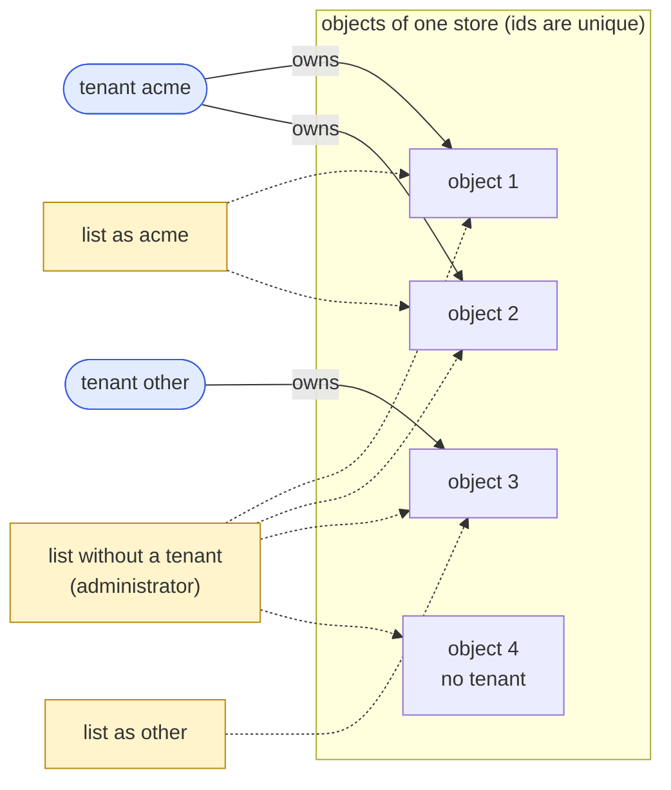
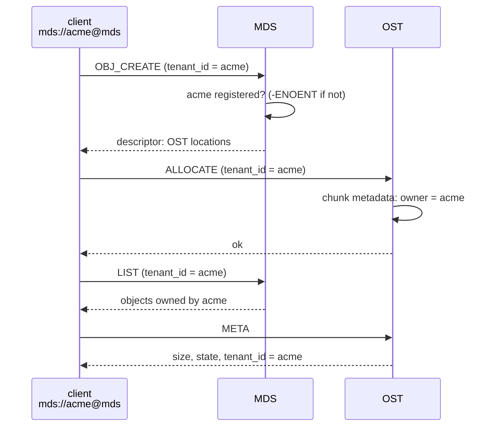
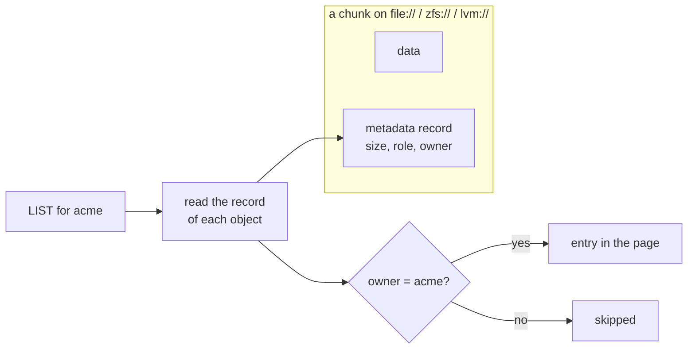

# Tenants

A **tenant** is a field of an object: the party that owns it. An object is
addressed by its id alone (ids are unique on their own), and the tenant is
what a later check of rights looks at. Rights are not implemented yet, and
nothing authenticates a caller: the tenant a caller names is **asserted by
the caller**. Today the tenant owns, filters a listing and is recorded; it is
not yet a security boundary ([Security design](security.md)).

## Status

Legend: ✅ implemented · 🟡 partial · ❌ not implemented yet.

| Feature | Status | Where |
|---|---|---|
| Tenant in the location URI (`<tenant>@`), optional | ✅ | `src/tenant.cpp`, `librawstd/src/uri.cpp` |
| Owner recorded with every chunk (`ALLOCATE`, chunk metadata, `META`) | ✅ | `src/blk_backend.cpp`, `include/rawstor/protocol.h` |
| `LIST` by owner; no tenant lists every object | ✅ | `src/blk_backend.cpp`, `mds/src/store.cpp` |
| MDS: owner of an object, tenant registry, `TENANT_CREATE` / `TENANT_REMOVE` / `LIST_TENANTS` | ✅ | `mds/src/store.cpp`, `mds/src/client.cpp` |
| `--reconstruct` restores owners and registers their tenants | ✅ | `mds/src/store.cpp` |
| CLI: `rawstor tenant create/remove/list` | ✅ | `cli/tenant.c` |
| Checking the caller's rights against the owner | ❌ | [Security design](security.md) |
| Authentication, binding a tenant to a certificate | ❌ | [Security design](security.md) |

## Model

- An object has **one tenant**, its owner, set when it is created and never
  changed. It is 16 bytes, a UUID; all zero means **no tenant**.
- An object id is **globally unique**: the tenant is not part of an address,
  a path on disk or a database key. Creating an id that exists is `-EEXIST`
  whoever asks.
- A caller names a tenant as the **user information of the location** it
  uses. It is optional. The tenant of a location is the owner of what is
  created through it, and the filter of what is listed through it.
- `list` returns the objects **visible to the caller**. Until rights exist
  that is the objects it owns; a caller that names no tenant, the
  administrator, sees every object of the store.
- Every other operation takes the tenant to be informational: an object is
  found by its id, whoever the caller says it is.

Who owns what, and what a `list` shows each caller:



## Addressing

```text
ost://<tenant>@10.0.0.1:7777
mds://<tenant>@10.0.0.2:7776/<object-uuid>
file://<tenant>@/var/lib/rawstor
zfs://<tenant>@tank/rawstor
```

The tenant follows a location through every layer: a target string, the OST
locations the MDS returns for an object (the client addresses every OST as the
tenant it names, so a chunk is created for it) and the targets `list` prints.
A user information that is not a non-nil UUID is refused with `-EINVAL`.

How the tenant of a location reaches the stored object, through the MDS and an
OST:



A server takes no tenant from its own configuration: `LOCATION=file:///data`
names a store, and the tenant of a request is the one in that request.

## Wire protocol

The tenant is data, not an address, so only the requests that set or filter it
carry it: `RawstorFrameAllocatePayload` and `RawstorFrameObjCreatePayload`
(the owner), `RawstorFrameListPayload` (the filter, nil = every object).
`META`'s answer (`RawstorFrameMetaPayload`) reports the owner. Every other
frame names an object by its id alone.

Three commands concern the registry ([protocol](protocol.md)), all of them on
the MDS: `LIST_TENANTS`, `TENANT_CREATE` and `TENANT_REMOVE`. An OST answers
`-ENOSYS`.

Frame layouts and the metadata record are not compatible with earlier ones, and
no older format is read or written.

## Storage

Backends keep the layout they had: `<location>/<uuid>/<offset>` on `file://`,
a zvol per chunk on `zfs://`, a logical volume per chunk on `lvm://`. The owner
is a field of the chunk's metadata record, next to its size and role, so it is
stored with the chunk wherever the chunk is. Listing a store for a tenant reads
that record for each object; a page can come back shorter than asked, and a
caller loops until the token is empty, as it does for any listing.



## MDS

An object's owner is a column of the `objects` table (16 zero bytes for none)
and of a witness, and `LIST` filters on it. An MDS database written before
tenants is refused at start (`-EPROTO`) instead of being misread: there are no
installations to migrate.

The **tenant registry** holds the tenants an object can be created for. An
object can be created for a registered tenant, or for none; any other tenant is
`-ENOENT`. `TENANT_CREATE` registers an id (`-EEXIST` if it is, `-EINVAL` for
nil), `TENANT_REMOVE` removes a tenant that owns no object (`-EBUSY` while it
owns one). Both are idempotent, and a retried creation of a tenant removed in
between registers it again. Tenants have no names in rawstor: the control plane
that creates them keeps its own.

`--reconstruct` rebuilds the map from what the OSTs hold, and the owner is part
of a chunk's metadata, so owners come back with it; a tenant found as an owner is
registered again.

## CLI

```bash
rawstor tenant create mds://10.0.0.2:7776            # prints the new tenant id
rawstor tenant create mds://10.0.0.2:7776 --uuid <uuid>
rawstor tenant list   mds://10.0.0.2:7776
rawstor tenant remove mds://10.0.0.2:7776 <uuid>

rawstor create mds://<tenant>@10.0.0.2:7776 --size 10G ...   # owned by <tenant>
rawstor list   mds://<tenant>@10.0.0.2:7776                  # what <tenant> owns
rawstor list   mds://10.0.0.2:7776                           # every object
```

## Not here

Authentication, the binding of a tenant to a certificate, rights, quotas and
per-tenant limits are separate work ([Security design](security.md)). Until
then any client can name any tenant, and the registry does not stop an OST from
storing an object for a tenant it does not list.
